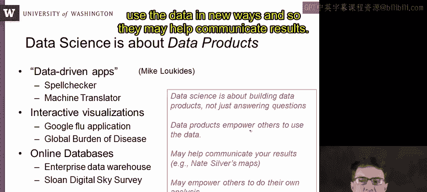

# 杜克大学《大规模数据科学（大数据操作，第1课／共3课有视频）｜Data Science at Scale》 - P8：7_数据科学的特征（续）.zh_en - GPT中英字幕课程资源 - BV12s421T7tJ

。

So another quote from Jeffrey Stanton who teaches a courses in data science at Syracuse and has and is involved in one of the earlier programs in data science much about the emerging area of work concerned with the collection。

 preparation analysis， visualization management and preservation of large collections of information and I think one thing that's interesting about his perspective is includes this word preservation so while the。

You， preparationpar， the analytics and the visualization are the three tenantets that you see quite often and it's something that we like in this course as well。

Jeffrey goes one step further and talks about preservation so even after you're done communicating the results。

 what do you do with the data long term and that's part of the reason he's got a background in library science and information studies where they're very concerned with the curation of data and so that's something we're probably not going to emphasize too much in this course but it's definitely part of the overall data life cycle if you will okay。

So another quote from a thinker in this space is Hillary Nson， the chief scientist at Bitley。

 and so she says the data scientist is someone who can obtain， scrub， explore。

 model and interpret data， you know blending hacking， statistics and machine learning。

 so we saw that before in Dr Conway's diagram is blending。

And data science are not onlydept at working with data。

 but can appreciate data itself as a first class product。

 and I think she's talking about there maybe is。Being able to organize the data and actually produce something that's usable by other people。

Right， okay， so having。A quality data resource， a data asset that others can use to answer questions is one of the outputs of data science and then you know she talks about let's see scrubbing and we what we saw muning on the previous slide and so you'll see some of these terms you'll see data jujitsu people will say you know this the data scientist that I want to hire is really good at data jujitsu and we don't。

in a couple of segments I'll talk about or the next segment I think I'll talk about。

What I think this means。All right， and so we've alluded to this before。

 but this is perhaps the three types of tasks that we see coming up over and over again。

 is this you know， preparing to run some kind of a model， actually running the model， you know。

 doing the statistical analysis and then communicate interpreting and communicating those results to decision makers。

All right。And here's where we see this kind of muning aspect again。

So another view that I like to take is that data science is really about data products。

 producing data products that you may use yourself or that others may use。

And so what do I mean by data products well this could be datadriven application so if you think about a spell checker right this is not just a piece of code。

 this is not just a piece of software that does something。

 this is only enabled by a dictionary of words and a dictionary of misspelled word actually and similarly a machine translation where you can type a sentence in French and have it automatically translated into Arabic relies on not just clever algorithms。

But rather an enormous corpus of French text and Arabic text，And in fact。

One point I'll make through this course。But I won't tell the story right now that。Large data sets。

 large corpusees of information tin to Trump， clever techniques。Okay。

 the second kind of data product is interactive visualizations。

 we saw this example with the Google flu application and there's a suite of visualizations on the web that I'm not going to show right now called that are associated with the global burden of diseasease and these are visualizations produced by the Institute for Health metricss here at the University of Washington。

And what I like about it is it's an example of where they've done a lot of research。

 but then the output was not just a research paper， although they wrote plenty of those as well。

 it was these interactive visualizations that allowed you to explore the data as well。

 And so this I think， captures this notion of producing。Not just the answer。

Or not just a paper in perhaps this case， but a data product that is us by others。

And then finally another kind of data product might be an online database of some kind that others can actually use to can query and answer their own questions。

 and so maybe there's not necessarily a visualization component。

 but the work that goes into producing these things， I would argue is part of data science。

 and so this captures some of the enterprise data warehouse。

Work and software and effort of which there's a lot and including business intelligence work and in a couple of segments I'll try to differentiate those two。

And it also captures。Things like the Sloan Digital Sky surveyve and what the Sloan Digital Sky survey is。

 I'll describe this in more detail。 Actually let me hold off on that now。

 but essentially this is an astronomy database where they took。Images from the sky extracted。

Clestial bodies out of them， put all those bodies into a database and serve it out on the web and the fact that they had produced this resource was incredibly powerful for the entire field of astronomy。

So again， just to summarize here what's in red data science is not just about building data products。

 rather it's about building data products， not just answering the questions once。

 and what data products are。our assets， digital assets that empower others to use the data in new ways。

 and so they may help communicate results， for example， Nate Silver built these maps。

 or they may empower others to do their own kind of analysis。

 say with a data warehouse or with a visualization。

