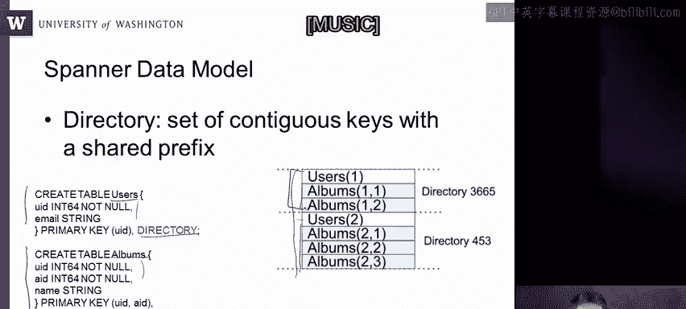

# 杜克大学《大规模数据科学（大数据操作，第1课／共3课有视频）｜Data Science at Scale》 - P90：89_Spanner.zh_en - GPT中英字幕课程资源 - BV12s421T7tJ

。Fast forward one more year。And so there's a 2012 paper on a system called。Spanner and。

I just want to mention these quotes， and then we'll talk a little bit about the system。

 and this one is。Still sort of being explored by。By the community。It's not available， actually。

 for use， but the paper is being explored。 the ideas is being explored。 So， for example。

 you don't see an open source。 Actually， and that's not true。

 You do see there has been a couple open source implementation of the ideas in Sp， but they haven't。

 They're not quite as。Popular some of the open source implications of the other Google systems。 Okay。

 so， you know， it says even though many projects happily use big table。

 we've also consistently received complaints from users of big table can be difficult to use for sometimes application。

 Those that have complex evolving schemas。Or those that want strong consistency in the presence of wide area replication。

And so then they could go on to say， we believe it is better to have application programmers deal with performance problems due to overuse of transactions as bottlenecks arise rather than always coding around the lack of transactions and so this you know。

The database community could have said， you know， well， sure， you know， well duh。

That's exactly the point is that system supplied support for transactions。is always a win。

 right because？It's difficult， error prone and expensive to try to do this at the application level。

 and more importantly it's fundamentally wrong in some sense to do it at the application level because the application doesn't have global knowledge of what's going on。

Only the system does。So fine， so although spanner scalable in the number of nodes。

 a final quote here， the node local data structures have relatively poor performance on complex SQO queries because they were designed for simple key value accesses。

And then means algorithms and data structures from the database literature could improve single node performance a great deal。

Again， you know， it's it's。Someone of a Google style approach to the problem of reboot everything。

 rebuild it all from scratch and then sort of cherry pick and bring things in。

 So this has been working pretty well。 and they have fantastic impact in the community。But。

There's a lot out there in the database literature and in database systems that。

Could have been used from the start。 I mean， in fact。

 trying to start from the beginning and just say we're going to build a big Google style parallel database。

May have been a good choice rather than sort of getting completely away from it and then coming back incrementally upon yourself。

In an inner SQL system。Now， I sort of skipped over what spanner is。Planet scale database system。

 There is a sQL like language。 Well， actually， let's go back to our。I mean， I know what I'm missing。

 I'm missing。Our table here， let me flip back up few， so here it is down here。

So I'm missing the slide here I showed it。So really big scale primary accesses you can access by other attributes。

 there are transactions， and in fact， they're global this time， they're real real asset transactions。

It's not clear to me whether joins are supported， I suspect they are because he're talking about SQL。

 but I couldn't find an example of whether it is or not。

There is some notion of schema they do sort of protect against。

Data that doesn't conform to the schema。 There is some notion of logical data independence。

 although they don't talk about it much。 There is a sQL like decorative language on top of it。

 I didn't see much evidence that they're doing a lot of fancy optimization。

 And I did just show you that quote of where they say that their performance is sort of pour on complex analytic queries。

 But that's something that probably could come along somewhat quickly。

 So that's spanner a high level。 Let me give you a couple more details about what the system does。

 So the data model here is this notion of directories。

 And these are a set of contiguous keys with a shared prefix。

 So you can think kind of like a tablet was in big table。 But now they have this notion of。

Multiple logical tables being sort of interlead。 And so if you're not used to staring at the syntax。

 don't worry too much。 But those of you who are thinking in terms of。DDL in our relational database。

 they have kind of a create table language that looks like this。

 you create table users with two columns， and then you give it this keyword directory。

And then you have a cr table albums with some columns。

 and you have this keyword interlea in parent users。 And what you end up with is something like this。

 where there's a user with all of its albums and a user with all of its albums。

 And you can see here that， you know， what we've been talking about。

 all these different systems are experimenting with ways of getting these nested data structures。

Herarchical data structures。That。Look a lot like what we saw way back in the 60s， right。

 And the motivation is the same as it was。 Then it's actually really。

 really fast when you're going to access when you want to pull up a user and then immediately pull up all of its albums。

 It's really fast to access those this way。But I'd probably speculate that the reasons why relational the relational approach eventually replaced these。

It can and will happen here as well， is that performance？Is。Not the number one。Priority。

 a lot of time， it's minim amount of developer headaches。Okay。So remains to be seen。

 but I think that this incremental walk step towards a big new scalable relational database is。

Is is underway。 Now， again， that doesn't mean that I'm saying use all the old databases。

 They really were designed for sort of a different workload and they really don't。

 There really is no evidence that just that they scale to some of these some of these levels。

 But that doesn't mean that you sort of throw out all the everything we learned。

