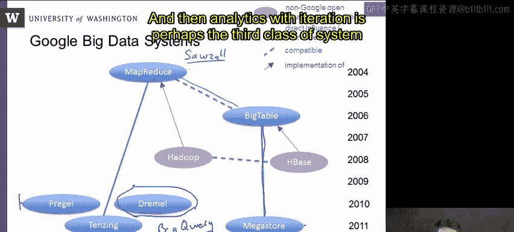

# 杜克大学《大规模数据科学（大数据操作，第1课／共3课有视频）｜Data Science at Scale》 - P91：90_Spanner（续）、Google系统.zh_en - GPT中英字幕课程资源 - BV12s421T7tJ

。

So fine， so how this works is。There's a universe master at the very， very top。

 And this is just a singleton。 There's only one of these sort of deployments。

 And they sort of imagine there might be only one or two of these deployments anywhere。

 So they have sort of one for test， one for production， slash test， and one for production。

 And that's it。 So so so many different applications will use the same deployment of。Of Spanner。

 And so this is mostly just status about status information about the zones。

 it doesn't interact with clients at all。And there's a placement driver that's responsible for moving these directory。

Setetss of records around for low bouncing purposes。

 and this happens on the scale of every few minutes。And then within a zone。

 there's a zone master that assigns data to spam servers。

And then there's a location proxy that sort of knows where everything is。

And route requests to the appropriate span server。 And then the span servers themselves serve data。

 And so in here， starting to look a little bit more like。Big table。

Zone is essentially an individual big table deployment。So inside of a spam server。

This is where the big difference here is this is where they're going to try to support。

Fully consistent transactions。So。Across these。Within a group of these replicas。

They support two phase commit。This only is needed when a transaction actually accesses data that's across。

Is not not constrained in one particular replica。 Okay。

 other than than it just skips over this logic and it doesn't cost anything。

And then one step down below。This across， so this is sorry， I guess I'm using the order term。

 So T based committed is across groups。 And when the transaction only is contained in one single group。

Then you drop down a level and you run the Paxos algorithm that I didn't talk about in detail。

 but I mentioned exists。In order to sort out the region rights for。In order to handle the right。Okay。

 and the only thing other piece I'll mention here is that this term colossus is new。

 it's the successor to Google file system and Google file system。Is the original。

Term for the open sourcecing implementation of HFS， which underlies mapRduce and Hadoop。Sorry。

GFS is to mapreuce as HDFS is to hey doop， so when I'm throwing these user acronyms actually。

 that's how to keep it straight。Okay。So that's all I want to say about Spner in particular。

Which is take a step back and look at all the different systems that Google has for a second。

 You know， Map Redduce was a paper in 2004 that had a ton of impact。 Big table had a ton of impact。

 And then later， there's mega store， there's the system tensing that we didn't talk about。

 But it's a sQL system on top of map produce， much like hive。

 if you were familiar with that or if you remember we mentioned it。 And then spanner very recently。

 And so you can sort of organize these things into a timeline this way just to kind of get a sense of this。

 And because of these systems that had so much influence。

 I want you to be aware of what they are and sort of how they fit together。

 So it doesn't just sound like a big jumble of terms。 So map reduce。Was。You know。

 one of the earliest ones wasn't quite the others， there's actually another one called Saazal。

That didn't really get a ton of traction， but it was a nice paper。嗯。

And then big table came a couple years later and later and I drew a dotted line there representing that they're sort of compatible or designed to go together。

 know one was map produceduce for analytics， big table is for the sort of micro operations and then both of these had a few years later had an open source implementation in Hadoop and age basease respectively。

Fast forward a few more years， and you've got megastore in Spain are coming very quickly one right after the other。

And this heart， this heavy blue line represents。You know。

 it's pretty clear that the influence is fairly direct。 In fact。

 I would suspect that there's a lot of code being borrowed。

 I mean Megastore makes plenty of references to big table and Spner makes references to both megastore and big table。

 and the papers have。Many of us can call authors。And then mapreduce depends directly on， sorry。

 excuse me。 Tenzing， which depends directly on Mareduce。 It provides a sQL layer on top of Mareduce。

 And then there's some other systems here， One is called Drmel。

 which was originally for very fast aggregate queries， but really just aggregate queries。

 but an extremely low latency。So this is， you know。

 in the analytics camp because you're doing these sort of aggregate。Questions。

 as opposed to the sort of micro updates， But it was extremely low latency， unlike map produced。

 which is more of a batch system。 And so this is， this is a great fit。 And it's a very nice system。

 And in fact， since then， they can do。Joins， not just aggregates。 And more importantly。

 this was exposed as a。Service that you can just use directly over the web。

 even in your browser called BigQu。 And that's a that's a。That's an important one to watch。

 it's one of the few systems that is available as a service through a or has a cloud service。

But scales to， very large data and sports analytics。

And then another one that we won't talk about yet， but we will come back to is Pragel。

 and this adds the one secret ingredient。That is sort of near and dear to my heart， which is。

Iteration and what I mean by that is when you， when you run map， reduced jobs to do analytics。

 you're sort of taking step 1 and then step 2 and then step 3 and you stop。

 But for many kinds of tasks， especially in data science， many of these analytics tasks。

 these machine learning tasks， you have to do something again and again and again and again and until some kind of convergence condition is reached。

 and Pragel and one of our systems and a few other systems are the ones that try to。

You know notices this limitation of mapreuce and extended it。

 So people were doing this with mapreduce， but they do it sort of in fairly ad hoc ways。Okay。

 and so we'll come back to that and talk about it。You know。Analytics。Low latency micro updates。

So there's two big classes of systems and then analytics with iteration is perhaps a third class system that we'll talk about。

