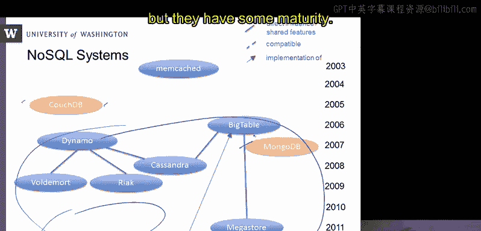

# 杜克大学《大规模数据科学（大数据操作，第1课／共3课有视频）｜Data Science at Scale》 - P92：91_基于MapReduce的系统.zh_en - GPT中英字幕课程资源 - BV12s421T7tJ

。

Okay， so going back to the grid， we can highlight those systems that were based on Mareduce itself。

 you know， the Mapreduce paper itself in 2004 and these language layers on top pig and hive in 2008。

 where hive is SQL。And PG is a relational algebra looking language that we'll talk about in some detail in the next few segments。

And Tzing， which is also SQL and Iala， which is also SQL。

 where Tzing is from Google and Iala is from a company called Clouddera。 that's a pretty。

Eager evangelist of。Maapreduce and Hadoop based technologies in general。 Okay， so one trend。

 I think you see is that these decative languages on top of the parallel processing primitive of Mareduce are really here to stay。

 right， So people that were。Relatively against these kind of languages certainly doing it。 Now。

 it's also fair to say that the。Enterprises in general have made a pretty significant investment in SQL expertise。

So。Even if they're attracted to the advantages that Hadoop might bring， theyre。

 they're pretty much demanding SQl。 So this may be a response to this inertia from having invested in SQL in the past。

 I think that's certainly true。 However， it's also true that the desire for a decorative languages。

Reasonably well founded for reasons that we've already talked about。

So you can put these systems on this timeline and the only point I want to make about。

This is that there's a bit of a gap between the paper in 2004 and these systems in 2008。

 but then as soon as you had heyoop。The system itself。

Developed a Yahoo and released as an Apache open source project。

 You sort of immediately see an ecosystem start to emerge of extensions to it that add these。

In particularly adding these languages on top， and so I think that the need for a high level interface is motivated by how quickly they came around as soon as Hadoop。

What was out and again， it didn't stop with these later systems a few years later。And actually。

 you know， not on this page， there's。Potentially hundreds of。

 if you include you know research projects based on extensions to Appreduce， there are really。

 really a lot Okay， and so this is。Some of the most popular ones。All right。So another。

Subset of this grid that you can look at is just the no SQL systems。 Now。

 the whole last few segments have osibly been about no SQL。

 but I've also included these kind of analytic systems in here。

 Mapper based systems and a few others， for example， Drmel and Spar and shark。 Drmel is a。

System from Google， that is the back end of a query as a service system called Google Big Que。

 which is。Pretty nice， Id recommend taking a look at it。

 you can sort of upload data and put it in there and it doesn't matter how big it is and you can kind of query it at very low latency。

Speed， spark and shark。Come from the amp lab at Berkeley and are part of the Berkeley data analyticslytic stack。

 BDS or Baass and Spark is a。Yeah。Language label on top of， it's not map producedd。

 but on top of a parallel processing。System and shark is an SQL layer even on top of that。

And so a couple of the distinguishing features of Spark is it loads everything into memory。

Process everything there when possible， writing things out to disk only for fault tolerance reasons。

 so much， much less often than map reduce。And it also support iterative processing。

 which is pretty important。 And we're going to come back to that a little later in the course。

 and then shark again is just SQl on top on top of this。 So within these NosQL systems。

 this diagram you know to point out that there's been sort of a Cammbrian explosion。

 So first you had sort of mim cache which is again just a caching layer for really the real system and the real system was a bunch of my Sql databases that weren't really working all that well for the requirements they're having them used for。

 but you could bring things into the memory and keep it there， looking it up by name。

 and it was just sort of a performance enhancement。

 a free performance enhancement if you invested in this system。

The real approach of throwing out everything you have and replacing it with a no SQL system。

came a little later And so the only couple of points I want to make is that there's been kind of a Cammbrian explosion of different systems around this time and that。

 you this space in here is not as nowhere near as empty as it looks。 I picked out a few systems here。

 but really the emergence of new systems in the space hasn't really slowed down much。At all。

So really filling out the design space。Here since around 2006。

 and the only the point I make is that these these quite popular document oriented data models systems。

 Co Db and MongoDb have actually been around for quite a while。

 so they've been know they released in 2005 and 2000。7even， so sometimes I think they。

Seem like newer systems， but， but they've。

I have some maturity。Okay。