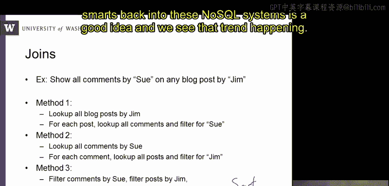

# 杜克大学《大规模数据科学（大数据操作，第1课／共3课有视频）｜Data Science at Scale》 - P93：92_重新引入连接.zh_en - GPT中英字幕课程资源 - BV12s421T7tJ

。

So then finally， one of the point I want to make is about this。

Column called that I've called joinins and Analytic。

 and so one of the distinguishing features of NoSQL systems is that they typically don't support。

Any notion of joins and you know they would mean the proponents of these systems would argue that that's okay that their joins aren't really necessary。

So the argument about why you can get away from joins goes something like this。

When you're joining two tables， you sort of have one record and then a bunch of corresponding records in another table。

 well if I've put all those corresponding records and colocate them with the parent record。

Then I can access everything all at once， and I don't actually need to compute the join。

So that works， and it should sound somewhat sort of familiar because it was part of these network and hierarchical data models that we talked about in the discussion of how we motivated relational databases。

 And if you remember that the downside of this was that you had kind of one dominant access path into the data。

But any other access path was either not supported at all or was。Inefficient， okay。

And if you wanted to reorganize your data to support a different access path or because your needs changed。

 well， a lot of your code might have broken and you would need to sort of rewrite it。 Okay。

 And so this tension between。Buying yourself a little bit of performance by。

Organizing the data in a pretty rigid way。Versus the development time that you save by not having to rewrite your code whenever you want to reorganize the data。

Ft you know that equation sort of balanced a certain way in the early 70s。

 And I would claim that it still balances the same way now。 Now。

 this is not to say that commercial databases。Relational databases as they stand today are necessarily meeting everybody's needs。

 I think they're clearly not for a variety of reasons but。To sort of throw out what we know and。

 you know， give up on。This flexibility that was earned from。The relational data model。

In favor of kind of upfront decisions about one dominant way of organizing the data。

 I'm not sure that's the right one either in order to。So that's one point I want to make。

 Another point is that there's not necessarily one right way of。

Decomposing things or one white way of even evaluating a join， even if you support them。 Okay。

 and this I1 maybe4， but I want to bring it up again in the context of NosqL。

 So in in a pretty classical web application scenario。

 if you want to show all comments by a username Sue associated with any blog post by a user name Jim。

 There's a couple different ways you could do this。

 you could look up all blog posts associated with the gym and then fetch all corresponding comments。

Filtering for Sue。Or you could go the other way， you could find all comments by Sue and then for each of those comments。

 look up all the blog posts by Jim。One or either one of the ways may or may not be available to you if you've already organized your data a particular way。

 but even if they aren't available to you，It's not clear which one's the right one。

 And there may even be a third method that sounds a little wild。

 but its filter all comments by Sue and then independently filter all posts for Jim。 sort them。

By some sort of blog I D and then pull one from each list and walk over the data that way。

 So that sounds a little wacky， but that's just a sort merge join that you may or may not be familiar with。

 And if you're not， that's okay。 But the point is， all three of these are perfectly valid。

And the right one depends on the。Details of the data that you as a programmer。

 as an application programmer may or may not have access to and that may change from time to time。

 and so really only the system is equipped to make this make this decision。And so be。You know。

 sort of succumbing to the tyranny of the of the， you know， initial design decision at。

The time the database was。Built or designed is one problem。

 another problem is that even if you have some flexibility。

Leadaving it up to the programmer to make the choice over the right way to access the data is。

Asking them to do， to make a decision for which they aren't equipped to they aren't equipped to make。

 Okay， and so this is something that does not happen with relational databases。

 neither one of these problems exist in the same way。 Okay， so I think trying to inject some of that。

Smart back into these NoSQL systems is a good idea， and we see that trend happening。

So that's maybe the takeaway that I want you to have。

