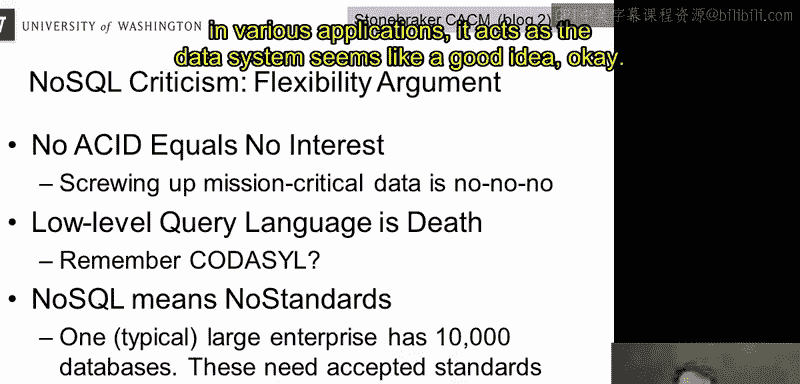
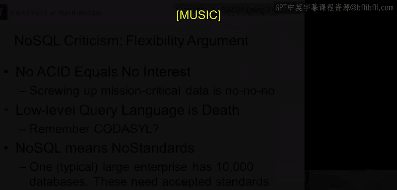

# 杜克大学《大规模数据科学（大数据操作，第1课／共3课有视频）｜Data Science at Scale》 - P94：93_NoSQL反驳.zh_en - GPT中英字幕课程资源 - BV12s421T7tJ

。

So that's all I want to say about this grid。 but let me give you a little bit of a character of a response to NosQL by Mike Stonebreaker in communications of the ACM。

 And there's a couple of different blog posts here that talked about two different。

Arguments in favor of Nogo and responded to each one of those arguments。

 And so I'm mostly going to focus on the second one。 So those two。Pro NosqL arguments are these。

 right you should points out that there's two value propositions offered by the NoSQL community。

 One is performance and the story， as Mike says， that I more or less agree with。Is that， you know。

 these people started out with a Mysql deployment of some kind。

 and they had a hard time scaling out in a distributed environment。 And then they had two choices。

 You know， either they could invest in a。Oh。Large care relational database and pay corresponding license fees。

Or they could do something different， use one of these no SQL systems。

And then the flexibility argument is like， well， look， you know， my data doesn't conform to a。

Ridd schema。 So in the performance argument， I'm not going to spend too much time on this because we talked about the trade offs associated with different choices in。

Transactional guarantees in these various systems。The other part of the argument that Mike makes has more to do with database internals that we didn't necessarily cover。

 So let me focus on the flexibility argument。An observation that he makes that I think Id probably agree with is that。

 you know， who are the customers of these NosqL systems。

 And so it's a lot of startups and a lot of web startups。

 And it's not quite such the same penetration in the enterprise。 Okay， at least not yet。

 So why is this， well。One argument is that most of the applications in the enterprise are traditional。

OL TP。 And if you don't know what， OTP means online transaction processing。 And so these are sort of。

 you know， bank records。 right， things where getting the transactions right really matters。 Okay。

 and it's further itss O TP on structured organized。Data。

 and so there's a few other applications around the edges。

But they're perhaps considered less important， right。

 It's okay to take a high risk system because the application itself is of less interest to。You know。

 executives。And so really， no asset compliance， you know， no transactions。

Is equivalent to not much interest in the system。 You know。

 it's not okay to screw up mission critical data， but for that app， you know。

 for some other application around the edge， maybe it's okay to。Experiment with a No SQL system。

Okay and then another second point he makes is that you know relying on these low level query interfaces。

Is a real tough sell and。And he calls up codaal， which is an early。

Data manipulation language that predated the decorative languages that we've been talking about。

 But we've sort of been down that road， and it's tough。

 And it's why these higher level languages were invented。 And again， we see we see it with Mareduce。

 which is admitted analytics， as opposed to pure nosqL。

 But we see that the value of these higher level interfaces pays off。

And then the third point he makes is that。You know， no sQL means。All bets are off， right。

's no there's no sort of home ingeneity at all between all these different。Deployments。

 and so in a typical enterprise， you have know， maybe 10，000 databases。

You already have enough of a trouble trying to integrate data from these databases because of the heterogeneity within their schemas。

 But at least you know that you're always working with rows and columns。

 and at least you have kind of a standard interface to manipulating them。 Okay， and so having。

You know， the number of design decisions that you have to make to encode your data in one of these NoSQL systems。

 you know what becomes the key， what becomes the value is are the blog posts nested under the comments or the comments nest under the blog posts right。

 do users。Keep their own wall， or do the。You know the message is on there on their front page or does the person who wrote the message keep access to it or both right。

 all these different design decisions of nesting layers and so forth。

Complicate integration and complicate standards， okay。So it's a tough sell。

Point that I guess I like to make this related to this， this third one here is that， you know。

 there's no real free lunch， right， Either the complexity is going to be in the system that you use to model the data。

 or you're going to sort of。Handed over to the application。 But in some sense。

 there're always these schemas， right， this this。Application business model is going to be encoded somewhere。

So having it centralized in the data system as opposed to hidden more than once in various applications to access the data system。

Seems like a good idea。

