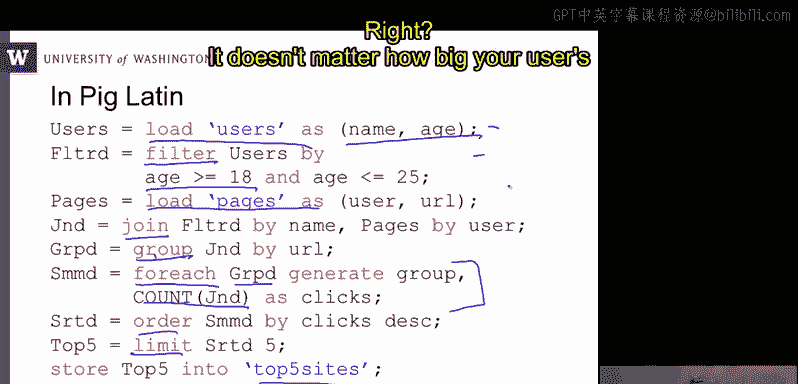
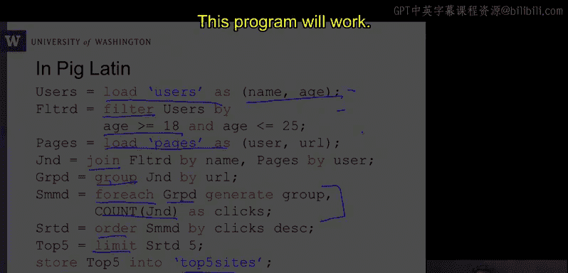

# 杜克大学《大规模数据科学（大数据操作，第1课／共3课有视频）｜Data Science at Scale》 - P95：94_接近SQL的Pig.zh_en - GPT中英字幕课程资源 - BV12s421T7tJ

。

Okay， so I want to talk a little bit about this system。Pig， and there's a couple of reasons for this。

 One is it represents this language layer on top of mapreduce。

 which I think is pretty important as I've mentioned before。

 and it also represents a more direct interface to relational algebra。

 which I've argued is really the important abstraction from databases SQL happens to be sort of intergalactic data speak and is the universal language for programming databases and manipulating data databases。

 but really the secret sauce and the technology that makes it effective is this underlying formalism of relational algebra and pig and a few other systems sort of exposed as a first class citizen and。

It's not necessarily the only way to do it or necessarily the better way to do it。

 but since you can see the relation algebra directly， I think it's a nice thing to be familiar with。

And it also I think makes the point that， you know you can cherry pick a little bit what features you bring。

 so while it's very obviously inspired by relational algebra and of course if you look in the sort of people that developed it。

 you can see why it definitely changes some things about the relational model and I think that's an important point too is that we can use this relational algebra abstraction。

Independently of some of the systems that it came from。

 we can make whatever changes we need and you keep what we like and throw out what we don't like and so I want you know I want you to sort of put your relational algebra goggles on and see the world in terms of relational algebra。

 I think if it's pretty effective for working with not just data in general。

 but especially big data and reason about very scalable。Alrithms， okay， so fine， so what is pig。

 so pig is an engine for executing programs on top of Hadoop。Okay。

 so what you're going to write a pig a program in P and it's going to generate a sequence of map reduced jobs that implement that program okay and the language here is called pig Latin。

And it's an Apache open source project and you can read more about it，And so why。

 why bother doing this Well， if you're coming from if you're a mapre programme or you're happy with mapred。

 why would you bother doing this， Well， suppose you have data in one file and。Data from websites。In。

 sorry， user data in one file and website data in another。

 And you need to find the top most visited sites by user in a particular age range。

 And so if youre thinking in terms of SQL， you can probably think about how to express this。

Task as a。Query。And here's a pictorial representation of it that。

Sort of shows a kind of data flow here。 We're gonna load users will' load the pages。

 will filter by age， do some kind of join on name， group， count up the clicks， order by clicks。

 and then take the top 5。 This may or may not be the way you draw it on the whiteboard。

 If you were to express it yourself。 But but it's a reasonable way of describing the problem。 Well。

 in map reduceuce， there's170 lines of code。 And at least in one example。

 coming from the papers here， It took someone4 hours to write it。

 These kind of metrics of how long development time are not never too compelling because it kind of depends on their background and their skill sets and。

so on， but still a decent amount of time。While the same program is in pig Latin is just nine lines of code and takes。

 you know， in least in this case，15 minutes to write and further， you know。

 does sort of capture some of this more abstract description of what's going on。 Now。

 this a little bit contri because these boxes obviously correspond to sort of particular pig commands。

 but I'd argue that that this。Even non。People that don't know pig if they were to ask sort of what the tasks are in evaluating this。

English question， they might come up with something along these lines。 They may may not say join。

 but。Some of these steps would be present， so I think it can say that it captures a little bit of the natural language description of the task。

You may or may not buy that。F， so here's what it looks like。

Load the user data according to a particular schema。Filter the user database on the age range。

Load the page's data。Perform a join， group。Can you say well for each？Group。

Count the number of clicks。 and we'll talk this one。

 This one probably looks the least like relational algebra。And we'll talk about it。And in the thing。

And then just take the top five and store that result into a new file。 Okay。

 And so the point here is that。Here you could also think， well， boy。

 I could just write all this in Python， right， That'd be much easier。

 Why don't I need to use this new language。 Well， the point is that this each one of these steps。

Well， not actually not each one。 groupss of these steps correspond to individual map reduced jobs。

 which mean they scale really， really well， right， It doesn't matter how big your user's table in。

 and doesn't matter how big your pages table is。

This program will work。

