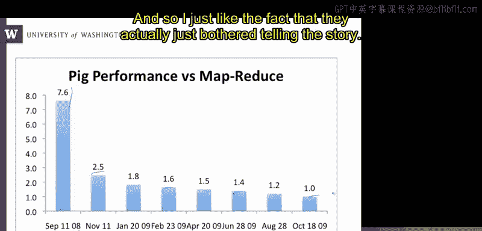

# 杜克大学《大规模数据科学（大数据操作，第1课／共3课有视频）｜Data Science at Scale》 - P96：95_Pig架构和性能.zh_en - GPT中英字幕课程资源 - BV12s421T7tJ

。

So how does the system work Well， the programme is going to enter a pig Latin program by writing these commands。

And assigning the results to variables， and then you can refer to the variables in future command。

 so this is， you know we've loaded data into this variable A， loaded into this variable B。

And then you can filter。My reference to A and sort of the resultency and so on。

We'll make this point again later， but nothing actually happens。

 no work is actually done until you try to actually write out the results so this sort of what we call lazy evaluation。

Right right。So fine。 So what happens when you write this program， Well， the pig parser will。

Turn the syntax of the program into an abstract representation of the program called execution plan。

 And so this is using parlance from databases and the。Lead of the pig project is a。

Great database guy named Chris Olson。So this abstract representation of the plan， you know。

 these operators。These operations that I'm going to call operators， again。

 using database par are sort of one to one with。The commands， although they need not always be。 Okay。

 but we're not done there。 That's just the execution plan。 still sort of。

 We can't actually execute that。 What we need to do is compile that down into mapreduce jobs。

 And the gain here is going to sort of be to minimize the number of map reduceduce jobs you need because there's a lot of overhead to execute one of these。

 So you don't want to run a whole map reduced job just to filter a data set。

 you might as well lump that in with other work that you're already doing。

 as long as you're scanning the data and reading off the disk。

 you might as well do as much as you can with it。 And so， for example， in this case， this program。

Can all be implemented as just one single map produced job， One in the map phase， you load the data。

 you filter it。And you also load the other data set in the reduce phase you do the join。

And we'll see another example of this。A little later on。 And then finally。

 dis Dap produced jobs are scheduled on a Hadoop cluster as usual and run。嗯。As usual， okay。

 these performance results are。A little funny， but I sort of like I sort of。

 I still like the argument that you made this is。Pig performance versus Mareduce。

Okay so this is a little funny because pig is built on top of Mareuce。

 but the point is is that the first version of PG in September 11。

 2008 was a lot slower than just writing the thing raw against Mareduce。

But with some various improvements。It got better and better over time until eventually。

 it was just as fast as the handwritten map produceduce。And I think。

You see this sort of pattern quite a bit that there is a cost to abstraction。But that you can。

 you typically can recover a lot of the performance of the hand coated stuff。 Meanwhilewhile。

 having gained。Some measure of programmer productivity by offering a higher level interface。

 Okay And so I just like the fact that they actually just bother telling the story that admitting that they were quite slow in the beginning。

 they got faster over time。

