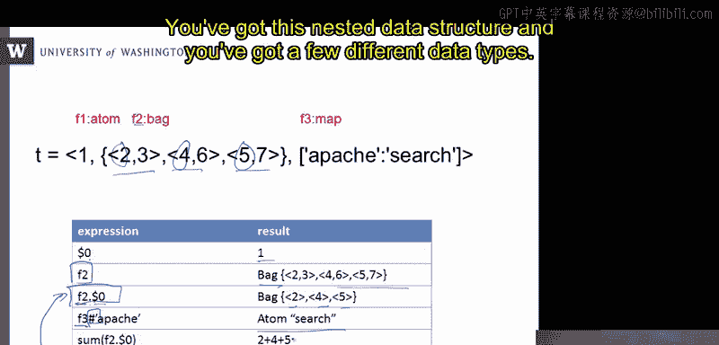

# 杜克大学《大规模数据科学（大数据操作，第1课／共3课有视频）｜Data Science at Scale》 - P97：96_数据模型.zh_en - GPT中英字幕课程资源 - BV12s421T7tJ

。

So what's the data model here？There's four。2。Types。Involveteer one is。The atom。

 which is just a primitive an inju a string and so on。

 And then there's three different collection types。 the first is a tuple。

 which is just a sequence of fields and every field can be of any type。 they need not be atoms。Okay。

 then there's a bag， which is a collection of tus， always tus。

 But those tuples need not be the same type。 So this is different than a table。

 different than a relation。 Okay， and it's a bag， not a set and。You know， I guess I can ask you。

 what's the difference between a bag and a set？Well a bag allows duplicates。

And then the third type is a map， which is a little bit confusing because we're talking about map Red。

 but this is a dictionary in Python， right， so string literal keys map to any other type。ok。

So let's look at an example of this。What is this thing？Well， it depends on my notation I guess。

 but assuming that you don't mind my angle brackets referring to Tple。

 then you can see that this outer thing is a tuple。And it has three fields， it has a integer。

Which is just an atom。And then it has this thing。Which is a bag。

 the curly braces I'm going to use to indicate bag。And then it's got this thing。Excuse me。

 which is a map， a dictionary。That has just one element in it。

 mapping the key Apache to the value search。Okay， so let's name these guys， F1， F2 and F3， and we'll。

Poing out in a couple of slides where those names can come from。

 there's a few different places they can come from， and I'll point out one of those sources soon。

 but right now it's just assuming that we have them。Okay， so let's consider these expressions。

Over this type。 So we can write dollar sign 0。 And what that means is give me the first field in the tubbal。

So in this case， it's just the number one。We can also access it by name。 So if we access F 2。

 that will give us the second field just because we gave it that explicit name。

 And there's nothing magic about F， nothing magic about 2。 And that'll give us a bag with these。

Values in it， by the way， we should say what are the elements of this bag？

Well they're two poles with two integerters each。You can also access。

F2 to give me So what does this expression do？Well， F2 gives me the bag， and then you can write dot。

Dollar sign zero。And I don't love this notation， it's a bit of an abusebusive notation。

 but what it means is for every element of the bag， project out the first element。

 and so this will give me another bag， but it only has two and four and five。

 It has the zeroth element。Of every two bowl。Okay。Then you've got this magic hash symbol here。

 which means find me the value associated with the key I'm about to provide so look at F3 which is the third field。

And hash into it and give me the key Apache。 If it's not a map， you're going to get an error。

 but in this case， it is a map。 And so once gets returned is the atom search。

OkayAnd then you also write functions， you can say sum up。

All of these values and this expression is the same one we saw here。

 which will be a sequence of integers， So I'll give you  two plus  four plus5 Okay and there's a few different other ways to sort of manipulate these things。

 But the first thing to notice is this is，Non relational， right。

 you've got these nested data structures and got a few different data types。

