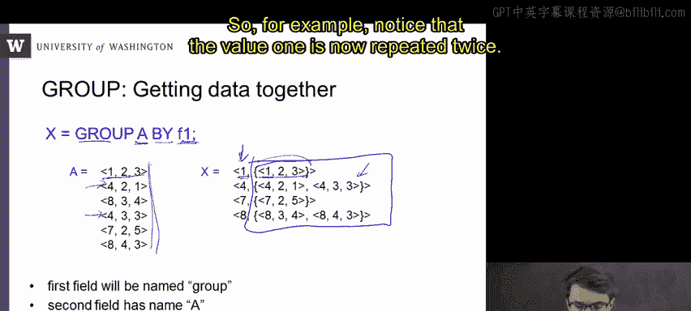

# 杜克大学《大规模数据科学（大数据操作，第1课／共3课有视频）｜Data Science at Scale》 - P98：97_加载、过滤、分组.zh_en - GPT中英字幕课程资源 - BV12s421T7tJ

。

Al right， let's go over some of the commands in PG， so the first one is load。

 which is how you get data in the system。And here the data is on HDFS in a Heop clusterster and the logical data model each。

Input data says is assumed to be a bag， which is a sequence of tuples。 Okay， so you can specify。

 you know， you can just say load， but you can also specify the function you're going to use to parse the data。

With this keyword using and this is。Seems like sort of just a trivial implementation to you do。

 but that's actually kind of an interesting point and really gets to the heart of one of the problems with。

Mini database products。 And one of the advantages of these map reduce based systems is that sometimes you're presented with data that's in its raw form。

 and you need to。Pars it yourself。Okay， and so。The database value proposition is， well， look。

 you know， design a schema and load all the data into the schema。 And after that。

 you'll be able to get all these benefits from querying。 Well， look。

 who's going to do that loading task， right， That's a big parallel job。

 If I've got 20 terabytes of text files。 somehow I've got to do I've got to manage that computation。

 And so this is where heyoop and also therefore pig and hive come into play。

 And so a lot of times what you'll see is that the application for a， say data science system。

 know data science application will be architected。All。Where。

Heyoop and its extensions are being used to do the initial processing parsing。You know， I'm loading。

And then the result of that is loaded into a more conventional database for kind of ad hoc querying。

 And we saw this in the very very first segment。 We talked about the Obama campaign。

Using this architecture as well。 They would at least in an article。

 you can sort of infer that they had used a similar article。 They mentioned hey doop for the。

ETL workload， extract transform load。another piece of jargon。

 and then they mentioned this verica database for the slicing and diing， Okay。

 and see this you see this。s always becoming。A commit a standard a best he's word standard。

 but it's the a best practice in designing these kind of。Data analysis architectures at scale。 Okay。

 so fine。 So what's nice about this is that you can specify your own parsing function so you can work with data in its raw format。

 All right。And then further you can specify a schema if your paring function is capable of producing lots of different things。

 you can say here are the names of the columns that I want to apply。

 so this is one source of where these column names are going to come from is you specified them right there in the load command。

 So this is kind of schema on read， if you will， right there's no schema associated with the data。

 It's not self-deib， but you can impose a schema on it as you read it into memory。Fine。

And so maybe this is where we get back， we get back a sequence of tuples and we'll use this as a running example。

Alright， so the next command is filter， which is pretty simple。

 You just get rid of some of these tus and you can have arbitrary bulloleing conditions。

 You can do kind of regular expressions because everything's very text based in the Hado portal。

 which is。In some cases， a limitation， and the syntax looks affect this you say filter some big data set by some condition。

 and so in this case filter where F1 equals 8 and remember that F1 was the name we gave it in the load command。

The name we gave to the very first column， and so this finds all the tuples where the first position is equal to8。

So another command is group， which is。Bringing data together。Okay。

 and so there's a couple of different forms of this。

But we're going to focus on so just right now we're just on my group， okay？

There's a code group command I'm going to talk about in a moment。 All right。

 So group says group this large data set by some。Sequence of columns。Okay。

So this looks a lot like the SQL clause that has this the same。It got the same sort of。Flavor。

But it does something。Pretty different。So if this is a and we group by F1。

 well what we get out is tus， but now the first。Column is the same because we grouped by F1。

 But the second column， the second field， I should say。Is now a bag。A little group representation。

Of all the tuples that were associated with this with this particular key。

 And so if you look over here， there's only one tuple with one。And that tuple appears in the group。

 there's two tuples。With。F1 equal to 4。 And so this bag has two tuples in it and so on。 Okay。

 so this is how you you。Can start off with something that's kind of a flat structure。

 and you can build up a nested structure。For various reasons， and we'll see why now。

 the other thing to keep in mind， and this is another。

Thing I don't really love about pay because they' doing things sort of implicitly rather than。

Explicitly is that the name of this field， every field ends up having to have a name is the name this field is defaulted to the name group。

Yeah， sorry。 I just lied。 The first field is default to the name group。

 and the second field is defaulted to the name of the original data set。And so。

I find this a little confusing when you're writing P yourself。

 but you can sort of see why they did it。 The reason is is that。Just these bags altogether。Actually。

 have the same information as the original data set just nested in a certain way。

 And so calling it a sort of makes sense。 It's got all the same information。 So， for example。

 notice that notice that the value 1 is now repeated twice once in the group。

 and it's still in the tuple。

