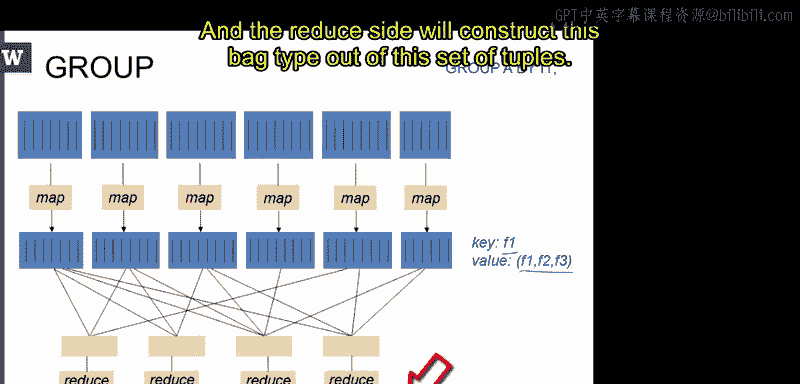
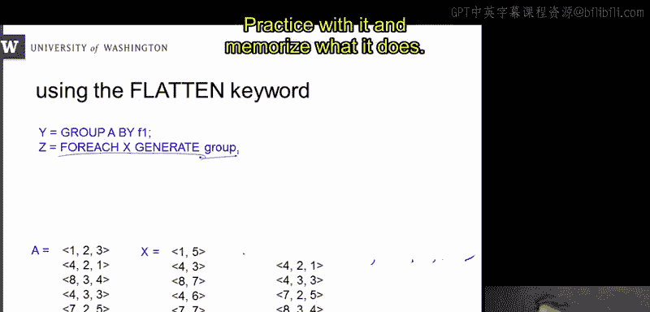

# 杜克大学《大规模数据科学（大数据操作，第1课／共3课有视频）｜Data Science at Scale》 - P99：98_分组、去重、遍历、展平.zh_en - GPT中英字幕课程资源 - BV12s421T7tJ

。

So there's also a command distinct that does just what you might imagine。

 it gets rid of all duplicates and just for a simple example here if you've got。

Two different elements in the bag that have the same value your output will be this。

I might make a claim that distinct a。Is equal to。Grouping of a by all three columns at once。

So first of all， why am I making that claim？Remember that。The group operator。

Puts out a single tuple for every unique value of the grouping columns， so that sounds about right。

And you can also maybe think from。If you know SQL。That this is sort of true there， right。

 You can use this distinct keyword and SQL and you can also group by all the columns and you end up getting the same。

Resolve， so are these two expressions the same， Do they produce the same output， Well。

 not quite because the grouping structure。Sorry， the group command produces a group field。

 which is now the whole tuple and the the。A field。Which is a bag with a single tuple in it。

 So you get this sort of repetition of information。 So distinct is much more。Concise。

 so you need to be careful and sort of make sure you understand what these things are going to produce。

So how does group work， Well， we already saw。You know。

 going back to our map produce schematic or our parallel processing schematic。

 we break the data into pieces。 We apply a map function that assigns。

Each tuple to its key and groups the tuple to in the value as well。 And so here， if we group by F1。

 then F1 becomes a key， and the value is all three of the elements in the tuple。

And those are shuffled across the network to the reduced side， and the reduced side will。

Construct this bag type。Out of the set of tus。

Okay， so this is a single map reduced job。So the for each command is。

Almost certainly the most complex ones。 So here you're basically going to manipulate each tuple in。

A bag。 So you write it like this。 You'll say for each a。Generate something。

 And here we're generating。A tuple with two fields， one is F0， and one is the sum of F1 and F2。

And here you can call user defined functions you can write other kinds of aiththmetic expressions。

 You can sort of do lots of things。 So another example is first， we group a by F1。

 just like we did in the previous slide。Excuse me， this should be why。And then， for each y。

Generate group。 So what's group。 Well， remember that's the magic name assigned given to the group field。

And then Y， which is the magic name given to the bag field。Dot。😡，A list of projection columns。

 and so this is the second element and the third element from each of those tus。Okay。

 so what does this look like？X， which is this first element here while we get。The first field from A。

 which is this。Column here。And then we get the sum of the second two， so 2 plus3 is equal to 5。

 2 plus 1 is equal to 3， 3 plus 4 is equal to 7 and so on。

So why is all of A grouped by the first field？But then we're going to generate the grouping field。

 which is the same。And we're going to project out。The second two columns。

 we're going to ignore the first column in each one of the bags。Okay。

 and so the point here being that you can manipulate these nested objects by writing these kinds of expressions。

 but I think the other sort of。Lurrkking point here is that it's a little bit complicated to think about what's going on because of this extra flexibility you get with the nested data model。

Okay。So you'll get in the assignment， you'll get a chance to try some of these out and make sure you understand what they're doing。

Okay， so then there's this keyword flatten and it's not really its own operator。

 use it in the context of for each。And so here， you know， because of the complexity here。

 what you might really want is， look， I just wanted to get rid of the。

If you want to recover the flat version of the nested structures。呃。

Created and stored in the variable Z。Well， you can do so like this。For each x。

 generate group and then the flatten of x。And the result you'll get out here is。But regardless。

 what it does is sort of peel out this bag and produce an extra tuple for each。

 and I don't really like this because。It sort of changes just using the keyword flattened。

 changes the semantics of the for each and generate。

 And I think it's a very confusing way of doing it。 So the I。

 it's hard to explain the principle going on here。 Just sort of memorize what it does。

 practice with it and memorize what it does。

