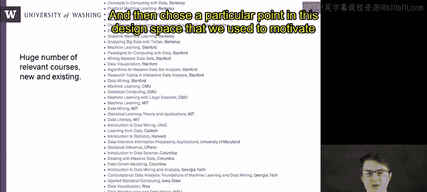

# 杜克大学《大规模数据科学（大数据操作，第1课／共3课有视频）｜Data Science at Scale》 - P9：8_区分数据科学与相关主题.zh_en - GPT中英字幕课程资源 - BV12s421T7tJ

。

So let's talk a little bit about what distinguishes the term data science from other related fields。

So one related field is business intelligence。Business intelligence systems are associated with a couple of concepts。

 one is a data warehouse， and the other is a set of dashboards or reports that consume data from the data warehouse and are used to answer particular questions。

So both of these components require a lot of upfront effort to design and build and are therefore not too adaptable when requirements change。

OkayAnd so therefore a software stack designed for business intelligence may or may not be appropriate for any particular data science problems where changing requirements are considered the norm。

 and so sort of warrants a new term is that business intelligence became associated with a particular approach to a particular set of problems and a data science is in some sense broader。

The other point I like to make about business intelligence is that the BI engineers are not typically expected to consume their own data products and perform their own analysis and make the business decisions themselves。

 usually they're building tools for others to make decisions with。As a data scientist。

 you'll be doing both。So what about statistics， well。

 statistical methods are at the heart of what a data scientist does day to day。

But a statistician will。Typically be comfortable with with assuming that any data set they encounter will fit in main memory on a single。

machine and this makes sense because the whole field was born out of the need to extract the most information possible from a very sparse。

 very expensive to collect and typically therefore a very small data set。

So if you only have 20 patients in the world with a particular disease。

 you can't just go find 20 more cheaply， so therefore you need to come up with new mathematics to squeeze as much information as you can out of the 20 you already have。

But that's not always the problem anymore so as we shift from a data poor regime to a data rich regime。

 the set of challenges move from the need for new mathematics to squeeze information out of a data set to new engineering to even handle or process very。

 very large data sets。Okay，However， some of the methods。

 some of the models that you'll build are the same in both cases。So database experts。

 database programmers and administrators， bring a lot of skills to the table to make them appropriate for data science tasks。

But there's a focus on a particular data model， which is usually the relational data model。

So this is rows and columns， so if you have data coming from sources that are as video or audio or even text or to some extent even graph graphs。

 nodes and edges which we'll talk about， a relational database may or may not be the right tool and even the concepts that transcend any particular database system may or may not be appropriate and we'll sort of explore when and where it isn't appropriate as we get into the course。

Okay， so visualization experts also bring a lot of skills at the table。But like statisticians are。

Historically less concerned with massive scale data that spans many hundreds of machines。啊。

And then finally， machine learning is perhaps the closest to data science。But here。

 and we'll try to make up。More of a point about this later。The， the， the。

As a proportion of the time you'll spend on a data science problem。

 actually choosing the right model or algorithm machine learning technique and applying it and running it is a fairly small fraction。

 which you'll be spending much more time on is，The preparation of the data。

 the manipulation of the data， the cleaning of the data， the wrangling of the data， some have been s。

 and for this machine learning techniques are not particularly relevant。

 and so this falls back more towards the database managers。Managers， the database expertsperson。

 database programmers。So there's a lot of courses。That could be considered data science courses。

 some of them use data science and the names， some of the newer ones。

 others have been around for a long time but are obviously in the same space。

 and so I want to spend a little bit of time describing the dimensions by which you could describe these courses and then choose a particular point in this design space that we've used to motivate this course。

