# 杜克大学《数据科学数学技能｜Data Science Math Skills》中英字幕 - P18：18_02_04_函数的单调性：增函数与减函数.zh_en - GPT中英字幕课程资源 - BV12mv6BLEhC

Welcome back everyone， we're going to continue with our module on functions。

 and here we're really going to focus our attention to functions from the real line to the real line。

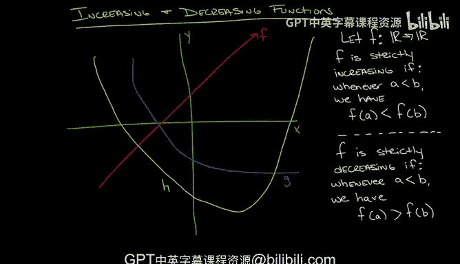

And the idea of today's lecture is the idea of an increasing or decreasing function these are two special classes of functions。

 it's important to understand that most functions don't fall into either but we need to understand which ones fall into which class。

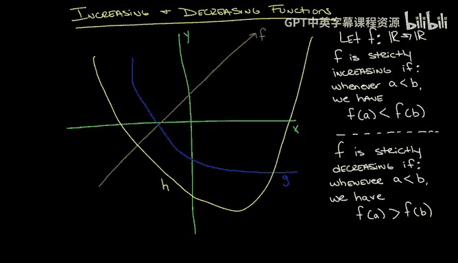

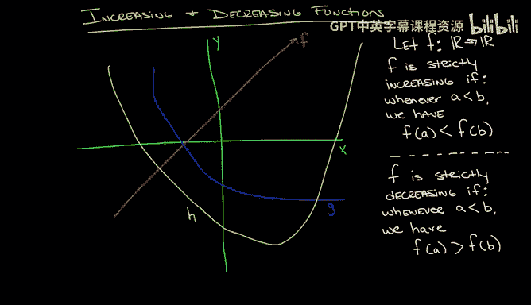

So if we look over on the left， we have three functions， we have the graph of F of x。

 which is the red graph。

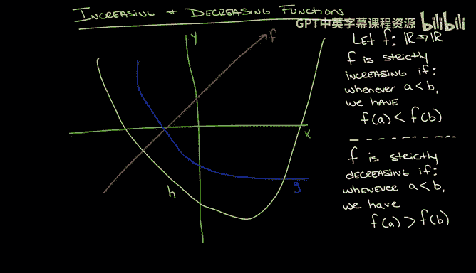

We have the graph of G of x， which is the blue graph， and we have the graph of H of x。

 which is the yellow graph。

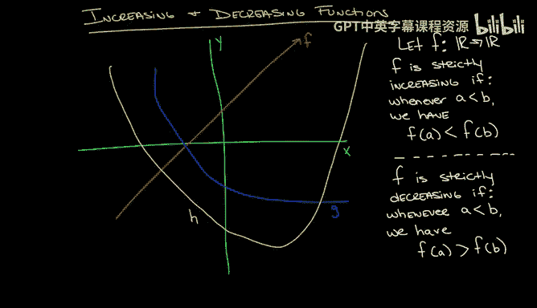

You'll notice F of x seems to go up as you move along the X axis and you look at where you are on the right graph。

 you're always climbing。

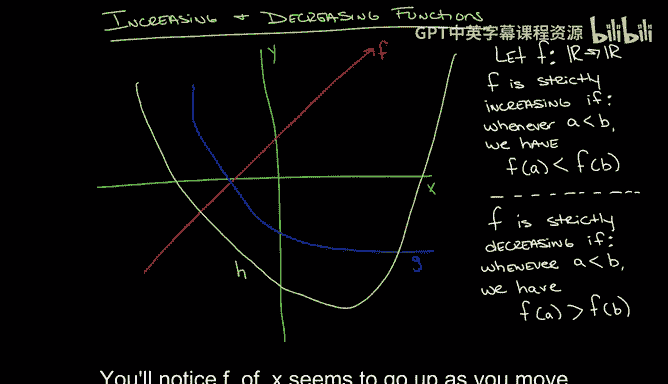

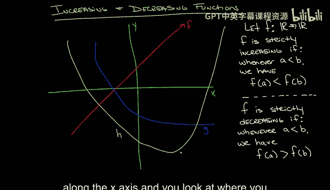

In notice the graph of G has the opposite， I'm always falling as I move along。

 whereas the graph of H has a falling period and then an increasing period。

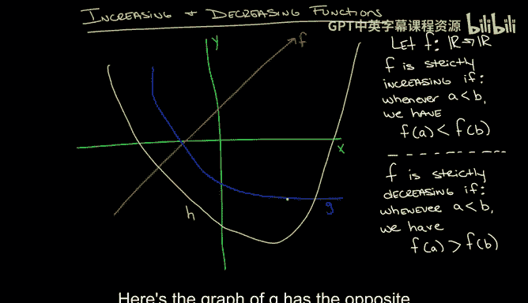

We say that F is its strictly increasing function， we say that G is a strictly decreasing function。

 and turns out that H is neither。

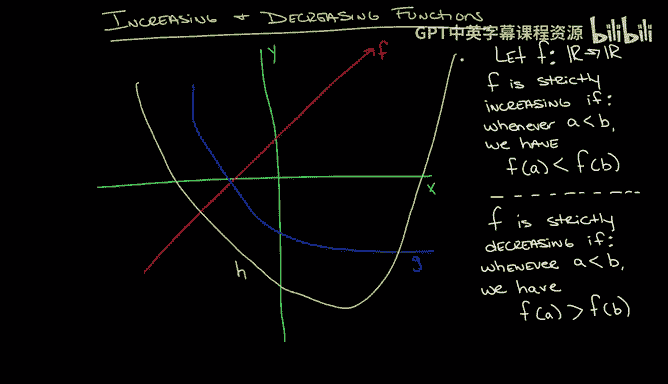

As we often knew more mathematicians werere not satisfied just with visual intuitive definitions we like to be annoying and write down some symbols so over here on the right I've done that let's look at what these symbols mean and let's look at how to translate those to the intuitive definitions we already see remember the idea is that the red should be strictly increasing the blue should be strictly decreasing H's neither to the definitions。

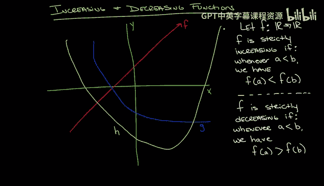

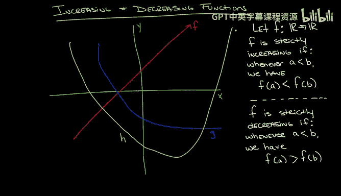

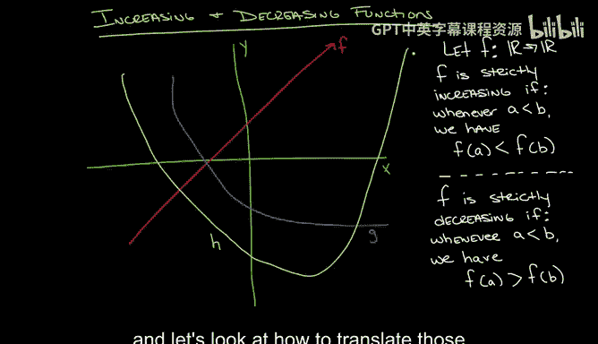

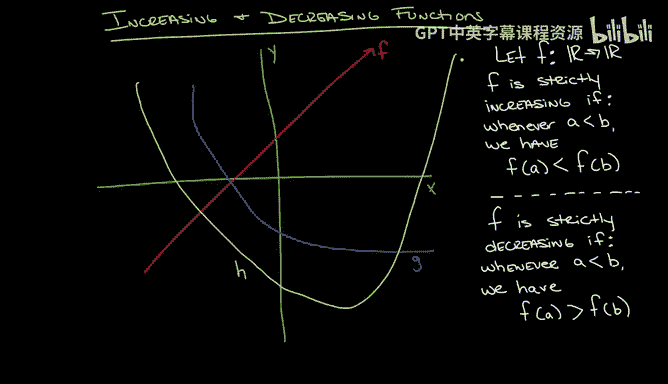

So let's let F be a function from real line to the real line and F can stand in for any of these。

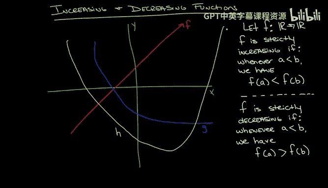

We say that F is strictly increasing if， and this condition is tricky to parse。

 whenever two inputs A and B have the relationship that A is less than B。

 it must be that the outputs F of B have the same relationship。

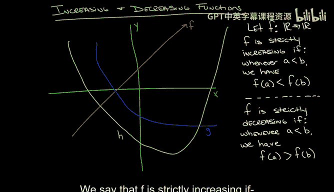

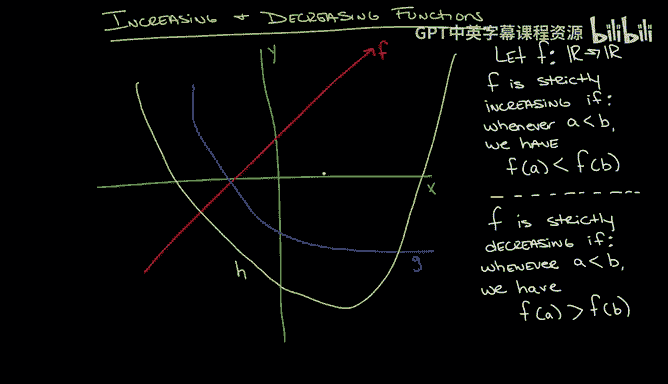

So let's check that S is strictly increasing for example， if this is a point A and this is a point B。

 notice that A and B or less A is less than B， but look up here。

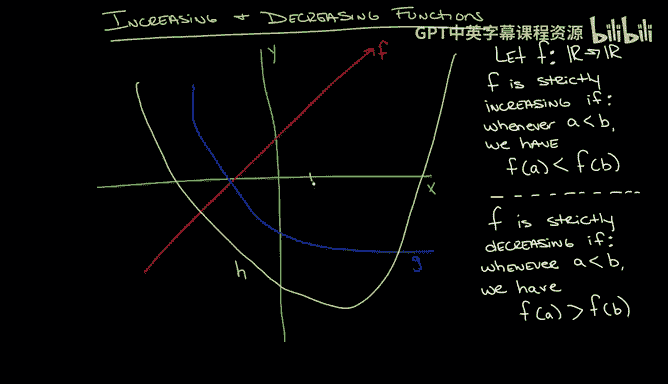

There is F of A on the graph。There's FFB in notice they have the same order relationship。

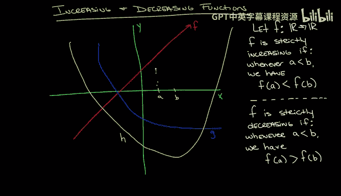

And I didn't just get lucky and pick those two， both could have been anywhere along the X axis。

 so turns out that F。

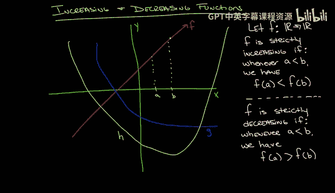

Butut that in red， F is strictly increasing。

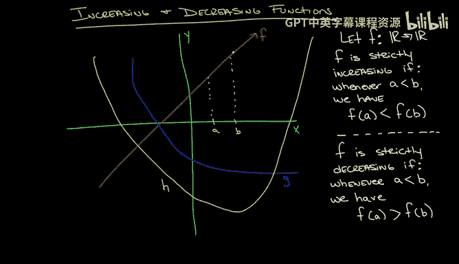

ho。O。We say that f is strictly decreasing if whenever a is less than B。

 the order relationship flips on the output， the f of a is greater than F of B turns out the blue guy。

 that's true right if we look at the blue guy here's a less than B so where they hit the graph。

There's G of A， there's G of B， even though they're getting closer to each other， G of B is actually。

Les than G of A and that's true no matter where I picked A and B， you can check for yourself that。

 so let's right that in here， G is strictly decreasing。好。On the other hand。

 I'll just give you the answer right away，H is neither。Can you convince yourself why that's true？

If I took A and B， say over here， and I looked at where it。

A hits the graph but I look at where B hits the graph， notice the order relationship flips。

 A is less than B but H of A is greater than A of B On the other hand。

 if I took A and B where we have them over here and I looked at where they hit the graph。

H ofA is actually less than it should be， so there's no consistency here。Okay。

 so we've seen some picture examples， let's write down some actual functions with formulas and let's figure out whether they're strictly increasing or strictly decreasing。

And the little secret here is I'm also going to show you some functions we haven't seen before。

 so we're going to get through the function F of x。

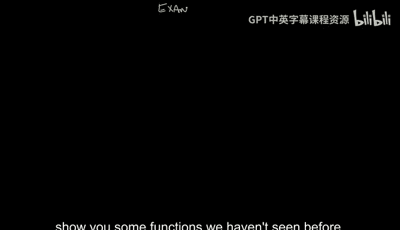

Equals 2 to the x。Weconsider G of x。Equals 3 to the minus x， and one you've seen before。

 which is h of x equals x squared。And let's figure out which of these are strictly increasing。

 which are strictly decreasing， which are neither。

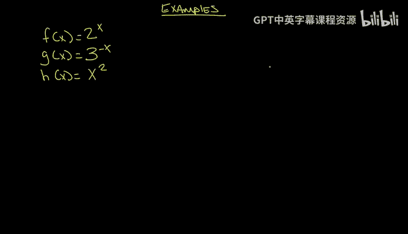

Over here are axes。

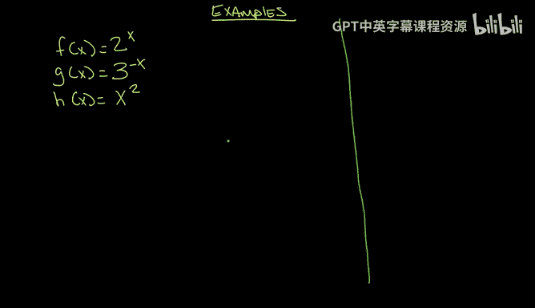

And let's first start by drawing the graph of f of x equals 2 x to the x。

 so you may not have seen this before this is called an exponential function。

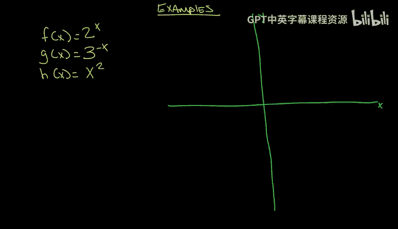

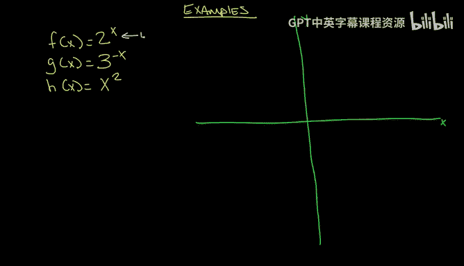

And the idea is that up here， x is in the exponent。

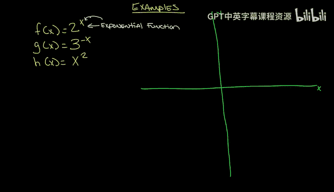

Let's figure out a table of values for what that might look like。So if x is zero。

This is x， and this is F of x。If x is0， then we have  two to the0， which is1， so here's the point01。

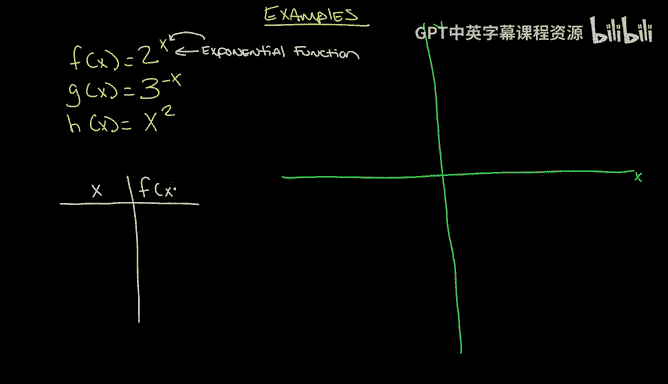

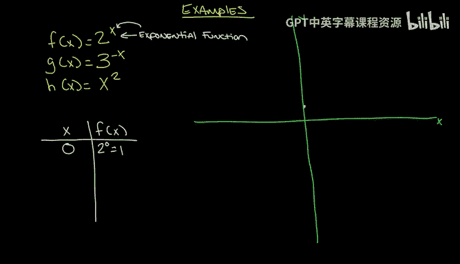

IfX is1， we have two to the1 equals 2。2。

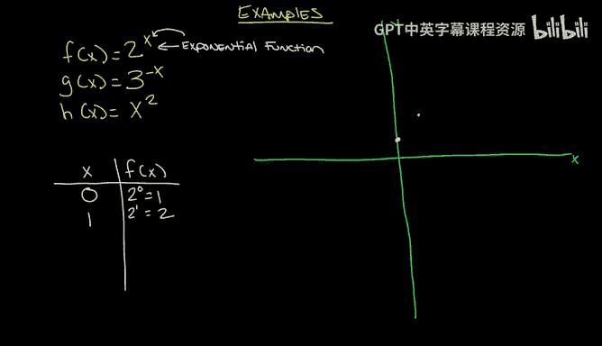

X is  two， we have two to the two is four。There's two， four。

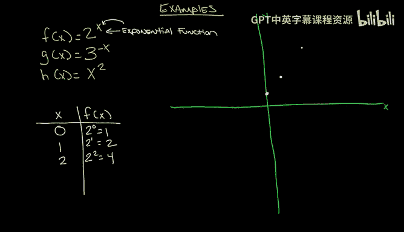

X is 3，2q equal of 8。So shoots all way up there， x is minus1。

2 to the minus1 is one over2 to the1 is one2。

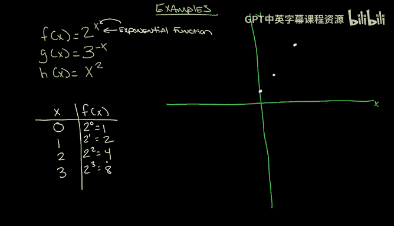

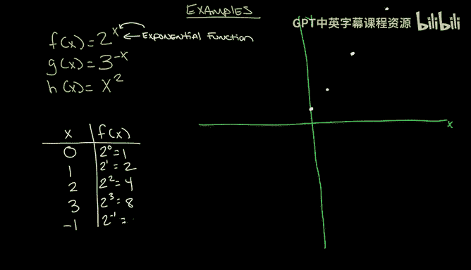

And so on。 So the graph actually ended up looking like this sort of。

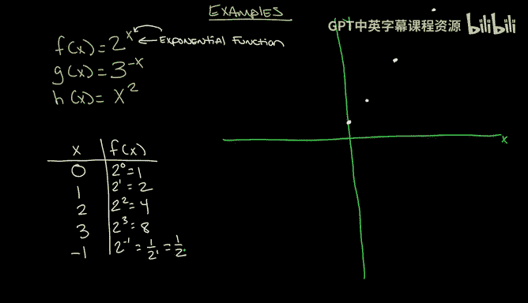

太难了。So there's f of x equals 2 x， that's the graph。

F of x equals 2 to the x。Turns out that's strictly increasing， as you could probably tell。

Okay， in blue。Let's figure out the graph of。

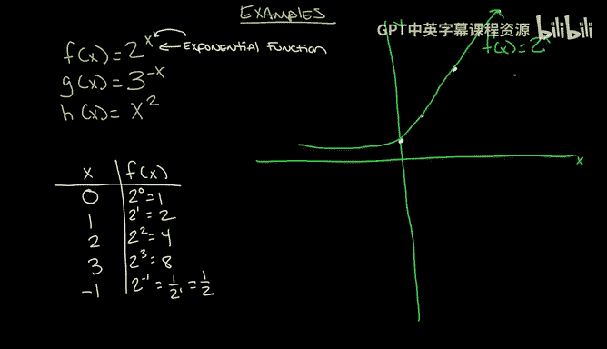

G of x equals 3 the minus x。So let' make our whole table of values， here's x， here's G of x。

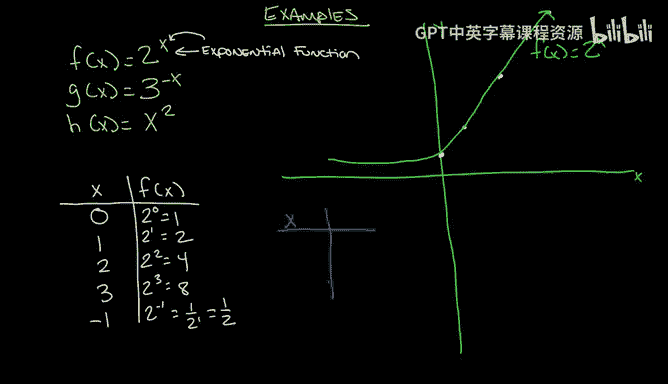

There is zero。So g of0 would be 3 to0 is1。

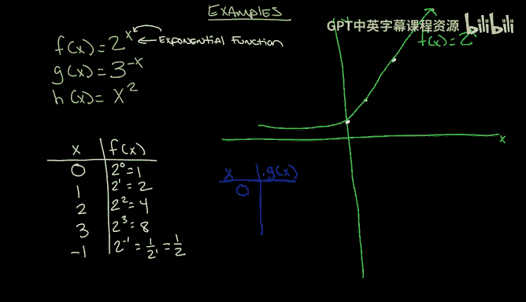

So it hits here。One would be three to the minus one， one third。

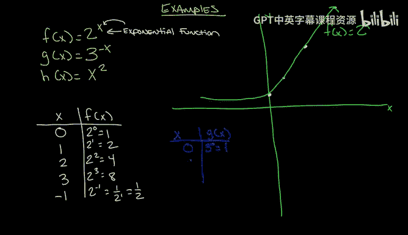

And you can sort of get the pattern， it's going to go。

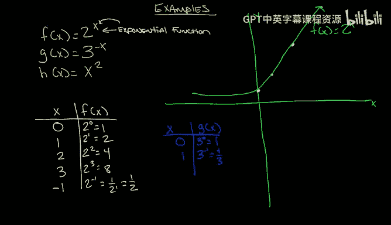

Quite steeper and up like that and down like that。

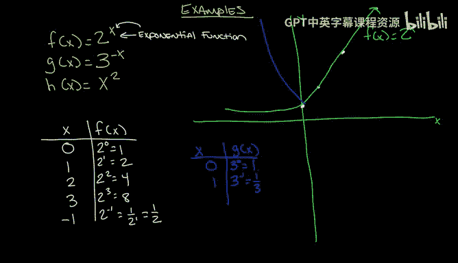

So， G。Next。

Is strictly decreasing。Okay， let's draw the graph of h of x equald x squared in yellow。

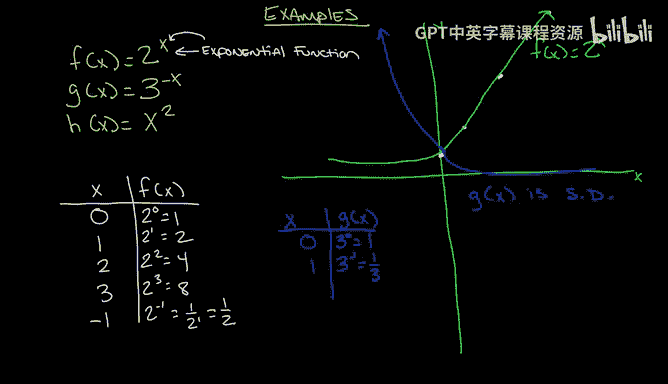

So let's see that should go through the points1，1 and 1 minus1。

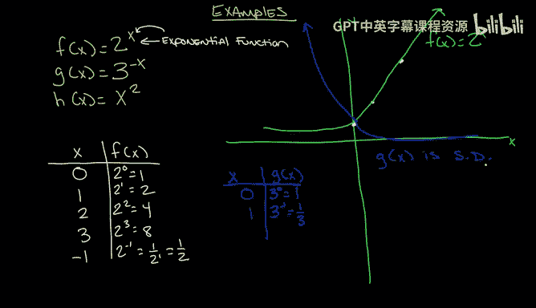

Looks about like that。

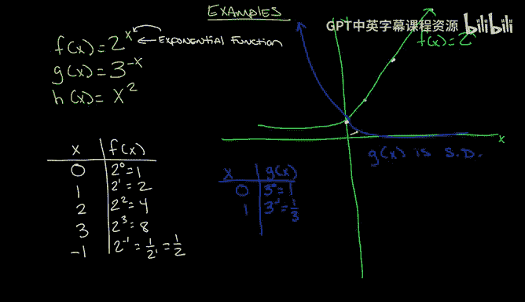

Now， H is neither。

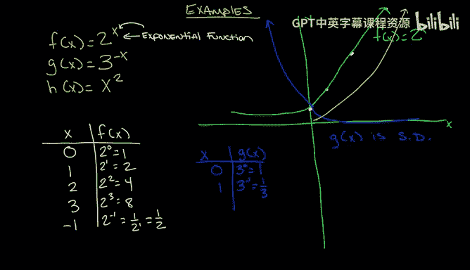

Strictly increasing nor strictly decreasing。

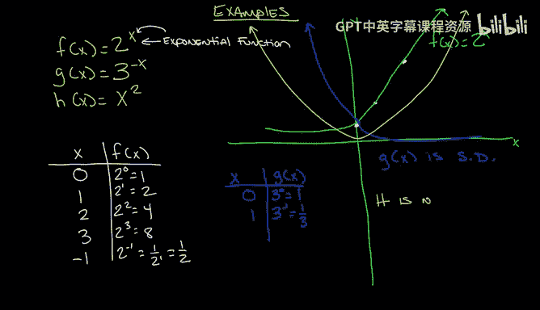

Right， so as it goes up， the it's coming down。

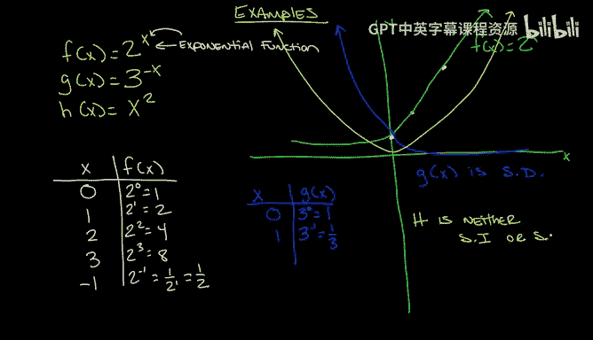

Here's a statement which you should intuitively understand what this means。

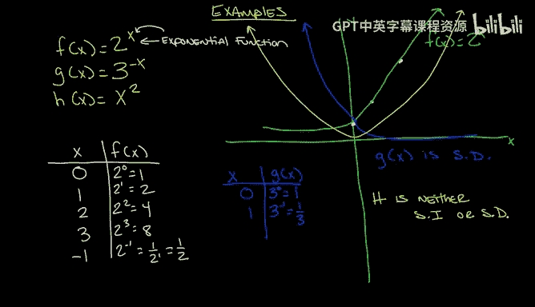

H is。Trickly increasing on the interval from zero to infinity。

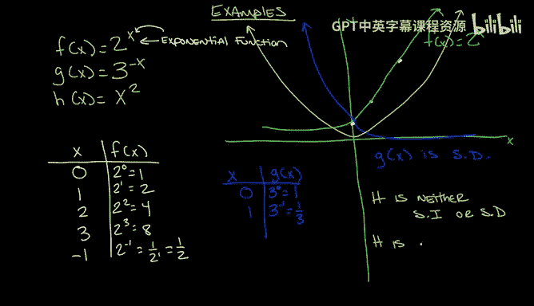

In other words， if I restrict myself only to things in this interval here。

 and I only use those with inputs， it satisfies the definition strictly increasing if I plug into two points in that。

 it goes up。

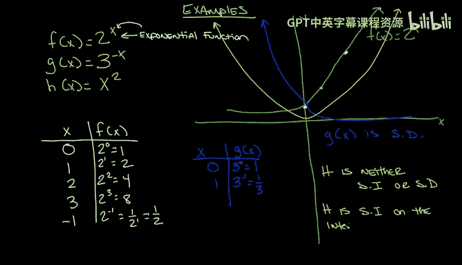

And。Age is strictly。Decreasing。On the interval from minus infinitefinity to zero。

 as you can commit yourself。So that's interesting。Okay。

 let's understand what this might have to do with say real world examples。Okay。

 so we've seen some examples of functions that I've just made up。

 here are some examples that might make more sense in the real world of where we might have increasing functions and decreasing functions On the left。

 let's imagine plotting over here。

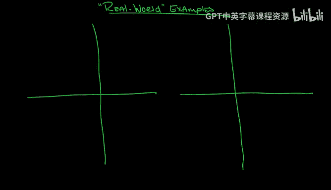

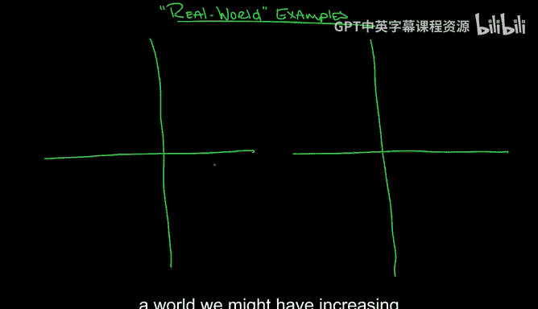

Years。Since birth。

Of a typical child， and over here let's plot height。

And we won't really commit to scaleal or units， we'll just get the tenth of the general shape。

 so notice of course， nothing to the left or the Y axis matters because there aren't negative years since birth。

This will almost entirely be an increasing function right you'll start at year one。

 we'll measure you you're about here and you'll go up， you'll go up really violently。

 things will start to level off。

Right around here， that's probably about 17。

You'll stay sort of stable for a long， long time， maybe a little bit of growth and you might dip down a little bit said lazy soupto so that's a function which is increasing for a long bit。

 then is sort of flat and then goes down。

As always the mathematical notions are always much more precise on what happens in real life。

 it wouldn't be a smooth curve， it would depend on the measurements of the doctor's office。

Okay，Over here， suppose we have years。

Since。Purchasing a car。

Over here we have value of car。

Without even drawing it you could probably predict that's going to be a decreasing function。

 right here's year one。

It's one of my cars， it's going to start at about $1，000， but perhaps that's undervaluing me。

 and then it's going to decrease as soon as you drive it off the lot。

 it goes down a little bit and it's going to plateau somewhere near the bottom。

Okay， we're going to close with just a simple visual test to tell whether or not a function is increasing or decreasing notice the red graph is the graph of a strictly increasing function。

 the blue graph is a graph of a function which is neither strictly increasing nor strictly decreasing a really simple way to do it is what's called the horizontal line test namely notice if I draw any horizontal line here in green。

It hits the red graph exactly once no matter where I draw the line。

Which makes sense， right because？That's the value that's hit that one time。

It could never ever return to that value， because if it did。

 the graph would have had to bend back down。

So in other words， there's a value I hit， I don't get to hit that value again because the graph is gone。

 see you later， it's all on the train。

On the other hand you'll notice blue， there are many horizontal lines which hit the graph twice this horizontal line here hit here。

 now blue goes down， we think we've left the line forever。

 but it starts to come back up again and hits the graph。

And so that's really the horizontal line test the function is strictly increasing or strictly decreasing if。

Whenever you graph it， every single horizontal line has to intersect exactly once。

