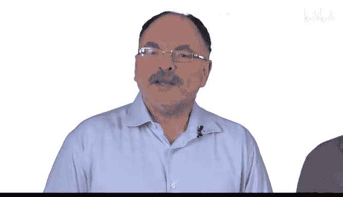
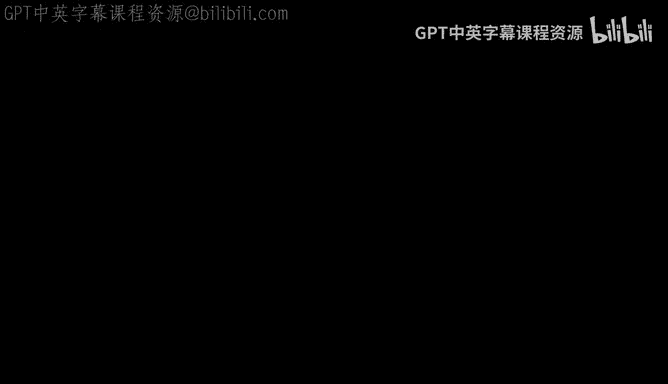

# 杜克大学《数据科学数学技能｜Data Science Math Skills》中英字幕 - P1：01_01_01_欢迎来到数据科学数学技能.zh_en - GPT中英字幕课程资源 - BV12mv6BLEhC

Hi， I'm Daniel Eger。 I'm a professor at Duke University's Engineering School。

I teach data science related courses， both here at Duke and online。

After launching a new data science course on Coursera in the fall of 2015。

 I noticed that many highly educated and motivated students were getting stuck because of some basic math concept or form of math notation they had not seen before。

So I went through that course and made a careful list of every concept that was not obvious to non math people。

 and I asked Paul to help me create a new online course that would provide a gentle introduction to all this material。

Thanks for bringing me in Daniel。 Hi， I'm Paul Benitch。 I'm a professor of mathematics here at Duke。

For the past four years， I've run what I hope is an innovative summer program called DataPlus。

 where our students work in small teams on interdisciplinary client facing data science challenges。

Over these summers， I've noticed that many of our team members bring really valuable domain expertise and extensive real world experience。

But are unable to contribute to their full potential because of really relatively minor gaps in their prior mass study。

 So Daniel and I really have a common passion of filling these gaps as efficiently and painlessly as possible。

Math helps form the language of data science。After working through this course。

 you will understand the basic vocabulary of this language and be able to communicate better in the workplace and on teams with data scientists。

If you aspire to become a data scientist yourself， going through this course is a great first step。

We've designed this course for people who either never studied algebra at all through the precalalculus level or took a course a long time ago and let's be honest。

 mostly tried to forget it， so we assume no prior knowledge of any of this material。

You're going to see both of us during this course。 I'll be guiding you through the content of the first four and a half weeks。

 We'll cover basic notions in set theory， algebraic notation。

 functions on the real number line and some curves in the Cartesian plane。

And then I'll finish you up with a non technical explanation of a basic calculus concept。

 how to compute the instantaneous rate of change of a function。In the last week and a half。

 I'll be introducing exponents and logris and giving a mini course on probability theory up to and including the famous Bayes theorem and how to use it。

We wish you the best of luck through this course and thank you for joining us。

