# 杜克大学《数据科学数学技能｜Data Science Math Skills》中英字幕 - P20：20_03_02_切线：曲线在某点处的斜率.zh_en - GPT中英字幕课程资源 - BV12mv6BLEhC

Okay， welcome back， everyone。

This is the beginning of a three video series on tangent lines。 And honestly。

 the entire point of the first video is that I want you to understand everything that's written on this screen。

 So I'm going to go through what's on this screen and take a few more screens to really describe all the different concepts。

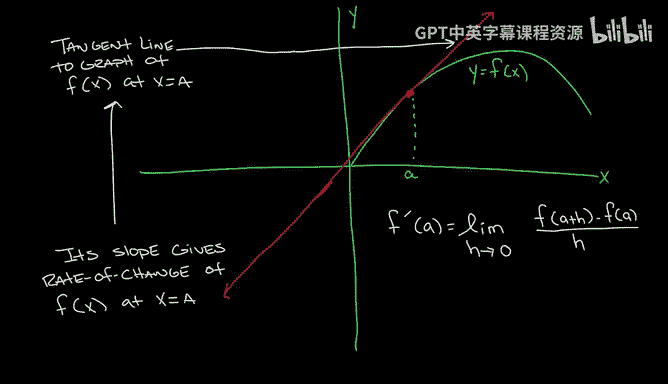

The key idea here is， for the moment， let's imagine we just have a graph of a function。

 Y equals F of x。 And we're watching this graph here in green。

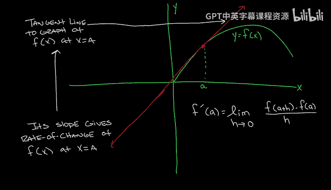

Now， suppose we take a particular point。 X equals a。 So right here is x equals a。

 And we want to ask the question， how fast is F of x changing at x equals a。

 I want you to appreciate that's a really actually tricky question that we take for granted all the time。

 It's like saying right here on this point in the road。 I'm moving 55 miles per hour。

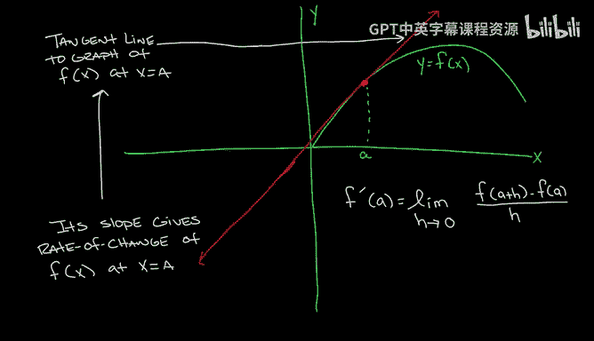

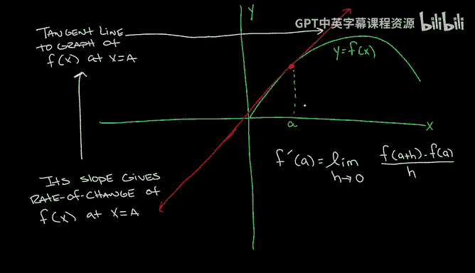

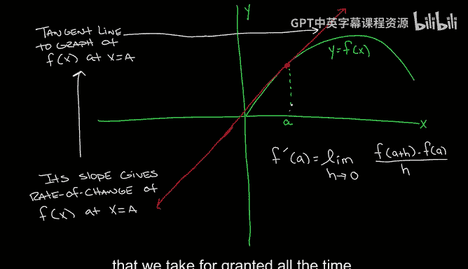

That doesn't mean in the next hour， I will have moved 55 miles。

 or it will take me one hour to move the next 55 miles。 It says right now， I'm moving 55 miles hour。

 It's a really tricky idea。 It what we often use calculus to describe as instantaneous rate of change。

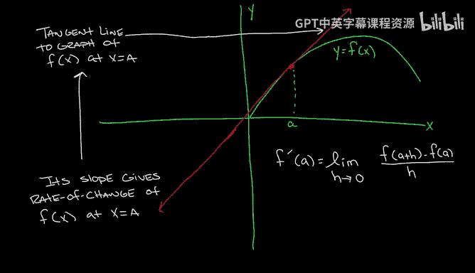

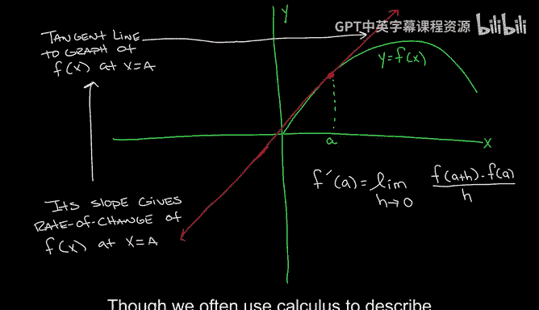

The cool geometric picture is if we look at this red line Ive drawn right here。

 that's what's called the tangent line to the graph of the function at x equals a。

 That's a key geometric concept。😊。

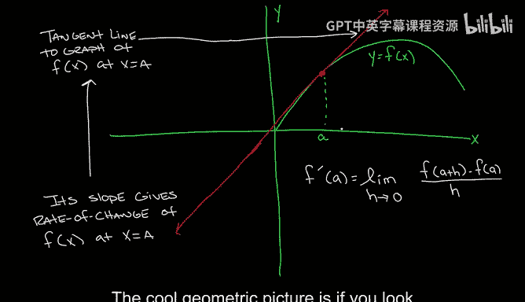

If you think back way back several videos ago， the only thing we know how to take slopes of are lines。

 we understand how to take the slope of a line。

This is going to be a line， and its slope is actually going to be that instantaneous rate of change。

 That's way written here。 This is the tangent line to the graph of the function， at the point。

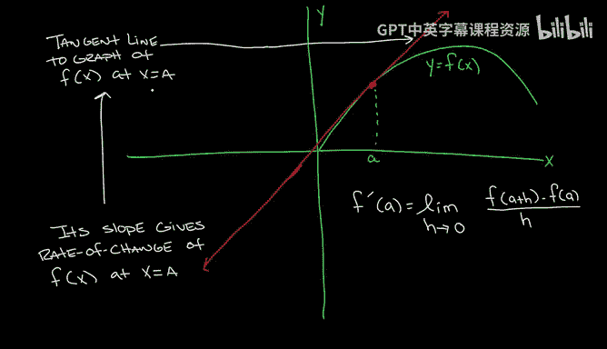

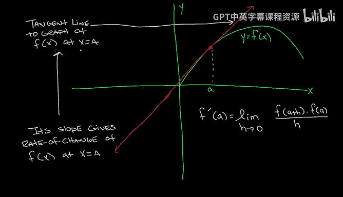

And its slope gives us the rate of the change there。If you take nothing else out of that video。

 that's a key idea。 Even though the graph itself is not aligned line， it's a curve。

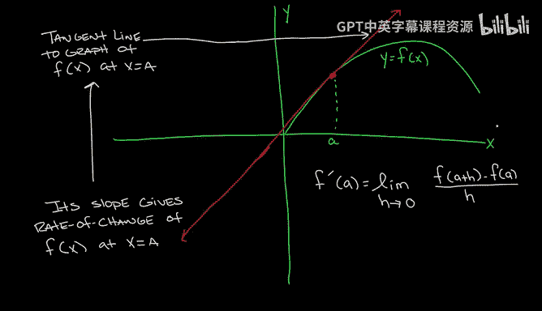

At each point， I can draw a line that's tangent， and its sloped is what we call。

That instantaneous rate of change。 that's also called the derivative of the function at that point。

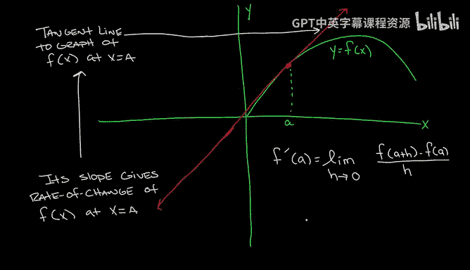

And that's this little symbol here， F prime of a。Now， how do you actually compute F prime of A。

 Under that's really tricky because to want to compute。

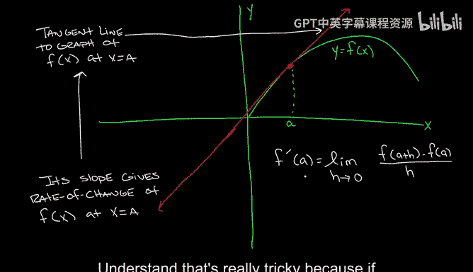

A slope of a line。 We need two points on the line。 really only have this one point。

 this red point here。

That's this tricky formula here。 Don't be scared of the limit。

 We're going to unpack that as we go through the screens， but those are the key ideas。

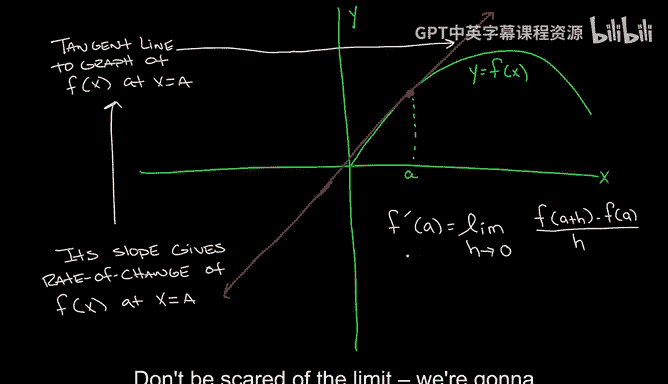

To work up that though， let me start with a much， much simpler example。

So suppose right here。

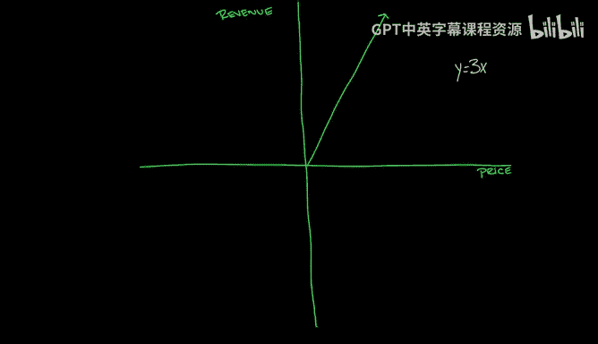

We have the graph Y equals 3 x。And for the moment， let's take a really fanciful example。

 Any business majors in here， please don't be offended。 I know this is simple。

 I'm going to pretend this models the revenue versus the price of an item。

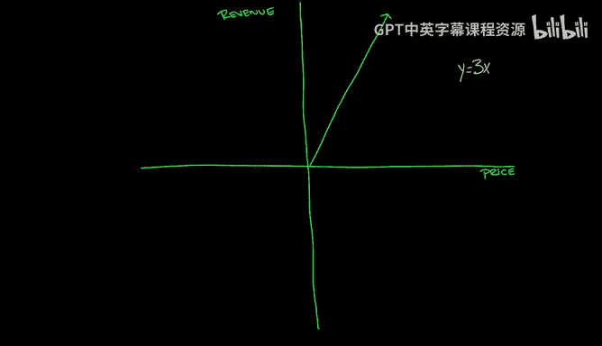

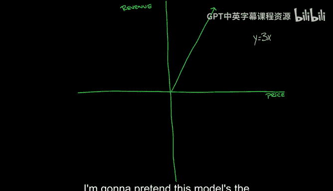

So there's a particular item I'm going to sell。 I want to sell it for X dollars。 That's the price。

 And then I want to see how much revenue comes in。Okay， so why is this unrealistic。

 You'll notice it's just the graph of y equals 3 x。 What this is saying is that is。

 as I increase the price， the revenue goes up forever evermore。 So obviously。

 what I should do is set the price to be $1 million bajillion trillion。 Obviously。

 that's why it's unrealistic。 But for the moment。Let's suppose。Let's suppose that right now。

 my business has set the price of the item as $ a。 It cost you 8 for the item。

 And I want to ask the question， if I increase the price will the revenue go up， Obviously， it will。

 But I want to know how much。 What's the rate of change at this point。

 It's a really simple question with the line。 Let's see that why that's true。

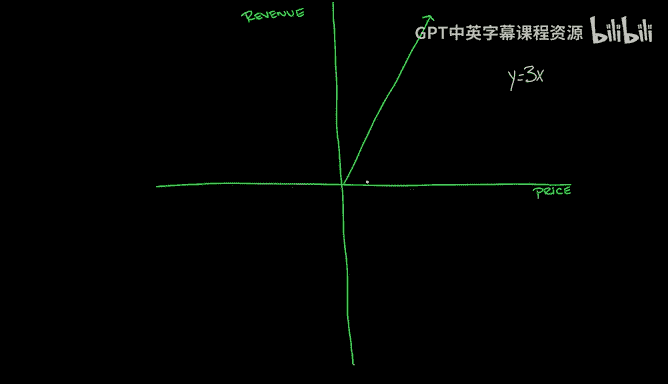

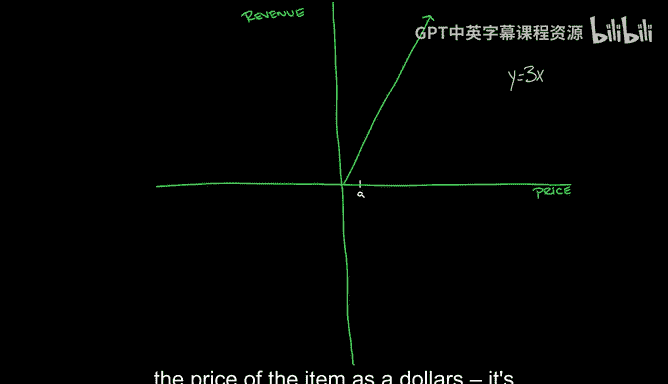

Let's go up here to the point in the graph。So that's the point。A comma 3。Now。

 suppose I increase the price of my unit by $1。So here's a plus1。Hit the graph。

 What are the coordinates to that point。 Those are a plus1。And three times a plus one。Okay。

 now let's figure out the slope of this line between the two， the slope of that line segment。

Think about calculating that is going to be the rise， the difference in the y values。

 So three times a plus1。

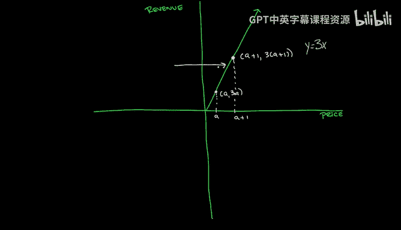

- three times a。

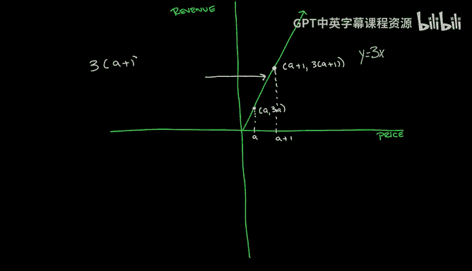

Divided by the run， the difference in the x values， So a plus 1。

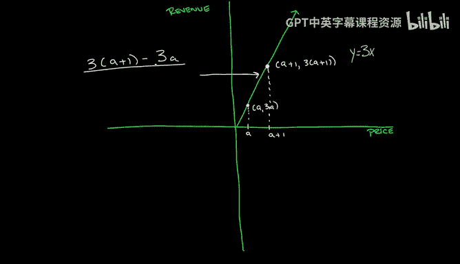

Minus a。And if you work at all that algebra， that's not really the point of this video。

 you're going to get three。

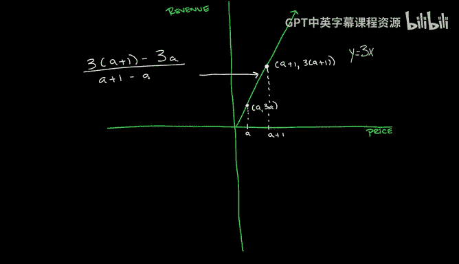

Okay， the key idea here that there was nothing special about increasing $1。

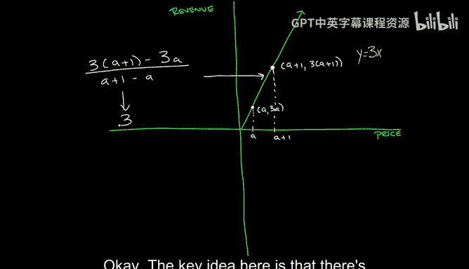

If I increase $2， that rise over run calculation will be exactly the same。

 That's what's special by the line。 The slope of the line doesn't really matter which line segment you take。

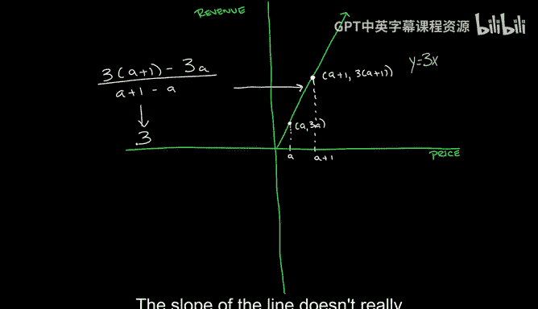

So in other words， if I increase $1， the revenue will go up $3 times $1。 If I increase $2。

 the revenue will go up $3 times $2。 That's really what the slope of the line is saying。

 If you remember back to the slope of line videos， that was really the key point of what the slope of the line means。

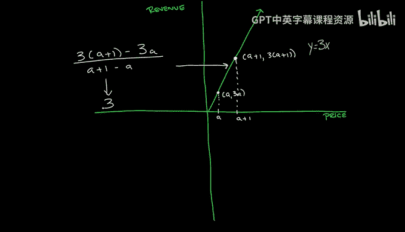

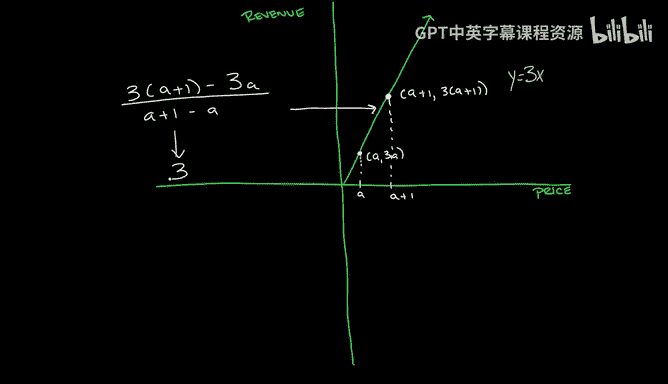

Okay， that's great。 Let's return to a much more realistic model。

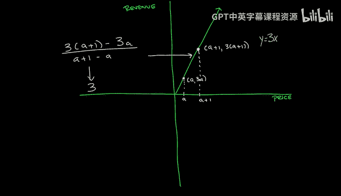

So if you look at the same picture， now， notice it's the same picture as we had in the very first。

 except I've added y equals F of X。 And I said that I'm graphing price first revenue。

 So this green curve， I put it to。 that's a more realistic price first revenue curve。

 What this is saying is normally when I raise the price。

 my revenue goes up because I get more dollars for each unit I sell。

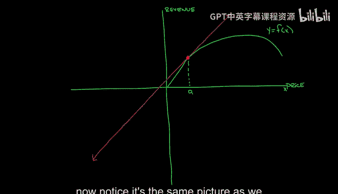

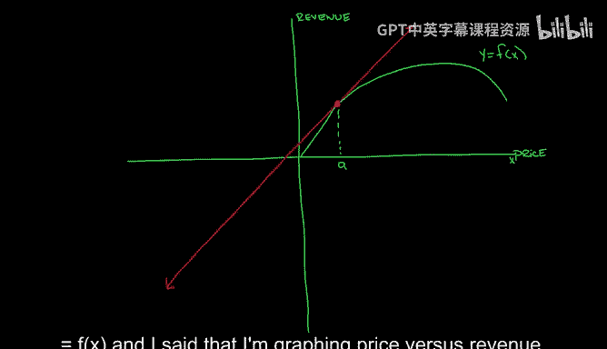

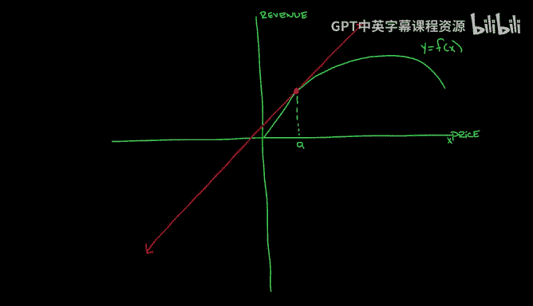

However， eventually I keep rising the price when people get mad at me and say。

 I'm not really going to buy your product。 It's not worth that much money， buddy。

 and so the revenue starts to go down。

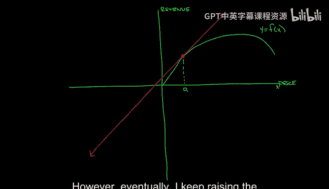

Okay， so that's essentially what this graph here means。

Now let's ask the question again。If I'm at $8。

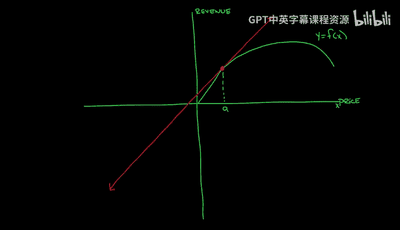

And my， I want to raise my price。 Does my revenue go up。 And if so。

 by how much does it go down and if so， by how much？ In other words。

 what's the instantaneous rate of change of the revenue at this price point。

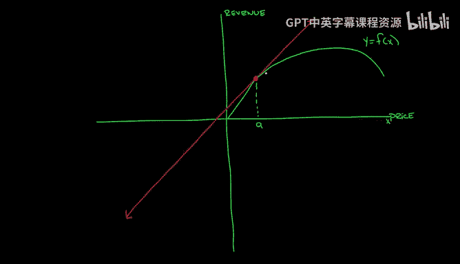

The very key idea here is the following， what makes this different from a line。

Is that the answer to that question depends on my price point。 So for example。

 suppose my price point was right here at B。 and let's look right up there。

Without even drawing the tangent line， you can probably guess that if I increase the price a little bit from B。

My revenue would go up， but by not nearly as much as it would if I increased it from a。

 and it gets even worse over here at C。

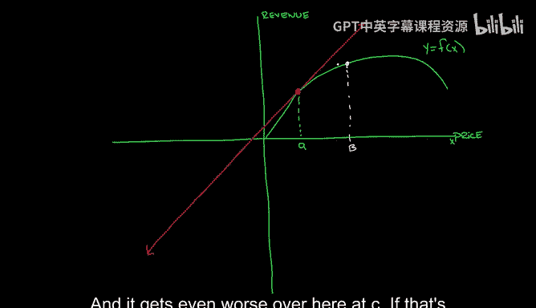

If that's my price point， and I increase the the price。

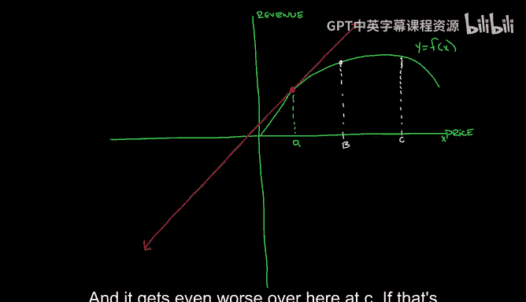

My revenue was actually going to go down， right， so it's a bad idea that I put it there。

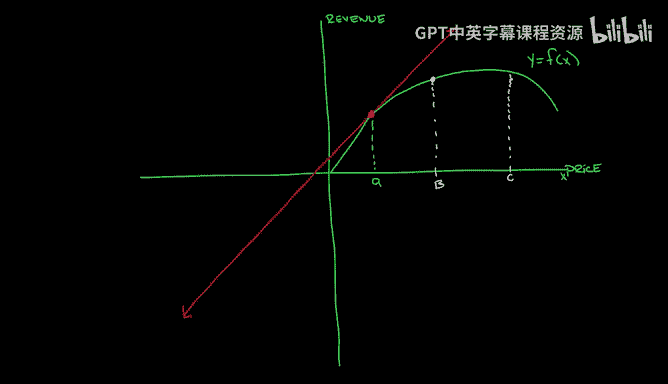

Business major among you might say it's a bad idea to have that price at sea at the first place。

 That's another matter。 But the key takeaway， the key mathematical takeaway here is that the slope of this tangent line changes depending on where you are on the curve。

 Notice that's not the case when my green curve was aligned， but it is the case here。 Okay。

 so the answer to the question。 by how much will the revenue increase。

 If I increase my price a little bit from the price point a。

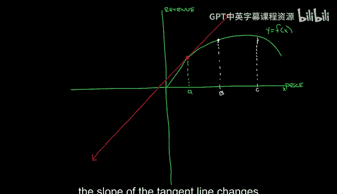

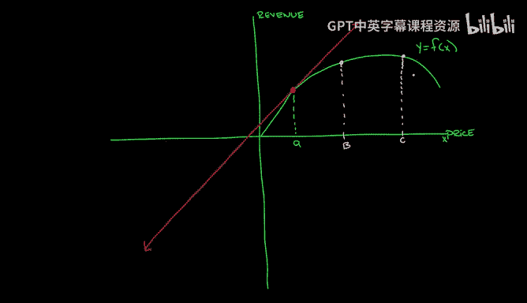

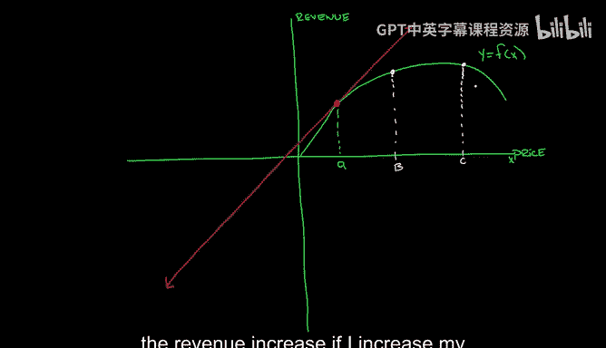

The answer to that is the slope of this red line。

That's what we call the derivative of the function at the value。 price value x equals a。

 So the thing we're after is we're after something called。

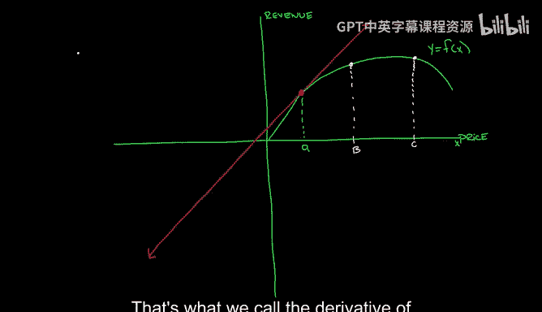

F prime of a。

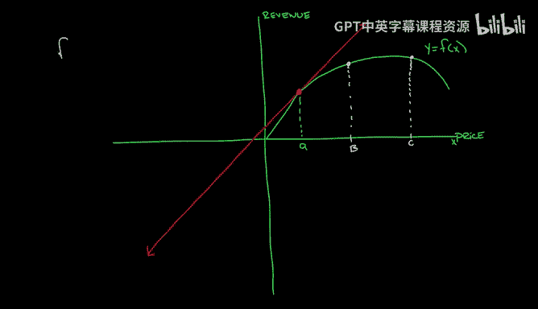

That's the derivative。

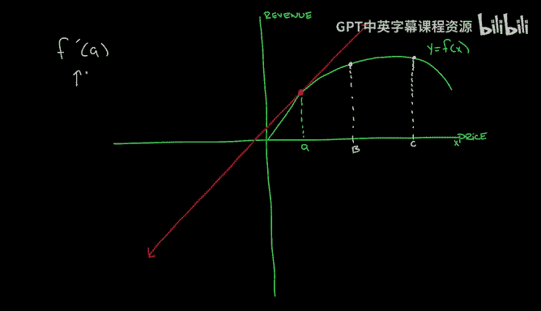

Of the function， F。

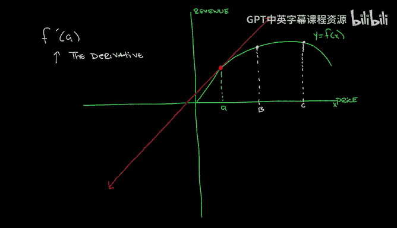

At the point， x equals a。Great， so it has a name， but now we need to calculate it。

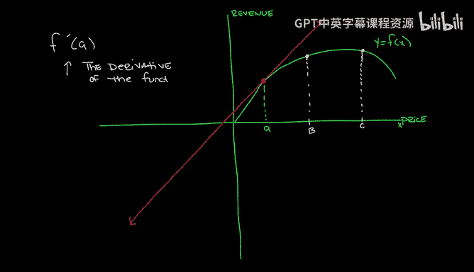

Okay， so imagine you're watching the video on slopes of lines。 A fair question to ask you would be。

 And if you did some of the quiz questions， you'll know we asked you this question。

Given two points， calculate the slope of the line segment between them。 That's a fair question。

 I think you're all pretty good at doing that by now。

Here's an unfair question。 Cal the slope of that red line。

 and all I'm going to do is give you the coordinates of that red dot。

 So I'm going to tell you what a is。 I'm going to tell you what f of a is。

 go nuts and give me the slope。

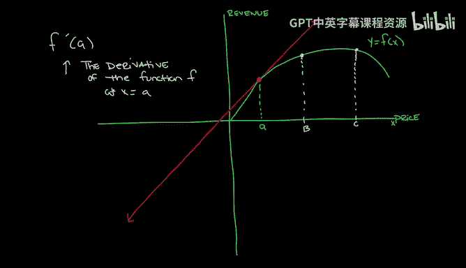

That's not fair。 You have a right to be angry if for asking that question。

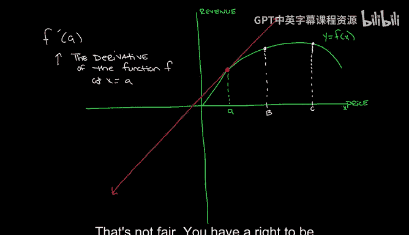

So let me ask you another question which you can do。

 although the answer won't give you the answer you want。

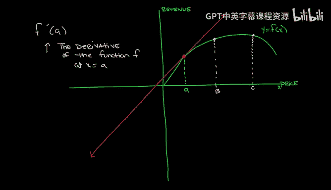

What I'm going to do。

If I'm going to take another point of the line and I'm going to draw a little line segment between them。

So let's think about what all those points are。

Let's say here is the point。 A plus H。H is sort of a notional symbol。

 but it stands here a little bit。 So in the words right here。

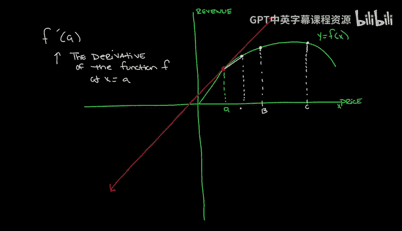

This is H。

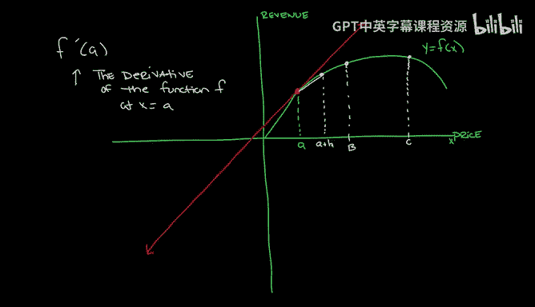

Let's think about what the coordinates of that point are。 First of all。

 the coordinates of this point right here， we know what those are。 those are a。

F喂。

And we know what according to this point are。They a plus H。

F of A plus H。Okay， fine。So I know how to calculate the slope of that line segment。 What is it， Well。

 what it is is the difference in the y values， what we call the rise。

 which is F of a plus H minus f of a。

Over the difference in the x values， which is the run， which is a plus H minus a。

 But looking at this picture， that difference is just H。 Let's put it there。

All right， so let's pause here for a second。I don't know the slope of the tangent line。

 but I would like to know it。 I do know the slope of the line segment。

 assuming you give me values for this。 But if you give me values for the function。

 I can give you values here。 So I know how to make that a number。

Here's where calculus comes in。 I can write an equals。I can write a limit sign。

And I can say H goes to zero。Okay， believe it or not in the next video。

 we'll calculate explicitly what this means。

But for now， the really conceptual point is it says， actually。

 I don't really want this point to be here。

I don't want that point to exist at all。 I want H to be 0 because if I move H towards 0。

 this little line segment snaps toward pointing in the same direction as the tangent line。

 So as I move H towards 0， the slope of that little line segment imagine it moving along。

 Snap snapap snap， Ss to the slope I care about。 That's why I put a limit as H goes to 0 here。

 It's not H G equals 0， but H gets closer and closer to 0。

Okay， that's the point of this lesson。

In the next video， we'll calculate an explicit example with an actual function。

 We'll show you how this formula lets you describe that slip。 Thanks for listening。

