# 杜克大学《数据科学数学技能｜Data Science Math Skills》中英字幕 - P22：22_03_02_整数指数的运用.zh_en - GPT中英字幕课程资源 - BV12mv6BLEhC

Hello， I am Daniel Leger。Welcome to the data science math skills section on Exponents and logarithms。

Willll be beginning now with。The basic integer exponents。

And we'll start with positive integer exponents。Positive integer exponents are numbers used for counting like 1。

2，3， and so on。

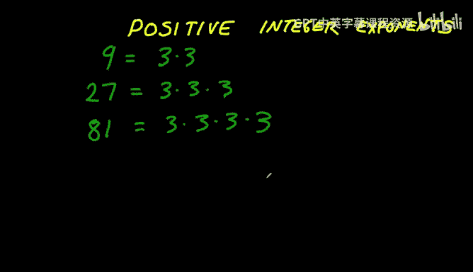

When we have a number， like 9。Which is equal to three times 3。Three is a factor of9。And it repeats。

It occurs twice。In the number 27， the factor3 occurs three times。And， of course， in the number 81。

 the factor 3 occurs four times。We can use positive integer exponents。

Which are numbers placed in the upper right corner of a factor。

To count how many times the same factor repeats in a number。So nine。Equals three times 3。Equals3。

To the second， where two is the exponent。27 equals 3 times 3 times 3。

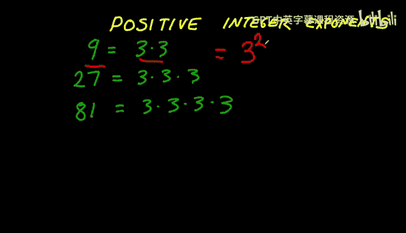

Equals3 to the third。Where three is the exponent。And 81 equals3 times 3 times 3 times 3 equals 3 to the four where4 is the exponent。

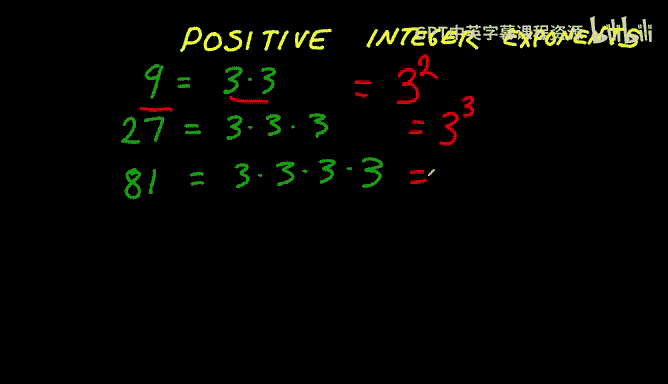

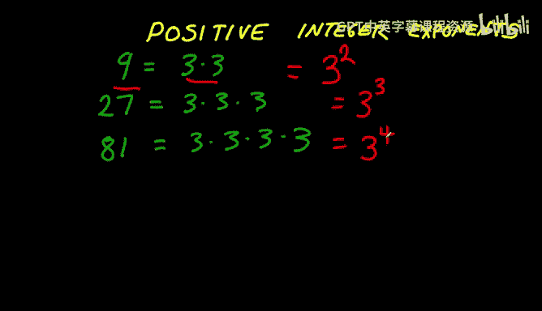

And so on。So。We read this as three raised to the fourth power。

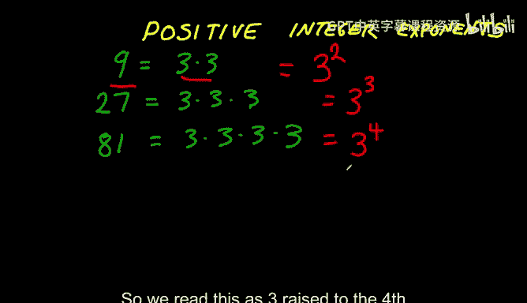

Or simply three to the fourth for short。

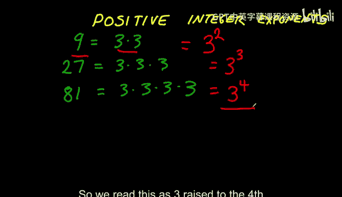

So let's look at another example。The number 248832 is just equal to 12 times 12 times 12 times 12 times 12。

And you can see the great convenience in being able to write this as 12。Raise to the fifth power。

Where5 is the exponent。And this number is 12 to the fifth。Note that for historical reasons。嗯。

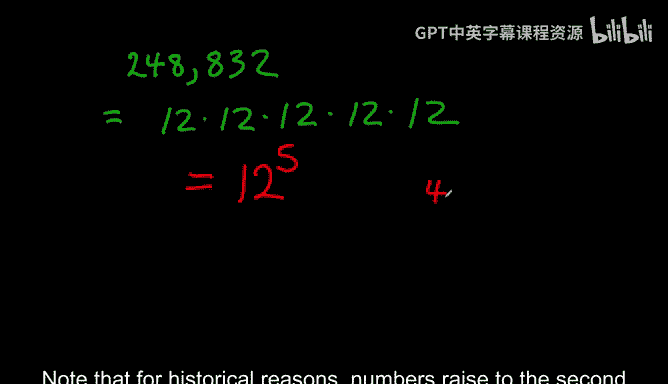

Numbers raised to the second power。Have special names， as well as their regular name。

 So this is4 to the second， but it's also four squared。

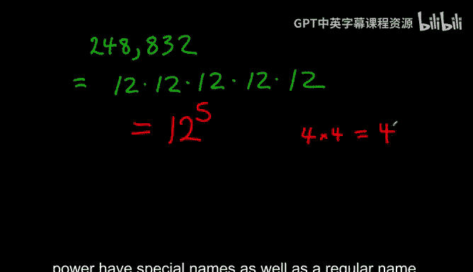

And this is。Four to the third。But it's also for cubed。

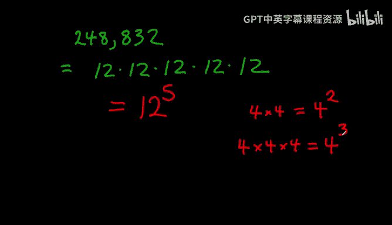

Next， we're going to talk about0 as an exponent。

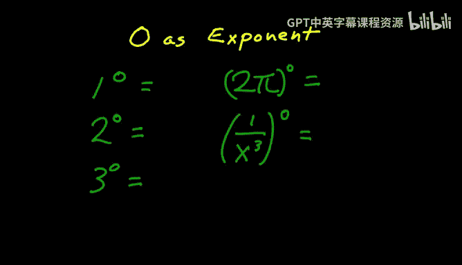

These problems are easy。

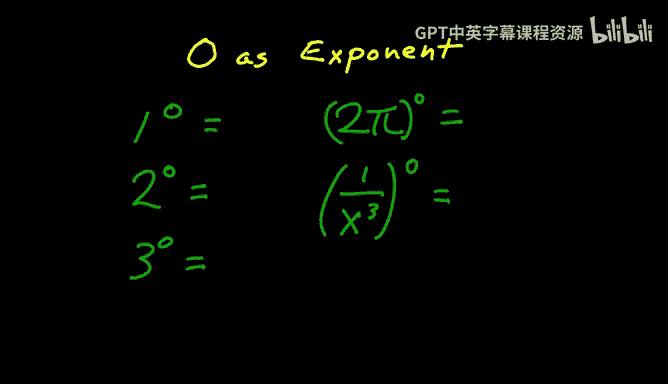

Why do I say that？Because by the definition of exponence， any number。Except 0。

 raised to the0 with power equals 1。So， for example。3 to the0 equals 1，2 to the0 equals 1。

2 pi to the0 equals 1，1 over x cubed to the0 equals 1 so long as x does not equal 0。And so on。

Even for mathematicians。Zero to the zero is a little too weird， and so that is simply undefined。

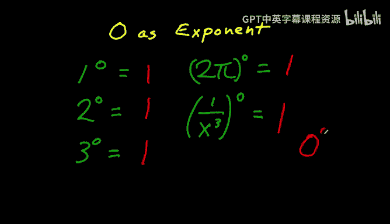

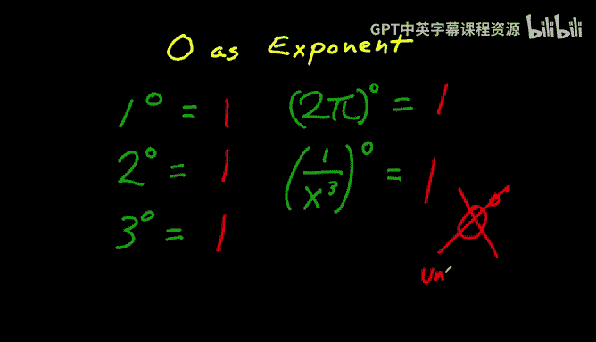

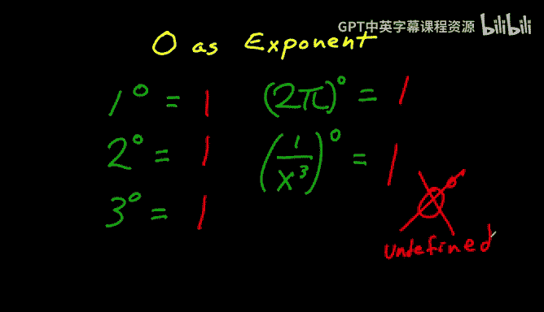

Next， we'll look at negative integer exponents。

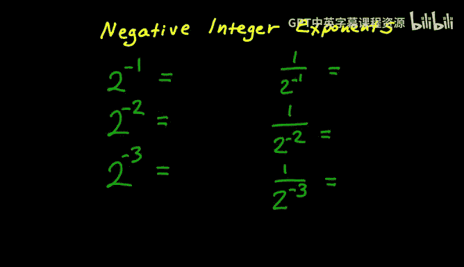

2。😔，Raised to the exponent， negative one is red。2 to the -1。

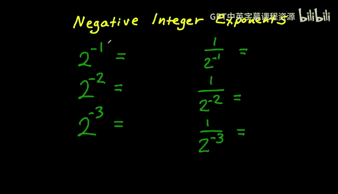

And it is equal to one over2 to the one。

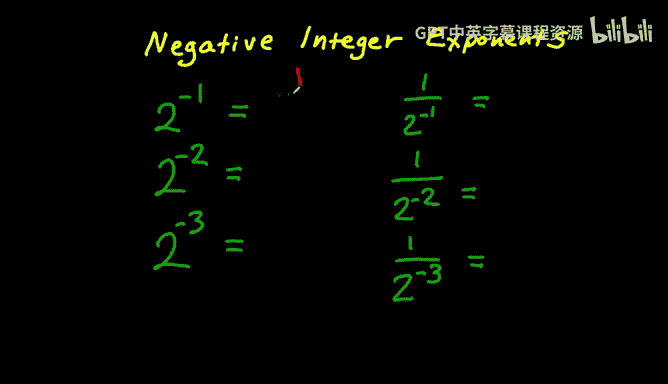

Or one half。

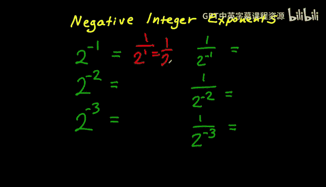

2 to the minus-2 is equal to one over2 to the2。

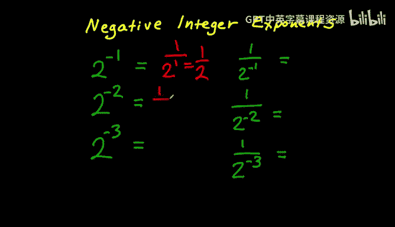

Or one quarter。

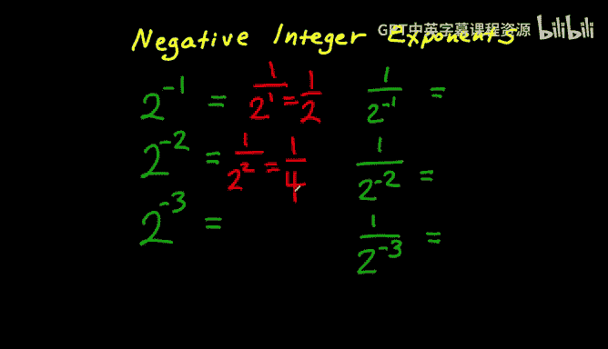

And 2 to the -3 is equal to one over 2 to the3。

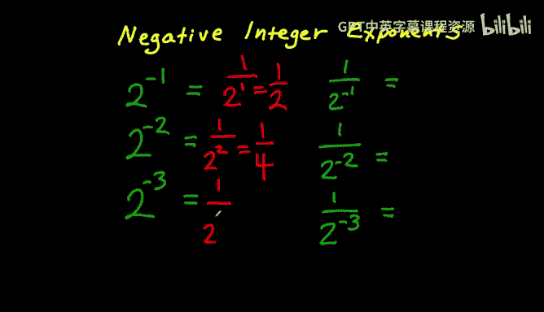

Or 1，8。So you should see the pattern here。

Raising a number to a negative exponent is the same as dividing it by the same integer。

 If that integer were positive。

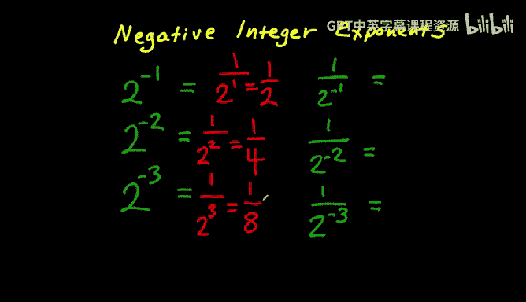

Now， let's consider dividing by a negative exponent。

By the exact same logic，1 over2 to the minus1。

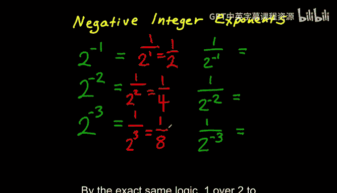

Simply equals 2 to the one or2。

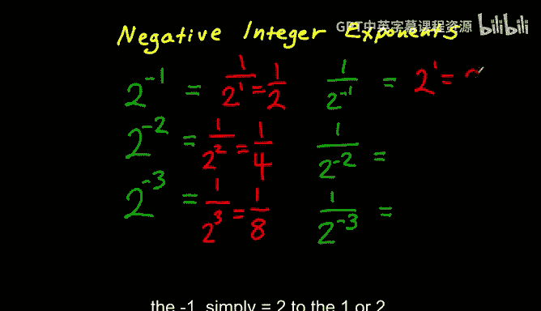

1 over 2 to the -2 simply equals22 to the second or two squared or 4。

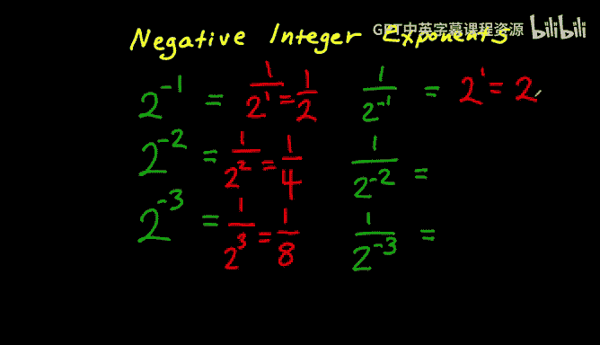

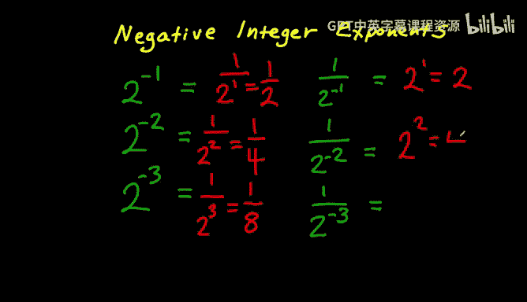

1 over 2 to the minus-3 simply equals 2 to the third or two cubed。

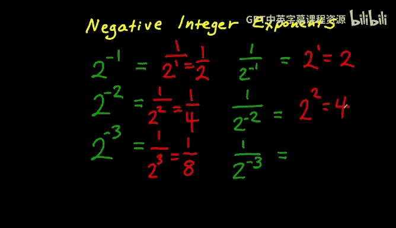

Or 8。

We expressed the general rule for negative exponents using letters to stand for just about any number。

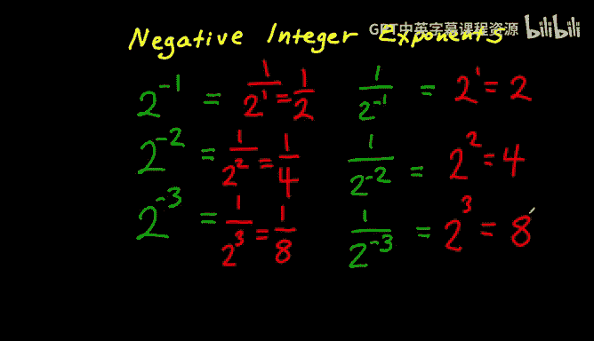

And the general rule looks like this。

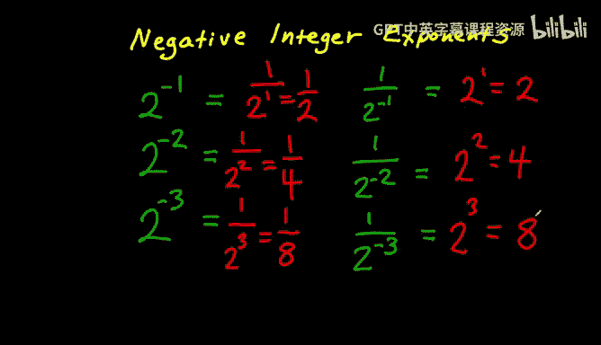

X to the minus and。

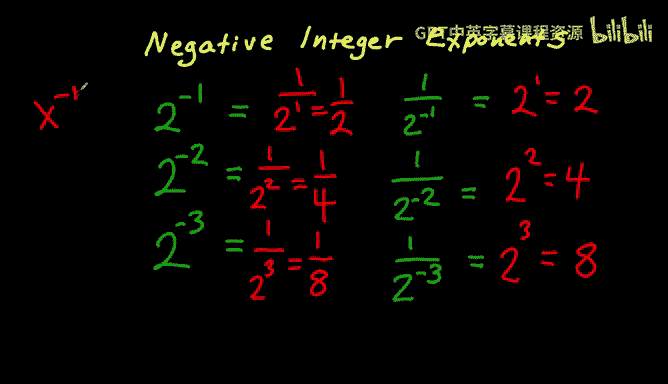

Equals。1 over x to the N。

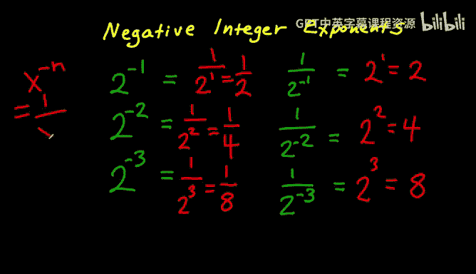

And。1 over x to the minus n。

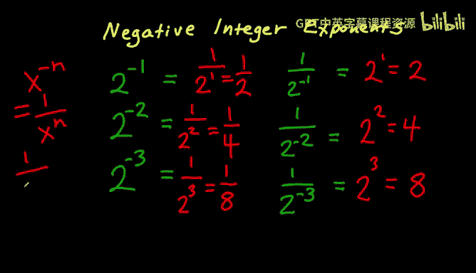

Equals。X。To the end。One of the most common uses of exponence。

Is for something that we call scientific notation。Scientific notation is a way to write numbers that otherwise would have a very large number of zeroes in them。

What we do is we take the part of the number that has significant digits。

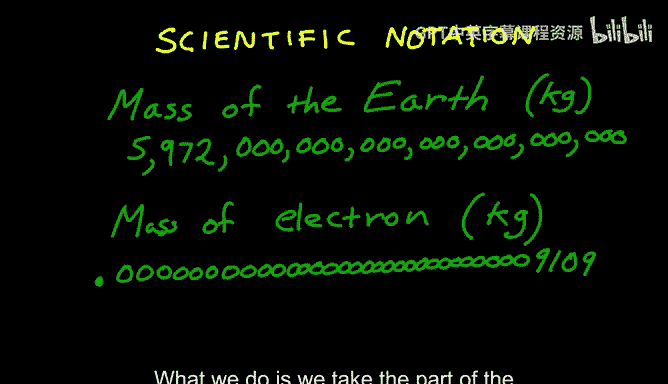

Here，5，9，7，2。And we put one digit to the left of the decimal place。So we have five point。9，7，2。

And then we multiply by 10 raised to the appropriate exponent。Which in this case is 24。

And 10 to the 24 means。That you are going to have。You're going to move the decimal place。

 24 spaces to the right。Get it。 So let's try another one。 If we have a number less than one。

 we're going to be moving the decimal place to the left， and we're going to have a negative exponent。

So in this case， we have the mass of an electron。And this would be 9。109。Times 10。To the -31。

 because we're moving the decimal place。31 places。To the left。Key thing to remember。

Is that we only need to keep the significant nonzero digits。And we always have one digit。

To the left of the decimal place。1。Digit。To the。Left。

And that's all you need to know for scientific notation。

And that concludes our first video on exponents。