# 杜克大学《数据科学数学技能｜Data Science Math Skills》中英字幕 - P25：25_03_05_对数换底公式.zh_en - GPT中英字幕课程资源 - BV12mv6BLEhC

Next， will consider how to change the base。4 formula。Generally， in data science， we use base 10。

And base 2， occasionally， we use something called Ln or natural log， which is logged to the base E。

 which we will discuss later。But in any case， regardless of base。

 it's possible to convert an equation from one base to another base using a simple formula。

If we want to calculate。

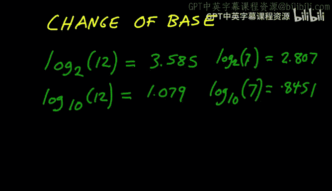

Logged to the base 2 of 12， we can use our pocket calculator or our Excel spreadsheet or our computer。

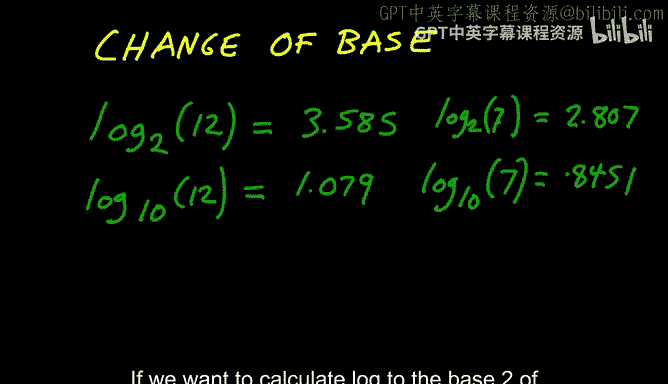

And we're going to get。

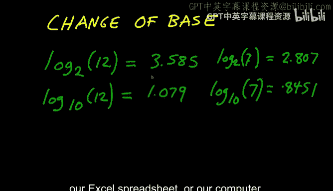

3。585。Logged to the base 10 of 12 is 1。079。 So this is a very important point to keep in mind。

 which is。

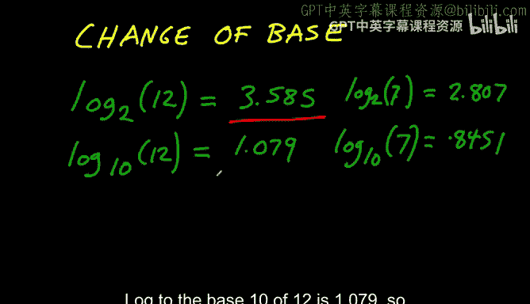

That you do not get the same answer。

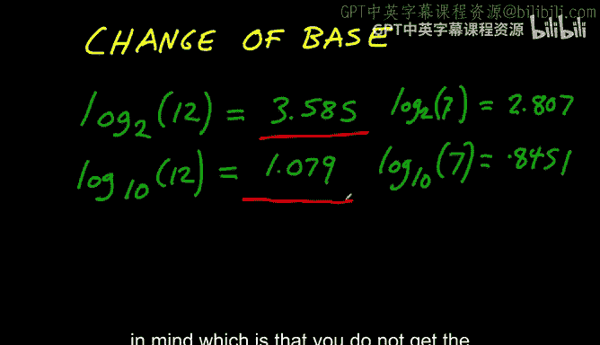

If you use a different base。

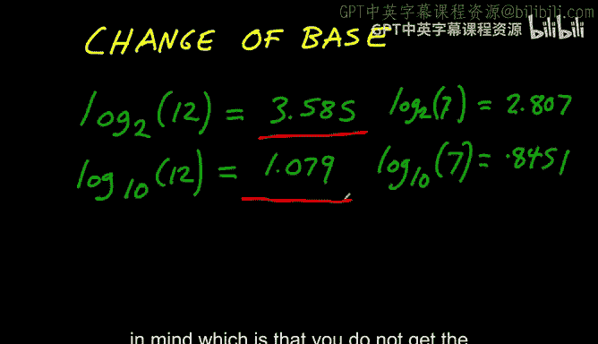

You'll notice that the base to the log 10 is quite a bit smaller。

It's roughly one third as much as logged to the base 2。

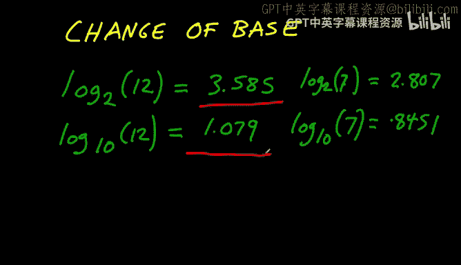

Similarly， if we have loggged to the base2 of 7， that gives us 2。807。

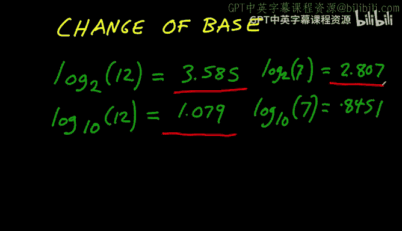

Logged to the base 10 of 7 is 。85451。 What's going on here。 Well， we have two to the。

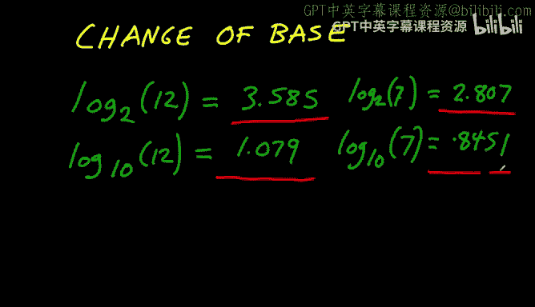

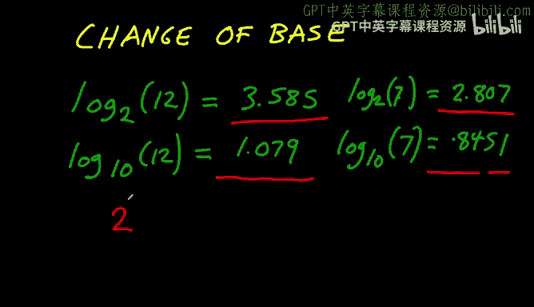

3。585 equals 12。

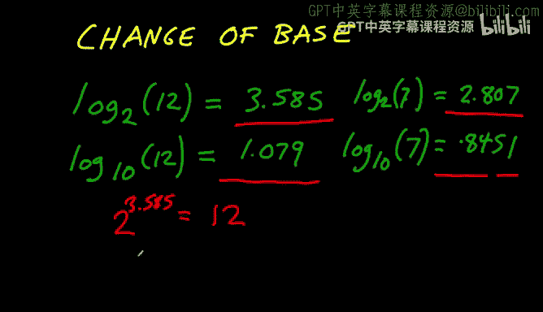

And we have 10 to the。1。079 equals 12。

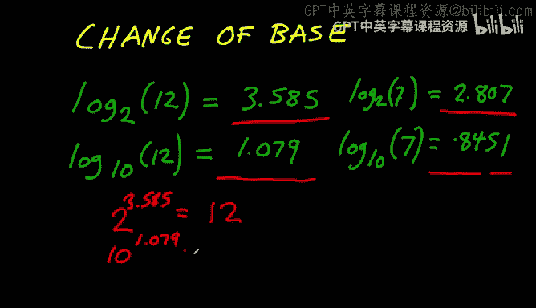

And similarly， we have。2 to the 2。807 equals 7 and 10 to the 。8451。Equals 7。If our old base is X。

And our new base is a。

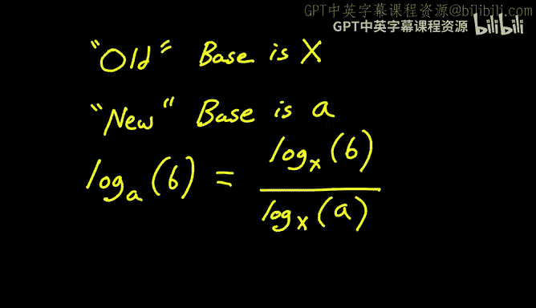

We take our original formula， which is log to the base。

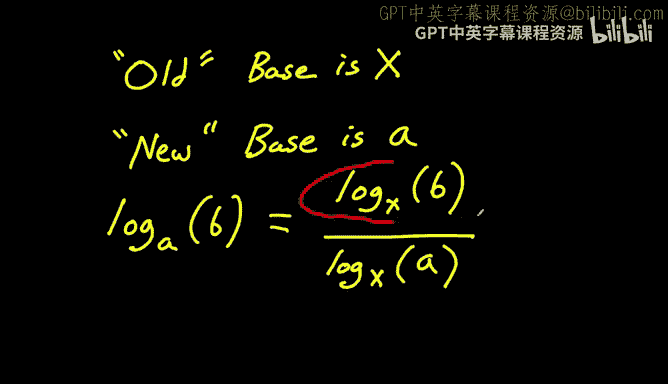

X of B。And we divide by。

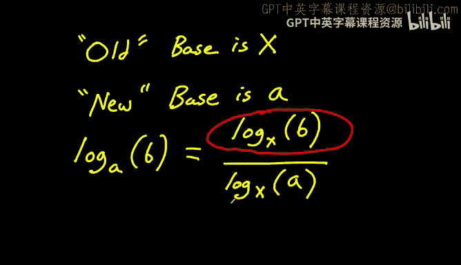

The log to the old base。Of the new base。

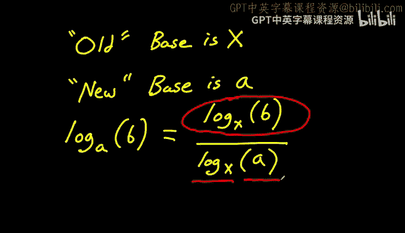

Let me work an example and show you just what I mean。

So we have logged the base 10 of 12。

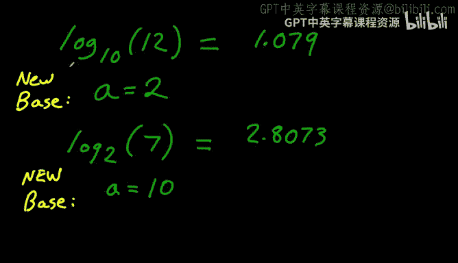

We want to convert this to。

Base 2。So， we are going to divide by。Log to the base 10 of 2。

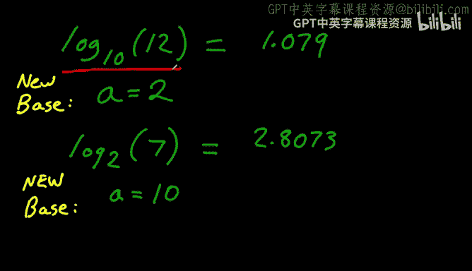

Log to the base 10 of2。

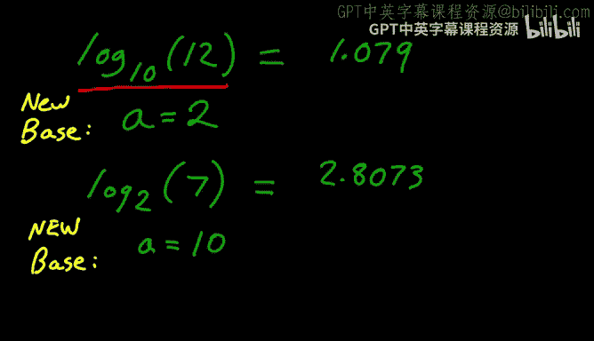

Log to the base 10 of 2。

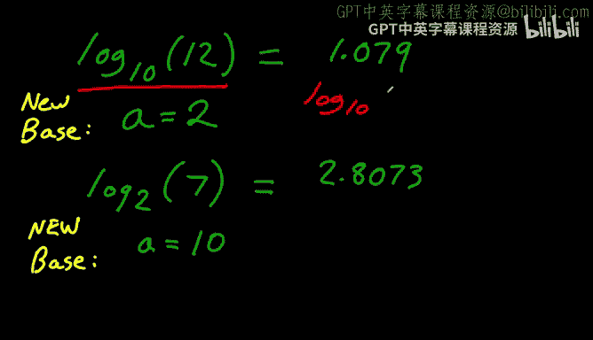

Equals 030103。

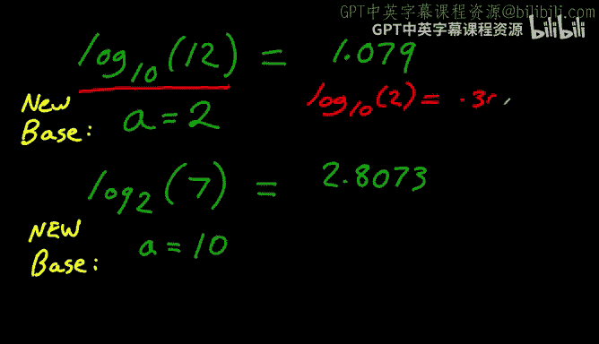

So we have 1。079 divided by 。30103。

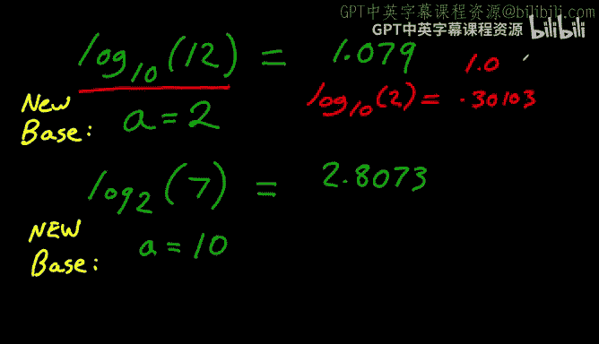

And that equals 3。5。

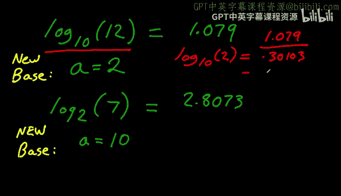

5？

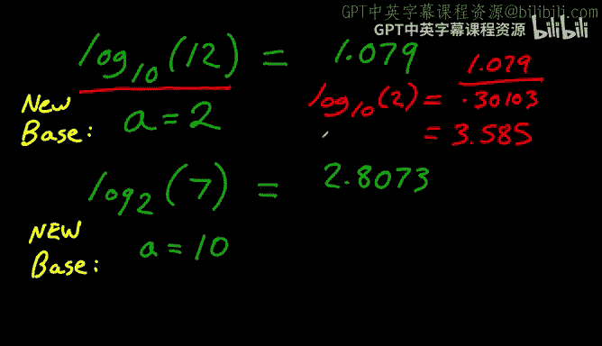

That is log。To the base 2。

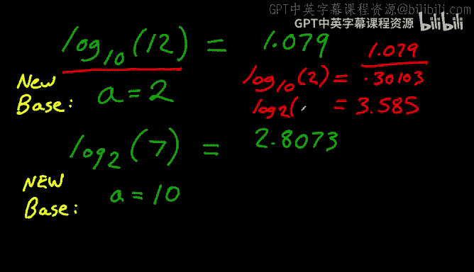

Of 12。Similarly， if I want to convert log2 of7。

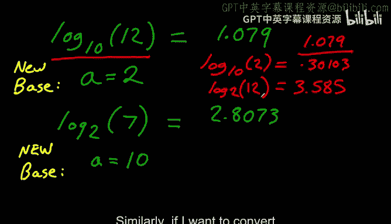

Into log 10 of 7。

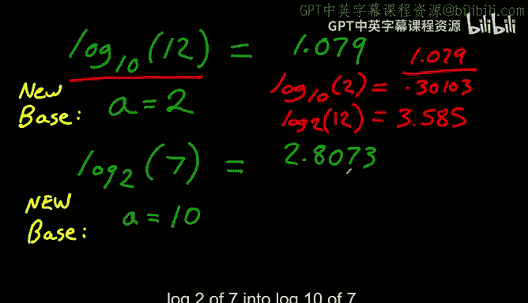

I'm going to divide by log。

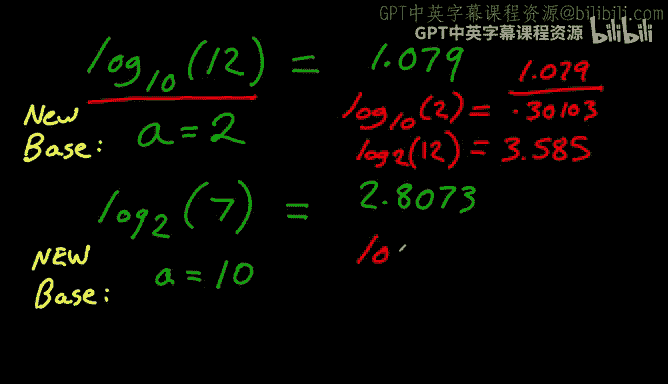

To the base 2。Of 10。Log to the base 2。Of 10。Yes。3。3219。So，2。8073 divided by。3 point。3，2，1。

9 is equal to points。F。4。To convert one base to another。Divide the original base。Bye。

The log to the original base of the new base。To get the result in the new base。

We have practice problems and the way to get familiar with this is just to work some examples。

 and it becomes more intuitive with time。