# 杜克大学《数据科学数学技能｜Data Science Math Skills》中英字幕 - P27：27_04_02_概率：定义与表示法.zh_en - GPT中英字幕课程资源 - BV12mv6BLEhC

Hello。I'm Daniel Egar。Welcome to the probability portion of data science math skillss。

I'll start by providing a definition of probability and a probability distribution。

Probability is the degree of belief in the truth or falsity of a statement。

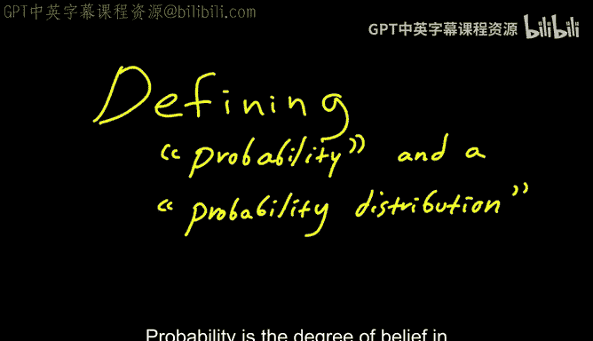

So。Whenever there is uncertainty。

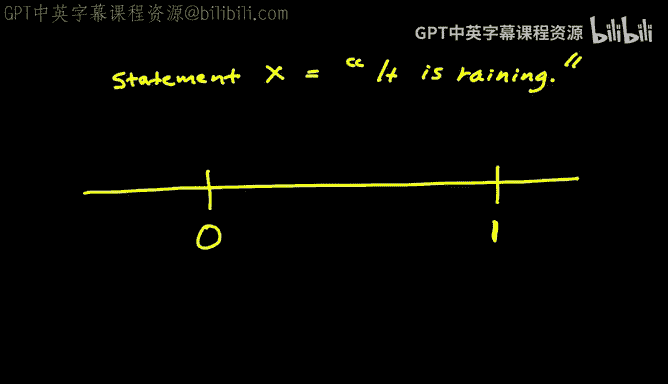

There is a value assigned to a statement that is greater than zero and less than one。

So we can define this as the range of uncertainty。When I am certain that a statement is true。

Then that statement is assigned probability 1。

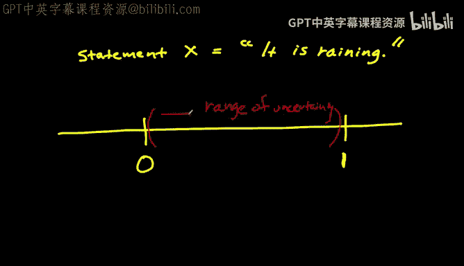

And if I'm certain the statement is false， then it's assigned probability0。

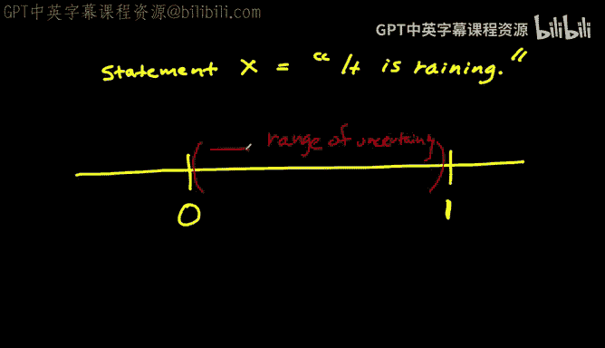

So let's say I'm sitting in my office that has no window to the outside world。

 And I don't know whether it's raining or not。 I'm going to assign some probability within this range。

 And then when I learn the true state of the weather outside。

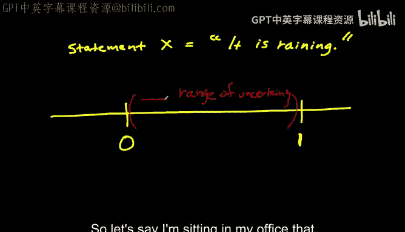

Then I'm going to either have certainty that this statement is true。So this is true with certainty。

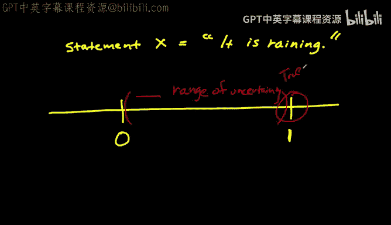

Or I am going to have certainty that the statement is false。

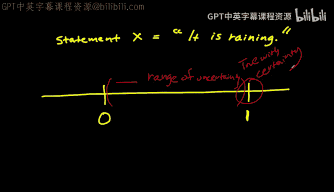

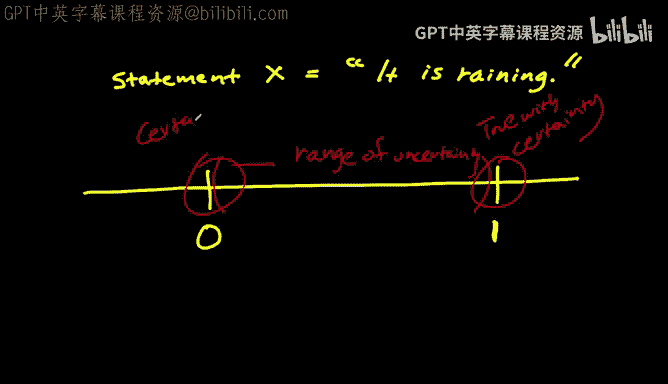

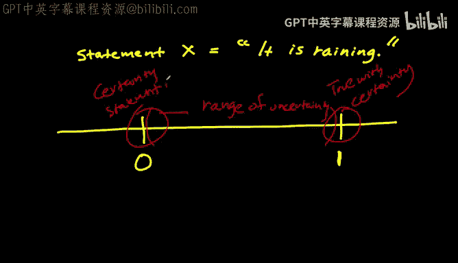

Okay。

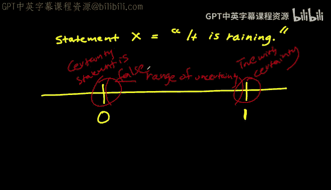

The notation that we use is we write p of x， meaning the probability of the statement X or the probability of the outcome represented by the statement X。

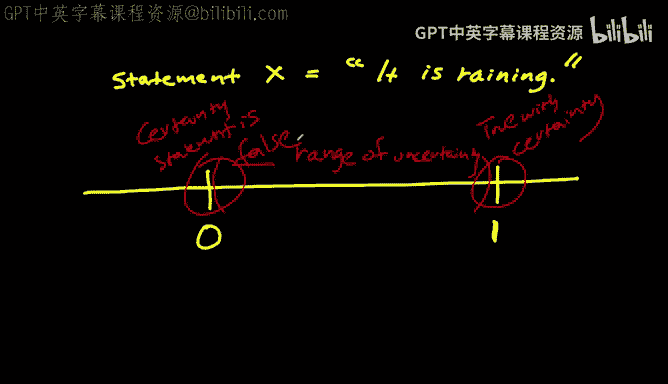

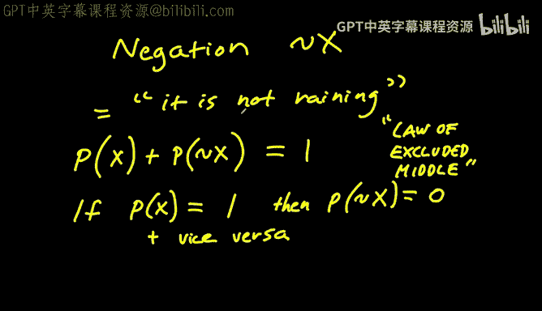

We also use the tilda。To indicate the negation of a statement。

And whenever we have a statement and its negation， we have a simple binary probability distribution。

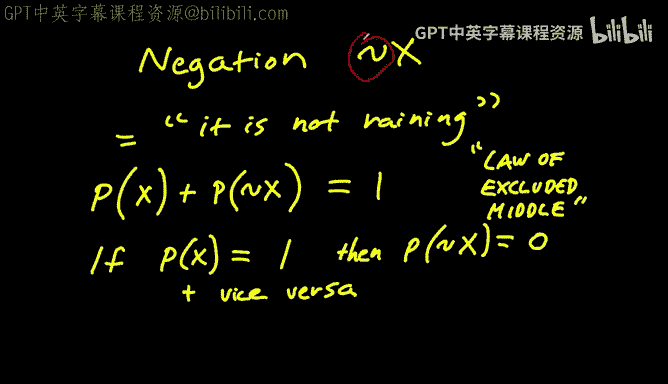

In other words， anytime we have a statement like it is raining。

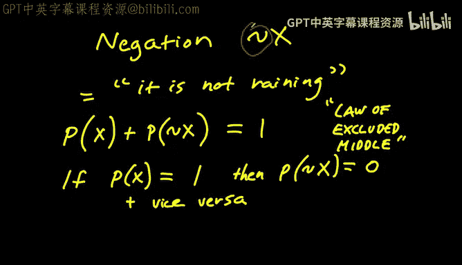

And the negation to that statement， it is not raining。

 those statements together will form a probability distribution。

One of those statements must be true when we have complete information about the situation。

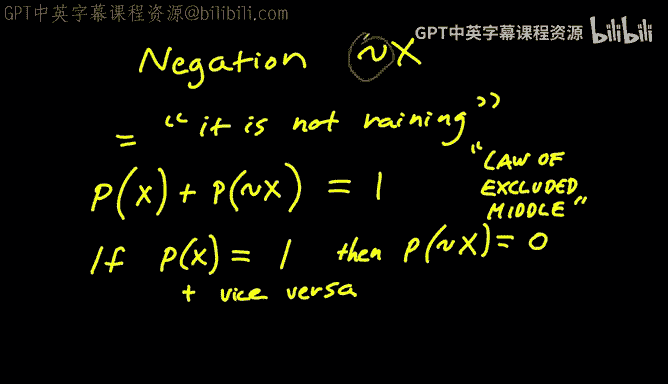

Note also that。Even before we have complete information about a situation。

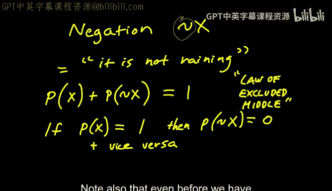

The probabilities for those two statements must still sum to one。 So， for example。

 if I think there is a。

3 out of four chance， a 75 per cent chance that it's raining outside right now。

Then I must think that there's a one in four or 25% cent chance that it is not raining outside right now。

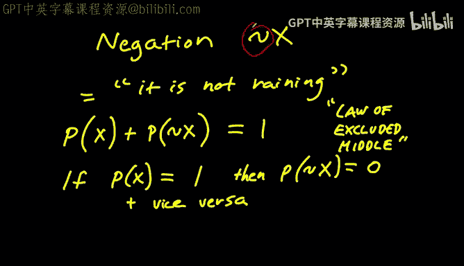

はい。This principle is known as the law of the excluded middle。

And this illustrates the basic rule of probability distributions。

 which is that all of the outcomes that make up a distribution must have probabilities that sum to one。

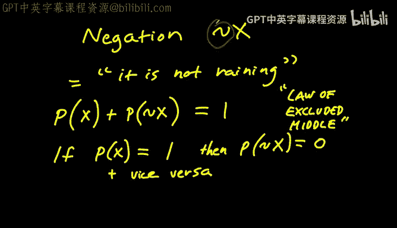

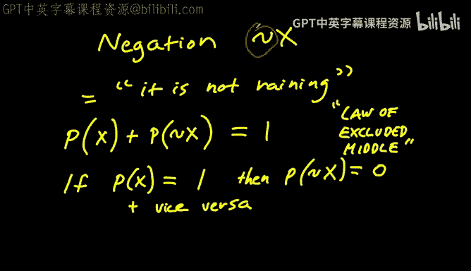

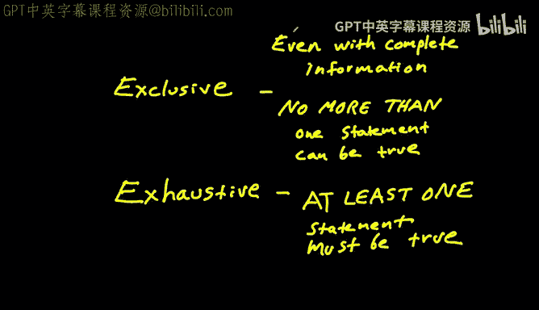

In fact， what defines a probability distribution？

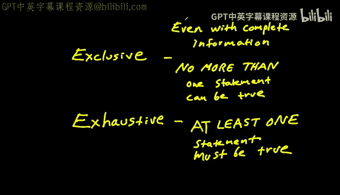

It is a collection of statements。

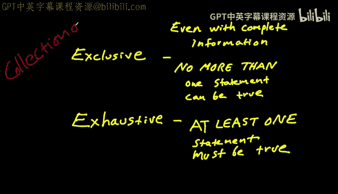

Two or more。

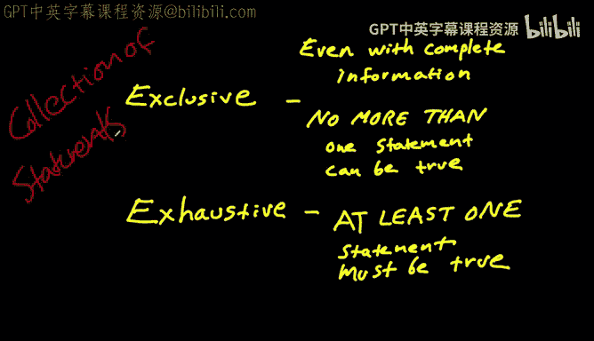

Where those statements are exclusive and exhaustive。Exclusive means that given complete information。

 no more than one of the statements can be true。

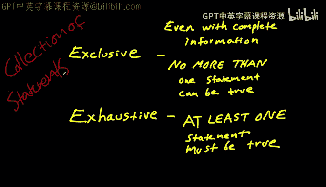

So it should be obvious that if we have the statements， it is raining and it is not raining。

 only one of those statements can be true at a time。

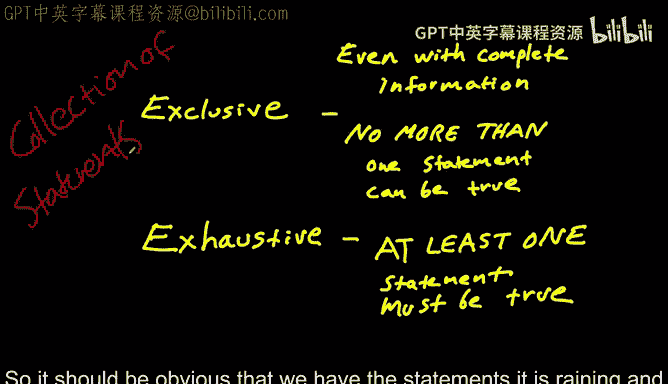

In addition， the statements that make up a probability distribution must be exhaustive。

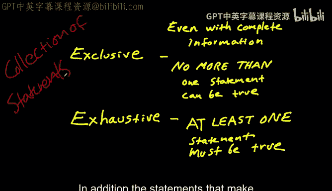

And that means that at least one of the statements must be true。

When we have complete information。

So I'm sitting inside， I don't know whether it's raining or not。

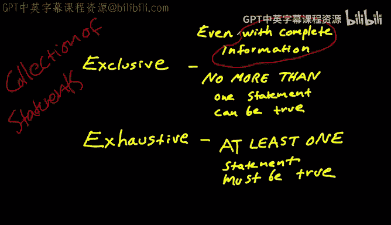

嗯。I assign a degree of probability that reflects uncertainty to both the statement it is raining and the statement it is not raining。

 But when my information is complete， exactly one of those statements must be true。

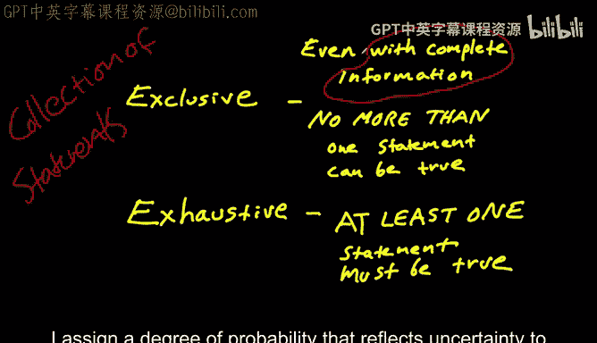

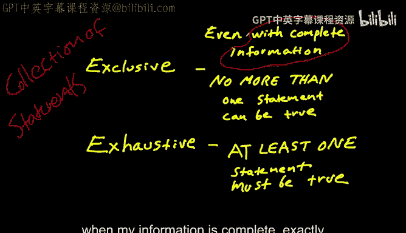

Now it's often the case that we have more than two statements that form a probability distribution。

 These statements are exclusive and exhaustive。And in many situations。

 we have a large number of statements， and we have no real basis to choose one outcome as more probable than another。

 So， for example， we might have a deck of 52 cards。 In that case， n is equal to 52。And I'm wondering。

 what is the probability that I might draw an ace。And let's say what is the probability that I would draw an ace of spades from a well shuffled deck of 52 cards？

There is nothing special about the Ace of spades so far as I know。

We assume the deck is well shuffled。 So under the principle of indifference。

 the probability that I would assign。Would be 1，50 seconds， one over 52。

It follows from the principle of indifference that we can calculate many。

 many probabilities as follows。

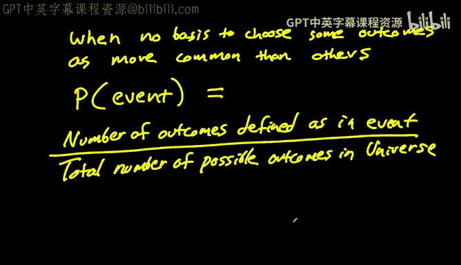

The probability of a certain event。An event being a collection of individual outcomes。

Is defined as the number of outcomes that are。

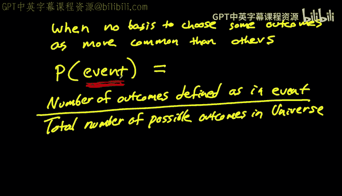

In the event。

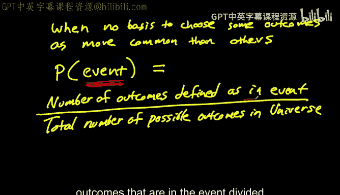

Divided by the total possible number， the total number of possible outcomes in the universe。

 So in our deck of cards example， we might say that our event is drawing a queen。

 And there are four queens in the deck of 52 cards。 So we have four outcomes， Queen of hearts。

 Queen of diamonds， Queen of spades， Queen of clubs。

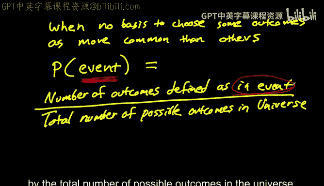

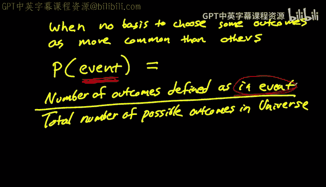

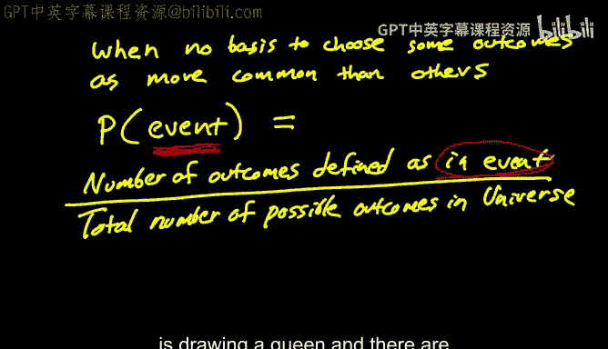

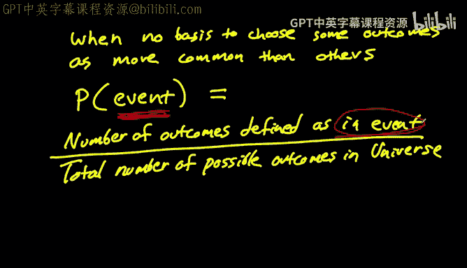

That。Are within the definition of the event。

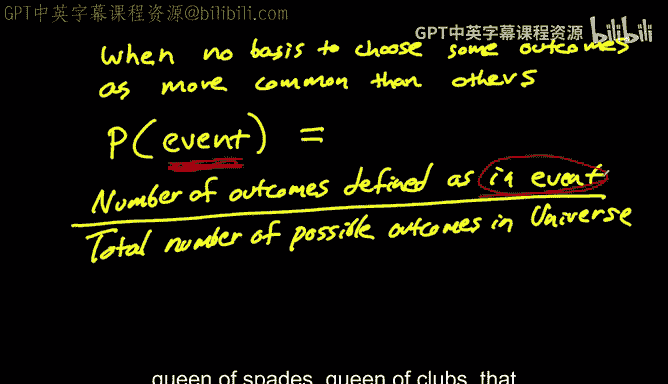

And we have a total number of outcomes that's equal to the number of cards。

 And so our probability of drawing a queen。Would be one in 13。Let me give you another example。

 what is the probability that a six sided die will come up even？The event。Is。

Even so we look for the outcomes that meet the definition of even， and they are2，4， and 6。

 There are three of those outcomes， and the universe of possible outcomes contains six outcomes。

 and so the probability that a die comes up even is three over6 or one half。And this simple。

Concept allows us to solve a very large number of probability problems。

