# 杜克大学《数据科学数学技能｜Data Science Math Skills》中英字幕 - P28：28_04_03_联合概率.zh_en - GPT中英字幕课程资源 - BV12mv6BLEhC

Next， we're going to talk about joint probabilities。

 Joint probabilities are the probabilities that two separate events from two separate probability distributions are both true。

So we're looking at the probability that a is true and B is true。

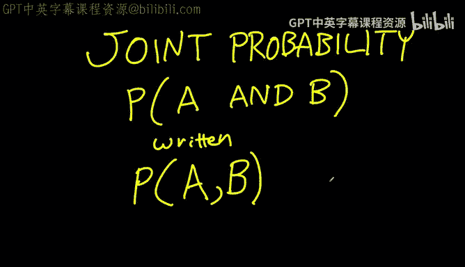

And our notation allows us to abbreviate this， simply placing both capital letters together with a comma between them。

 This is read as the joint probability of A and B， or。

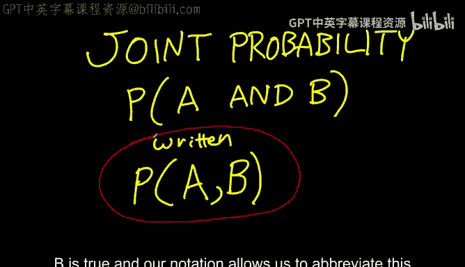

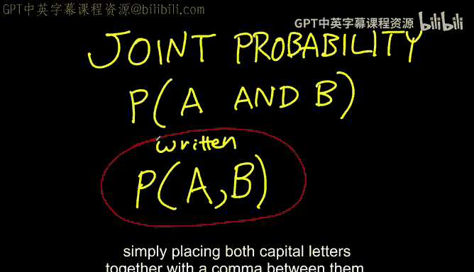

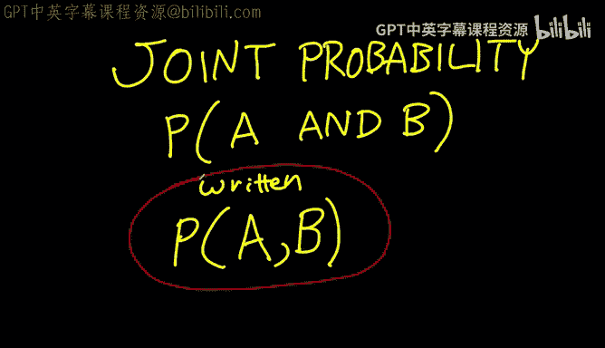

The probability that A is true and B is true。

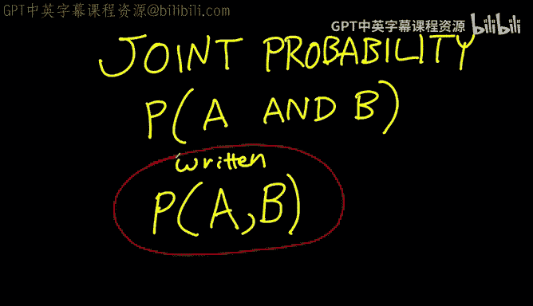

An important point here to note is that the ordering does not matter in joint probabilities。

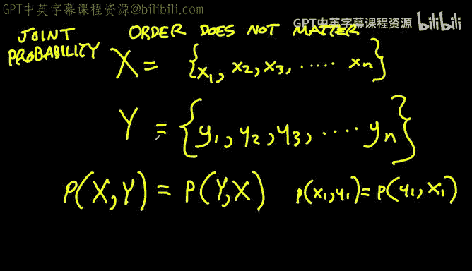

So also I want to point out that our standard notation for probability uses capital letters to refer to the entire probability distribution。

 that's the entire collection of exclusive and exhaustive statements。

 and we use lower case letters to refer to the individual statements。

 and we can reference an individual probability the same way。

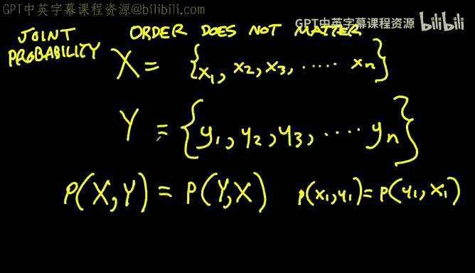

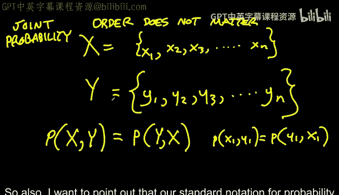

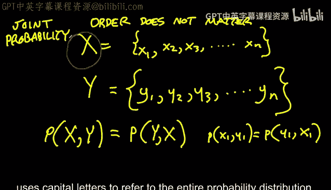

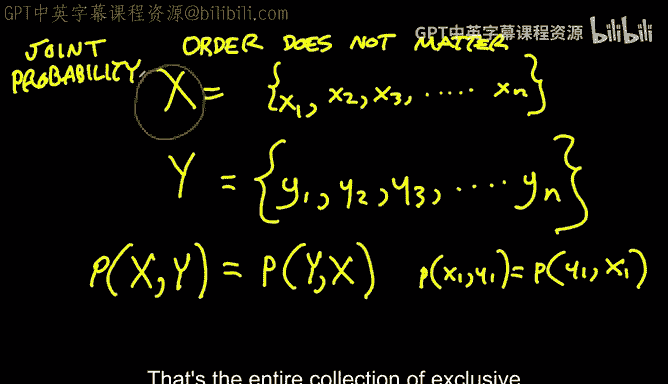

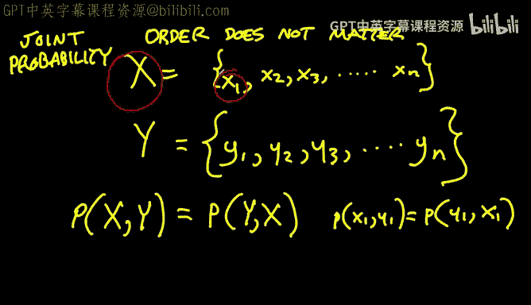

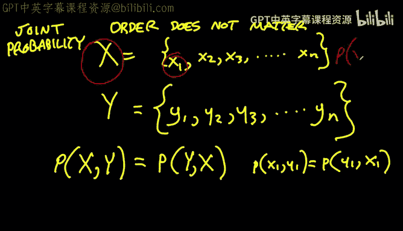

Okay。So。What we've written here。

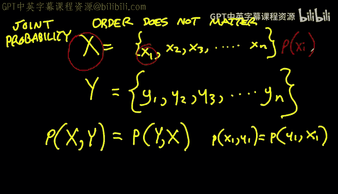

Suggests that the joint。Probabilities。Are equal。For regardless of which order we write the terms or which order we consider the probability distributions。

And the same is true of each individual probability within。The distribution。

 So the probability of x1 and y1 occurring together is the same as the probability of y1 and x1 occurring together。

This may perhaps seem obvious to you， but it turns out to be a very， very useful principle as well。

Now we're going to talk about the definition of the independence of two probability distributions。

If two probability distributions are independent。Knowing the outcome of one does not affect our belief in the truth of the other。

Therefore， knowing the outcome of one does not change the probability of the other。

When two probabilities are independent， you can think of them as being unrelated and unconnected。

I'm tossing a coin。 It has a 50% probability of coming up heads， and I'm rolling a die。

 and it has a 50 per excuse me。 And it has a one in6 probability of coming up as a three。

The joint probability heads。

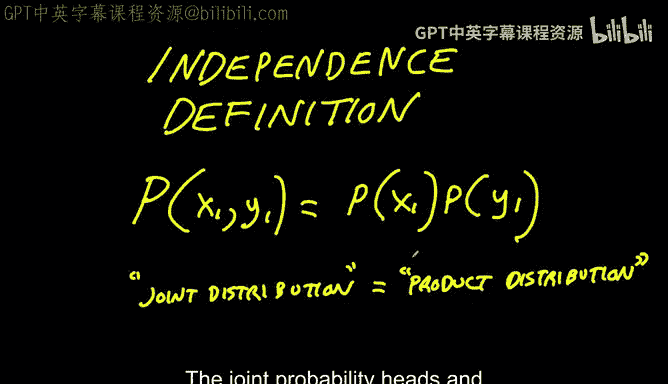

And3。

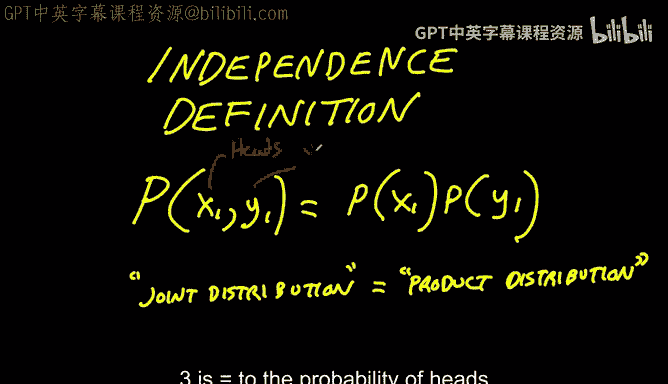

Is equal to the probability of heads， which is one half。

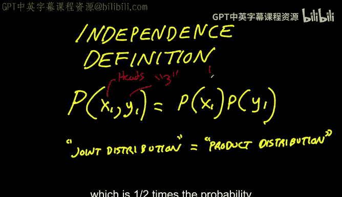

Times， the probability of coming up。

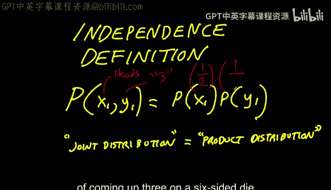

Three on a six sided die is 16， and that equals 1，12。

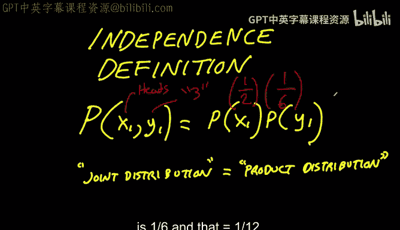

So。For probability problems involving independent distributions。

 this is the formula to calculate the probability that both events happen at the same time。

We have a special name for。The product of the two probabilities that is known as the product distribution。

so when the joint distribution equals the product distribution。

 the two probability distributions are by definition independent。We often use Venn diagrams。

 These are diagrams that show the intersection and union of sets。

To illustrate the intersection of two sets of events。

And get develop some intuition about what it means to say that both the probability that both events occur。

 So， for example， if we have the probability of。

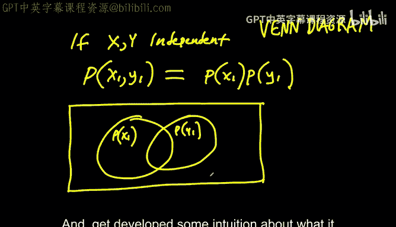

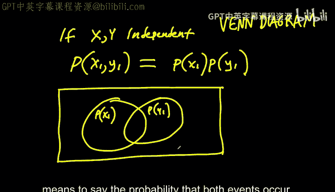

Flipping a coin， and it comes up heads。 And the probability of tossing a die。 and it comes up 3。

 Okay， we can represent。

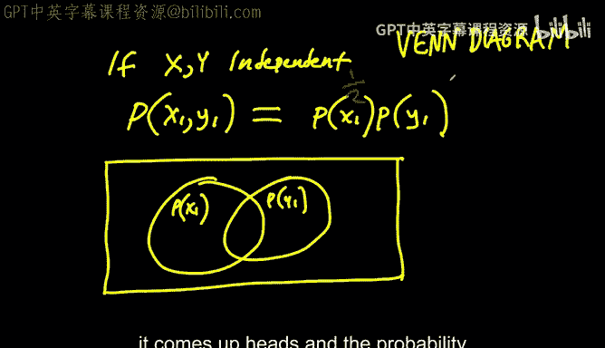

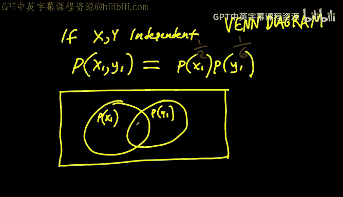

This area as the product of the two。

Okay。

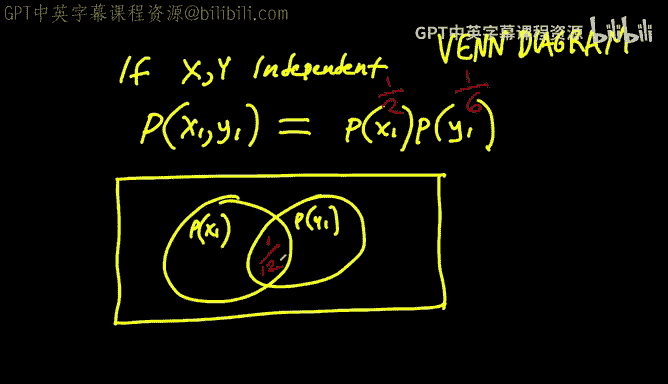

You can think of this outer area as the universe of all possible outcomes。

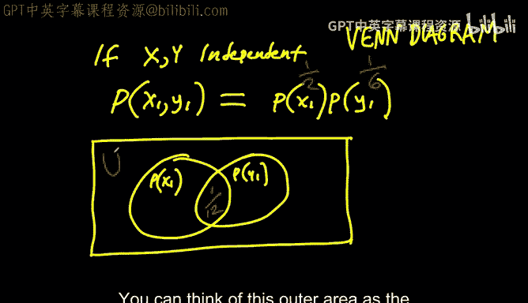

Okay。And this gives us the probability that both of the events that we've defined as relevant occur at the same time。

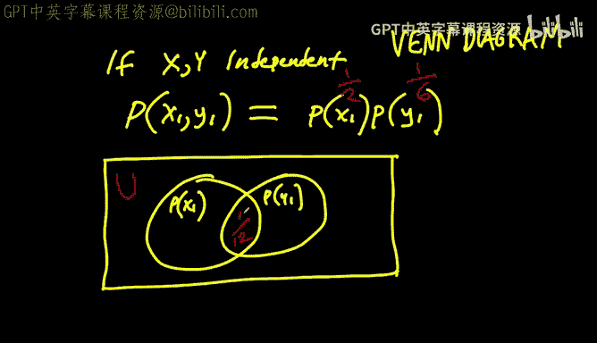

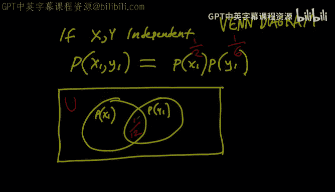

Perhaps the Venn diagram is even more useful in capturing the concept of or probability。

 What is the probability that our coin comes up heads。

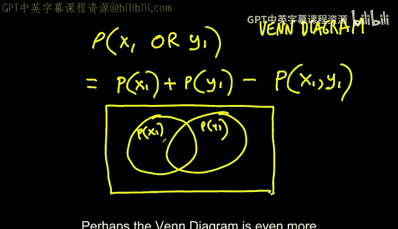

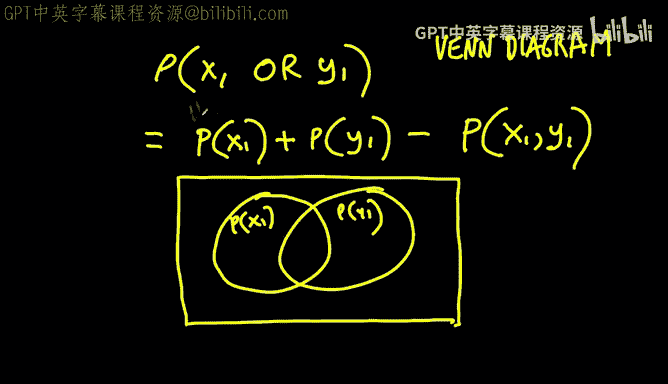

Or。

Now， interestingly， it is written with a plus sign。But in probability。

 what we're doing is we're looking at。

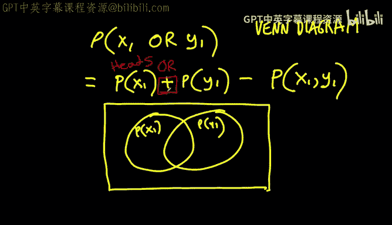

The probability that either one event occurs or the other occurs or both occur。

So we're interested in the probability that the coin comes up heads or the die comes up three。

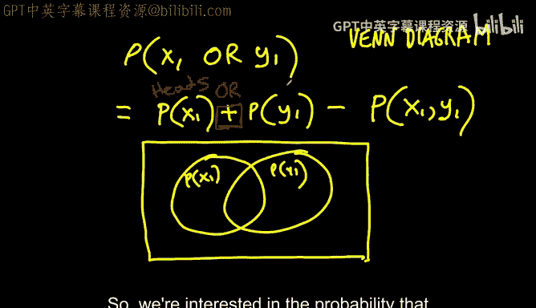

Okay。

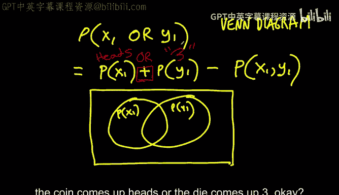

Well， if we simply added the two circles together， we'd count the central area twice。

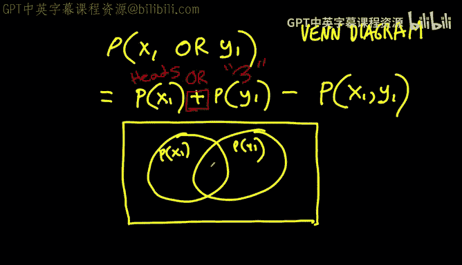

So to avoid that， we subtract the central area from the sum of the two circles。

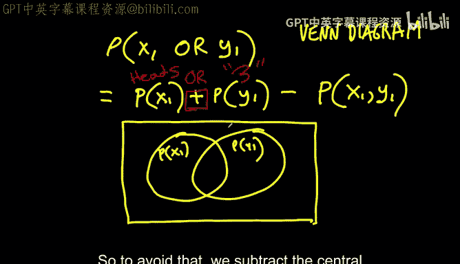

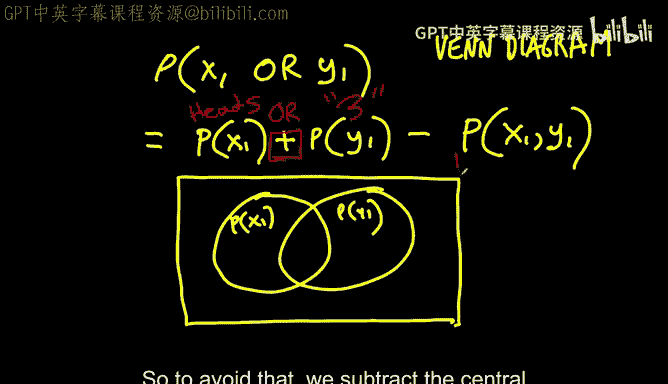

So we are subtracting。The joint probability， which， as we know。

 is equal to the product probability 1，12。

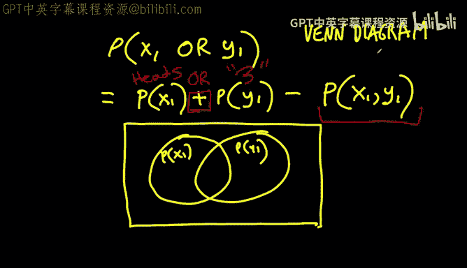

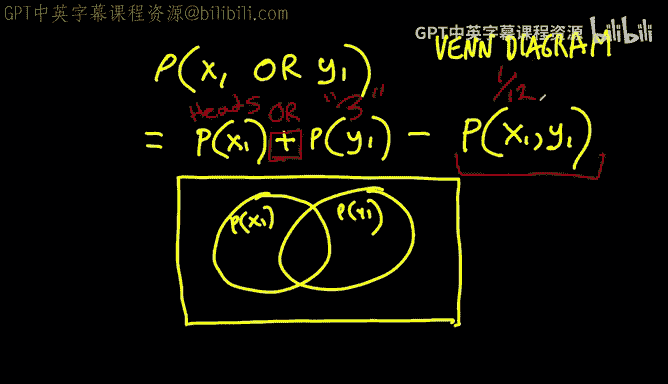

So the probability that either the coin comes up heads or the die comes up three would be one half。

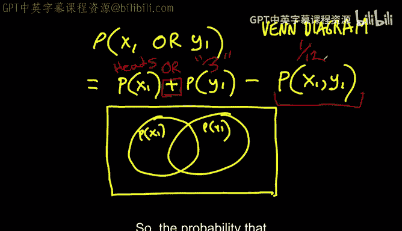

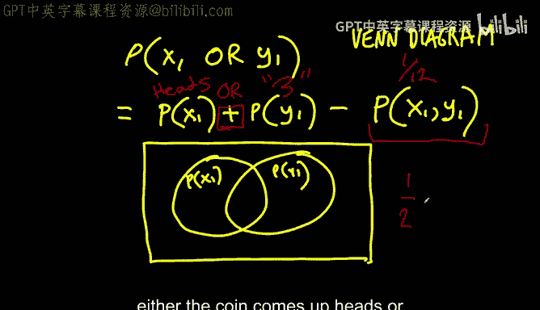

Plus， one6。-1，12。

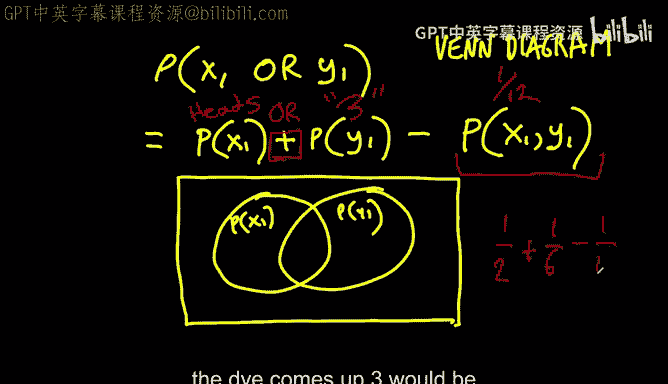

4。6，12。Plus 2，12。-1，12。Equals。7even。12th。