# 杜克大学《数据科学数学技能｜Data Science Math Skills》中英字幕 - P29：29_04_02_排列与组合.zh_en - GPT中英字幕课程资源 - BV12mv6BLEhC

Now， we're going to talk about。How probabilities can be thought of as。

The probability of certain events occurring in a certain order。

Or the probability of a certain group of events occurring。So for example。

 I might have five people working for me and I have five different assignments。

And I need to place those people in those five different assignments。I can place the first person in。

Any one of the assignments？So I have five people。

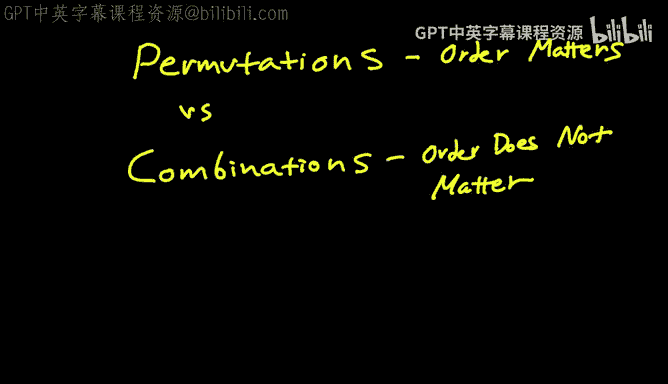

And I have five assignments。

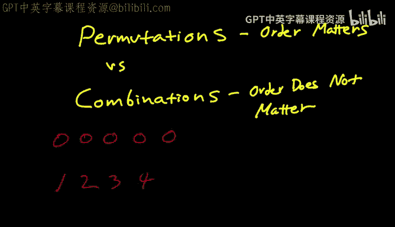

I can place the first person in five places。

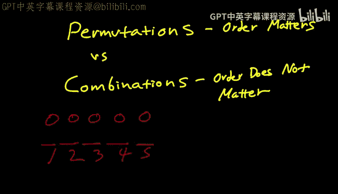

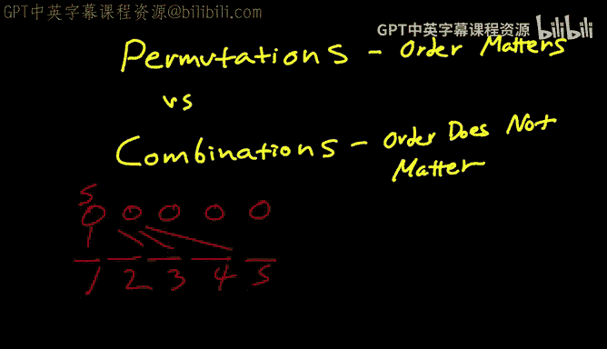

Now one square is occupied so I can place the second person in four places。

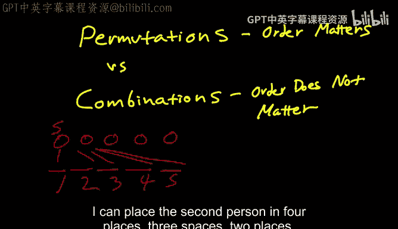

Three spaces， two places。 And now there's only one possible place to place the last person。

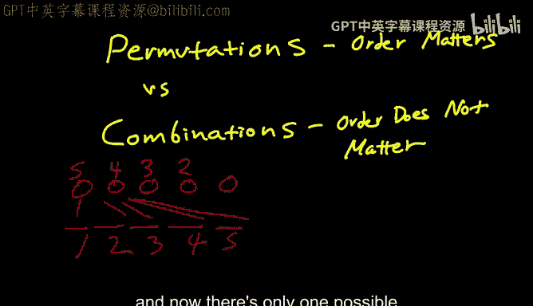

Okay。

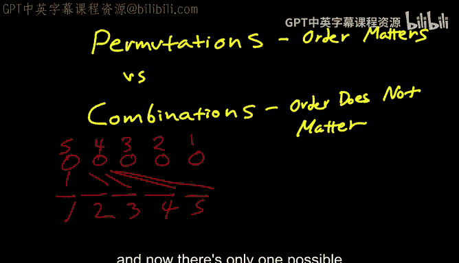

So you see that there are 120 possible ways that I could put five people in five different jobs。

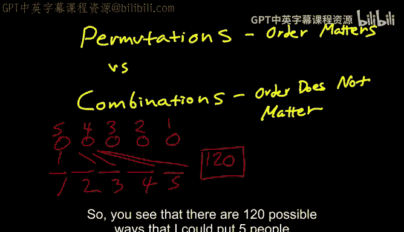

Here， the order of the assignment matters， so this is known as a permutation。

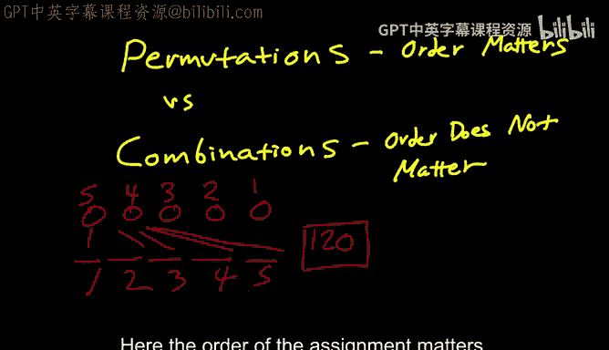

Okay。

But let's say that I had five people， and I wanted to form it a team of five people who are all equal。

 There's no ordering。 There's no specific role assigned to each person。 Well。

 now there's really only one combination possible。 I just need to assign my five people to the team。

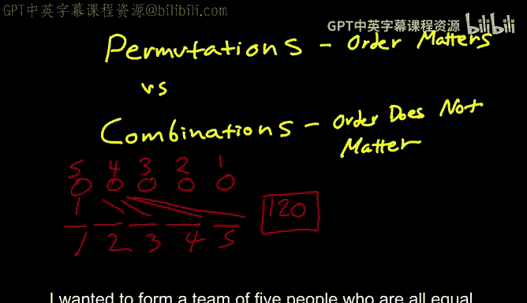

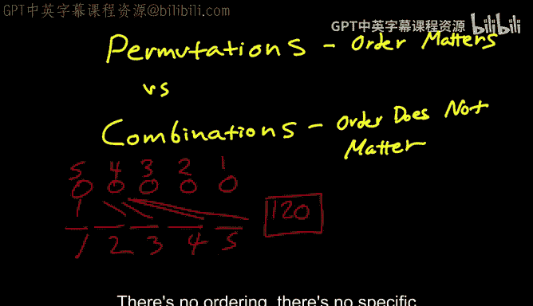

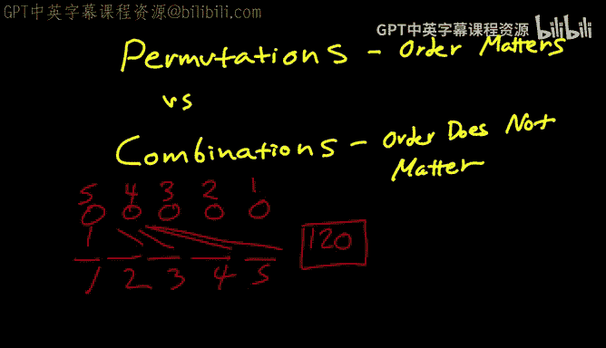

When order doesn't matter。

There are always fewer possibilities。

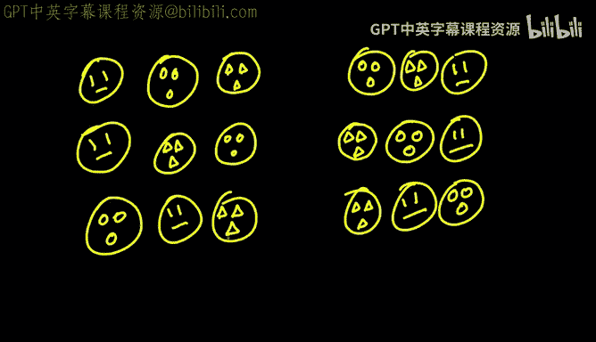

Because multiple orderings of the same committee。

Are accounted as one combination。Here we have six orderings of three distinct objects。

So that would be6，1，2，3，4，5， six permutations。

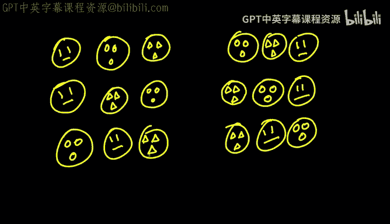

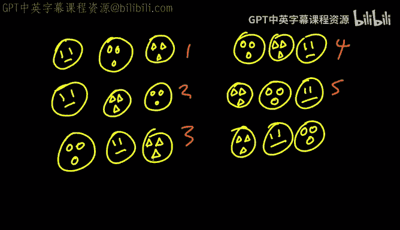

But the members of the group are constant。 And so there's only one。

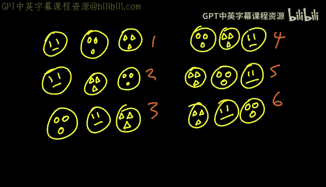

Combination。Let's imagine a lottery。Starting with a bowl that has six different balls in it。

 each labeled。 so they're labeled 1，2，3，4，5， and 6。And we're going to draw four balls， one at a time。

To identify the winning number for the lottery。There are two ways you can think about the rules to this lottery。

 either the order of the numbers matters or it does not。If the order matters。

 then we're talking about the number of。Permutations。The way four positions。

1 through four can be filled。By drawing from six unique objects。 So the first ball could be any of 1。

2，3，4，5，6。And having drawn。Those6， there are  five left。

 so we have any of five to go in the next place。And that leaves 4 to go in the next place。

And that leaves three that could go in the last place。

So our total number of permutations would be6 times 5 times 4 times 3， which is equal to 360。

If you need to predict the order to win the lottery。

Then a fair bet would pay 360 to one or $360 on a $1 wager。The number of permutations。

Has a general formula that can be written。N factorial， divided by n minus M。Factorial。

Where the exclamation mark stands for factorial。And n is the number of unique objects。

 so n is equal to sex。And M is the number of unique attributes。

 or here the orderings from first to fourth。🤢，So， M would be equal to。4。

And minus M would be equal to 2， so we would have six factorial over2 factorial。Which， of course。

 is equal to6 times 5 times 4 times 3 or 360。On the other hand。If in order to win the lottery。啊。

It doesn't matter what order we select the balls， we simply have to select the four correct numbers。

🤢，Now we are talking about combinations。So let's imagine that I reach in here and I draw out the four。

The two。The three and the five。Okay。4。To。3。And5。Now。

 let's suppose that I only need to guess the correct four numbers， but not their ordering。

In this case， I am going to divide 360 by 24。To get。15 possible combinations of four balls。

And now to win a lottery based on combinations。I would only receive $15 on a $1 wager if the lottery were fair。

 because now I have a  one in 15 chance of guessing the four numbers correctly。Why 15。

 because there are 24 different ways that。4 balls can be ordered， so we need to divide 360。By 24。

And 360 divided by 24 is equal to 15。Y 24。Well， I've written them out here for you。Because。

The first number。Second number。Third number and the fourth number can be first。

Then we have three numbers that could be in second place。And then for each of those combinations。

 we have two remaining， so we have。4。Times 3 times 2。Or 24 possibilities。

The formula that gives the general answer 15。Can be expressed as n factorial。

Divided by n minus M factorial。Times M factorial。And this formula has a special name。

It's called N choose M。And here， we are showing。The value N choose M for equals 6， and M equals 4。

 It's 360。Divided by 24。Which is equal to 15。Now， let's consider another example。

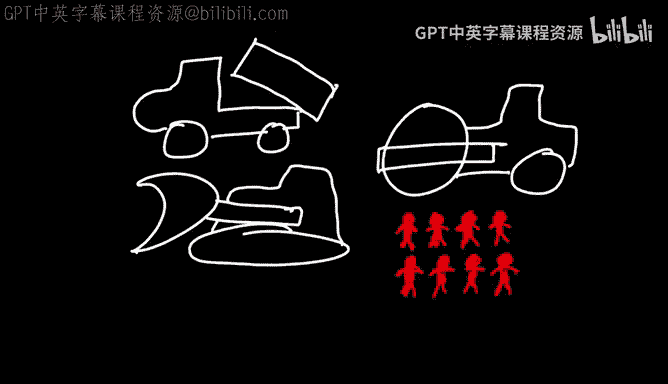

I need to send a dump truck， a bulldozer。

An a steam roller to a construction project， and I have eight potential drivers。

 each of whom is qualified to drive all three machines。

If I care about exactly which driver operates， which machine。

Then I could have any of eight drivers。Drive the first vehicle，7。

 drive the second vehicle and 6 drive the third vehicle。

 So I have 8 times 7 times 6 is equal to 336 unique ways that I could send out teams to drive the three machines。

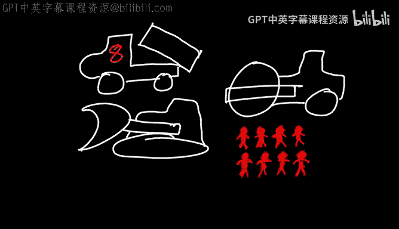

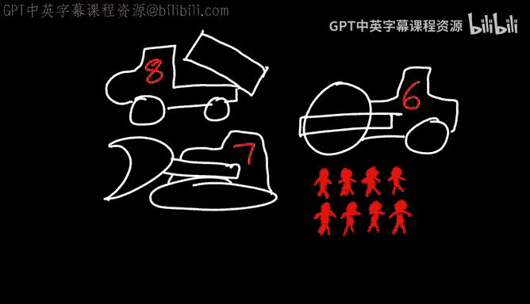

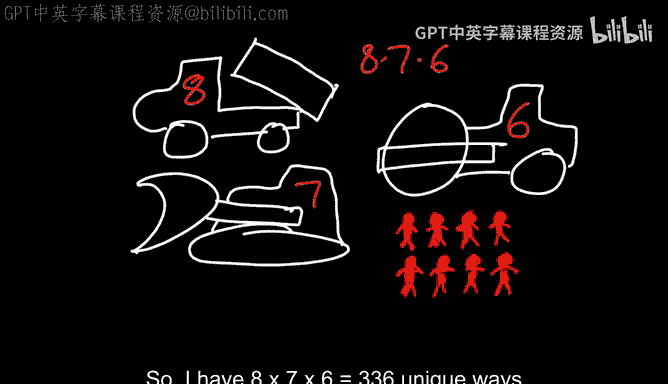

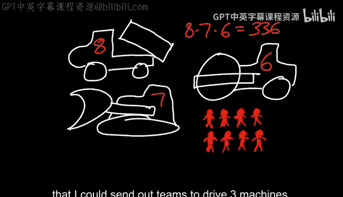

So here， the general formula is for permutations， which is n factorial divided by n minus M factorial。

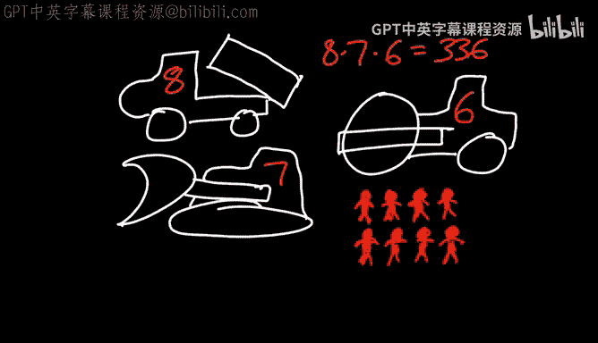

N is equal to 8。

And M is equal to。

3。So， we have8 factorial。

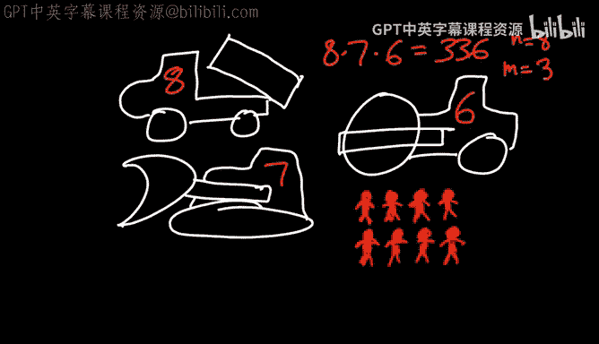

Divided by 8 minus3。

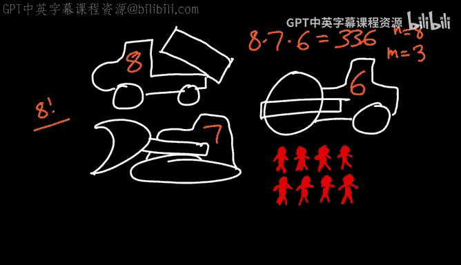

Factctorial， which is 5 factorial。 And that would give us 8 times 7 times 6。

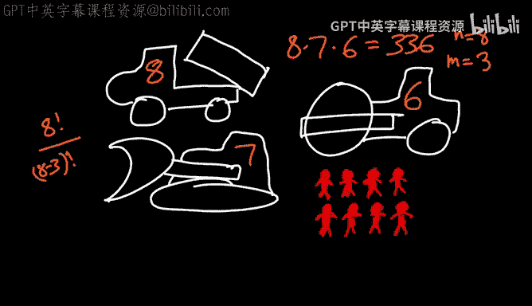

Right。

On the other hand。If it doesn't matter which driver drives which machine。

 I just want to know how many distinct teams of three drivers I might send to the construction site with my vehicles In that case。

 I use the formula for the number of combinations。

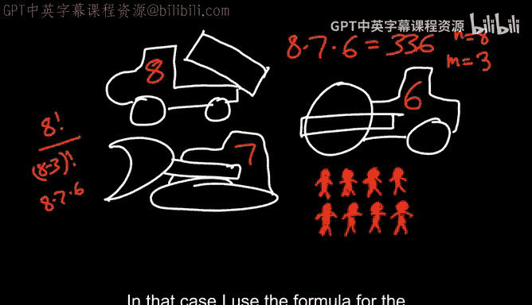

Which would be。

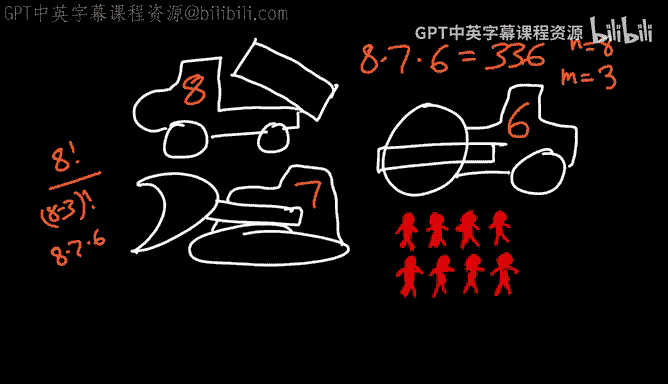

N factorial divided by n minus M factorial times M factorial。

Or 8， choose 3， which would be。

8 factorial divided by5 factorial times3 factorial。

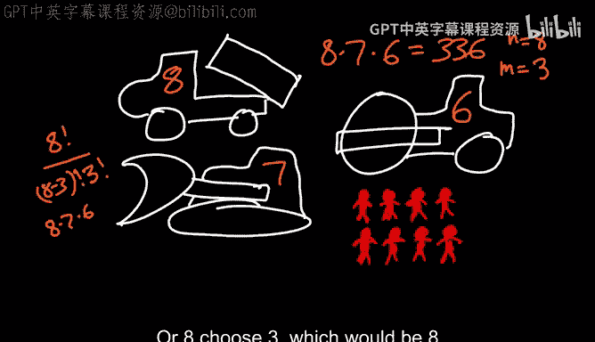

So I'm going to divide my previous answer by six。

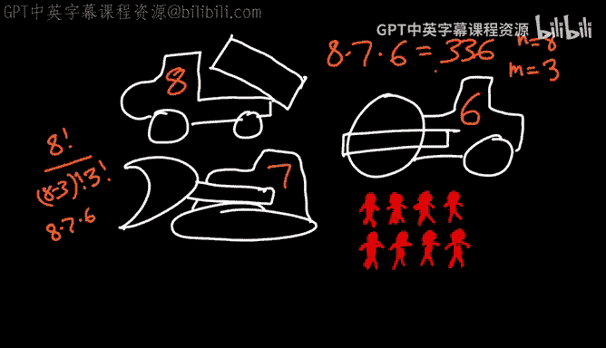

And now I am going to get 56。Possible teams that I could send。

 And that is the difference between combinations and permutation。

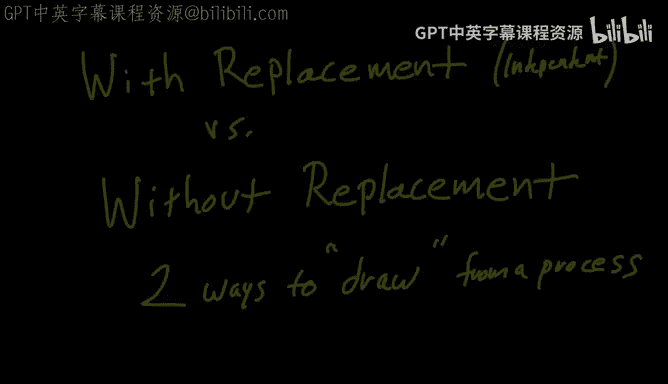

Next， we need to consider the concept of with replacement and without replacement when we're。

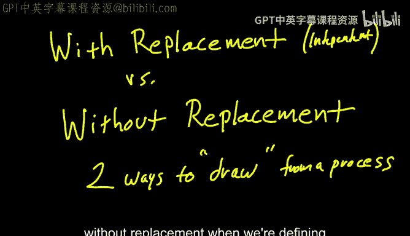

Defining the probability of a certain situation。

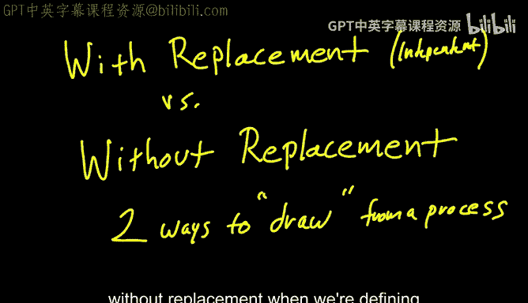

When we draw a card from a deck of cards， say in a poker hand。

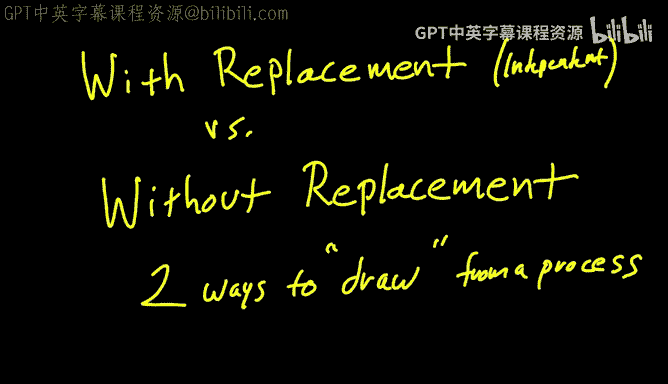

That card is removed from the deck， and there's no longer any possibility of getting that card again until we have a new hand and a new situation。

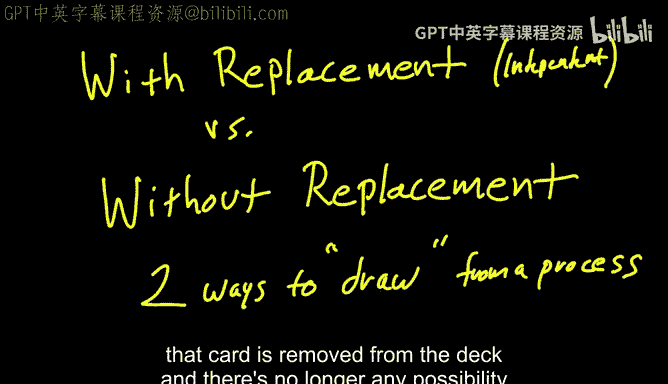

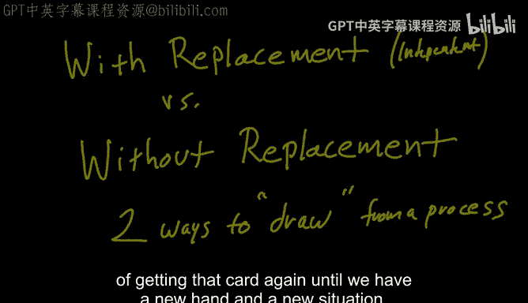

So for example， if I draw an ace on my first card， I would have a one in 13 chance of doing that。

And my。Probability of drawing an ace on the second card would be different。

 There are now three aces left in the deck out of 51 cards。

 And so my probability of drawing an ace on the second card would be 3 divided by 51。

Okay so any type of situation where we're removing things from the realm of possibility is without replacement。

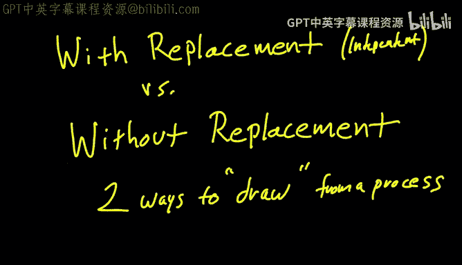

Okay，On the other hand， if I ask if I'm trying to predict or。

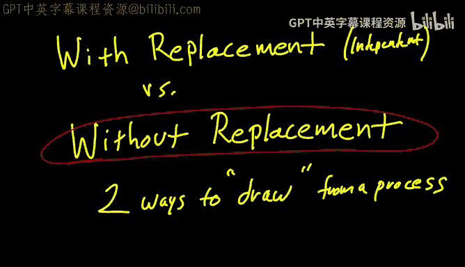

Gues a number between 000 and 999。 it's certainly allowed to use each of the digits 0 through 9。

More than once， you can use each one two or three times。

 and so there we're generating a number and the digits are being used。With replacement。

So between the concept of permutation and combination and the concept of width replacement and without replacement。

We have almost all probability situations that are likely to arise in a basic probability course。

