# 杜克大学《数据科学数学技能｜Data Science Math Skills》中英字幕 - P30：30_04_03_阶乘与组合数C(m,n)的应用.zh_en - GPT中英字幕课程资源 - BV12mv6BLEhC

Let's talk a little bit about urns。Everyone who teaches probability is always talking about urns。

 An urn is a container， and you can't see into that container。

 And there are usually two different colors of marbles， although sometimes there are。

 there are more colors。And the idea is that you're drawing marbles out of the container。

There are two basic ways that we can draw marbles out of this container。 We can draw them。

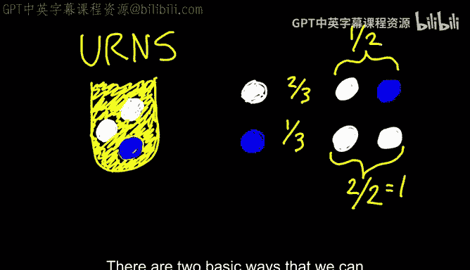

With replacement or without replacement。

If we draw them with replacement， then we have a two third probability of drawing a white marble and a one third probability of drawing a blue marble。

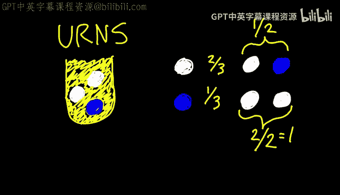

each time we draw and the draws are independent。

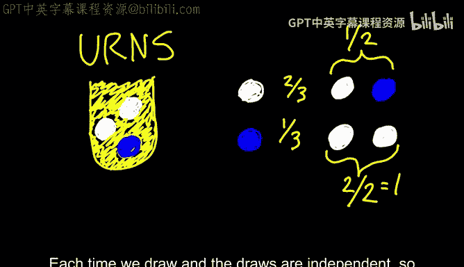

So our probability of drawing a white marble。

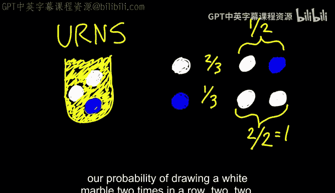

Two times in a row。2。

2 white in a row。

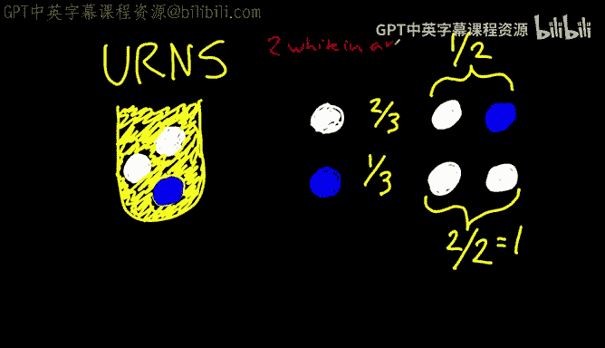

Would be two third。Times， two thirds。

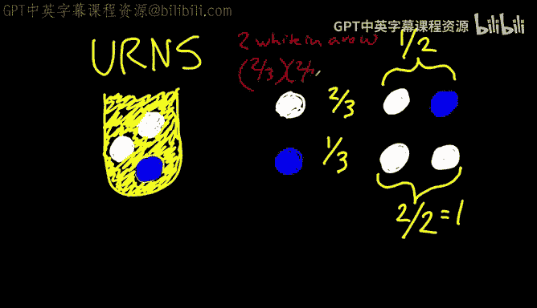

Would be for nights。On the other hand。

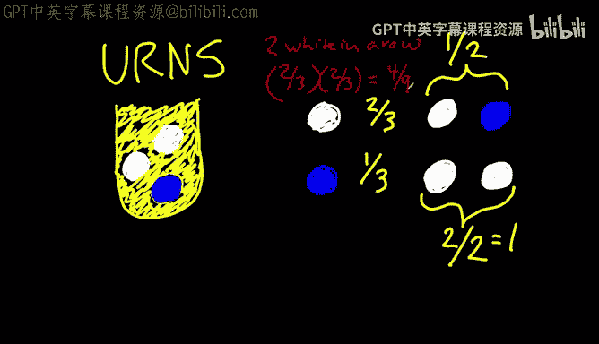

If I am drawing without replacement。

Then on my first draw。I may draw a white marble。

In which case I have， which I have a two third probability of doing。

In which， which case， my probability of drawing a white marble on the second draw is one half。

Or。I could draw a blue marble on the first draw， in which case there's no chance of drawing two white marbles in a row。

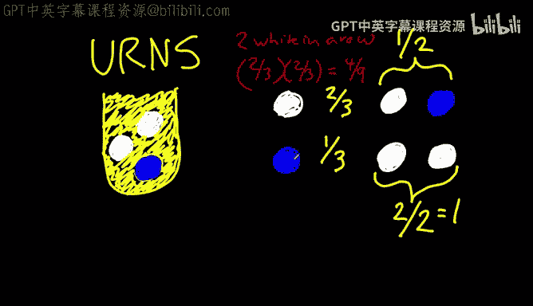

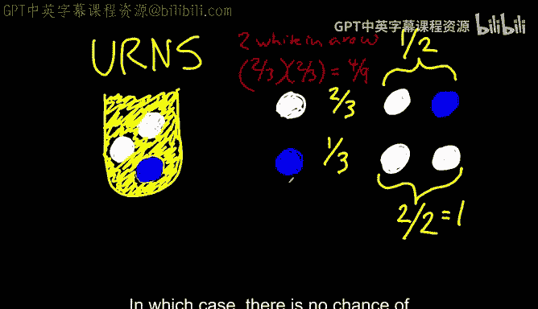

Okay。So my probability of drawing two white marbles in a row without replacement。

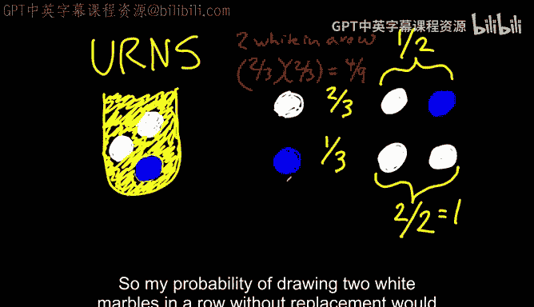

Would be two thirds times1 half。

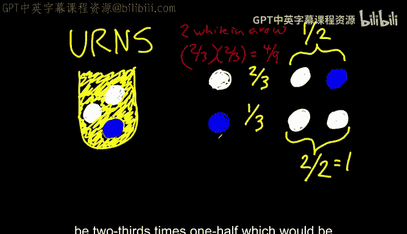

Which would be。Two third times1 half would be2，6。

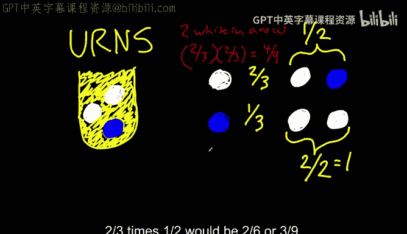

Or three9s。

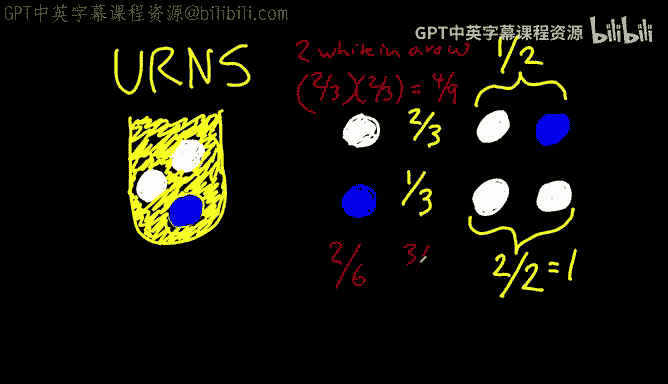

So a minute ago， I was telling you that the way that you can arrange people in different jobs is kind of a product where you have more slots open at the beginning and fewer at the end。

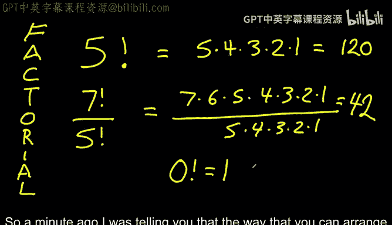

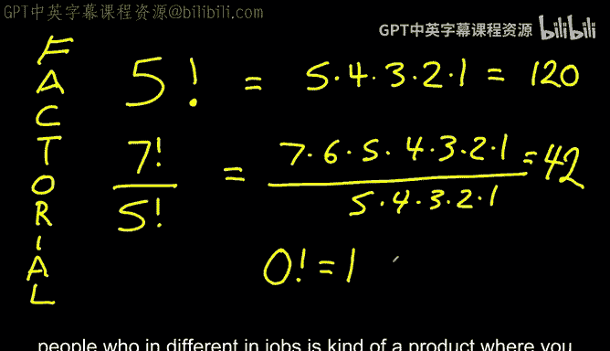

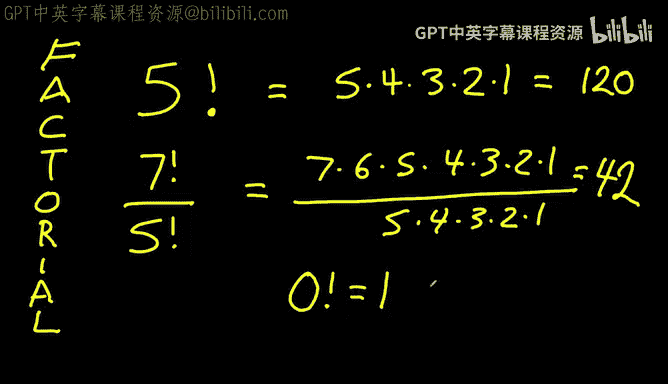

We have a general term for this type of。

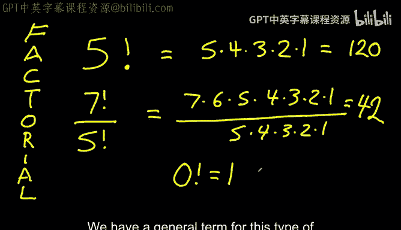

Arithmetic。Where we take a number and we multiply it by a smaller， a number one smaller。

 the integer one smaller and the integer one smaller than that until we get down to one。

 it's called factorial。

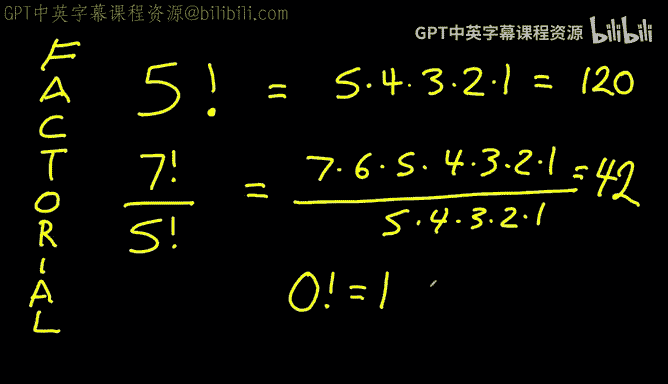

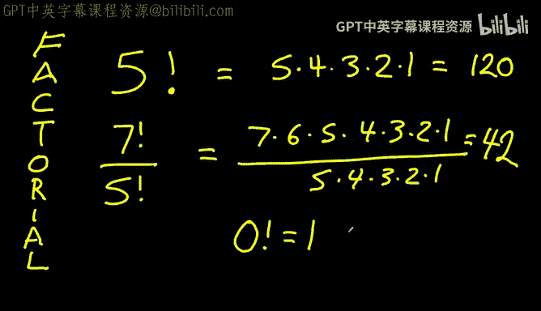

So， this。

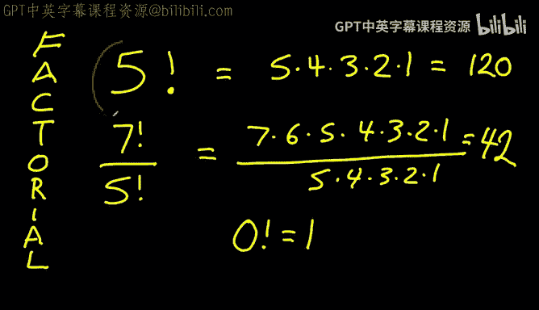

Notation 5 with an exclamation， Mark is read。

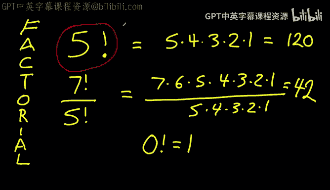

5 factorial。

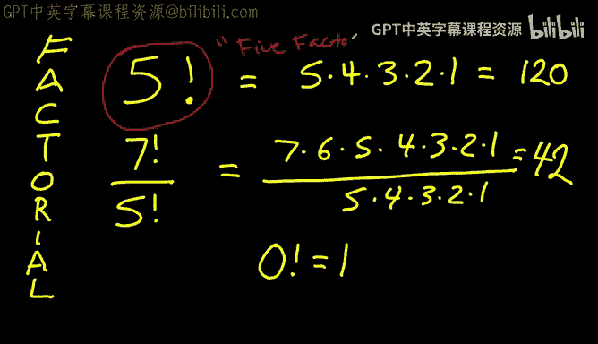

And it is equal to5 times4 times3 times2 times 1， which is 120。

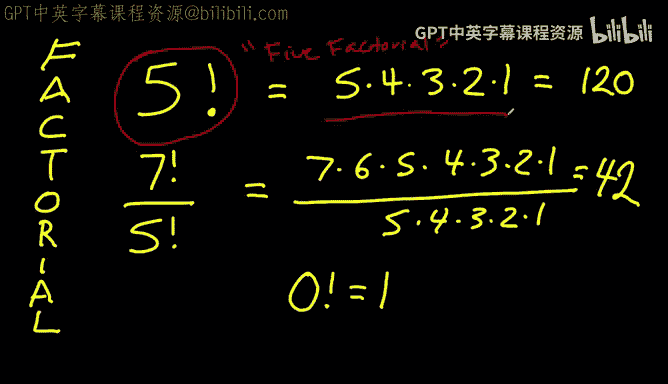

When we have。

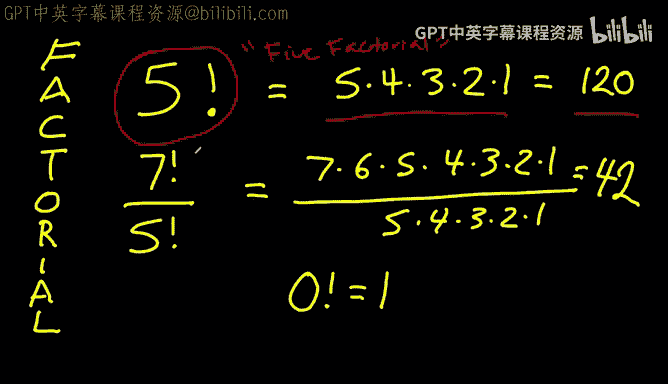

One factorial divided by another。What we're actually saying is that we have。This factorial on top。

7 times 6 times 5 times 4 times 3 times2 times 1， and this factorial on the bottom。

5 times 4 times3 times 2 times 1， and as you see， most of these numbers cancel out because these products are equal to1。

 and so the resulting number would be7 times 6。One more thing to know about factorials by convention。

The notation zero factorial is equal to one。When we are drawing。N items from a group of M items。

Without replacement。The number of unique groups that we can form。

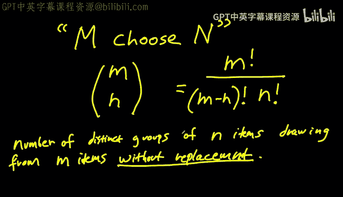

Has a special name。 It's called M Cho N。

This type of problem comes up so much in probability that it has its own name and its own notation。

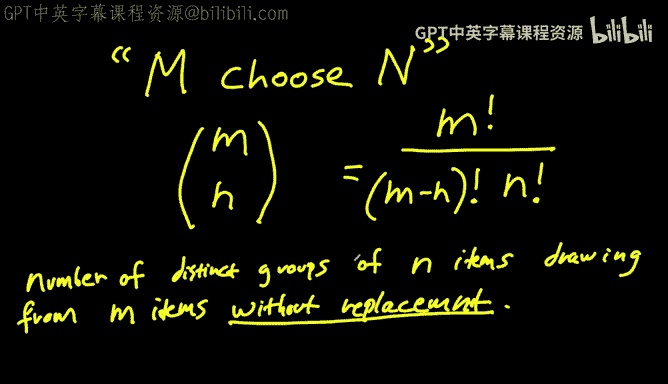

So if I want to know。How many unique committees of five？

People， I could form from a group of 10 people。

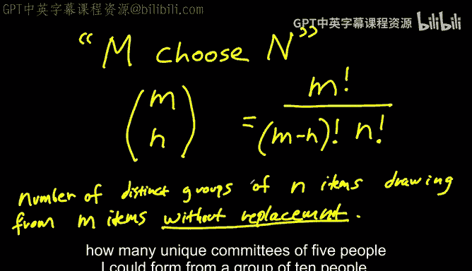

So I have， I start with M equals 10。

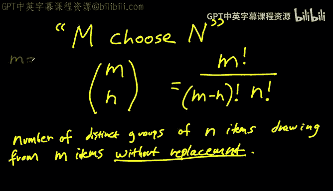

And n equals 5。This would be described as。

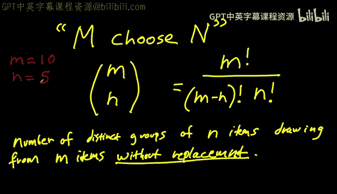

10。Choose。

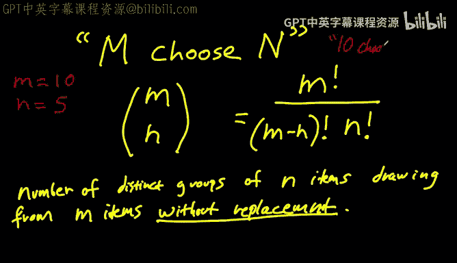

5。And it can be written using this special notation。

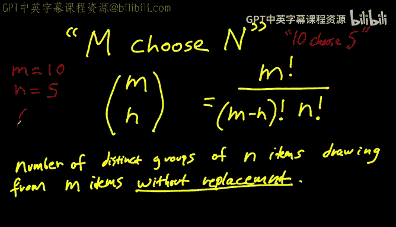

Like this。And what is that equal？It is equal 10 factorial。Divided by 10-5 factorial， or 5 factorial。

Times 5 factorial。Okay。This terminology will come up again and again and again in probability。

In our current example， we're interested in how。Many teams。Meaning， unique teams。

Where all the rules are equivalent。Of five people。Can be formed。From 10 people。Okay。

 so we're interested in the number of unique。Teams。

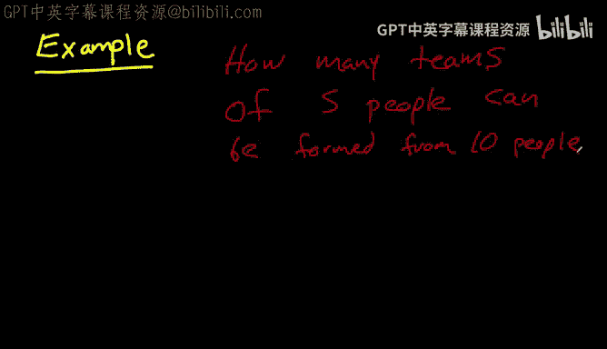

This is referred to as。10， choose 5， which is equal to 10 factorial divided by 5 factorial times 5 factorial。

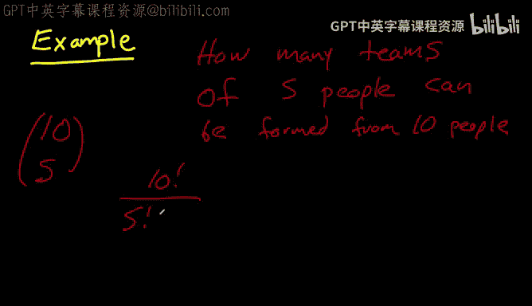

And I'm going to show you a little trick for when you want to get an idea of your answer when you don't have your calculator handy。

 which is this is going to be equal to 10 times 9 times 8 times 7 times 6。

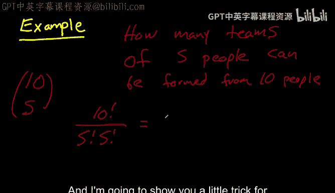

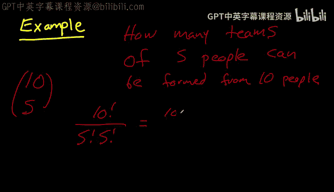

And then。

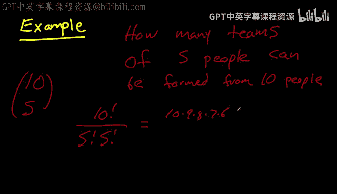

5ive times 4 times3 times 2 times one is going to cancel out the one of the five factorials。

 so that's canceled out。

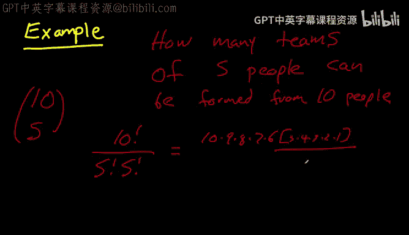

And the other5 factorial will be 5 times 4 times 3 times 2 times 1。

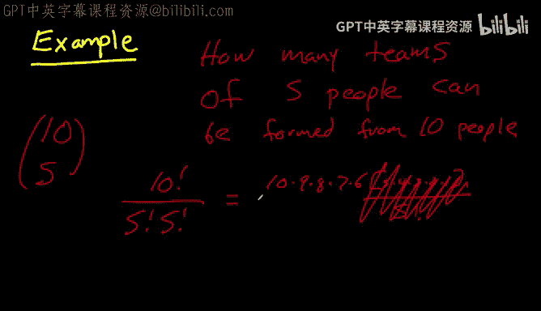

And we can say 10 divided by5 is2。

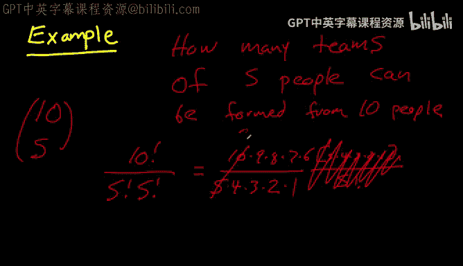

9 divided by 3 is3。8 divided by 4 is 2，6， divided by 2 is3 and7。

 so we have2 times 3 times 2 times 7 times 3， which is equal 252。

