# 杜克大学《数据科学数学技能｜Data Science Math Skills》中英字幕 - P31：31_04_04_加法法则、条件概率与乘法法则.zh_en - GPT中英字幕课程资源 - BV12mv6BLEhC

Next， we're going to talk about marginal probabilities and the sum rule。

It often happens in probability problems that we know the joint probabilities that two things will happen together。

And we don't know。 We want to know。The individual probability that only one of those things will happen。

 regardless of the other event。When we want to know what is the probability of x1 and we are given the probability of x1 and y 1。

 x1 and Y 2。X 1， and Y 3。Then we can refer to the probability of x1 as the marginal probability of x1。

Okay， you can think of it as being。Out on the margins of this matrix。Okay。The sum rule tells us。

That the marginal probability， the probability of x1。Is equal to。

Assuming that Y is a proper probability distribution。

 meaning its statements are exclusive and exhaustive。Equal to the sum of the joint probabilities。

 So the probability of x1 is equal to。1 plus 1% plus 10% plus 4% is equal to 15%。Similarly。

 the probability of y2， the marginal probability of y2 is equal to the sum of。X 1， Y 2 plus x 2。

 Y 2 plus x 3， Y 2。Which would be 79% or 0。79。Okay。That。That we can do that。

 that we can add together。Joint probabilities to get a marginal probability。

Is due to something called the sum rule。Here are two versions of the sum rule written out。

 the first is for a binary probability distribution。 we have probability of B， probability of not B。

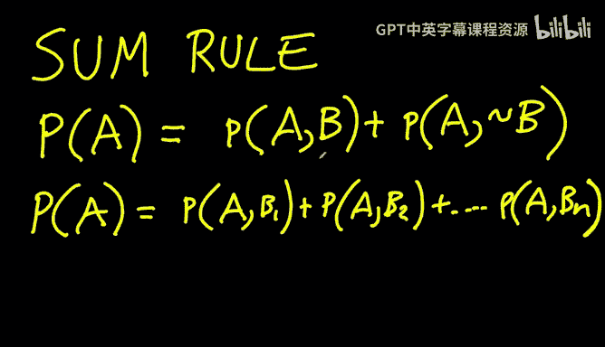

And we have the joint probability of A and B， and we have the joint probability of A and not B。

And together， they sum to the probability of a。Similarly， if we have a whole series of probabilities。

N probabilities。 We can sum the N joint probabilities to get the marginal probability of a。

So it's exactly the same principle。Next， we're going to talk about conditional probability。

Conditional probability is defined as the probability that a statement is true。

Given that some other statement is true with certainty。Everything to the right of the line。

Is considered true with certainty。So what this notation means is。If。B is true with certainty。

 What is the probability of a in that case。 So， for example。

If I throw a six sided die and it comes up。Od， what is the conditional probability that it is a three。

Well， there would be three odd roles，1，3， and five。

 so the conditional probability would be one third。What about if I throw a three with certainty。

 What is the conditional probability that my throw is odd。Well， in this case， the probability is one。

It's odd with certainty。 If it's three with certainty。

So what we're looking at here are relationships of dependence rather than independence。

The general formula that we use for calculating conditional probabilities。

Is that we take the relevant outcomes， the ones that meet our definition of a。

 and we divide them by the total outcomes in our universe， however。Our outcome has shrunk。

It is cut down。Because B must be true。So the example of the die that I just gave you。

We are cutting down the universe from six possibilities，1，2，3，4，5，6 to the odd possibilities 1。

3 and 5。 And in that case， the relevant outcome of three。And the odd outcomes， 1，3，5。

There's one of those and three of those， and so my probability is one third。

 my conditional probability of throwing a three， if I know that the dye that I threw is odd。

Now we want to relate our concept of joint probability。

 our concept of marginal probability and our concept of conditional probability。

And we do this using a very important rule called the product rule。

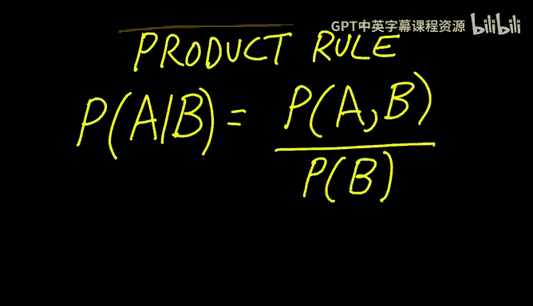

The product rule tells us that the conditional probability of a。

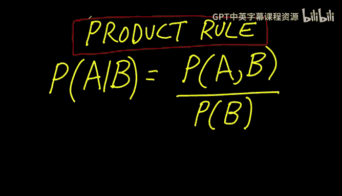

Given that B is true with certainty。

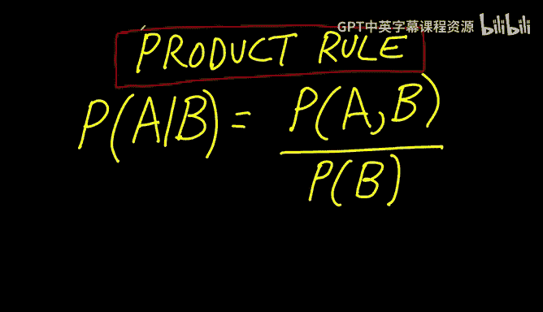

Is equal to the joint probability that both A and B are true。

Divided by the marginal probability that B is true。

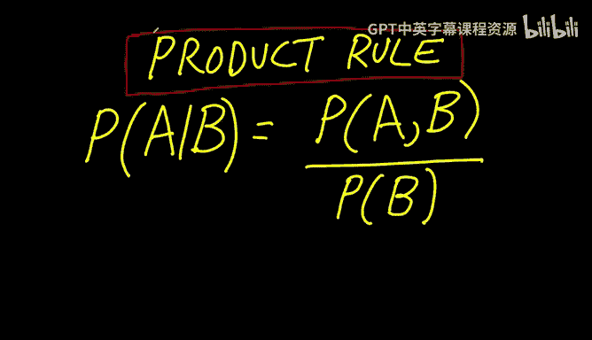

Okay， so you notice that over here， we're not assuming that B is true。

 The only way that we assume B is true is when it's to the right of this special magic line。

 This line is what makes it true。 Over here， it does not need to equal 1。

 It could equal anything other than 0。

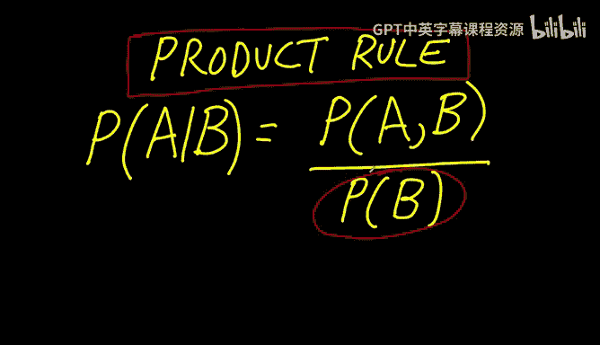

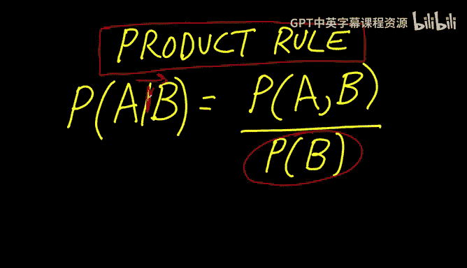

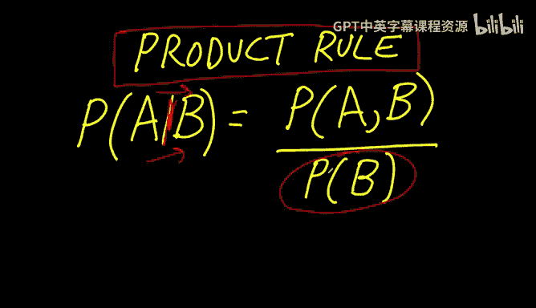

The product rule allows us to develop a new definition of independence。

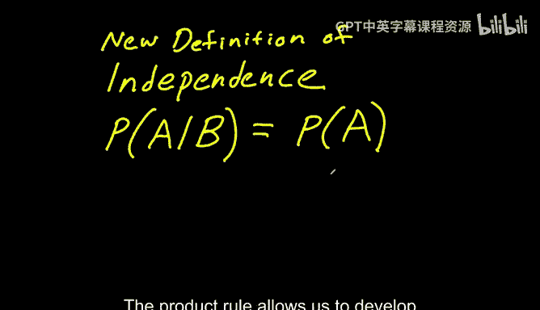

You may remember that。 our definition of。

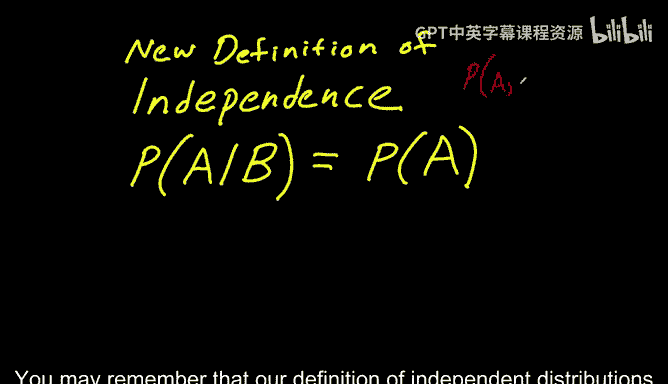

Independent distributions is that the。Joint distribution is equal to the product distribution。

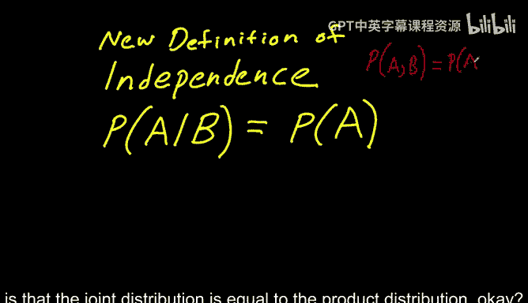

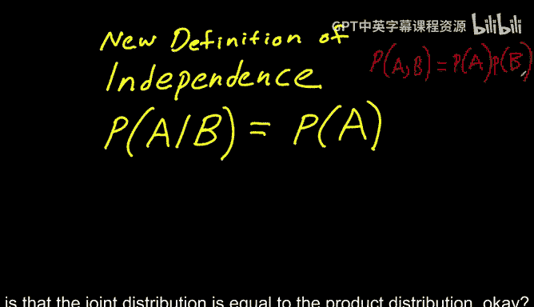

Well， how do we get from our old definition to our new definition， The answer is that we。

Divide both sides by probability of B。

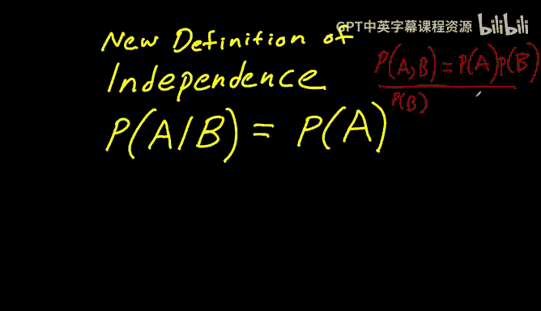

Okay， so we have。

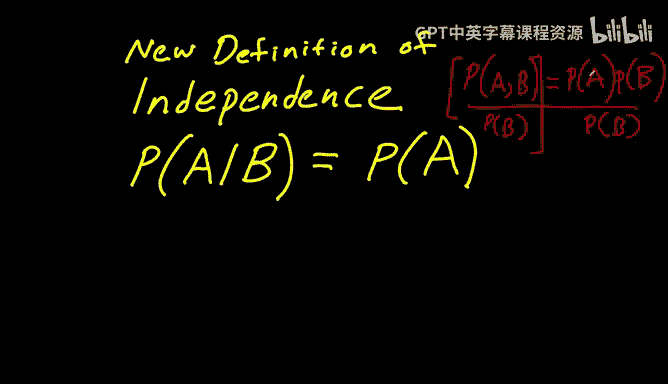

The joint probability of A B divided by probability of B。

 and we have probability of a times probability of B divided by probability of B。

 assuming the probability of B is not equal 0。

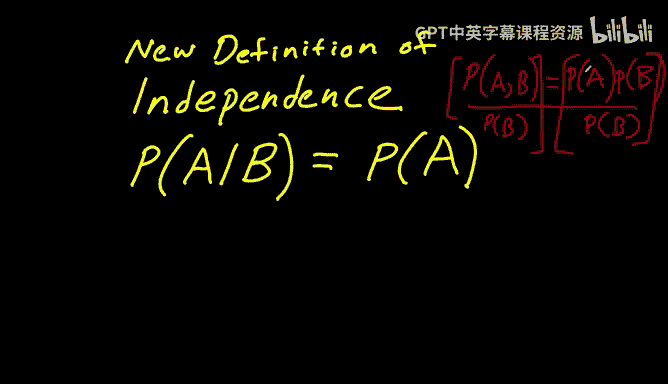

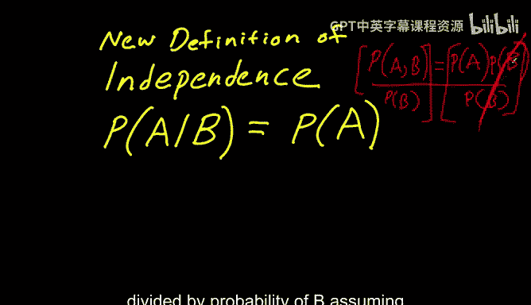

And now we use the product rule。

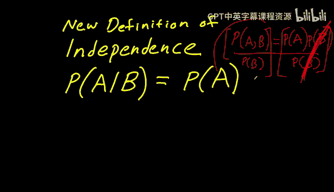

To say that this term is equal to probability of a， given B。

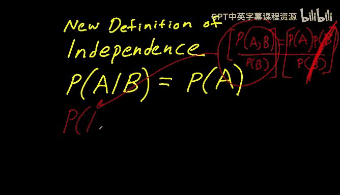

And that is equal to probability of a。

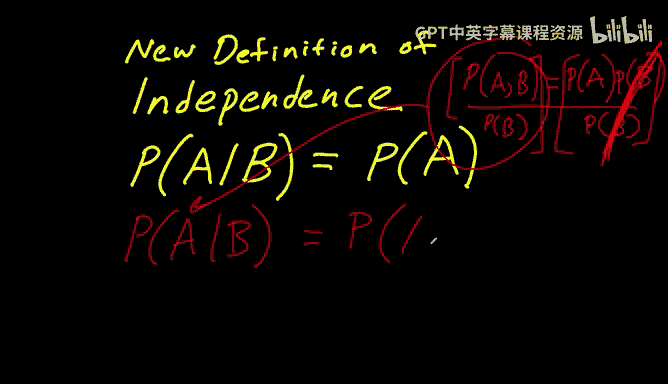

Our intuition about what this means is that knowing that being is true。

Tells us nothing about the probabilities of A。B。The outcome B has no effect on the probability A。

And therefore， they are independent。The converse is also true， if。um。

If the conditional probability of a does not sorry。

 if the conditional probability of a given B does not equal the probability of a。

Then they are dependent， so any two distributions are either independent or dependent。

 There's no middle way。