# 杜克大学《数据科学数学技能｜Data Science Math Skills》中英字幕 - P32：32_04_02_贝叶斯定理第一部分.zh_en - GPT中英字幕课程资源 - BV12mv6BLEhC

Now we come to one of the most famous and powerful theorems in probability theory， Bay's theorem。

We start with the familiar product rule。You'll notice that if we multiply both sides of this equation by the probability of B。

We'll get something that's equivalent still due to the product rule that looks like this。

 the conditional probability of A given B。Times the marginal probability of B is equal to the joint probability A。

 B。Now， we can substitute。Probability of B and A for probability of A and B。

 because we know that they are completely equivalent。And then we can apply the product rule again。

 to probability of B and A in the form that we've written it in its equivalent。

 So this would be probability of B given a times probability of a。Equals probability of。Heby。Okay。

And then， we are left with。This equivalence。Which is Bay's theorem。That is based there。One of the。

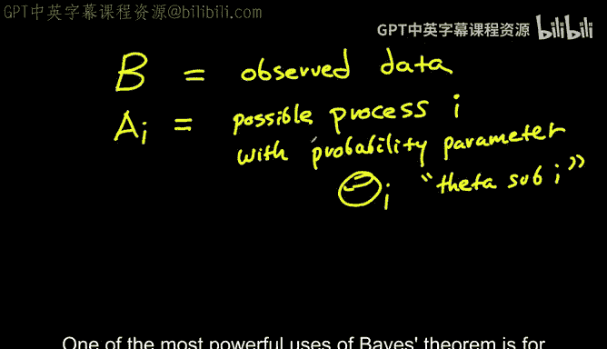

Most powerful uses of Bayes theorem is for something we call inverse probability problems。

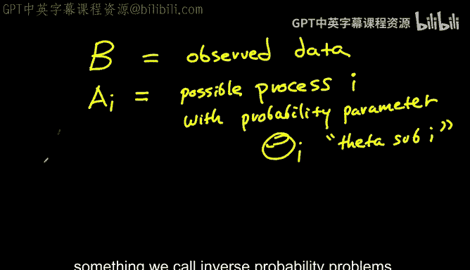

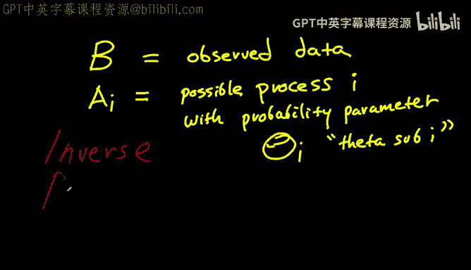

Inverse probability problems。

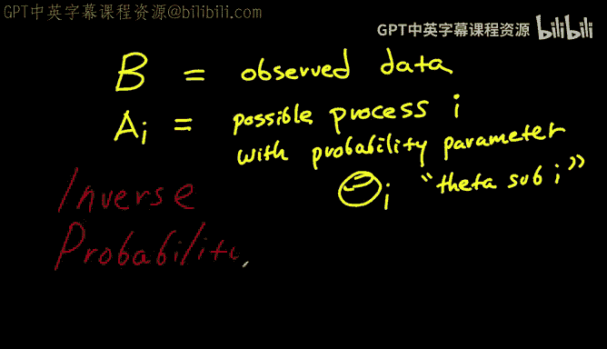

Are those where the answer is in the form of。

The probability that a certain process。

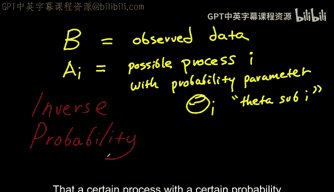

With a certain probability parameter is being used to generate the observed data。

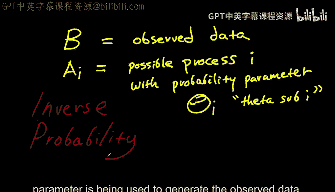

And I'll give some examples of this。 So this will make more sense in a moment。

 but we sometimes use the Greek letter theta to refer to。

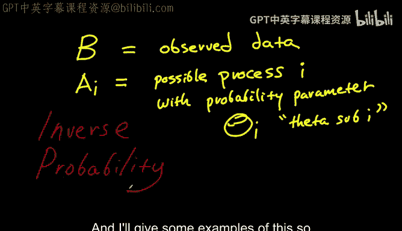

The different parameter that might be causing the data or generating the data that we observe。And。

We sometimes also just use a sub I indicating one of the possible processes that are generating the observed data。

They're essentially， for our purposes， equivalent。Okay。So we're going to look at an example。hich is。

 let's say that we have two urns。And one has 20% white marbles， and one has 10% white marbles。

We observe three white marbles in a row being drawn with replacement from one or other of the urns。

 but we don't know which urn we are observing。What is the probability that we are observing earnn 1 and what is the probability that we are observing earn2？

These probabilities are the probabilities of the process。Earn one。Or the parameter。

White probability of white equals 02。Earn2 is the process earned2 or the parameter。

That probability of white。On each individual， draw is equal to 01。

So in a more conventional forward probability problem。

 were interested in the probability of a certain observed outcome， given a known process。So。

 for example， if we know that the urn is urn 1， that's a known process。

 then the probability that we would observe three white marbles in a row would be 0。2 times 0。

2 times 0。2。Or810ths。That would be a conventional probability problem。In this problem。

 we are starting with the known outcome and we're interested in how probable is it that we observed。

 earnn 1 or earn2。Okay， an unknown process。Okay。Written in the terminology of conditional probability。

 we're interested in what is the probability of the process parameter， This is urn 1 or urn 2。

 This is probability of white。Equals 0。2 or probability of white。Equals 0。1 and they're equivalent。

Given the observed data of three white marbles in a row。Bays theorem tells us。That this is equal to。

If this is probability of a sub I， given B。A sub I， given B。Then。That is equal to the probability of。

B given a sub I。Times。Probability of。A sub I。Divided by。Probability of B。

Which here we have broken up using the sum rule。To be the series of joint probabilities。

 the probability of the observed data with parameter 1 plus probability observed data with parameter 2 each。

Times the original probability of that parameter or process。Okay。So。

Part of Bay's theorem is the particular equation。

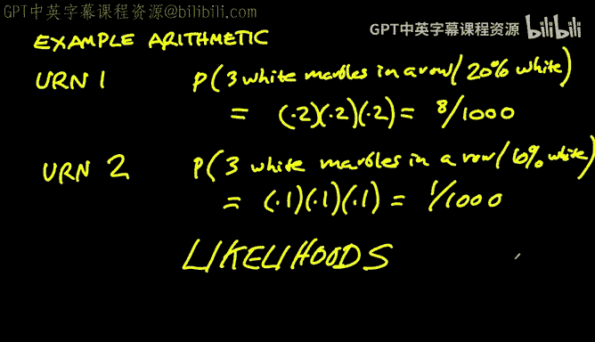

What is the probability of the observation given the parameter？

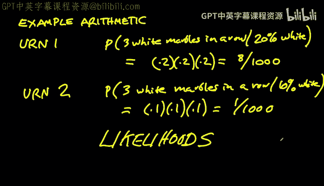

so this is the observation。

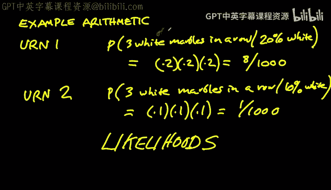

And this is a sub1。Okay， this is a sub2。This portion of the solution to Bayes theorem is known as the likelihood。

It solving for it is solving a simple forward probability problem。So the probability of。

Observing three whites in a row， if we know we're observing urn 1 is 8 in 1000， Similarlyly。

 if the likelihood of each individual white marble being drawn with placement is。10%。

 then the probability of three whites in a row is one in 1000。And these terms。

Are known as likelihoods。The likelihood of the data given the parameter。

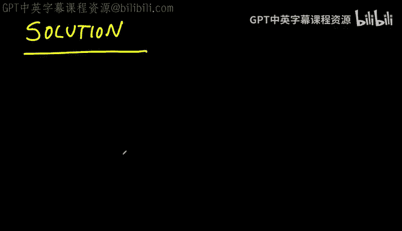

So what is our solution， Well， we're going to start with the principle of indifference， tells us。

Prinncciple。Of indifference。Tells us that we have no basis for choosing between the two urns。

 so probability of a1 is equal to 0。5。 probability of a2 is equal to 0。5。 in other words。

 before we observe any data。

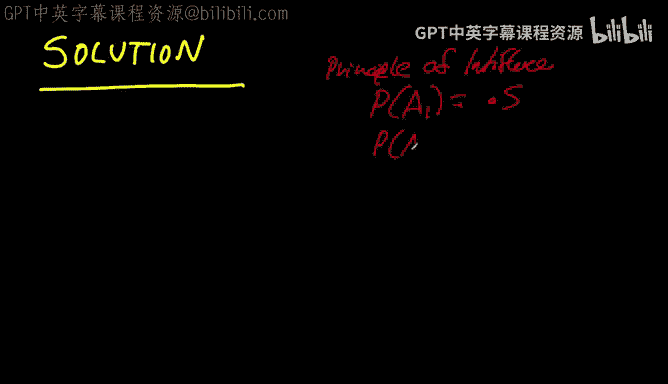

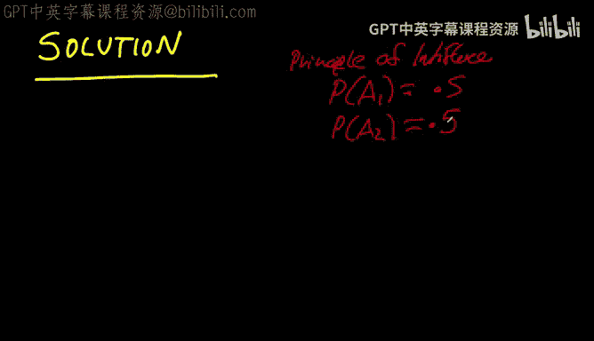

We are neutral as to which urn we are observing。

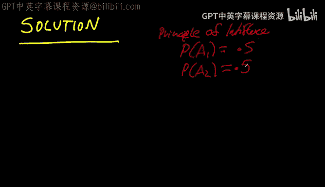

They have equal probability。Because this is before。

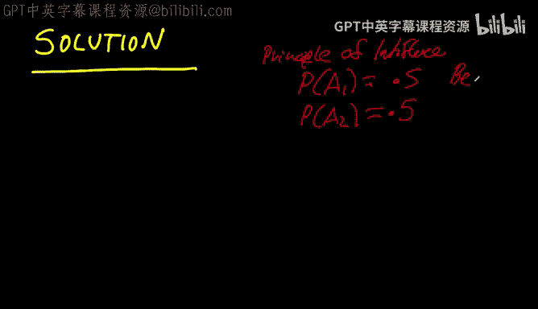

Any data are observed。We call this the prior。

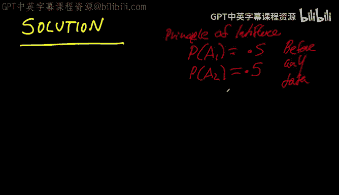

Probability。

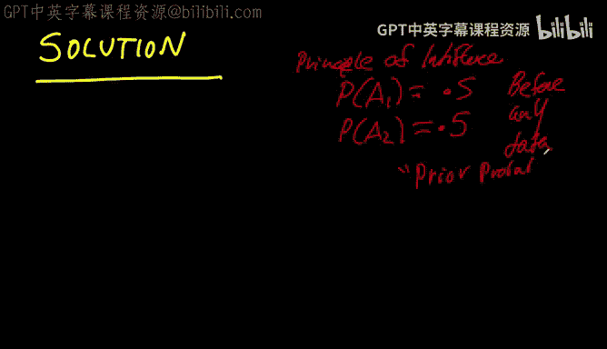

Of the parameters or of the process。

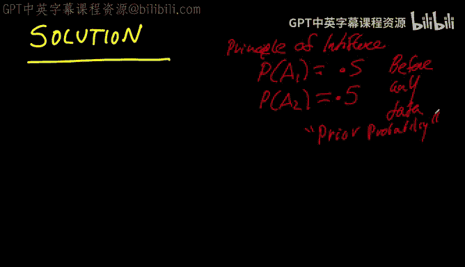

Okay。So we're going to look at。Probability of B given a one times probability of。

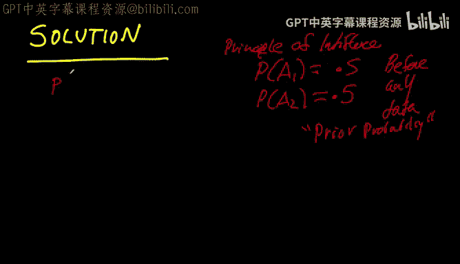

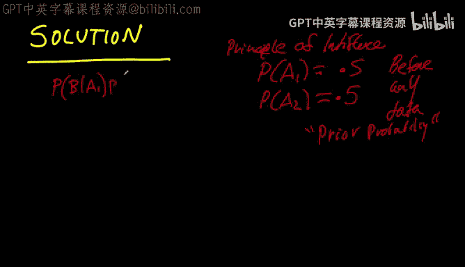

A one。Divided by。

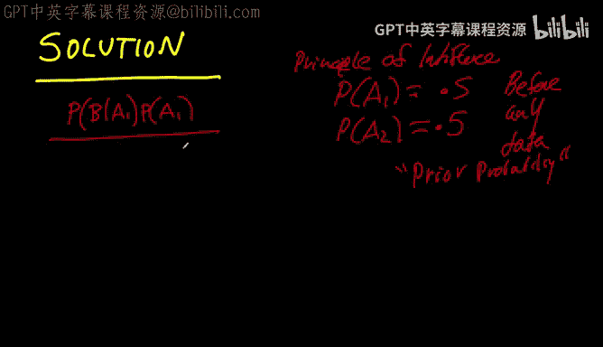

Probability of B， which is going to be equal to probability of B A1。

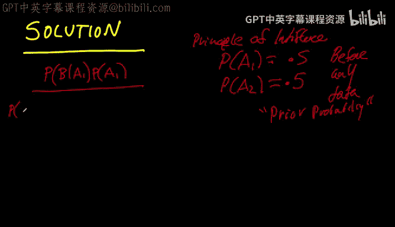

Plus， probability of。

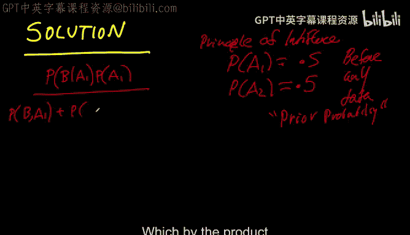

Be a 2 by the sum rule。

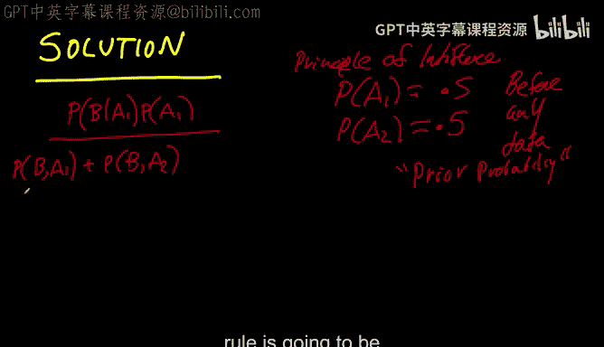

Which by the product rule is going to be equal to probability of B given A times 1 times probability of a1。

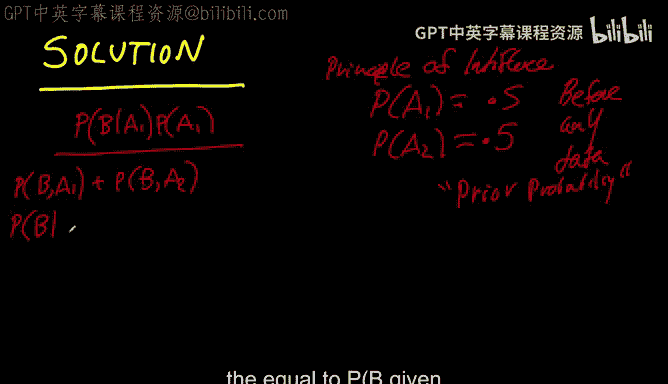

Plus， probability of B， given a。

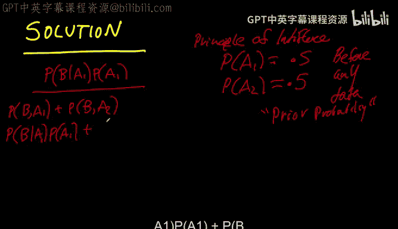

2。And probability of a2。

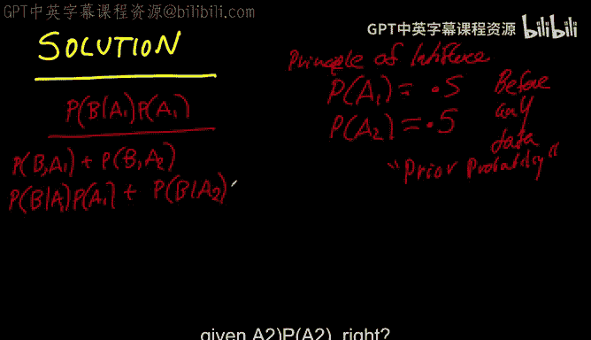

Right。So all of this is equal to。

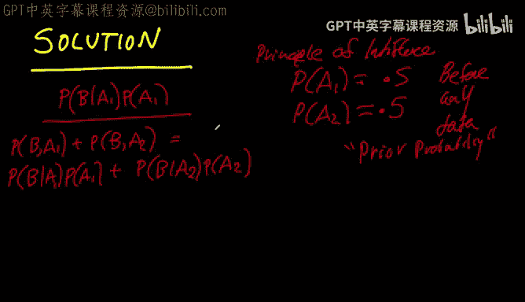

Probability of B。

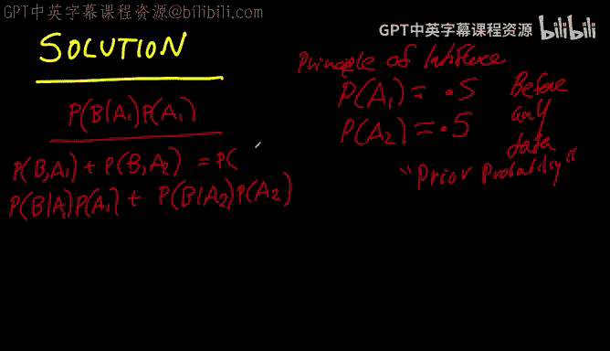

Okay， so you see this is。Base theorem 4， a1。And we can also solve for A2。

 but because there are only two possibilities they're going to sum to one， so if we solve for one。

 we've also solved for the other。So probability of B given A， as we just said a minute ago。

 is 8 over 1000。And that's times 1 half。Divided by。8 times 1000。Times1 half。Plus。

The probability of observing three white marbles， if we have a 10% chance of drawing a white marble。

 which is going to be 1，100th。Times1 half。The prior probability of earnN 2。The one/ halfs cancel out。

And we're left with eight9s。Which is the probability。That。We observed。Earn one。And obviously。

 the probability that we observed earn 2 would be1 minus8 ninth or one ninth。

And that is the application of Bayes theorem， using inverse probability。

