# 杜克大学《数据科学数学技能｜Data Science Math Skills》中英字幕 - P33：33_04_03_贝叶斯定理第二部分.zh_en - GPT中英字幕课程资源 - BV12mv6BLEhC

One of the really powerful things about Bays theorem。

Is that it allows for updating our probabilities based on new data。

So let's suppose that we have a fourth marble。

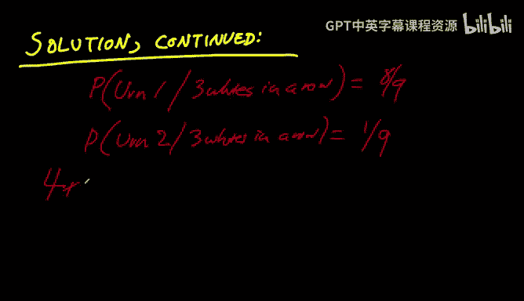

And it is also white。

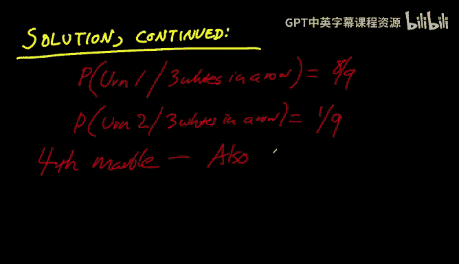

Okay。

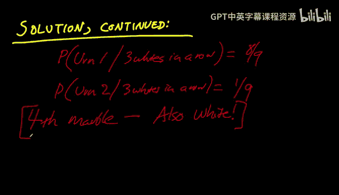

How would we update our probabilities well？

We would set up the same type of base theorem formula that we did before。

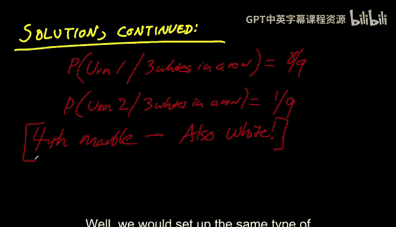

But these values， probability of a。

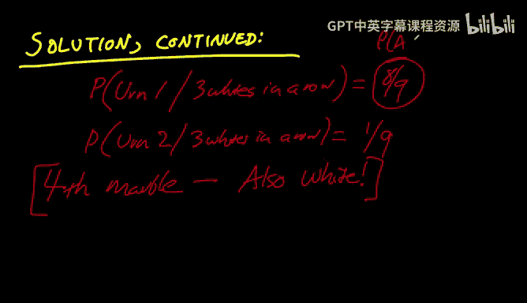

One probability of a2。

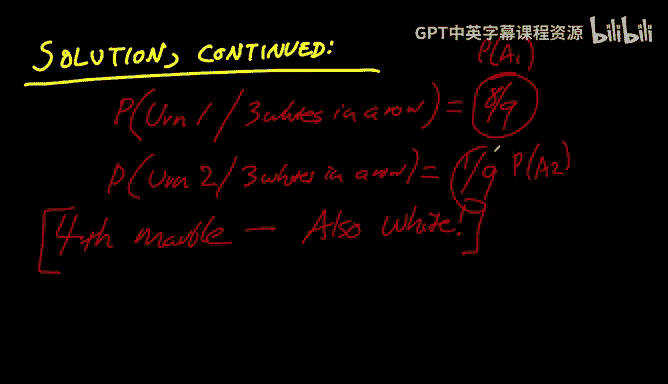

They become our new。Prior probabilities。They become our new priors， for short。

so we have the same base theorem formula， but instead of using one/ half and1/ half by the principle of indifference。

 we now can use eight ninths and19， so let me show you what I mean。The probability that we have。

Eurn one。Given three whites。And a fourth。Would be equal to。Probability that we would observe。

A white marble。From earnn。1。Which would be。bil that we would observe a white。From earn1。

Times the prior probability。That that is the ur that we're observing。

Divided by the total probability of the data， which would be the probability that we are observing white。

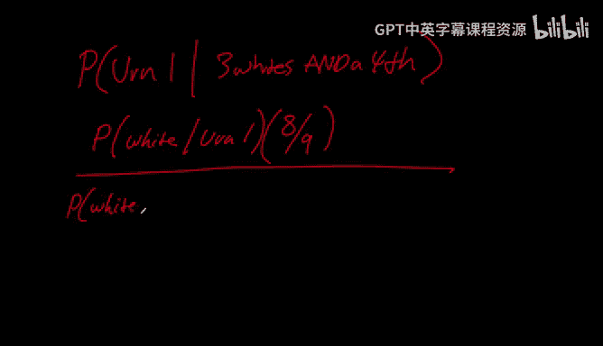

Given that's earned one。Time， late nights。Plus。

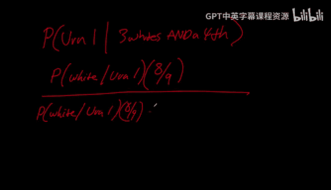

The probability of observing white。Given that it's earned two。Times one night。

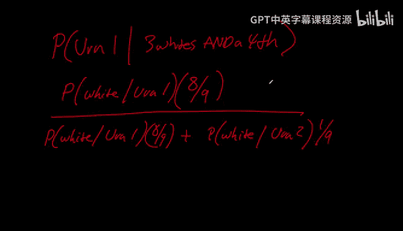

So this on the top is going to be equal to 02。Time 8，9th。

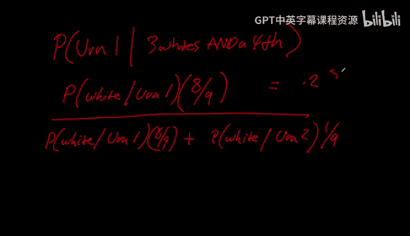

And on the bottom， we have。

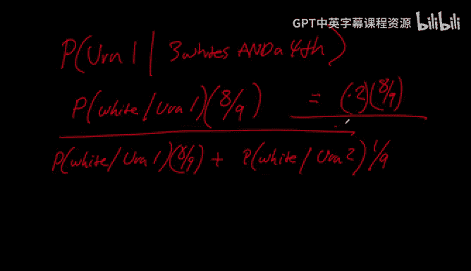

Point2。Times 8，9th。铜拉屎。

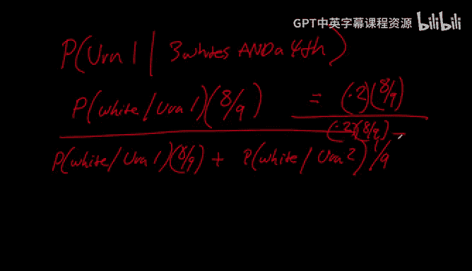

Point1。Times one9。But if we convert them to percentages， the probability of earnn1。Is。94。12% now。

And probability of earn two。Is 5。88%。So this probability is。Down， it was previously 11。1%。

And this probability is up， it was previously 88。9%。

The different parts of the Bays equation have special names。

Here I've written the theta to indicate the different parameters that were possible in this problem。

 earnn1 had a parameter of 0。2 probability white and urn 2 had a parameter of probability 0。

1 of white。Okay。But you can use A's if that seems more familiar and comfortable。Okay。The result。

Is the posterior probability posterior means after， so this is after new data are observed。

It's our best estimate of the probability of which parameter is active， the 0。2 parameter or the 0。

1 parameter after new data。The prior probability is what we started with。

Either before any data were observed。Or。Before。New data were observed before any data。

 we would have 0。5。Before new data， we would have eight ninths and one ninths。Okay。

The standard forward probability part of the problem。

 the probability of the data given each parameter subi is known as the likelihood。Okay。

And the probability of the data on the bottom is the marginal probability。Which。

 as we know is equal to that term on the top for the first and that term on the top for the second and so on for howeverever many terms there are。

