# 杜克大学《数据科学数学技能｜Data Science Math Skills》中英字幕 - P7：07_01_04_不等式代数运算 - GPT中英字幕课程资源 - BV12mv6BLEhC

。

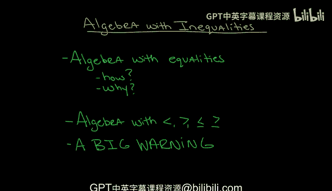

Welcome back everyone， we're going to continue with our suite on inequalities。

Last time we just showed you the basic ideas of what less than greater than。

 less than or equal to then， greater than the equal 1 looks like and how to picture them on the number line。

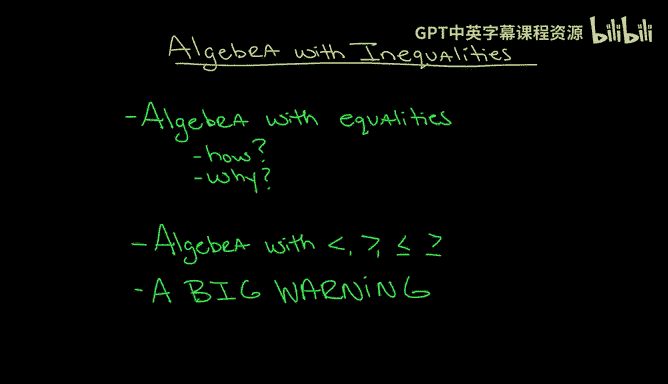

Now we'll get a little bit more technical。 Nothing too technical and show you how to do some algebraic manipulation with inequalities。

 We'll start by reminding you how to do it with equalalities。 First。

 what you do mechanically and why you would do it。 the way you do it is to solve for X。

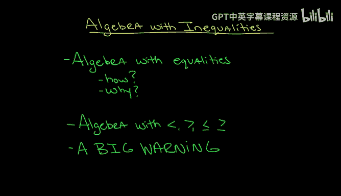

Then we'll show you what is probably some new stuff， which is how to do it with inequalities。

 What works， And then a very， very big warning that there's one thing you can do with algebraic equalalities。

 namely multiplying by negative numbers that you have to be very。

 very careful with inequalities to give away the punchline at the beginning。

 The only real difference is when you multiply by a negative number and inequality。

 you have to flip the sign。 and'll show you what that means。 Let's get into it。

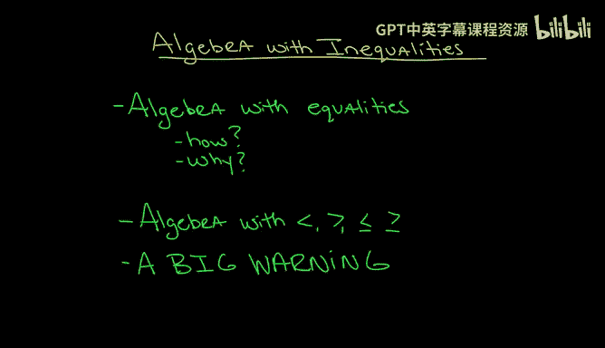

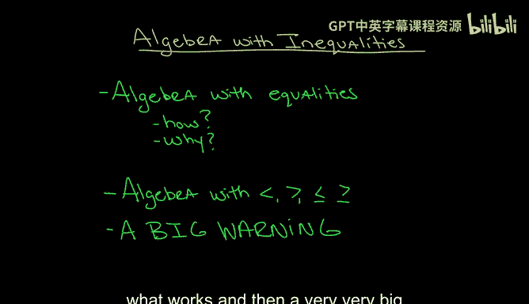

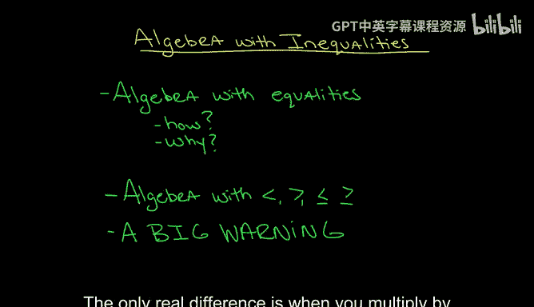

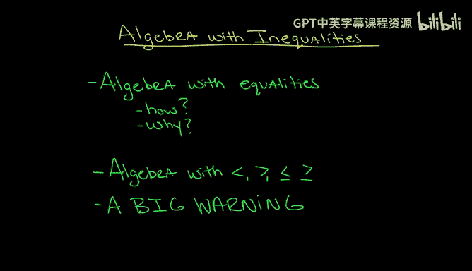

Okay， first， what is probably some very， very familiar material。

 Let's talk about algebra with inequalities， supposeupp we start with something really simple like4 equals4。

Here's something that seems so obvious that no one really appreciates what a powerful tool it is in an algebraic ason。

 What am I saying， what I'm saying is that if you take in equality and add the same thing to both sides。

 so let's take four and let's add3 to the left side。

 let's add three to the right side and let's put the equal sign here。This is still true。

If 4 equals 4， then four plus 3 equals 4 plus 3， the fact this is equal to 7 and this is equal to 7。

So let's put that as a general rule。If a equals B， then。A plus C equals B plus C， or A。

 B and C can be any numbers， positive negative integers， fractions， whatever。

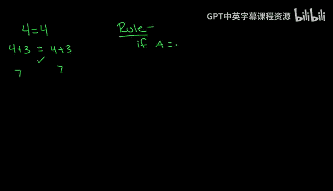

Who cares？ Well， Who cares is this allows you to do algebra。 For example。

 Supp someone tells you there's a mystery symbol called X。

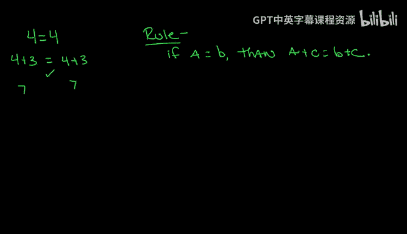

And x plus3 equals 10， and they demand that you solve for x。

 meaning what they're really asking is what is x if x plus 3 equals 10？

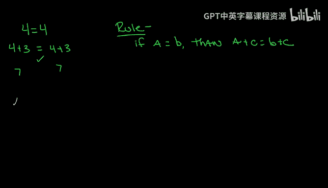

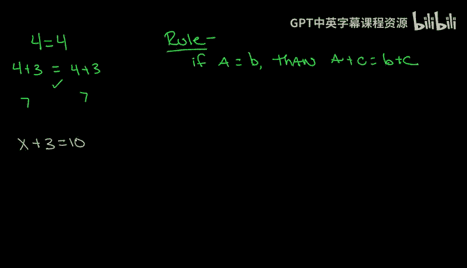

The simple one like this， you can sort of stare at it and say x probably has to be seven。

 but you can also do it rigorously and technically using this algebraic rule。

 this this tool you have in your arsenal， How could you do it Well you look here and you want to isolate X。

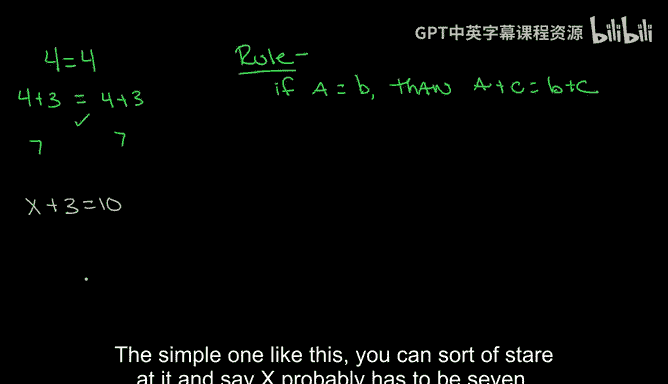

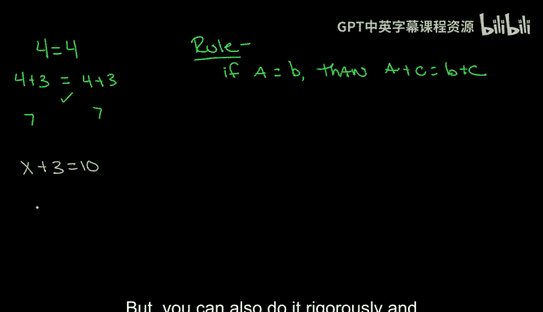

If you knew that x was equal to something， you'd be done because that's what it means it solve for x。

 so let's isolate it by getting rid of the thing next to it， let's subtract three from both sides。

 In other words， if we write x plus3。

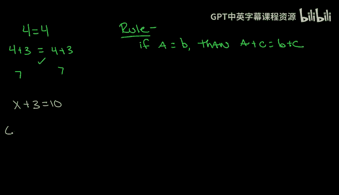

Minus3， this is equal to 10 minus3。X plus 3 minus3 is equal to x。

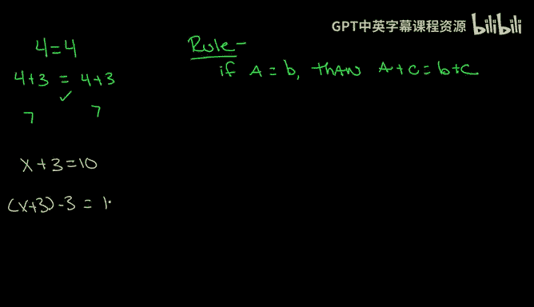

10-3 is equal to 7。 and Hooray。 We found out what we wanted to find out。

 which we is sort of new already。 Okay， so that's nice。 Let's start again with 4 equals 4。😊。

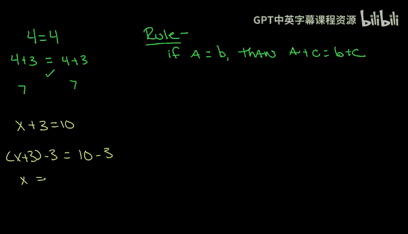

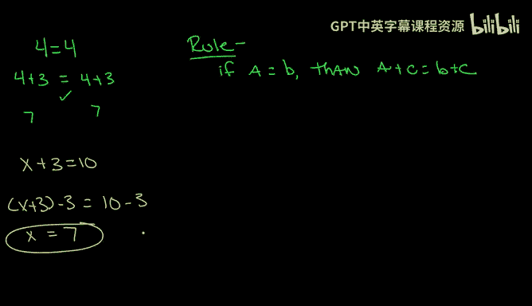

And let's multiply it by fake two。Two times 4 equals 2 times 4。This works， this is  eight。

 and this is eight。So I can multiply by a number。I can also multiply by a negative number。

 so if I start with four equals 4， and I multiply by negative 3。

Negative3 times 4 equals negative3 times 4。Over here this gives me negative 12 over here this gives me negative 12。

 and I'm happy。General rule。

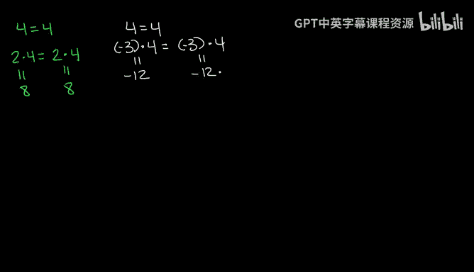

If A， B， and C are numbers。

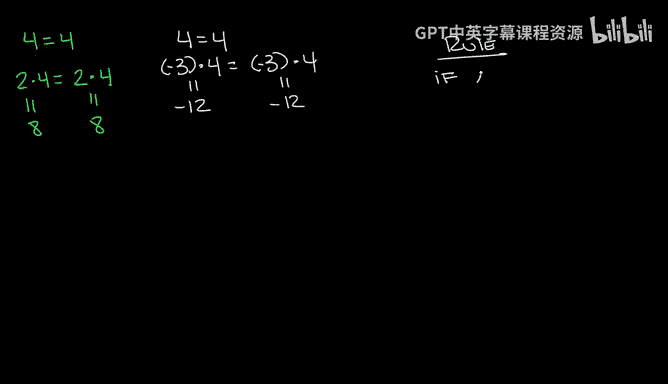

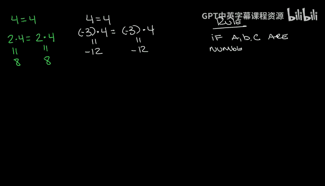

And C is not zero。And A equals B。

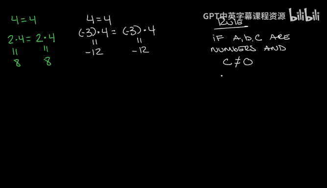

Then。C times a equals C times B。

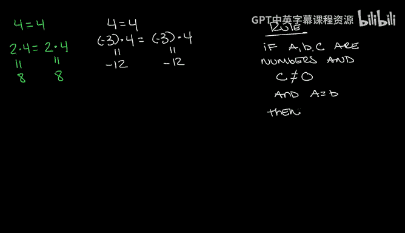

Who cares？ Well， again， it allows us to do algebra。

 So suppose suppose someone comes along and says-5 x equals 15。 hey， you solve for X。

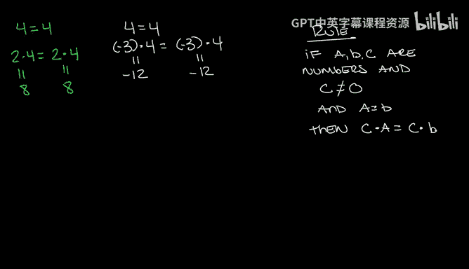

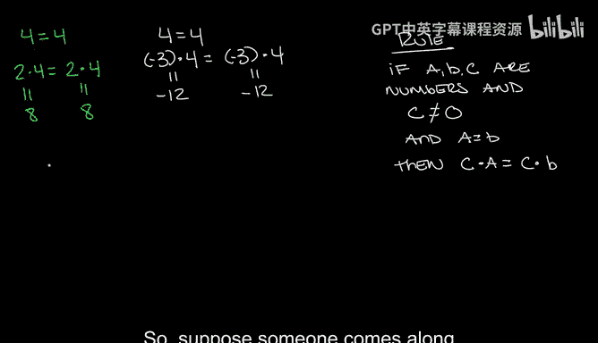

So we have to stare at this， if you're a little practice。

 you can probably figure out that x equals minus3。

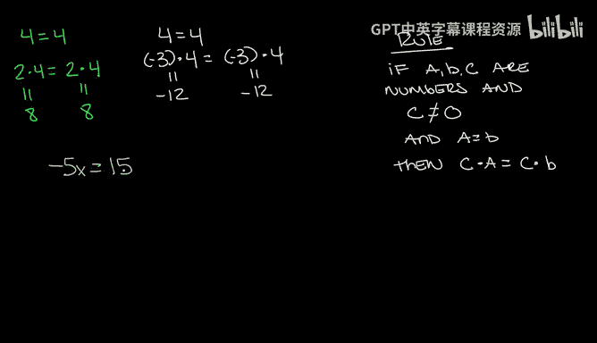

Another way to do it is let's isolate the x。 X is being multiplied by -5。

 I need to somehow cancel that out。 Let's multiply by negative1 fifth。

 So I multiply by negative 1 fifth。

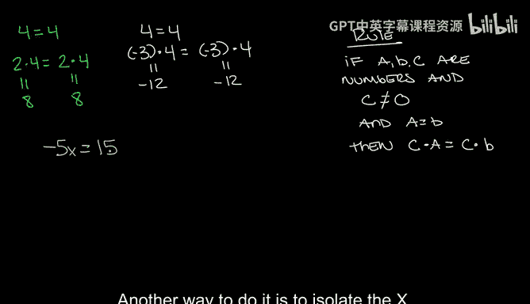

Times minus 5 x。

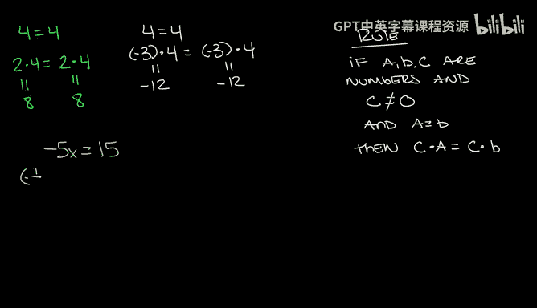

That's equal to negative 1， fifth。

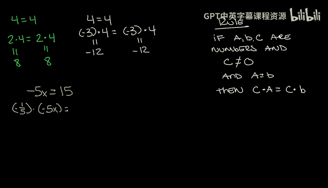

Times 15， negative 15 times minus5 is 1， so this gives me that x is equal to minus 15 over 5。

 which is minus3。

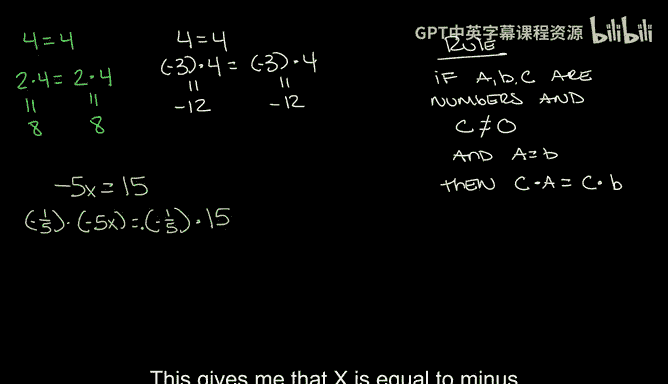

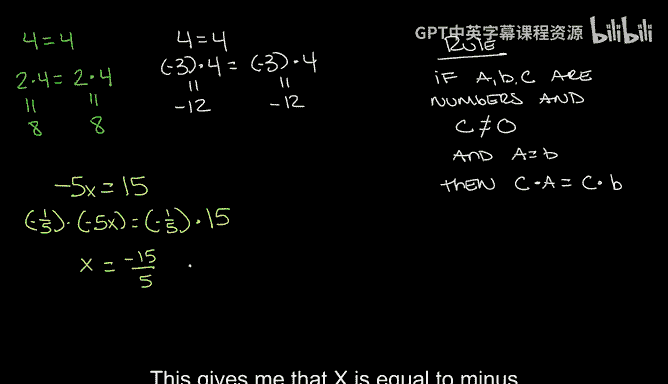

X equals minus3 and circle and I'm happy。Okay， fine。

 so that tells us that those two algebraic tools in our arsenal that you can add the same thing to both sides of equation and you can multiply both sides of equation still say true allows to solve for things。

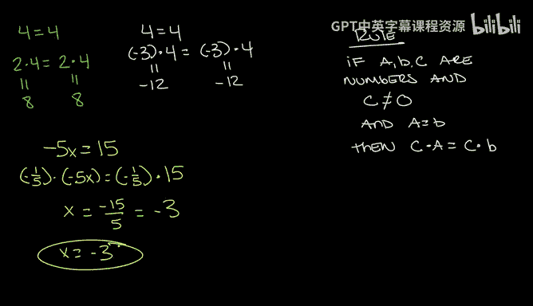

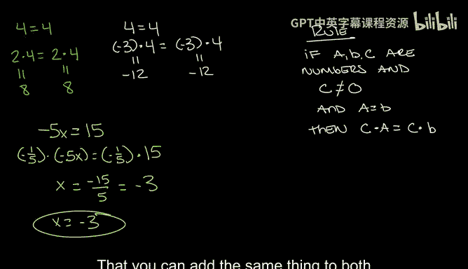

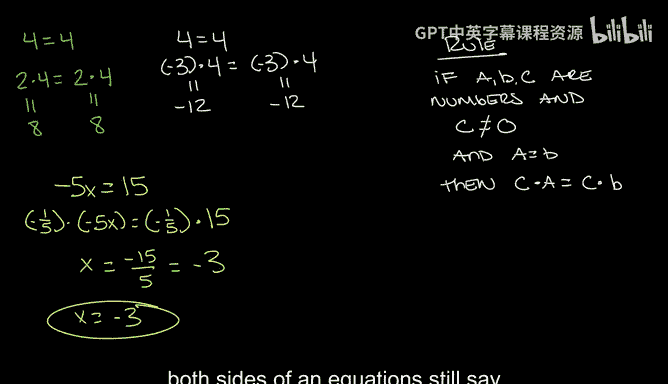

Okay， let's go toward in qualities， supposeupp I start with four is less than seven。

And suppose I added something to both sides， so four is less than seven。

 is it true that4 plus 2 is less than7 plus2？Yep， because four plus2 is 6，7 plus2 is9， that works。

 right？If I start with four is less than 7。And I subtract something。

 so say4 minus1 is less than7 minus1 that work that says that three is less than6 and that works。

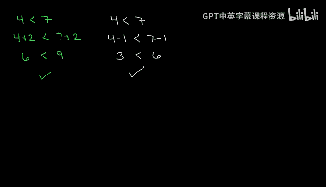

So， general rule。

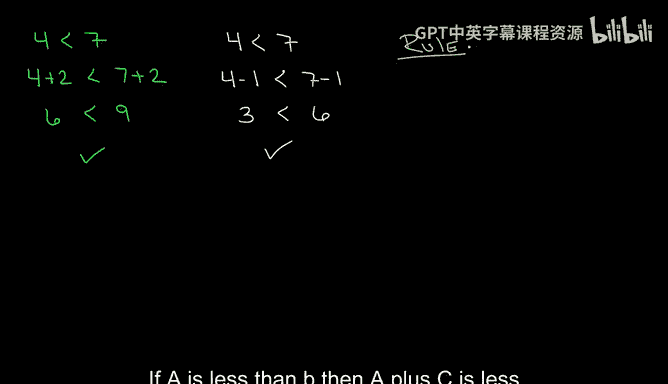

If a is less than B。Then。

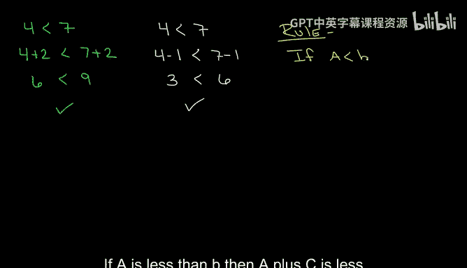

A plus C is less than b plus C。

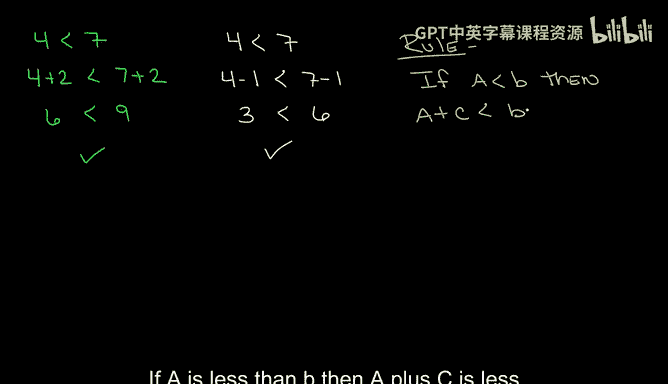

For any numbers A， B and C， we can even picture that on the number line。Suppose here's a， here's B。

 that means A is less than B is to the left of it， and I add C， if C is positive。

 it means I'm shifting A by C and I'm shifting B by C。

 there's no way that A plus C can jump over B plus C， likewise a C is negative。

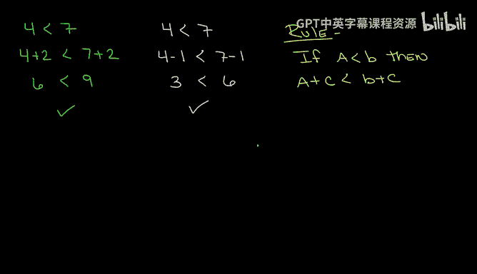

That's why that works and that's often very powerful that allows us to do elder growth inequalities just before。

 in in other words suppose someone tells us that x plus 3 is less than 10。

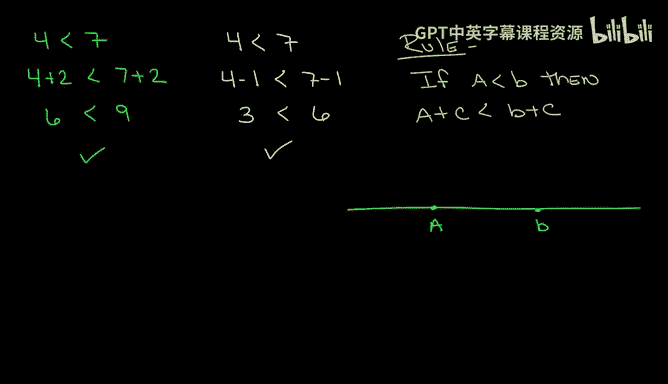

And they ask us to tell us more about what that means about X。So if x plus3 is less than 10。

 I can subtract3 from both sides and you all are for a practice with that。

 so let's just see if I subtract3 from the left， I get x。I subtract 3 from the right， I get 10-3。

In other words， x is less than7。So what， well， what does that mean， that means that。

Whatever on earth X is， and it could be anything is not one particular thing。

It has to be to the left of7。 In other words， X has to live in this blue zone here。

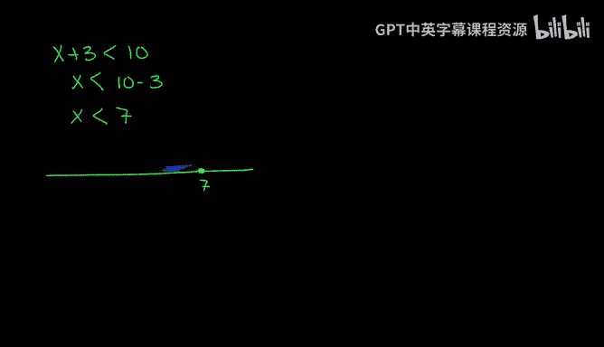

Any number it wants to be as long as it doesn't exceed7。

 and that's what the information that x plus3 is less than 10 looks like。

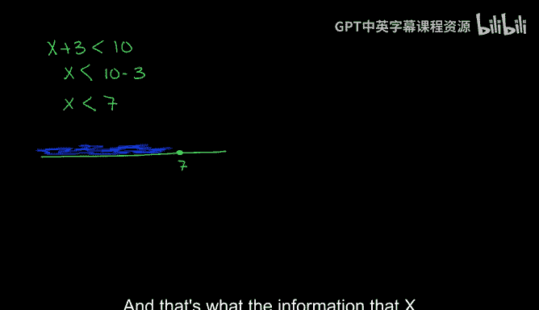

By the way， in a later video， we're going to talk about this being a half open ray。

 this is going to be a symbol minus infinity to 7 and x is in there we'll tell you what that means okay confused about it now I just want you to see that in advance。

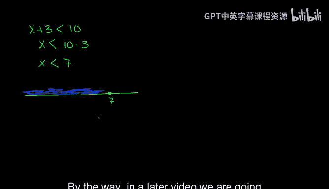

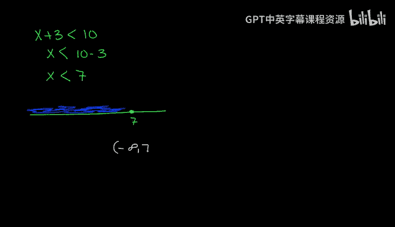

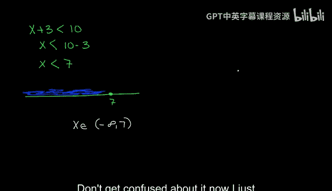

Okay， that's great。😊，Now here's a little warning when you multiply inequalities by both sides。

 it's a little more dangerous。 Let's start again with five is less than8。And first。

 let's multiply both sides by a positive number。 so for example。Three， three times five。

 less than eight times five。Question mark。Yep， that works because three times 5 is 15，8 times 5。

 OD arithmetic in public，8 times 5， gear is churning were8 times5 is 40。I think that's right。

 so 15 is less than 40 and that works。Here's a problem。Let's take five， less than eight。

And let's multiply both sides by a negative number， say minus1。I do -1 times 5。 and I ask。

 are you less than question mark。Minus1 times8。

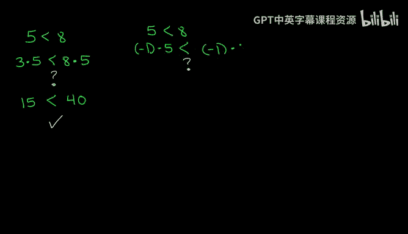

Turns out we get an electric shock through the keyboard if we even try to write this because minus1 times 5 is minus5。

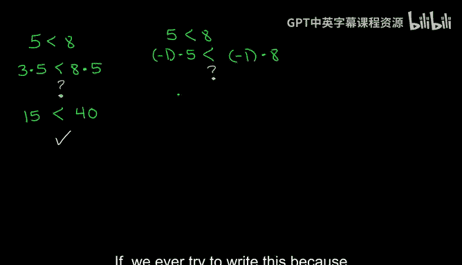

Last time， question mark。

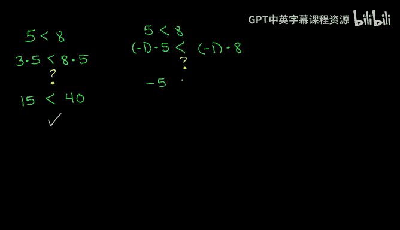

M-8。

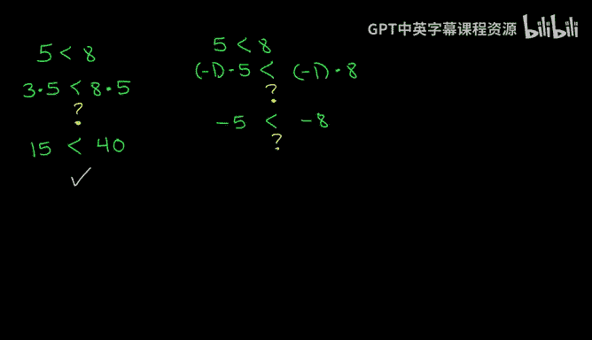

No way， right。 Here's the real number line。 Here's 0。 Here's 5。 here's 8。 Unfortunately， here's-5。

 here's -8。Mus5 is not till left of minus8。

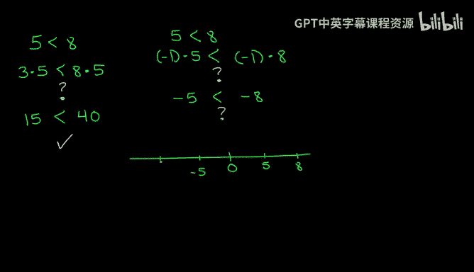

This is completely awful。In fact， what is true is that minus5 is greater than 8。

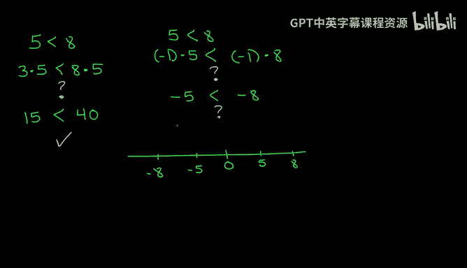

Here's the general rule。

Suppose。A is less than B。

If。C is greater than zero。

A times C is less than B times C。But if C is less than zero。

Then A times C is greater than B times C。 just as we saw here， you have to flip the inequalities。

Let's see one example of that。

So I do a little bit of algebra。 Suppose someone tells us that minus2 times x。Is less than 10。

What does that mean about x？Well， let's multiply both sides by minus12。

So if I multiply this side by minus12。Times minus 2 x。Multiply this side by1 half，1 half times 10。

 but now I have to flip the inequality right because I've multiplied both sides to inequality by a negative number。

 This gives me x is greater than 5。

Which pictured on the real number line， here's 0。 Here's -5。And that means x can be anything in here。

So if x is anything in here and I feed x to this equation up here， this inequality up here。

 I make it true。

That's really just the only pitfall you have to worry about， but it can be a serious one Okay。

 that concludes our video。

