# 杜克大学《数据科学数学技能｜Data Science Math Skills》中英字幕 - P9：09_01_02_求和符号Σ简介 - GPT中英字幕课程资源 - BV12mv6BLEhC

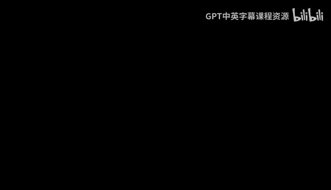

Okay， welcome back everyone， The point of today's video is to understand what we mean by Sigma notation。

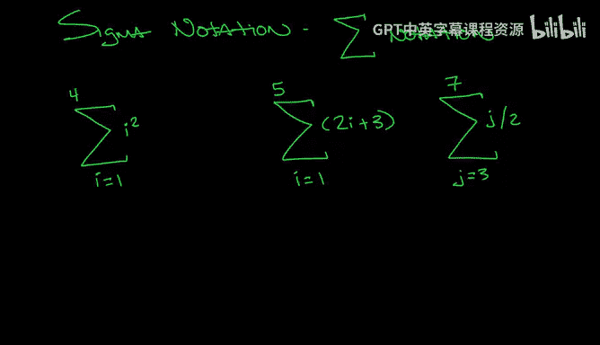

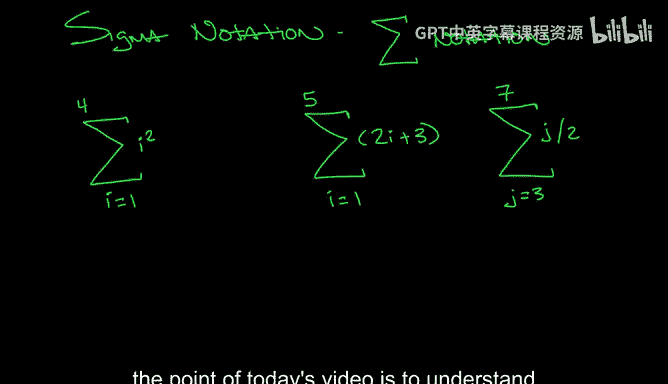

And Sigma is often used， we often use for Sigma as this big Greek letter， Sigma。

 which kind of looks like a big point Ds。

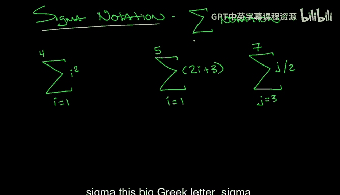

And as always in these lectures， the point is not necessarily to bombard you with computations or of judge you on write or wrong answers。

 but simply to demystify and explain notation which might otherwise be mystifying so what we're going to do in this lecture is just work through three examples each one of an example of sigma notation。

 each one of these things here。

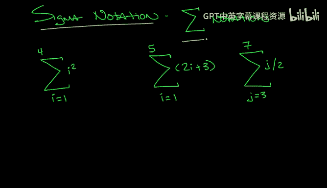

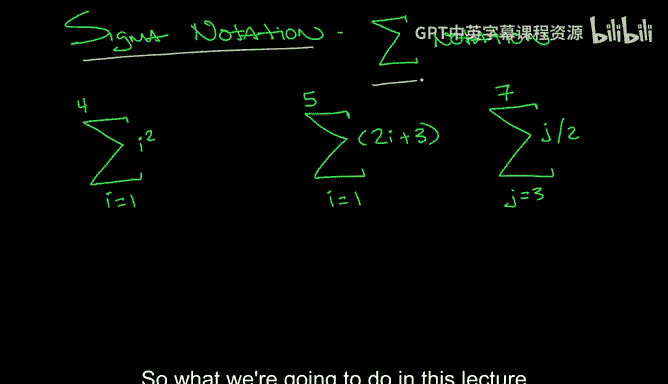

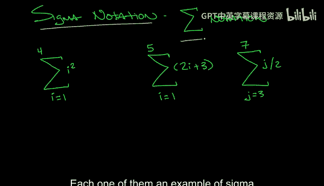

The sum from i equals 1 to4 of I squared。The sum from I equals 1 to 5 of 2 I plus 3。

 and the sum from J equals 3 to 7 of J over 2。

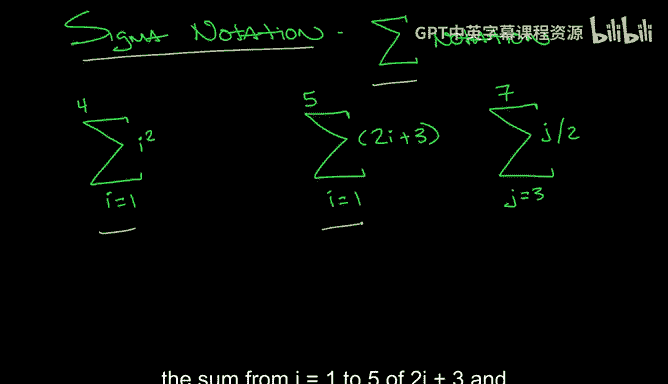

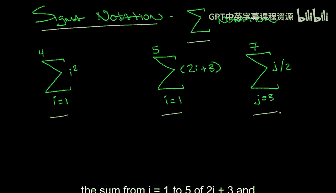

These are all just fancy ways of writing numbers， in fact， tell you the answer in advance。

 this first number equals 30。

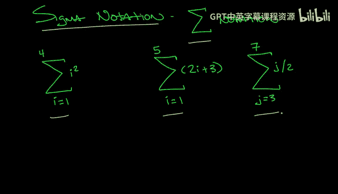

The second number equals 45。And this last number equals 25 hs。

 how on earth did I know that when this lecture is to learn why that's true？

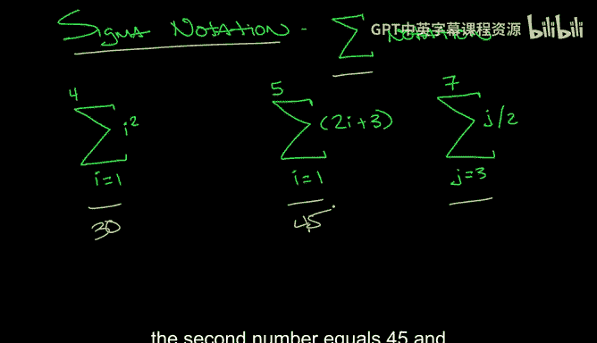

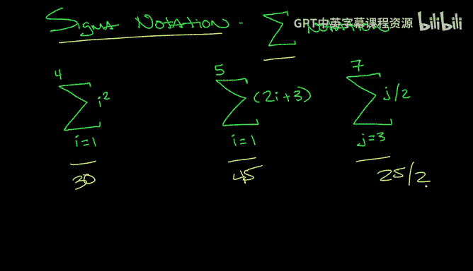

Let's dive in， do the first one。We're going to compute the sum from i equals1 to4 of i squared。

What I'm going to do is just do this myself first and then walk you through it unpack how I did that。

 so the sum from i equals 1 to4 of I squared is equal to one squared plus2 squared plus3 squared plus4 squared。

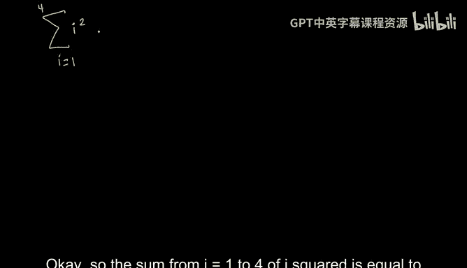

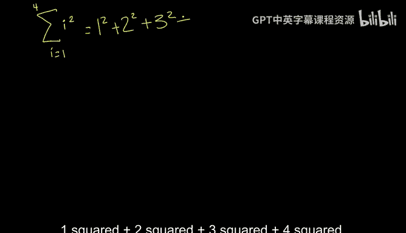

Okay， so suppose someone paid me to do this problem， I consider myself done。 I've worked it out。

 I've translated it from Sigma notation to something。

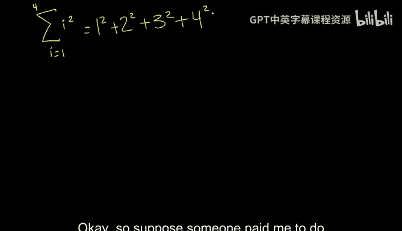

Someone who knows arithmetic could do。That person is really a stickler for details。

 So I'm going to say， well， keep going。 And I'm going to say， maybe you need to pay me more money。

 And after we're done with that negotiation I'll say， okay， from here， it's arithmetic。

 this is just equal to dot dot dot。 The dots covering up the fact that I've done this in advance。

 This is equal to 30。 which is the answer we saw before。

 But the real point of today's lecture is understand this first equal sign。

 How on earth did I know that this funny symbol。 The sum from equals1 to 4 of I squared。

 It was equal to 1 squared plus 2 squared plus 3 squared plus 4 squared。😊。

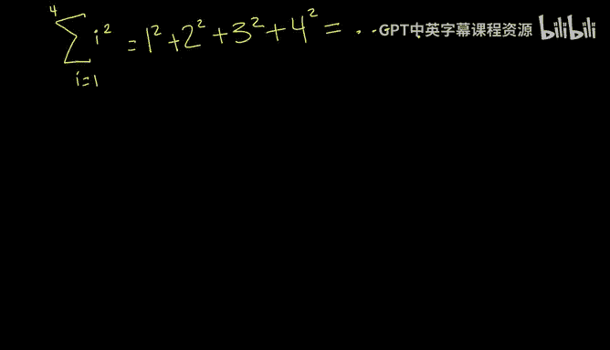

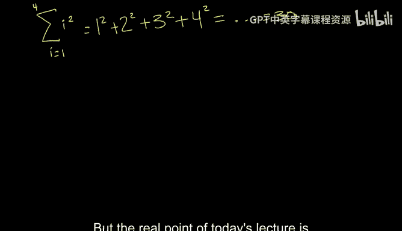

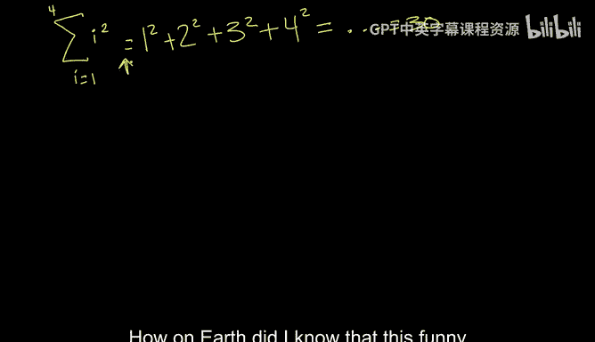

Okay， so let's walk through that。

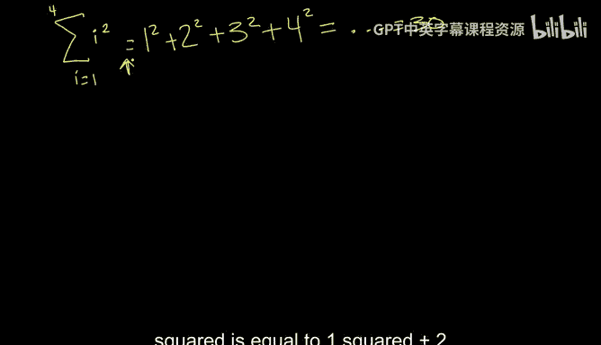

The first thing to realize looking at this symbol is there's a bunch of things first there's a counter in here。

 there's a symbol in here I squared。

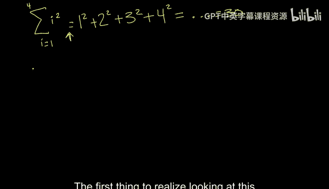

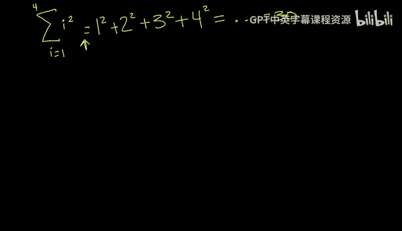

That same person walks to me on the street， person pretty annoying by now and says。

 I'll give you 10 bucks if you tell me what I square it is， no deal， it's not really a fair question。

 I don't know what I is， but actually I have some hints。

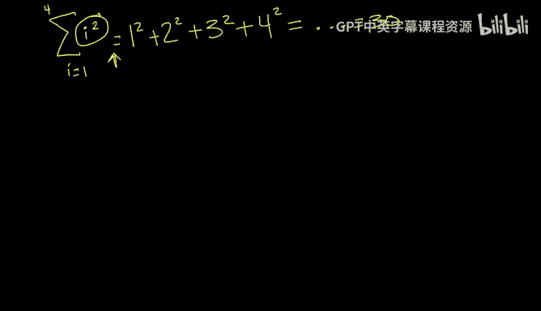

Down here at the bottom， I know how to start my range of I。

 I know that I should start from I equals 1。 And at the top， I know that I should finish when I is4。

Okay， so let's do some scratch work and work that out on the side。Here I have I equals1。

 here I have I equals 2。

Here I I equals 3 and here I I equals 4。

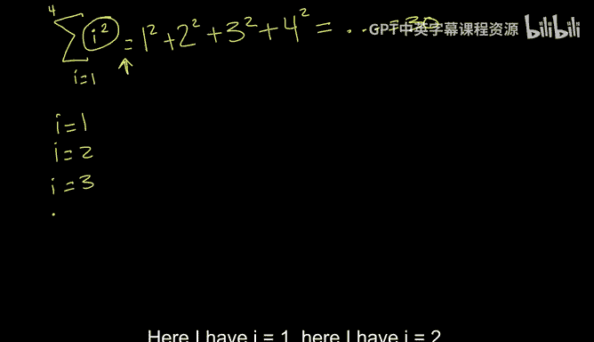

So you'll notice that starting range。Starting from one， that finishing range， ending at 4。

And actually， there's something here it's a little unfair。

 nothing in the symbol tells me that I count by one going from the bottom of my range to the top of my range。

That's okay。 That's sort of a cultural agreement。 You start from the low eye。

 you end at the top eye and you count by one。 Okay， fine， So what do we do to each one of these eyes。

 we do what this thing in the middle tells us to do。 In this case， that thing in the middle。

 Very bossy tells us to square eye。

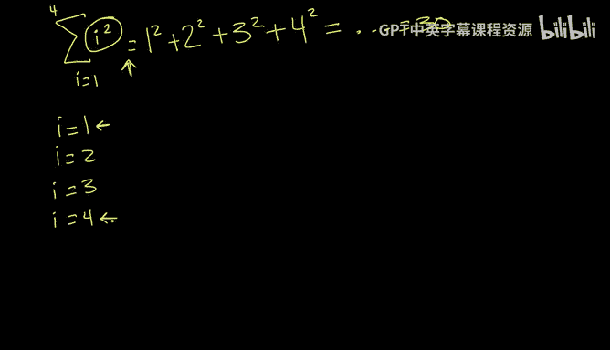

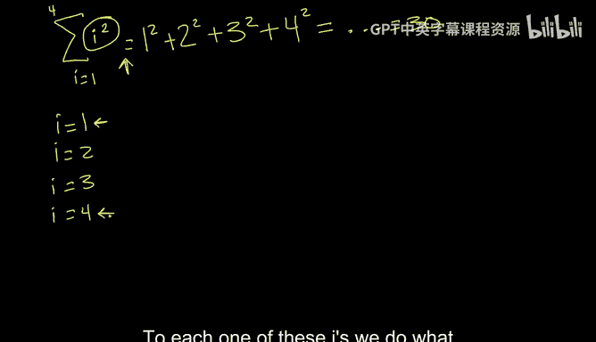

So if I equals one。Then I squared， equals one squared。

If I equals 2， then I squared equals 2 squared。If I equals 3， then I squared equals3 squared。

 I think you get the hang of it。 If I equals4， then I squared equals 4 squared。

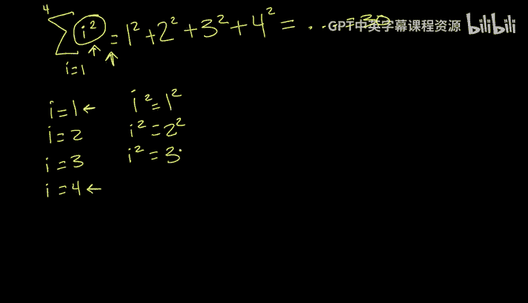

Okay， we've done the scratch work on the side， What do we do next？

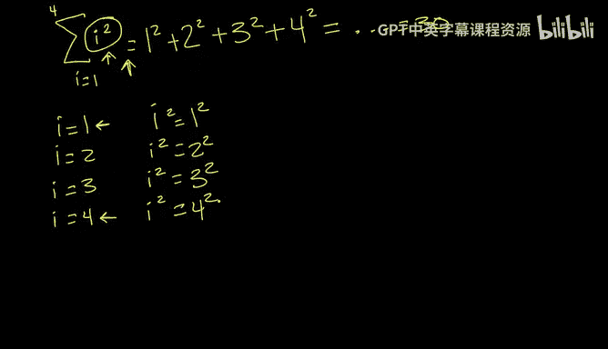

Well， sigma。

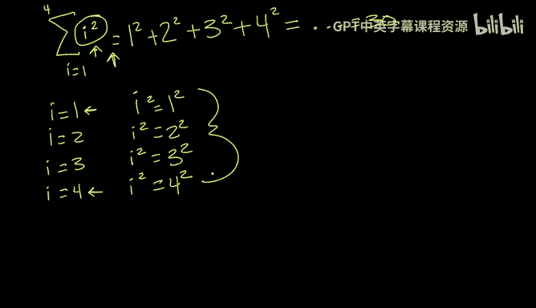

What you want to think about this is equal to sum。Meaning。

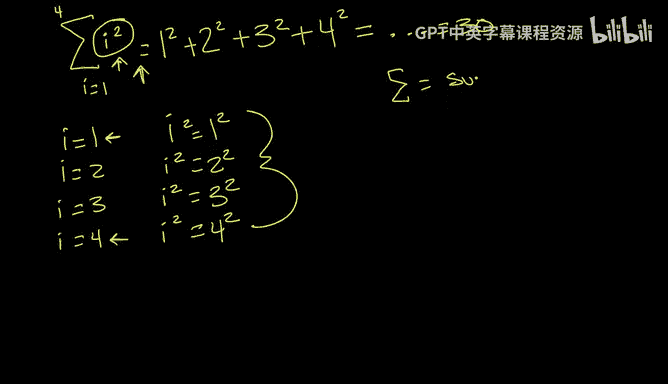

We take all of these answers here and we add them up。And that's how we get what we get up here。

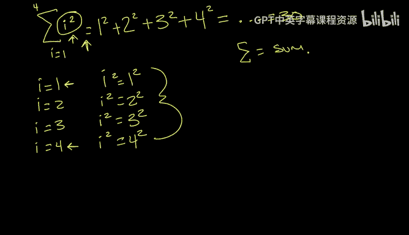

We've computed on the side that when I equals 1 i squared equals1 squared and so on。

 and then we add them all up and we get our answer。

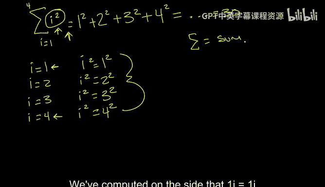

For those of you who are sort of business minded， you can think of this as a process which can be broken up into parallel processes undertaken by different workers。

 so one worker can compute what happens when I equal one。

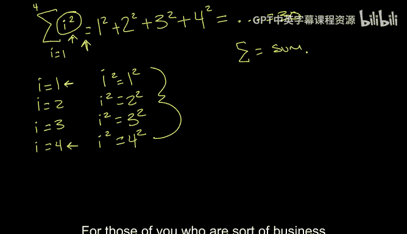

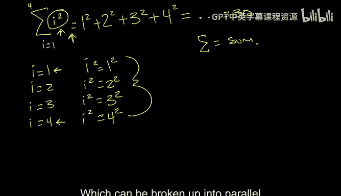

One worker can do when I equals 2， one when I equals 3。

 one when I equals 4 doesn't really matter when they do them。

 and do them at the same time in parallel， the end of the day they compare their answers。

 the last worker add them all up and we get the answer that we get over here or over here。

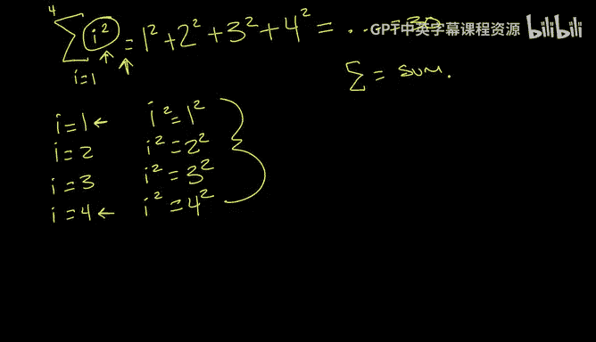

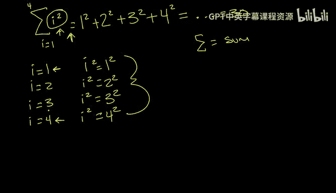

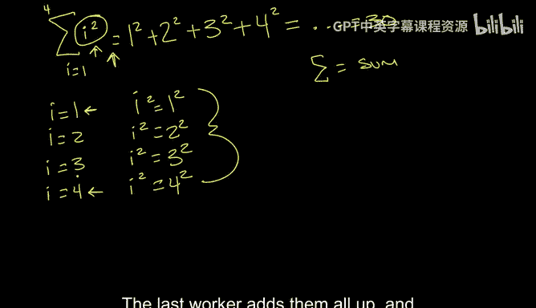

Okay， fine， let's do another example， very much like the same little of twist。

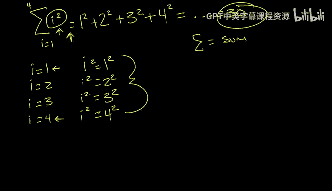

So the second promise example is to sum from I equal 1 to5 of2 i plus 3。

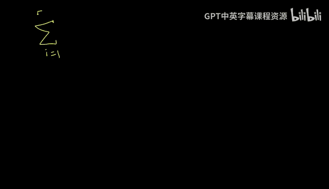

Only thing that changed from last time is we change the top of the range and we change the thing inside。

So just like before， do it one more time in full detail， I go from I equals 1， I equals 2。

 I equals 3， I equals4， and I equals 5。What do I do to I equals 1？

I do what I'm told to do to any eye by this symbol。 So in this case。

 I take it and multiply it by two， and I add three。Here I get two times one plus three。

Here I get two times two plus three。Here I get two times3 plus3。

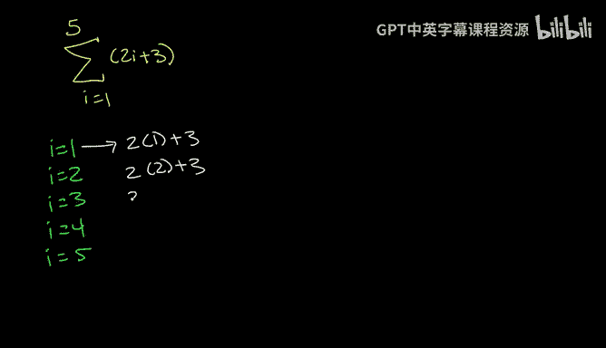

Here I get two，14， three。And here I get to timess 5 plus three。End of the day， take them all up。

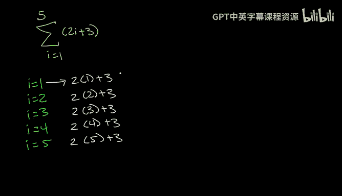

A up。

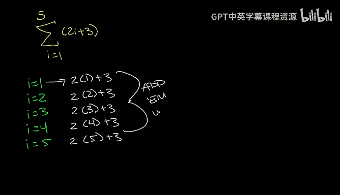

Just like you did before。So we do that up here， which is equal to。

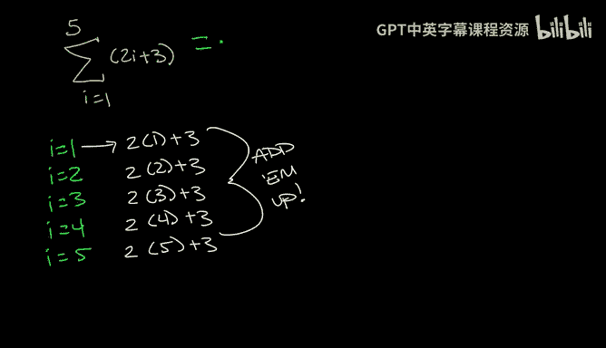

Two times one plus three。Plus。Two times two plus three。

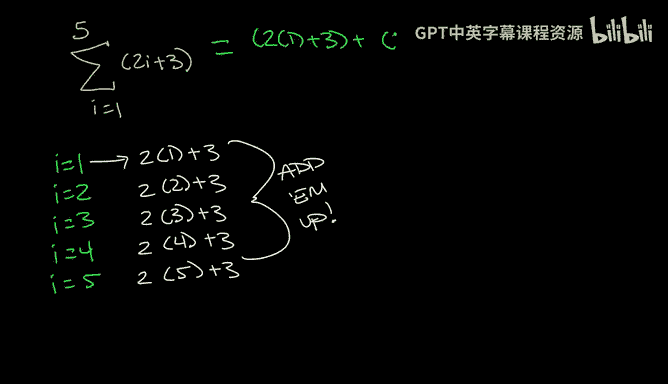

And your notice is getting a little tedious， that's sort of the point adding up long strings of numbers is tedious。

 really the added value here。

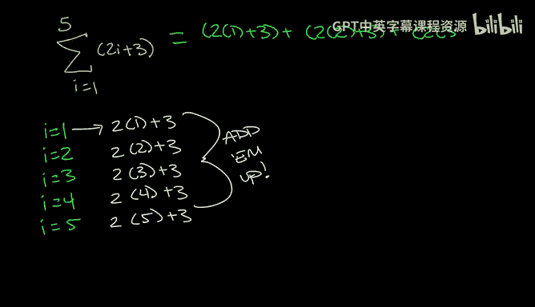

Is that the sigmaization gives you a compact way of representing the work order。

 This is what you're going to have to do。 Should you choose to do it and you won't choose to do it。

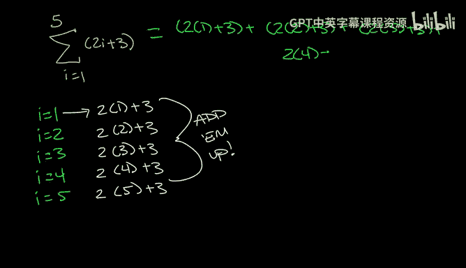

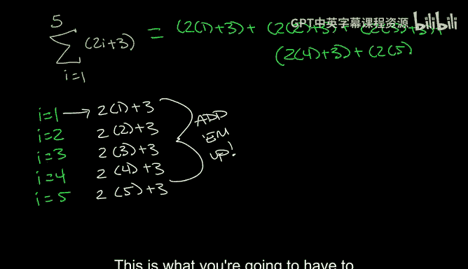

And then we have two times five plus three， and again， we're really done。

 I consider myself done if you really want an answer， you want to pay me a little bit more money。

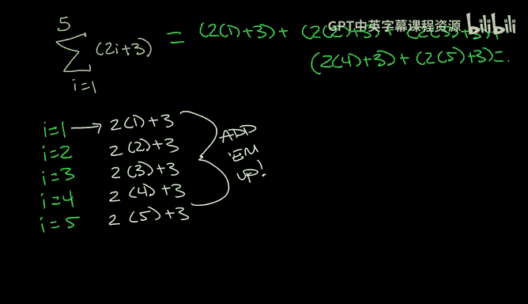

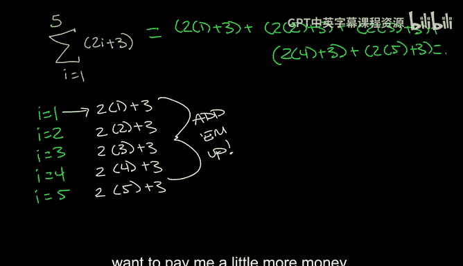

Maybe I've done this work in advance， turns out this is equal to 45。

 which we already knew because I told you at the beginning， but maybe you believe me。

 maybe you didn't。

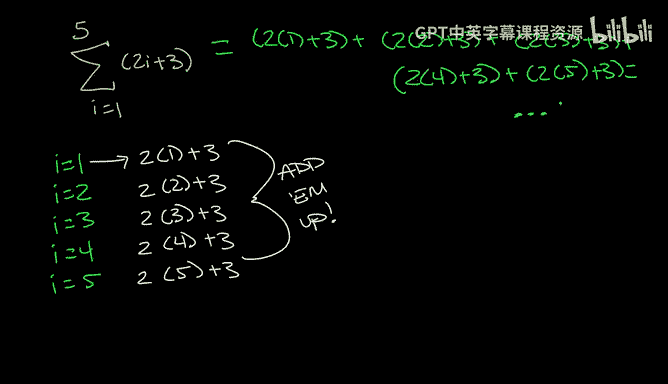

Okay， fine， let's do one more example。This case， we're going to break the idea that you have to start from one with a counter。

 We're also going to break the idea that you have to use I。 Let's take the sum。From J equals3。2 7。

Okay over to。You know what we're going to be big kids about this now and not even do our scratch work because I think we get the idea。

 This tells us to do something to J。 What do we do to J， we divide it by 2， Okay， boss。

 but which js do we do that2， we do it from J equals 3 inementing1 up to j。Okay。

 so this is equal to three over two。Plus four over two。Plus five over two。Plus6 over two。

Plus 7 over two。We work all that out。 I really don't like arithmetic and I really don't like fractions So here I'm the up front and say I did this myself。

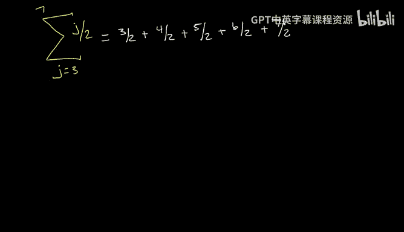

At home， actually at five in the morning。This is equal to 25 divided by 2。

Okay， so those are three easy examples now I'm going to give you the 100 gold coins gold star problem。

Which is I want you to compute the sum from R equals 3 to 7 of r over 2。

 and I want you to pause the video and think about。

Okay， so there's two ways to have done this， wanted to do it directly just as we did before。

 the other is to be a a little bit clever in say nows trick questions just 25 over two。

How come well， the only difference between these two is one's got to J。

One's got an R。 Otherwise， it's the same range of J， same range of R。

 And the same thing is being done to J and R。 There's something special about J And R。 In fact。

 J and R are examples of something we call。

Dummy indices。And we need to be as super disrespectful as dummy makes it sound。

J and R U dummies are not real variables They not real unknowns like an algebra。

 when you solve 2 x plus1 equals a， and you have to solve for x， and you either get points or not。

 They don't have any independent existence。 There's no answer to what they are。

 They're just symbols for counters。 They say， start at something equals 3。

 increment that something up to 7。 Do the following to something to really drive that point home。

Note that the sum。From smiley face。

Equals 3 to 7。Of smiley face over two。 What do you think that is。 Well， it's just 25 hves， too。

 There's nothing special about it。

That said， let's not get too wild， there's generally a cultural agreement。

That when we use dodices， we tend to use symbols like I J K， maybe L， maybe R， sometimes M。

 sometimes n。 In other words， we tend to use things from around the middle of the alphabet。

 but that's just an agreement。 No particular reason you couldn't use a B。

Smiy face。Maybe try to draw a little doggy。

Really， very， very poorly because that's not what I do。Heres。

People will look at you funny， but you' be just as perfectly right。

