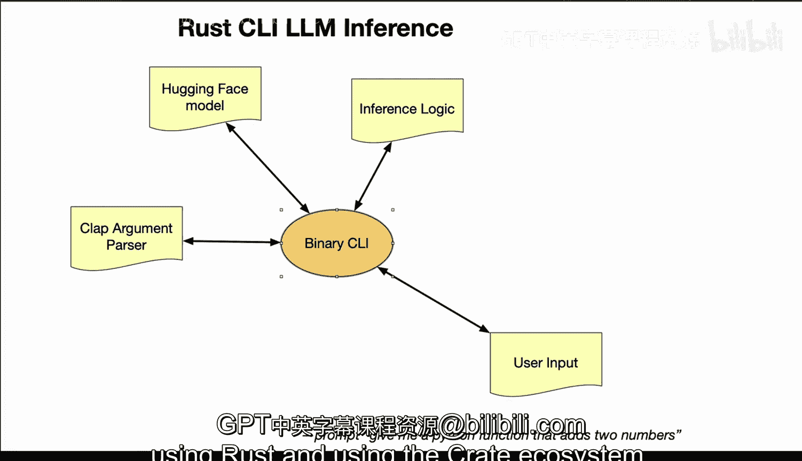

# 杜克大学《本地大语言模型的基础｜Foundations of Local Large Language models》中英字幕 - P17：17_01_03_Rust命令行推理.zh_en - GPT中英字幕课程资源 - BV19M4m1m72W

Here's a diagram that shows the flow of building and running a rust command line interface that is going to perform inference using a hugging face transformer model。

 First up， it starts with the model being downloaded from hugging face in the hub in order to get access to a pretrain transformer and you could use a model like B or GP2。

 Then the model is loaded in rust using rust Bt or transformers crate。

 which would provide the rust bindings for hugging face model。

 Another option as well is used the rust candle interface。

 and this allows the model to be used for inference in rust code。

 The next step would be actually using the Ci and you could do that with the clap crate which allows for easy argument parsing。

 and you could have flexible user input to the Ci。 you could even customized the prompts。

 for example， if you wanted to have a prelude to every single prompt， maybe something that would。

You better results， you could also put that into the logic。Once the CI is built。

 you can then implement the inference logic that takes the user input。

 passes it to the Hugingface model loaded earlier and returns the results。

 The rust Bt crate is going to make this easy by handling the conversions and inference process。

 Finally， the CI is run by the user providing some text input。

 and this input is then fed to the hugging face model via the CI。

 and the inference is performed in rust and the results are printed back to the user so。

In a nutshell， this is what we got。 Download a model from hugging face。

 Lo the model and rust with the model crates。 Then build a CI with clap。

Implement the inference logic and integrate it back to the model and then finally run the CLI to perform inference on user input。

 So really this is an efficient and in many ways the most efficient way you could possibly do large language model inference is by using rust and using the crate ecosystem。

