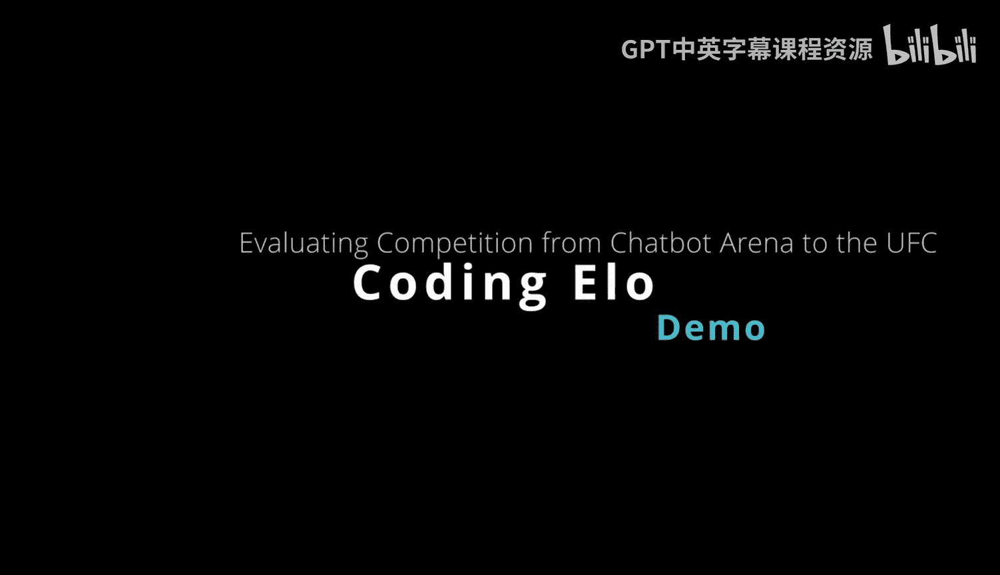
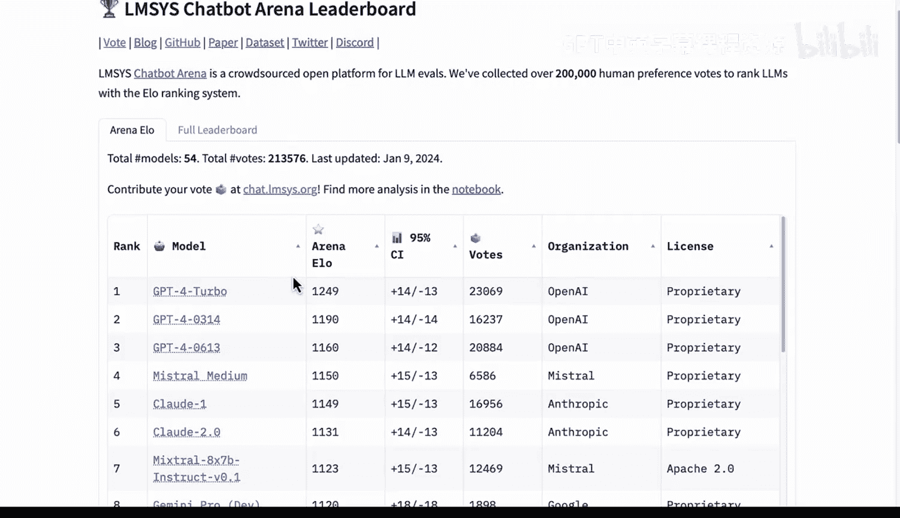
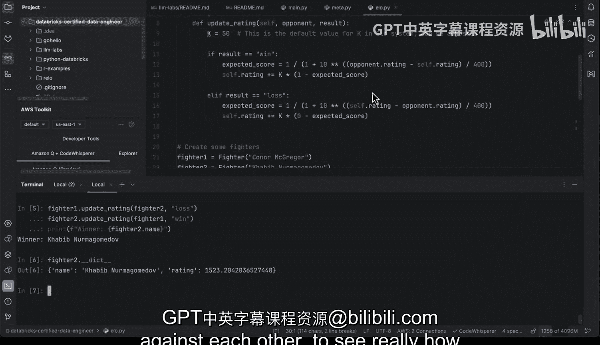

# 杜克大学《本地大语言模型的基础｜Foundations of Local Large Language models》中英字幕 - P22：22_02_02_用Python实现ELO评分系统.zh_en - GPT中英字幕课程资源 - BV19M4m1m72W

A lot of people are excited about chatbot Arena because it's a great way to do head to head testing for large language models。

 we can see commercial models versus open source models and proprietary models and what's really cool about this is we can actually really dive into who's better from a numerical perspective。

The reason why we're able to do that is because of ELO and ELO is a strength of schedule metric。

 and so what it really scores is how well you do against your opponent versus what's your score so if you have a 20 and0 record but all of the people you competed with were amateurs that doesn't say as much as someone who has maybe a fewudal losses。

But has actually worked with much harder opponents。

 So this is what the elo is really telling us is the strength of schedule。

 So if we go through into Python， we can actually code this up ourselves。

 So let's go ahead and take a look at how that would work here we have a fighter and we initialize it with a name and a rating And then we have a method here。

 in this case， the K is 50。 and this would be the default value that we would adjust depending on potentially how many competitions or R 32 is a good number for a lot of chess matches because there's many matches。

 but in the case of Ufc there's very few。 So maybe we want the K to be a little bit larger。

 and you would tune it based on your experiences with the data set。 But in a nutshell。

 what it says is if you win you get a score that's dependent on your opponents rating as part of the weighting and if you have a loss is also depending on the opponent's rating as the component。

 And so if we take a look here， we could create a couple fighters in this case。

or and Kabeb we could also go through and print the rating before the match。

And then we could print the simulation of what happens and we would update their ratings right afterwards。

 and then we would go through and print this out。 So， so not a lot of code。

 Most of it's actually print statements， if we go through here and we run this we can go ahead and see that Connor has a 15 kbibe has a 1500。

 The winners Kabibe。 after the match。 Connor actually regresses。

 he goes to 1475 and Kabeb actually improves and his goes to 1523。

 you can see how if you do multiple iterations， you're going to get these metrics that show numerically who is the best based on their opponent not just based on whether they won or lost。

 And this is one of the power powers of elo is it's a great way to measure competition。 Now。

 we can even dive into I Python as well here。😊，And play around with this a little bit。

 So if we say from elo import F right here， we could also do the same thing so we could you know。

 make an instance of this and play around with it。 We could say， you know， let's make one of these。

Here we'll copy this， throw it in。And let's go ahead and make a second one。

 throw it in and this is what's nice about using an interactive terminal or using something like Jupiter for these kinds of things is that it's kind of fun to play around with the object and you have it in memory and you can actually start to experiment with something in this case we could again you know go through here and figure out basically who won and then if we wanted to as well if we say this is one of the cool things that you can do。

With， with I Python is we could also do diict， and we could look inside。Of the state。

 And we could actually see that oh， it's just a dictionary that has the name and it has the rating。

 So elo isn't a magic you know metric。 It's pretty simple to actually code it up yourself。

 You can see here this is just what the score is， but it's a very intuitive rating。

 and it's a great metric for judging the competitive nature of large language models。

 both open source and proprietary against each other to see really how they act in a real world scenario。

😊。

