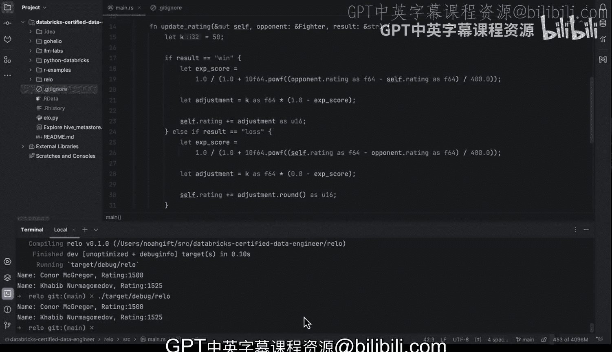

# 杜克大学《本地大语言模型的基础｜Foundations of Local Large Language models》中英字幕 - P23：23_02_03_用Rust实现ELO评分系统.zh_en - GPT中英字幕课程资源 - BV19M4m1m72W

Yeah。Here I have a Ru project where I'm going to code up an eO example。

 so ELO is a way to compare two different users or two competitors and see who has got a better rating based on their strength of schedule so。

First up here we have the Fstruct inside this is a name that's a string and the rating is U16 if we think through the implementation here。

 you can see next that this particular piece of code here allows us to implement the fighter methods on the struct and so there's a new which creates the new fighter and returns the struct。

 there's the update rating which will update the rating after the fight。

And if we take a look here at the update rating。This is really where the heart of a lot of the logic is。

 we define a K here and the K is going to be adjusted based on the kind of thing you're measuring in this case fighters don't fight a lot so we'll do a bigger K。

You'll do a lower one if you had lots of competitions。

 and here we can just go through and look at the score。

 So there's going to be a win that goes through and calculates the win percentage。

 and then there's going to be a loss， which is going to calculate the last percentage So this calculation will then get inside of the rating and we can see we've adjusted it right here。

 And then finally we can look through here and get into the main here。

 So really in a nutshell what's happening is we would first create an initial value。

 So in this case it would be an initial value of 1500 for F 1。

 which would be conor would do let mutable fighter 2 also be 1500。 So we initialize them at the same。

 and then what we do is we simulate a fight。 So we say fighter out update rating。

 Now notice that these are mutable variable。 So this is important concept and rust is that if you're going to change a value you have to explicitly set it to be mutable。

And so these rating changes as well will have to borrow that right here。 This is the borrow。

 and then we're going to record a loss and a win。 Now what's going to happen at the end is there's going to be a calculation that is going to give us the name and the new rating afterwards。

 So let's go ahead and print this out。 So how do we do this。 How we run this rust project。

 I think it's a good idea to always make sure that your code is formatted。

 make sure things are looking good so we can just say you know cargo FMT looks like things are formatted correctly and then we can type in cargo run。

And this will compile it and we can see the results， we have name Conor McGor rating 1500， name Kbib。

And his rating is a little bit higher because again， he won that last competition。

 So that's really the intuition here behind the elo rating， not a lot of code。

 there's just one method here called update rating that's called and it was nice about rust is that we have a very safe system here that has types and has a compiler that's protecting us and we know that this would run very fast if we wanted to run this in production。

 Now how would we do that notice here that it says running target debug relo So if we go ahead and we actually navigate to that。

 we can even see exactly where that binary is。 and we can do the same thing that the compiler did。

 So R is a great option for generating metrics at scale if you' were going to generate your own simulator。

 for example， that was using eO to evaluate the metrics in your own company for large language models。

 rust would be a great choice。

