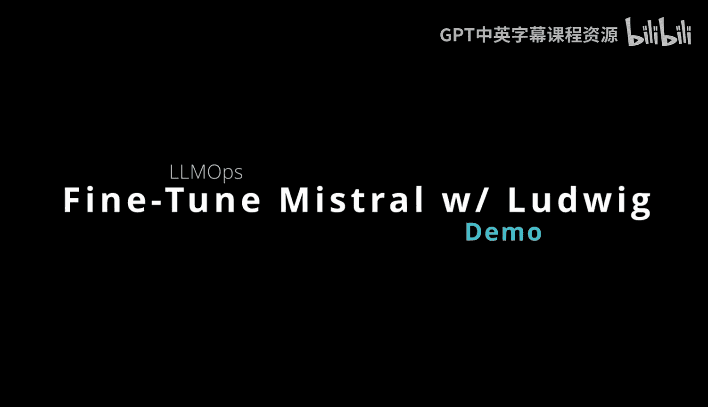
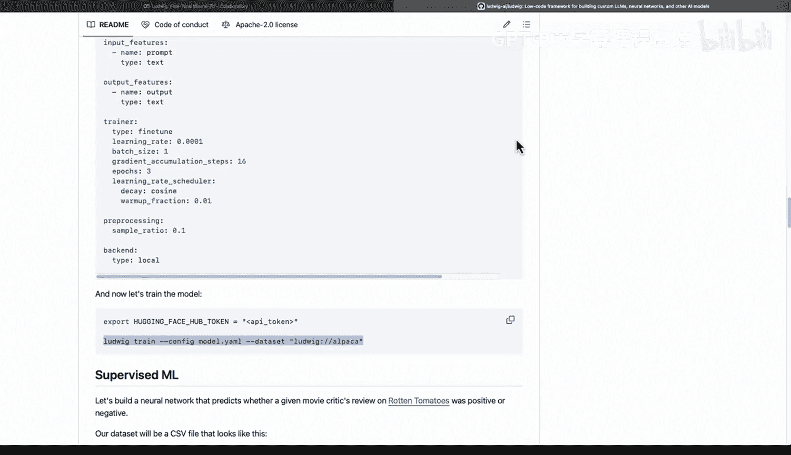
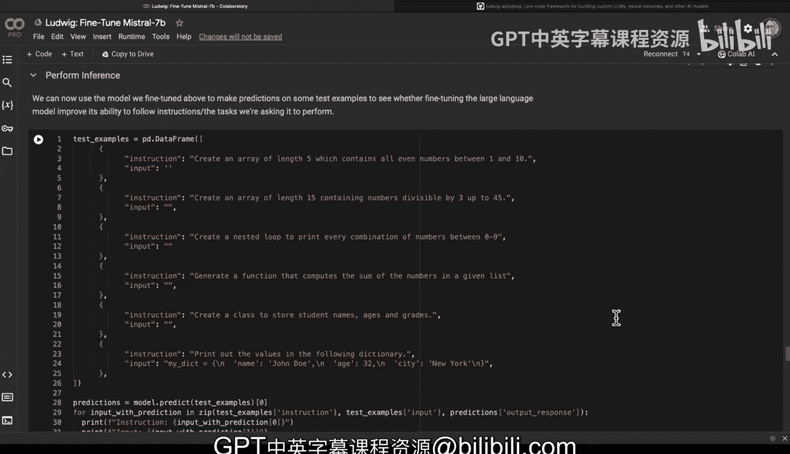

# 杜克大学《本地大语言模型的基础｜Foundations of Local Large Language models》中英字幕 - P27：27_02_06_使用Ludwig微调Mistral-7B模型.zh_en - GPT中英字幕课程资源 - BV19M4m1m72W

Let's take a look at Ludwig here， which is one of the more stealth fine tuning tools available for large language models。

 A lot of people are very interested in training large language models and getting a little deeper into that whole ecosystem and Ludwig is a good choice because it's a lowcode framework If we take a look here at some of the things you can do first step here you can see this is a visual of the fact that you use config files which I'm a huge fan of and you also have some getting started guides here。

 for example， fine tuning Mistrel which is one of the hotter open source large language models and you can see here that it is a yamlbased approach which makes it very appealing and then in fact you can just train with the command line So it has some of the same characteristics of let's say a Devops type workflow where you're able to simplify things with a Yaml file Now let's go ahead and take a look here at a notebook in coab Pro which is a pretty good choice as well for doing fine tuning。

It has access to a GPPU Now let's take a look at this runtime here， you can see that this runtime。

 look what I've got， I've got a coab Pro here， we've got lots of Ram， we've got a disk， etc ce。

And in fact， one of the things I can do as well is I can go to runtime and if I wanted to。

 I can even toggle different kinds of GPUus。 this is a great GPU for this particular use case。

 but I also could even get a higher ra if I wanted to now if we take a look at how this works first step the goal of this particular notebook is to use large language models for code generation and you can see here that there's some English instruction and then there's the code as well and so look here as well how simple this is as you have a YaAml file where you actually are putting the inputs and the outputs and then you define what the base model is going to be and if we scroll down here。

 you see the inputs and then if we go a little bit further here we can actually get into the code。

 So the big thing that's going happen first is the code generation data has to be loaded So that's the whole point of fine tuning is you have a model that is already pretty good and then you get some custom code and some。

Data and you mix those together and you make the model better。

 And this is the gist of how this would work is you would go through here and say， hey。

 here's my data set and you can see the instructions， we have the input and we have the output。

And you can even read exactly what those do。 So if we keep scrolling down here。

 there's some data processing as well， which is pretty normal when you're working with fine tuning and then if we scroll down here you can see all of the metrics as well and then finally at the very end here。

 we can actually go through here， do some preprocessing。

 load the entire configuration for the project and then the fine tuning takes place and you can see the output as your fine tuning which is really useful and it even shows you the GPU type as well。

 So it's a pretty strong contender for the simplest possible way to do fine tuning is to use Ludwig there's some notebooks that make it very simple for you so go ahead and take a look it might be the simplest way to actually fine tune one of the new large language models。

