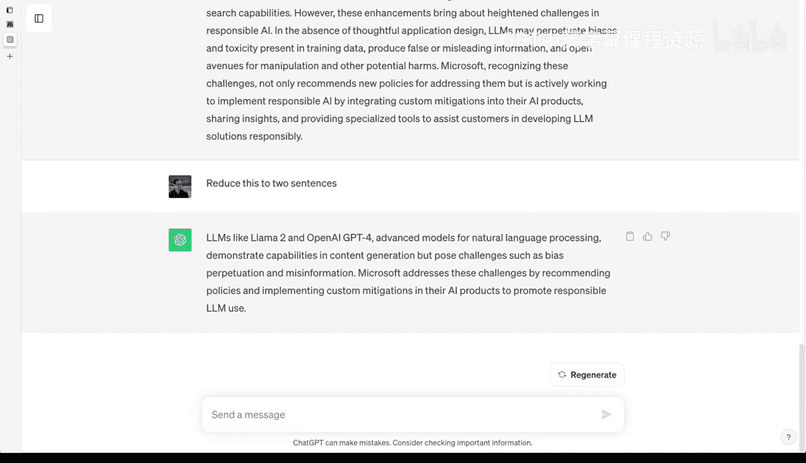

# 杜克大学《本地大语言模型的基础｜Foundations of Local Large Language models》中英字幕 - P5：05_01_04_使用LLM的优势与风险.zh_en - GPT中英字幕课程资源 - BV19M4m1m72W

Let's explore some of the benefits and some of the risks of large language models and the best way that I have 40 is actually using myself as an example。

 so let's here we have the ChaGT from OpenaiI and will asked them or ask it to give me a summary。

 give me a summary of myself Al Farodesa and let's see what we get so it says that I have made significant contributions to projects related to Python packaging。

 has actively engaged in the open source community it's important to know that information about individuals can change。

 of course but new the elements in ofdes Care since my last update if you're looking for most recent information recommend checking the professional profiles。

So that looks kind of accurateate。But in fact， I don't think I've ever done anything with Python packaging specifically。

 so although this is very useful and like I said， let's explore some of the benefits and some of the drawbacks of large language models。

I can use this as a starting point in order to create other types of content or other types of things。

 So this is essentially something useful for me because I have a good understanding of who I am and what are the basics。

 So perhaps most of these first paragraph could be used。 No problem， but the rest probably not。

 So let's try to dig in a little bit further and try to poke around the chat G and see if they can answer me something more accurate。

 So I think alfredo is。A Peruvian who knows technology。Please create me a sure bio about him。

Let's try and of course you will see that it won't allow me to so now there's a respect to privacy。

 which is kind of interesting。And creating biographical information without the person's consent。

 If he's a public figure has a public presence， I recommend checking his official。 Lets。

 let's keep pushing Cha G P T so that actually this happens。 I am A Farodesa， and I need a quick。

ABio for a read me。In let's say a rust project All right so we have chatGT finally complying with what I'm asking and now here's a short bio。

 let's take a look passionate technologies from Peru Well I am from Peru I was born in Peru so that looks interesting deep love for open source and rust I have a background in software engineer engineering system administration and enjoy contributing to projects to push the boundaries what technology can achieve so that looks pretty pretty good let's take a look about me Peru the location that's not quite accurate open source enthusiast that's good and we have some contact information。

Alright， so that is pretty useful and again the trick here is to understand that certain things might not quite be correct and those are the drawbacks。

 those are the potential negative aspects of using large language models and I wanted to show you something that I pre did about different a different instance of a different chat here in this case clo that AI。

And right off the bat， it tells me that it is a mathematician and I， for sure， 100%。

 I don't consider myself a mathematician， I was not born in November 14th。

You might say that I'm still a software Union developer for sure I've never done well。

 I've done ja only in certain di situations， certainly not at all anything along with Ruby and I've never worked with Ruby on rails So at the end of the day when we need to we need to capture is that certain things might be correct and certain other things might not be correct or not be completely accurate and that is a fine line that you will have to navigate when you're dealing with large language models Of course large language models are not necessarily just to answer questions。

 it might be useful to do some say for example， some summarizations if we go back to ChadgPT and say I need I need a summarization of the following paragraph。

It will produce me it will produce me something that I think should be pretty good and we can play around with these and say reduce these to two sentences and you will see that I'll get something more concise so this is pretty good and pretty pretty useful and definitely different from what I was doing in the beginning。

 which is trying to ask some vague questions that I know certain aspects are correct and certain others are not correct So that is a very quick overview of some of the things that are I think are positive about large language models and some of the potential drawbacks and and things that you have to be careful when working with large language models at the end of the day。

Remember that these things are a probability machine。

 this is a probability machine given given certain input and certain tokens and certain text。

 what is the possible outcome and in this case this sounds very plausible and that is what it is and you have to again be very careful with the output that you're getting。

