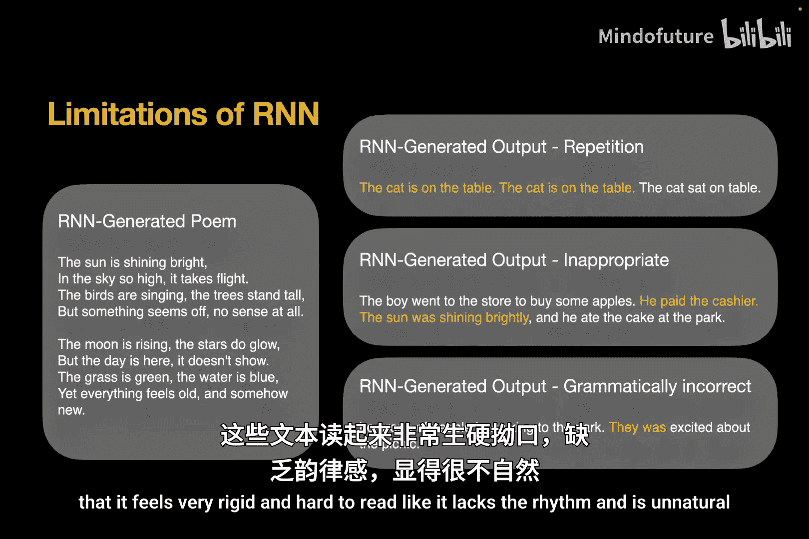
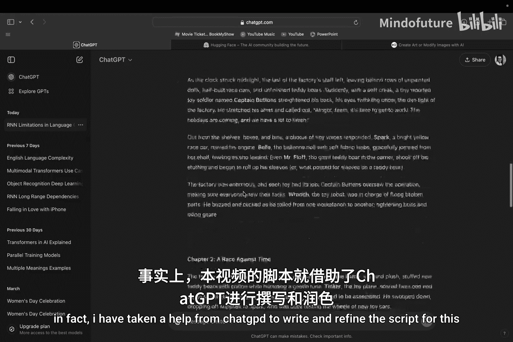
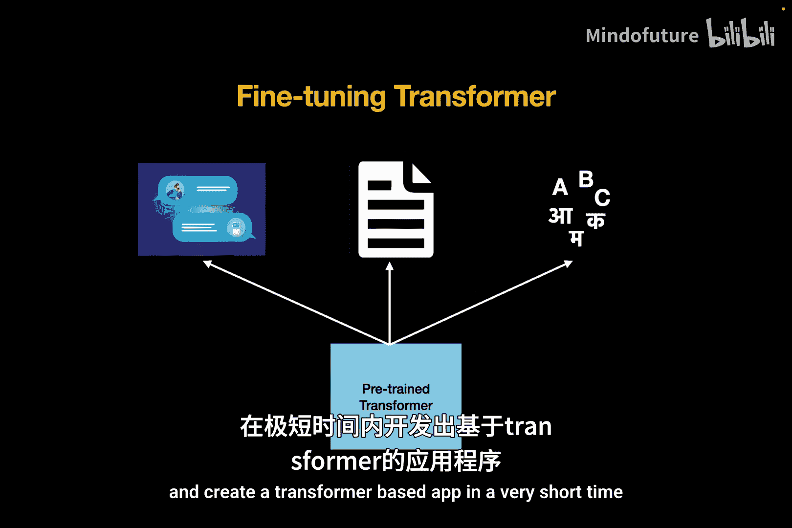
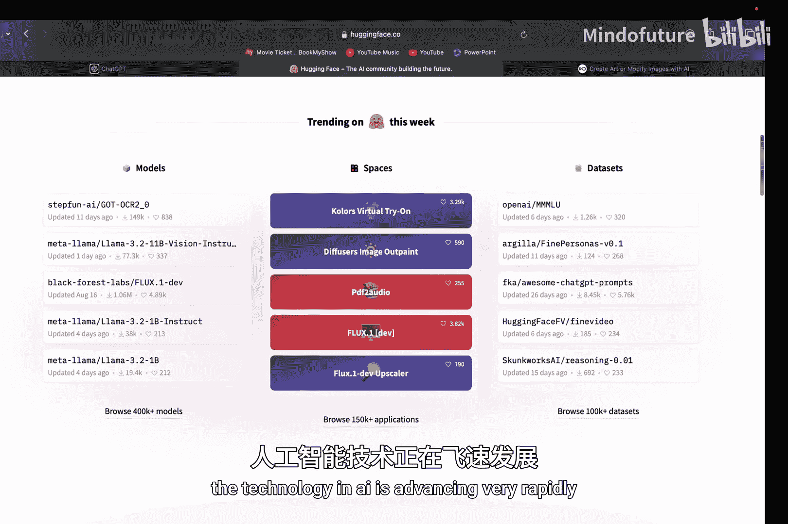
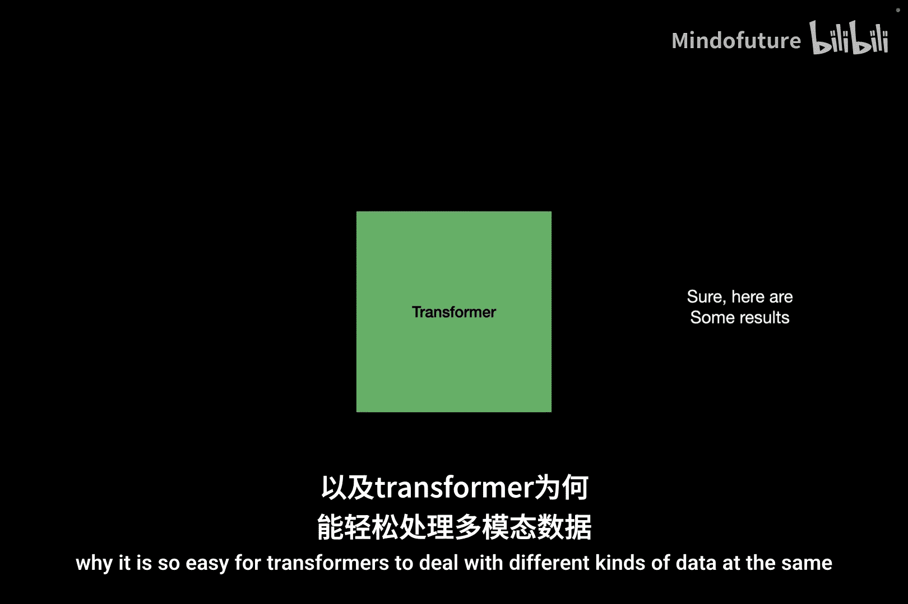

# 深度学习中的Transformer架构 ｜ Transformers In Deep Learning ｜ Learn With Jay p01 P01_Transformers_in_Deep_Learning-Introduction_to_Transformers -BV1Mdt9zXEpE_p1-

Starting with this video， we are going to deep dive into the most groundbreaking advancements in artificial intelligence。

 and that is transformformers。 Transformers are the deep learning models that have now revolutionize the AI industry。

 They are crucial part of applications like Chap Google Trans meta AI and image generation tools like D Transformers are the reasons why now AI can also perform cognitive tasks like understanding and responding in natural language When all previous models fail to understand the natural language Transformers did it effortlessly。

 and they are now so advanced that they are now also used in computer vision tasks。

 So what are transformers。 How did they became so powerful。

 That's what we are going to study in this video series， We will see what is transformers。

 what makes them so special， we will also dissect into every single block of transformers in detail。

 and we won't be seeing just the surface level overview like。😊。

you will found in the lots of content or on the Internet。

 but we will deep dive into the mathematics behind it the reason why the scientists decided to put something in the transformer architecture and how all of that magically seems to work by the end of this playlist My goal for you is to be able to understand the transformer architecture and design in utmost detail and to be able to reproduce it from scratch on paper This will be a kind of an intermediate course。

 you need to have basic understanding of neural network recurrent neural network and also preferably convolutional neural network once you know how these things work then it will be very easy for you to understand how transformers work if you have not learned about neural network and recurrent neural network before then you can click on the upper i button it will take you to my playlist or neural network and recurrent neural network so are you excited for this let's get started。

😊，Yeah。We will first start by looking at the limitations of RNN。

If you read the words produced by R N， then you will notice that they are good。

 but they lack the natural flow in a sentence。 Sometimes there are repetitionations of words or sentences。

 Sometimes it's inappropriate。 Like it would immediately change the context to something entirely different。

 or sometimes it's grammatically incorrect。 We even have many examples of poems generated by Rin。

 But when we read them， we realize that it， it feels very rigid and hard to read like it lacks the rhythm and is unnatural。

Well， on the other hand， the words produced by transformer based applications are so good that it even helps us to correct our grammatical errors and improve the natural flow in the words in our text。

 such as emails or articles or messages。 In fact， I have taken a help from Chad GP to write and refine the script for my this video。

 So what is the problem with R in in the first place。 If you remember， this is how an rN works。

 we pass the inputs words sequentially one after another at different timests and update this hidden state。

 which acts as a memory context。 This memory context is overridden at every timest by each new word。

 and at the end of the sentence， the memory context supposedly has the entire contextual summary of the sentence。

😊。

Well the problem with this is that the memory context of RnN cell is limited and can store only a limited amount of data。

 and it's also updated at every new word， It might not remember what it has seen at the beginning of the sentence this is called vanishing gradient problem that the gradients it had at the beginning of the sentence are overwritten or vanished at the later part of the sentence while we did try to solve this problem by variation of Rnn models like LSTM and GRU and increase the sentence length by a certain amount。

 but even for LSTM and GRU their memory context is also limited it struggles with vanishing gradient problem when dealing with lot bigger sentences like multiple paragraphs or an article or an essay because of this Rnn cannot deal with longrange depends in a long text when words appearing at the beginning of the sentence are related with the words appearing at the later end of the sentence。

😊，Supposing we somehow can overcome this vanishing gradient problem and can hold the entire context of the article。

 another problem with this sequential processing of input is that it will take more time to process a big sentence because the inputs are processed sequentially I have to wait for the previous input to be processed before I can process the current one it will take more time to read through the entire article thus the training will be very slow。

Apart from this， there are still few limitations that RNN cannot solve entirely。

 for example there are so many words in English that can mean entirely different thing if used in a different context English language has a lot of intricacies and subtleties that it is not possible for RNN based model to interpret。

😊，One word can mean different things in English For example。

 if I take the word light what comes to your mind probably the spectrum of wavelength that' is visible to human eyes but what if I say light weight now this has nothing to do with the light which is the wavelength but now our context is entirely shifted to a measure of weight It's something that has less weight What about light blue now the context is entirely shifted to the color which indicates a lighter shade of the blue what about lighter candle now light is acting as a verb the same word can mean something entirely different in a different context。

RNN cannot solve this problem and that is why the words generated by RNN feels unnatural or rigid。😊。

The reason why Rin cannot solve this problem is because it uses word embedding to represent words。

 Word emmidding is a set of fixed numbers in a vector that correspond to certain features of an object。

For example， the word embedding of the word apple might have some higher value corresponding to tech or might have some higher value corresponding to fruit。

 but it is a fixed vector it cannot change its value if I take two sentences I love Apple phones and I love Apple juice then I will be using the same fixed word embedding of the word apple in both these sentences。

Let's say its value has 50% tech properties and 50% fruit properties。 Now。

 because it's 50 taken50 fruit， it cannot effectively represent the word apple in that sentence。

 What I want is the power to flexibly and dynamically change the word embedding of the word apple according to the context For example。

 if I am talking about apple juice， I want higher values for the property like is fruit and is food。

 and when I'm talking about apple phones， I want higher values for the properties like is tech can call is smart。

 Only if I use this word embedding， I can effectively represent the word apple in that context。

 while transformer has this power it can dynamically change the word embedding representation of words because transformer use something called selfatten mechanism Selfatten is the crux of the transformer。

 which makes it super powerful， though we will go in depth of。😊。

Self attention in the upcoming videos I want to tell you very briefly what self attention is Se attention is a mechanism that captures the dependencies and the relationship between the words among each other in the input sentence it will create a map that will tell that the certain words are closely related to one another For example。

 if I have this sentence I love Apple then the self attention might create a close dependency between the word I and love specifying that the subject I is performing the action love Similarlyly it might create a close dependency between the word apple and phone specifying that these two words go together in the sentence。

😊，Once these dependencies are identified， it will generate a new word embedding representation for every single word in this sentence。

 For example， if I pass the word I love apple phones into the selfatten mechanism then it will try to identify related and dependent words and based on this dependency。

 it will change the embedding representation of each words in this sentence so initially the apple had 50% tech and 50% fruit after the self attention。

 it will be shifted more towards the tech side representing it as a technology company thus it is replaced by richer embedding which signifies the true meaning of Apple in this sentence Similarlyly if I have Apple juice than it might generate a close dependency between the word apple and juice and shift the word embedding of the apple more towards the fruit side this is very important to understand so I'm going to take another example to explain this in。

😊，of the example of our light if initially the word embeending of light was related to flash bright waves etc then after selfat operation it will modify the embedding of the word light in a way that it will more appropriately represent the context in the sentence if Im talking about light weight then the word embeending of light will be shifted more towards the words like feathery weight delicate airy etc if I'm talking about light blue then it will be shifted more towards the color side maybe somewhere in between blue and the white or if I say lighthead it might shift itself towards words like relax faint or dizzy etc because of this ability of transformers the language that transformer understands and generates flows naturally it understands what it means by Apple phones versus Apple juice and not just that this also gives transformers the ability to imagine things that doesn't exist for example if I。

😊，Ask Chad GT to generate an image of leafy cloud。 It won't generate two separate images of cloud and leafy for me。

 but it will identify the relationship between the word leafy in the cloud and generate something completely imagine it but because cellpre mechanism dynamically changes the representation of the word cloud it will add leafy property to it。

 the result will be a cloud which will have leafy property making it a leafy cloud isnn't this fascinating Now EI even has capability to imagine things like we human do but the power of transformer is not just limited here it can do a lot more than this ever wonder that the same sentence in English can have multiple interpretations for example。

 if I take this sentence she saw the man with the telescope it can have multiple interpretations and can be ambiguous in English One of the interpretation could be that she saw the man。

😊，wa holding the telescope or another could be that she used a telescope to see the man Now both these interpretations are valid while looking at this sentence Transer can generate not just one but multiple different attention maps capturing different interpretations of the sentence in the first in the first interpretation it might capture the relationship between man and the telescope while in the second one it might capture the relationship between the word she and the telescope After generating the multiple interpretations it can choose the appropriate interpretation based on the surrounding context of the paragraph。

This is called multiheaded attention， which we will look in detail later in this series for RNN。

 This is something that is absolutely impossible to do。

 So how is transformer able to do such fascinating things。 How big is its architecture。

 How complex is its architecture， What is the scale of transformer， How many number of parameters。

 Well， the modern day transformer based applications are overwhelmed with many。

 many number of parameters， the G3 model by openaiI has about 175 billion parameters that is equal to 350 G of data just for the learnable parameters itself。

 You know how many parameters are there in G4，1。8 trillion。 that's equivalent to 3。

6 TB of parameters insane， right？ Then you should be asking me how is the training of such huge models possible what it take ages to train them probably you and I might get old by the time it gets。

😊，Well my answer to this is that transformer has another capability that RnN could not have remember for Rnn every input word is processed sequentially for me to process any word I need to have context vector updated for all the words before it this sequential processing of RnN makes it very slow and thus it is very difficult to train Rnn model with large amount of data while in transformers I never said that I need to process the words sequentially in transformers all words are passed as an input at the same time and the new word embedding vectors are calculated based on their relationship with each other so there is no such sequential dependency in transformers because of this I can process all the words parallel these four words are processed at the same time because of this parallellyzization I can even use multiple GPUus to process a large input sentence。

pass all the words in the input at the same time and multiple GPUus will parallel process them to produce a new embedding representation of every single word。

 Thus if my sentence says 100 words then it would take the same amount of time to process those 100 words as it would take to process1 single word while something like this is not possible in Rn Rn can only use1 GPU as every word is processed sequentially one after another this makes the training in transformer much faster compared to rn based models。

 even the prediction is faster while involving 1。8 trillion parameters GPD only takes few seconds or few milliseconds to respond and only because of this the term large language model aka LLm became a buzzword in the industry as now people could train models with huge amount of data with ease Now earlier I said are challenges to deal。

with long range dependencies or capture the relationship between words that are far apart from each other could be paragraphs apart is selfre and transformers helping us there as we are processing the words parallelly at the same time I can consider all the words as if they are in the same space for me I can compute the dependencies among the words no matter how far apart they are in the sentence by eliminating the sequential processing of words we even solve the problem of capturing the long range dependencies and we can deal with sentences of any length。

As I said before， we have just started to list on the benefits of transformers。

 We are still not done yet。 Another feature that makes transformer widely acceptable in industry and so massively scalable。

 is it allows transfer learning。 What is transfer learning。 You might have heard of it before。

 The transfer learning is a technique where I train the model in two phases。

 One is the pretraining phase where I train it for some general task。

 and the other is the fine tuning phase， where I train it for specific task。

 This was first introduced in convolutional neural network。

 I can create a deep convolutional neural network model and pretrain the model to make it learn the general features and general objects in this universe。

 The main aim is for the model to be able to understand what different objects look like and have general idea of those features。

😊，Once the model is pre traineded， I can find unit on specific tasks such as cat or dog classification or object detection。

 Similar to CNN， I can take a transformer model and pretrain it to make it understand the general English language。

 What I will do is I will provide it with random partial sentences and make it predict the next word。

😊，And I will train it with lots and lots of such data from books， news articles， etc。

 even though this training is not attaining any purpose。

 but the model will have general idea of English language like which words are related with one another it will pick up the general idea of the gender and also the grammar once the model has general idea of English language and the relationship between the words I can take this pretrained model and fine tune with more specific tasks like question and answering chatbot text sumization or language translation etc the same pretrained model can be fine tuned to serve multiple different tasks fine tuning requires fairly limited amount of data and time than pretraining does the monitoring cost and the time to create specific apps is significantly reduced as Ive already created a pretrained model ones and I'm reusing it for multiple different applications This kind of pretraining was not possible。

With RnN or if possible， was not very effective because of the limited memory context size of RnN and its limitation of training it on large data without pretraining and fine tuning phase the traditional RnN would be required to be trained separately on all these specific tasks from scratch thus significantly increasing the cost and time Also this training was more time consuming than transformer based models because of this feature of transformer we are able to quickly scale up and create a transformer based app in a very short time recently this company named hugging phase has become very popular in the industry which provides various pretrained transformer based models and also the tools to fineunit with small amount of data and with just few lines of code any new B and AI can come to this platform and hugging phase will provide the pretrained model out of the box and help them fine tune that model on a specific task as per their requirement。

😊。

to create and train models from scratch。 Isn't this amazing。

 I was marveled when I first learned about this。 Now。

 anyone can create scalable large language models in a very short time。

 which can perform cognitive task like how we human can The technology and AI is advancing very rapidly。

 Finally， the last feature that I want to talk about transformers is multimodality。

 Self attention in transformer can be used to interpret not just text。

 but different kinds of data types like images。 audio and video。

 It can understand and generate content across different data types。

 which means that I can feed a textual description of an image that I want to generate and transformer will generate an image。

 or on the other hand， I can feed an image to the transformer。

 and it can generate a textual description of that image。

 or I can provide both image and text as an input at the same time。

 and ask it some specific questions on it。 This domain when it deals with。😊。

Viion and language together is called VLM vision and language models Later in this series。

 we will see how this is done and why it is so easy for transformers to deal with different kinds of data at the same time。

 Open AI has this app called Dli where you can give a description of an image that you would want to generate it will generate an image for you。

 And even after generating the image， you can refine it with your needs like you can change the facial expression or change some other granular details in the image with transformers。

 we can fuse information from diverse modalities leading to richer more contextually aware model which can deal with image text audio video all at the same time。

 This way， AI is able to mimic human understanding and creativity more closely than ever before in the history。

 So I am very excited to take you forward in this journey of how transformers work。

 We are going to see every single block of transform。😊。

What makes up a transformer and why they are so effective and we are not just going to see the surface level overview of just the intuition。

 but we are also going to deep dive into the mathematics in it and as usual if you found this video helpful then please do hit the like button share it among your friends as it takes a lot of energy to create such videos consider subscribing and support the channel so that I can keep on making more such future videos do let me know down in the comment section below what do you think of this video and I will see you in the next one。

