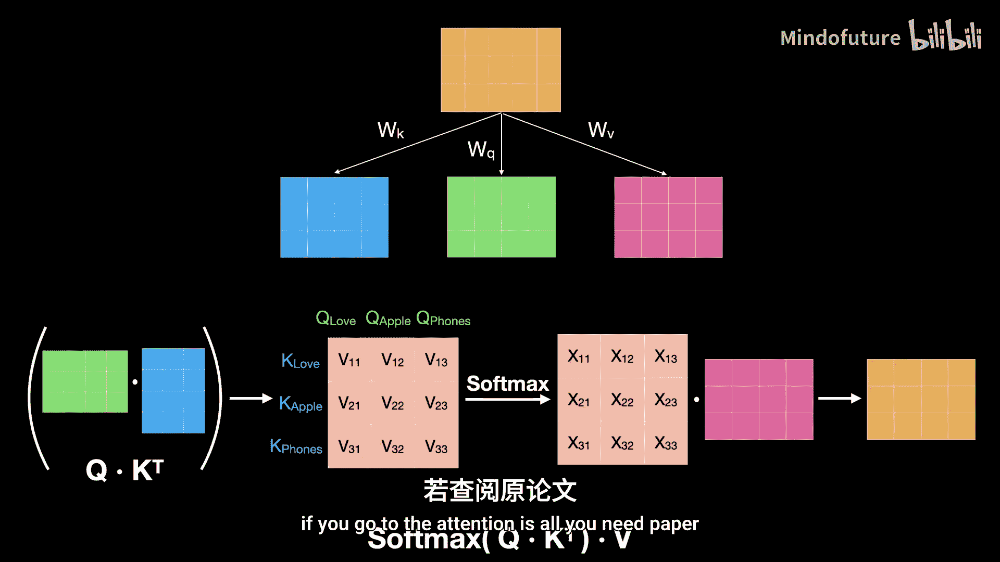

# 深度学习中的Transformer架构 ｜ Transformers In Deep Learning ｜ Learn With Jay p02 P02_Self_Attention_in_Transformers-Transformers_in_Deep_Learning -BV1Mdt9zXEpE_p2-

What's going on， everyone。 This is Jay Patel and welcome to my channel。

 Today we are going to understand the heart of transformers。 That is selfatten mechanism。

 Self-atten is the foundational block of modern AI and the foundational block of models like Birt or G I have been waiting to bring you this video since a long time because this is such a powerful concept that has revolutionized the modern AI。

 I know it took me a long time to upload this video。

 but I had to put a lot of effort in creating this video I have shot this video twice I have changed the structure of the video multiple times so that it feels super easy for you to understand it。

 and you don't have to go anywhere else after watching this video So this video is structured in a way that instead of me telling you that this is the equation and this is how it works。

 we are going to create self-atten from ground zero directly from scratch we will see what is the problem by self-atten was needed。

 and we will step by step solve that problem。😊，Reaching to our end goal of self attention。

So I really hope you stick around till the end of the video because if you do then that is all you need so why wait further let's get started we will start by looking at why do we need selfper the problem that we are trying to solve with selfper is something called contextual word representation have you ever noticed that in English the same word can mean different things when used in different context For example。

 when I take the word light what comes to your mind probably the electromagnetic radiation that is visible to humanize right。

But what if I say light weight now this has nothing to do with electromagnetic radiation。

 but now the context is shifted to a measure of weight。 It means something that has less weight。

What about light blue， Now， this has nothing to do with the measure nor electromagnetic radiation。

 Now， the context is entirely shifted to the color。 It means the lighter shade of blue。

What about lighter candle now the word light is acting as a word。

The same word light means differently when used in different context。

 Similarlyly with an example of Apple。 When I say Apple phones， I mean that I'm talking about Apple。

 the technology company。 When I'm talking about Apple choose， I mean I'm talking about Apple fruit。

 And thus， we should be using different representation of the word apple as per the context。

 And this is the problem that all the iron based models could not solve。

 The reason iron based models could not solve this problem is because it uses word embeddings。

 word embeddings is a set of fixed numbers in a vector that correspond to certain features of an object。

 For example， the word embedding of Apple might have some higher values related to tech and it can also have some higher values related to fruit。

 but these values are static。 It's a constant vector。 If I take two sentences。

 I love Apple phones and。😊，Apple juice， I will be using the same value of the Apple word embedding in both of these sentences。

😊，Consider that this word embedding might have 50% properties related to technology company and it might have 50% properties related to fruit Now。

 as it has both 50% tech and 50% fruit， it cannot represent Apple in that sentence effectively。

 Instead， I should be using better word representation for Apple in each sentences。

 If Im talking about Apple juice， then I want higher values corresponding to properties like is fruit is food etc ce。

 And when I'm talking about Apple phones， I want higher values corresponding to is tech can call a smart etc。

 When I use this word representation， only then I can effectively represent Apple in that sentence。

 and this is what self attention helps us to do When I take a sentence， I love Apple phones。

 I will be passing the word embedding of each word into the self attention mechanism and what self attention will do is that it will。

Identify the relationship of each words in the sentence among each other and after identifying this relationship between words。

 it will generate new word representation for every single word in that sentence so if initially Apple had 50% tech properties than 50% fruit properties then after selfreten it will be shifted more towards tech side representing it as a technology company Thus the initial word embedding is replaced by a richer word representation that signifies the true meaning of Apple in that sentence Similarlyly。

 when I take the sentence I love Apple juice and pass it in the self-atten mechanism it will identify the relationship between Apple and juice and shift the word embedding of Apple more towards fruit side this is very important to understand so I'm going to take another example in case of example of light it initially the word embedding of light was more close to words like photons bride wave etc。

Then after self attention operation it will modify the word embedding of the light in a way that it will more appropriately represent word light in that context if Im talking about light weight then the word embedding of light will be shifted more towards words like a feathery delicate airy etc when I'm talking about light blue then the word embedding will be shifted more towards the colors probably somewhere in between blue and the white and when I say lighthead then the word embedding will be shifted more towards the words like faint dizzy etc so this is what selfat does it changes the initial static word embeddings and create a new word representation that more appropriately represent that word in that context。

So now the question arises， how do we generate these new word representations。

 what operations are performed in the self attention mechanism？

So think about it if you were to generate new word representation for Apple what are the factors that determine the context of Apple in these sentences In't it the other words of the sentence determine the context of Apple if I use Apple with phones I mean I am talking about Apple the technology company if I am using Apple with juice I mean I am talking about Apple fruitru so clearly the other words of the sentence determines what Apple means in that sentence So when I am creating new word representation for Apple I somehow need to be aware of all the other words of that sentence so what if I represent Apple with all the other words of the sentence what I'm saying is。

What if my new representation of Apple， which I will call is Apple dash？Is made up of 01 times love。

Plus point。5 times Apple。Plus，04 times。Phs。This way my new apple will be aware of all the other words of the sentence and when I say words understand that I am talking about the embedding of those words。

So， what I mean by this representation is that my new Apple is made up of。10%。Embedding of love。

50% embeddings of。Apple。And 40%。Embbeddings of phones so with this representation what I am doing here is that I am taking the already existing embedding of Apple and adding some embeddings of phones to it。

😊，So if initially the word embedding of Apple had 50% tech properties and 50% fruit properties。

 then after the addition of 40% phones embeddings the overall embeddings will be shifted more towards the technology company side because phones will have some tech properties this addition of embeddings of phone will shift the overall word embeddings more towards technology side similarly with our second sentence Ill represent the new Apple。

As01 times love。Plus， 05。Times， apple。N。 four times juice。And here in this sentence。

 if my initial word embedding of apple had 50% taken 50% fruit properties。

 then in my new word representation of apple， the overall properties will be shifted more towards fruit side because here we are adding some properties of juice to it juice will have some properties related to fruit thus the overall contextual word embeddings will be shifted more towards fruit side。

 hope this is making sense， so the word representation of other words of the sentence will be given by something like this what Im saying is new word representation of love will be made up of 80% of love plus 10% of apple plus 10% of phones Similarlyly the new representation of juice will be made up of 10% love 40% apple and 50% juice and for juice we are adding some properties of apples to it。

 thus the new word representation of apple will have some properties of。😊。

Apple which will overall make it a juice of Apple。 I hope this is making sense to you Now I know you will be having one question in your mind what are these numbers Where are they coming from how are they calculated and as you can see these numbers are different for different words So let me explain you that let's take this point for this point for is actually the relationship between Apple and phones。

This 05 is relationship between Apple。And apple。This point1 is relationship between。Apple。And love。

 similarly， when we talk about Jews， this point4 is relationship between Jews。And apple。

This  point5 is the relationship between Jews and Jews。And this is the relationship between Jews。

And love。Basically these numbers are asking a question how much is my apple related to phones。

 how much is my apple related to Apple， how much is my apple related to love and for juice they are asking a question how much my juice is related to love。

 how much my juice is related to Apple how much my juice is related to juice。

 so we need to find a mathematical way to calculate the relationship between two words。😊。

If I put all the word embeddings of my dataset in a 2D plane it will look something like this here you can see the apple is equidistant from both phones and juice considering that it has both 50% taken 50% fruit properties so if I were to find the relationship between Apple and phones then can I find that relationship by calculating the distance between them why distance because this is the basics of word embeddings if two words in the word embedding space are closer to each other then we can say that those words are more related to each other if two words in the word embedding space。

Are far from each other。 Then those words are less related to each other or unrelated to each other。

 or sometimes even opposite to each other。 Thus， I can say that the distance between two words can determine the relationship between those two words。

 In other way of saying， I can also say that this distance is a measure of similarity between these two words。

 The lesser the distance。More， the similarity。So， here when I said how much my apple is related to phones。

 what I actually asked is how much my Apple is similar to phones thus to calculate these numbers。

Or these percentage values have to calculate the similarity between every pair of word。

In mathematics， there are many ways to calculate similarity。

 One of the most common way is dot product similarity。

 What dot product similarity says is that if I have two vectors。

Then the similarity between these two vectors are calculated by multiplying the values of these two vectors and if the distance between these two vectors are less then their dot product will be high and thus they will have high similarity。

And if I have another vector with which the distance is high。

 then their dot product value will be low and thus they will have low similarity。

To calculate the similarity between Apple and phones I have to multiply the vector of Apple with the vector of phones as Ive represented my words in a 2D plane I can say that my word embeddings at two dimensionals thus the coordinates of those words will be the actual word embedding values of those words thus if I want to calculate the similarity of Apple with phones what I have to do is I have to multiply these coordinates which will be 0 times 2 plus4 times 2 and that is 8 thus the similarity score of Apple with phones is 8 similarly I'll calculate the similarity of Apple with love which will be minus4 times 2 plus3 times 2 and that is minus2 and similarity of Apple with juices2 times 4 plus2 times0 equals 8 again and the similarity of Apple with itself。

Will be two times 2 plus 2 times 2。 That is 8。So coming back to this now I have a mathematical expression to calculate these numbers。

 If this 0。4 is the similarity between Apple and phones。

 then it will be calculated by multiplying the embedding of Apple。

With the transpose of embedding of phones。This multiplication will result into a singular number because if e of apple is of size 1 comma 2 and transpose of E of phones will be of size 2 comma 1。

 then the resultant multiplication of these vectors will be of size 1 comma 1 that is a singular value Okay so this similarly this 0。

5 will be calculated by multiplying E of Apple with the transpose of E of Apple that is itself this 01 will be calculated by multiplying E of Apple。

With ear of love。But there is one problem by calculating the similarities this way。

 The problem is if you notice that I've chosen these numbers in terms of probabilities。

 there sum is equal to 1。 but the number that we will get from this vector multiplication can be any number It can be a large number or it can be even a negative number in our previous example this dot product had value 8 this was also 8。

 and this was2 So somehow I need to convert these-2 8 and 8 into probabilities。

 can you think of an operation that helps us to convert a set of numbers into probabilities well if you have studied deep learning with me then you might be able to answer this。

It's our most commonly used softm function。 If I pass these three numbers into softm function。

 then it will convert them into probabilities， and the resultant will be 0。00。5 and 0。5。So， overall。

 what I am saying is if you want to find the new word representation of Apple。

We will first calculate the similarity between Apple and all the words in the sentence by performing the dot product of their word embeddings these dot products will give us a singular number but this singular number can be a large value or it can be a negative value thus we will need to pass these numbers into softmax function and softmax will convert them into probabilities and once I get these probabilities I'll be multiplying these probabilities again with the embedding vectors if x1 is the probabilistic similarity between Apple and love then I'll multiply x1 with E of love if x3 is the probabilistic similarity between Apple and Apple then I'll multiply it with E of Apple if x3 is the probabilistic similarity between Apple and phones then I'll multiply x3 with E of phones and finally I'll just do their summation and this will be my resultant new word representation of Apple。

😊，Just like how I have calculated the new word representation of Apple I will be calculating the new word representation for all the words in the sentence so if I want to calculate the new word representation of love I will be calculating the similarity of love with all the other words in the sentence and then I will be passing those similarity values in a softmax operation and I will multiply the output value of softmax operation with the word embeddings of all the words of the sentence。

In case of phones for calculating the new word representation of Apple。

I will be calculating the similarity of Apple with all the other words of the sentence。

 passing that to softmax and multiplying with the word embeddings of the words in that sentence。

 Think of this operation in terms of gravity What gravity does is that it pulls all the objects towards each other and lesser the distance between the objects stronger is the pull more the distance between the object。

 the lesser is the pool。 So Apple and phones will be strongly pulled by each other and Apple and love will not be pulled by each other that much。

 And if initially Apple was at this location in the word embedding space， then after self attention。

 it is moving more towards the phone side Thus the context of Apple has been shifted from the original position to a new position and this new position of Apple is a better representation of Apple in this sentence rather than this old position。

😊，So I can say that Ive found a way to generate contextual word representation for every word。

 and this is the basis of self attention operation。

 though with the expression that we have generated there are still few problems。

 Can you think of those problems。 The problem number one is that it has no learnable parameters involved So far whatever we have calculated is just plain mathematical operations it does not have any learnable parameters and with no learnable parameters。

 I cannot train my model for a task specific thing。

 The word representation that it will generate will be all based on the general word embeddings。

 It cannot adapt itself to a specific task。 One of the example that I can give is Consider that we are making a chat board for an electronic store and the customer says I love Apple watch Now the word embedding of watch can lie somewhere in between words like C observe or words like clock time because watch is syn。

😊，To both of these things while the Apple will lie somewhere between fruit and technology company and because there is no similarity between the word Apple and watch。

 the cell attention will not generate any relationship or dependency between these two words and our model will be fail to understand what Apple watch means it might understand Apple as a separate entity and watch as a separate entity and it would not be able to recognize that we are talking about Apple smartwatches。

 instead， what I want to do is I want to use learnable parameters to capture the similarity。

 I want to train a model based on some data and after training。

 I want the model to understand which similarities are relevant and which similarities are not relevant。

 So instead of using general word embeddings to calculate similarity。

 which might fail to capture relevant relationship I want to use learnable parameters which can。

Sify certain similarities that should be captured。The problem number two is that Im using the same vector at all these three places I'm using the same word embedding in this horizontal vector in this and in this vertical vector and in this vector that I am multiplying after softmax because of this what will happen is the similarity between Apple and phones will turn out to be equal to the similarity of phones with Apple because this multiplication will result into the same value。

 thus both of the words Apple and phones will pull each other equal with my previous example of gravity the attraction between Apple and phones will be equal thus the position of phones will also be shifted more towards Apple and we might not want to make that shift for phones we would want to shift Apple towards phones but we might。

Not want to shift phones towards Apple， but if we use the same horizontal and vertical vector。

 then this will happen。So these are the two problems that I have to solve my first problem I need to use learnable parameters in my self-attention operation and also somehow need to use learnable parameters while calculating these similarities so that my captured similarities and the relationship between words are based on training and I can train the model for any specific task to solve the second problem I need to use different vectors at these three places because my horizontal n vertical vector is same the similarity between Apple and phones is same as phones and apples which I want to avoid so what I mean is that I want to use some different variation of Eapp here and some other different variation of Eapp here and some other different variation of Eapp here it's like saying that I want to multiply some a with these horizontal vectors。

です？Some be with these vertical vectors。And some see with these vector。Because in this case。

 if you calculate the similarity of Apple and phones， then it will come out to be8 times e of Apple。

And B times your phones。And if you calculate the similarity between phones and Apple。

 then it will be eight times。😊，E phones。And B times E of。U을。And both of these are not equal。

 so some learnable parameters， which we can call as w。Which can act as weight parameters。

And multiplication of some， A， B and C。So what if I multiply these horizontal vectors with some Wq。

These vertical vectors with some W k。And these vectors with some W V。This way。

 I can solve both of my problems。 After training the model。

 the values of these weights will be adjusted in such a way that it will understand to capture the relevant similarities in the sentence and generate a new word representation that appropriately describe that word as per the context with these weight parameters in a way you can say that the self retention operation will have some common sense like Apple。

😊，Is more related to phones。And shift the word eming of Apple towards the technology side while the phones is not that related to Apple。

And don't ship the embeddings of phones towards Apple Also without these weight parameters。

 what would generally happen is that the similarity of the words with itself would be highest rather than the word with some other word like Apple with phones and this would have kind of added a bias that it would always capture the similarity of the word with itself and not able to appropriately capture the similarity between Apple and phones。

 but this would be completely avoided with the use of these W parameters。I hope this is making sense。

So what I am saying is from the initial word embeddings we will be generating three new vectors for each word this k vector will be generated by multiplying the embedding with w k this Q vector will be generated by multiplying the embedding with wq and v vector will be generated by multiplying the embedding with w v lets say the dimension of e of apple is1 comma512 and the dimension of these w matrixrices is 512 comma 64 then the resultant vectors this kqv vectors that we will be generating will be of size1 comma 64 and now we will use these vectors to generate our new word representation first we will be calculating this similarity between words by using this k andq vectors if I want to calculate the new word representation of apple then I will need to calculate。

The similarities between Apple and all the other words in the sentence and these similarities will be calculated by takingq of Apple and k vectors of all the words in the sentence so the similarity between Apple and love will be calculated by multiplying Q of Apple with Q of love the similarity between Apple and Apple will be calculated by multiplying Q of Apple with K of Apple and similarity between Apple and phones will be calculated by multiplying Q of Apple with K of phones。

Notice the Q of apple remains same in all the three places and these k vectors are different for different words by multiplyingq of apple with k of love。

 I will get a singular value。 why， as I say these vectors are of size1 comma 64。 So if I multiply。

Q of apple that is 1 comma 64 and it transpose ofq of love that will be 64 comma 1。

 then the resultant multiplication will be a singular value and once I get these values which is。

Representing the similarity between the words， I'll pass this values into softmax function and softmax will convert these into probabilities and thus the summation of these values will be equal to1 and then I will multiply the corresponding probability with v vectors here the x1 is the probabilistic similarity between Apple and love thus I will multiply x1 with v of love the x2 is the probabilistic similarity between Apple and Apple and Ill multiply it with v of Apple and similarly I will multiply x3 with v of phones and then Ill just do the summation of these values and that will be my resultant new ver presentation for Apple and this is our entire softmax operation。

Just like how I calculated new word representation for Apple I will be calculating the new word representation for all the words in the sentence for calculating the new word representation of love first I will be calculating the similarity between love and all the other words in the sentence。

😊，And Ill pass the similarities into the softmax function which will convert it into probabilities and I'll multiply these probabilistic values with v vectors and then I' will do this summ the only difference between these three diagrams is this Q vectors if I want to calculate the new word representation of love then I will be using Q of love here for Apple I will be using Q of Apple and for phones I will be using Q of phones well if you notice rest everything else is exactly same and that is how easy it is to calculate new word representations。

In this example I have taken only three words love Apple phones。

 but in a sentence there can be many words if a sentence has five words then there will be total five such blocks which will be calculating the corresponding new word representation for all those five words。

If the sentence has 100 words， then we will be calculating the new word representation for all the 100 words in that sentence。

 So I hope this explanation makes sense to you。 Now。

 I want to talk about the benefit of self attention operation。

 if you have noticed in these three blocks。If I want to calculate the new word representation of phones。

 this is completely independent of these two blocks。So。

 what I mean is to calculate the new word representation of phones。

 I do not need to calculate the new word representation of love in Apple first。

 all these three operations are completely independent of each other which means that I do not need any sequential processing here like how I need it in RNN。

I can generate new word representation of all the three words parallelly at the same time one of my CPU thread will be calculating the new word representation of love parallelly another CPU thread can calculate the new representation of Apple and parallelly another thread can calculate the new word representation for phones if I have 100 such words then parallelly I can calculate new word representation for all those 100 words at the same time Thus the self attention eliminates the sequential processing。

And because of this parallelization， I can take advantage of using multiple GPUs to train and process my sentences。

If my sentence is really big even of 1000 words， then all the words can be processed parallelly by using multiple GPUs。

 thus my training becomes extremely fast because it takes the same time to process a single word as it takes for me to process 1000 words。

Thus， the order of the self attention operation is o of1。

 it does not depend on this sequence length while in Rnn。

The processing was of order of n where n is the sequence length。

 This is one of the main advantages self attention operation offers。

And this gives us another benefit。 and that is to capture long range dependencies。 Remember。

 Ernand struggle to capture the relationship between the words at the initial part of the sentence with the words at the later part of the sentence。

 But because in selfpreten， there is no sequential processing happening while calculating the similarity between the words。

 this problem will be completely avoided。 Even if my sentence is really big to generate the new word representation of Apple。

 I will be calculating the similarity of Apple with all the other words in the sentence。

 All of these words will be influencing my word Apple Thus the context of Apple can be grained according to the sentence。

 and I can also capture the similarities between Apple and words at the later part of the sentence like voicemail music player etc ce。

 This is another major problem that we are solving。

 when we are dealing with long sentences is very important to capture the long range dependencies。

 only then。😊，My model can appropriately summarize the overall context or can generate better responses for my questions。

So we have come a long way。 I think it's time we have a quick recap of whatever we have discussed so far。

 All right， so let's start our recap。 We started our discussion by understanding a problem。

And the problem was that in English the same word can mean different things in different context。

 for example， if I have word love Apple phones。And love。Apple。juice。

Then the meaning of word apple in both of these sentence is different。

 Thus the static word representation of Apple will not effectively represent the word apple in these sentences。

 and that is the problem with static word embeddings because the word embeddings are static vectors and if we use only word embeddings to represent these words it will not effectively represent the word apple in these sentences。

 Thus， we need to somehow come up with a way to generate contextual。Word representation。

Meaning that the word representation of Apple should be based on the context of the sentence and how is my context of the sentence decided isn't it decided by the other words in the sentence right so if I use Apple with phones my context of Apple is different if I use apple with juice my context of apple is different thus we realize that to generate the contextual word representation of Apple we need to keep in mind the other words in that sentence。

So， we decided to represent Apple。With certain percentages of all the words in the sentence。

 For example， it is made of 01 times love，05 times apple。And。4 times phones。Similarly here。

 Apple is made up of。0。1 times love。5 times apple。And point four times juice。

This way we can shift the embeddings of Apple by adding some technology properties to it and here we can shift the embeddings of Apple by adding some fruit properties to it and we can fine tune our new apple according to the context of the sentence but then the problem we had in front of us was what are these values representing what are these numbers how are they calculated we saw that these numbers are in a way asking a question like how much is the apple related to phones how much is the apple related to apple and how much is the apple related to love thus these numbers are nothing but the relationship between Apple with all the words in the sentence and then we saw that the relationship between two words is proportional to the distance between those two words in the word embedding space if in a word embedding space two words are close to each other they are called as more related to each other if the words are far from each other then they are not very related to each other。

😊，Thus in a way that these values are the distance between two words or the similarity between the two words and then we saw that the similarity in mathematics are calculated by multiplying the vectors for which we are calculating the similarities so the similarity between Apple and phones will be calculated by multiplying the embedding vector of Apple with embedding vector of phones and similarity of Apple with love will be calculated by Apple。

With love。So we were sorted so far， but then we realized that calculating the new word representation in this way is a problem。

 The problem is we are not using any trainable parameters here thus the model has nothing to learn from what we want is the ability for the model to be trained and understand which two words are more related instead of using the general word embeddings to calculate the similarities I want to train the model to capture the relevant similarities so we decided to multiply this with Wq this with W K and this with W v and then this became my final new word representation and we concluded that this is our self attention operation。

And so far we have seen everything for individual words but we have not yet seen how everything looks like in terms of mats because computer wants to process everything fast。

 all of this processing happens in forms of matrix multiplications so lets see how the matrix multiplications look like。

In attentiontion is all you need paper。The dimension of the word embedding was taken as 1 comma 5 and2。

 thus the matrix of this sentence。 If I have sentence with three words love。Apple。Funs。

Then the matrix will be of size 3 comma 512。Where this will be the single vector for love。

 this will be the single vector for Apple， this will be the single vector for phones and overall my matrix will be of size 3 comma 5 and2 from this matrix Ill multiply this matrix with wk wq and wv to generate my K Q and V matrixes the size of these w vectors in attention is all you need paper is 512 comma 64 Thus if I multiply this matrix with this matrix I will get a resultant matrix of size 3 comma 64。

And these are our k vector， Q vector and V vector。Then I will calculate the similarities by multiplying Q with k transpose。

If I perform this multiplication。Then I will get a resultant matrix of size 3 comma 3。

And this v11 v21 v31 is representing the similarity between the words this v1 is the similarity between love and love。

 this v21 is the similarity between love and Apple this v31 is the similarity between love and phones similarly this V23 is the similarity between phones and Apple once I have calculated the similarities Ill perform this softm operation in this vertical direction。

And I'll get the resultant matrix again of size 3 comma 3。 Now these x 1。

1 x21 x31 are representing the probabilities and this summation of these three values will be equal to 1 Okay。

 so after softm I' will multiply this3 comma 3 matrix with R v matrix This v matrix is of size 3 comm 64 thus the resultant multiplication。

Will result into another matrix of size 3 comma 64。

 and this resultant matrix will become our new word representations for each word。

 This vector will be my E dash of love。This will be my E dash of Apple。

And this will be my E dash of phones。And mathematically。

 the equation of self attention can be given as follows。

 And this is the exact equation that you will see in the attention is all you need paper。

 If you go to the attention is all you need paper。 Then you will find the same equation。

 except for the division of root of decay， and I will cover what is this division of root of decay in the upcoming videos。

 in that video， we will see why the authors decided to divide with root of decay。

So that is our entire selfattention mechanism。 I hope you found this video valuable。

 If you have stuck around so far， then you have taken a big step in your Transer's journey。 Now。

 I want some suggestions from you down in the comment section。

 let me know what do you think of this kind of explanation。

 Did you understand this video properly or the concept still didn't make much sense to you。

 And if you did find this valuable， then consider subscribing。

 hit the like button and share it among your friends。 I've also started a membership in this channel。

 you can join the membership by paying a very small fee。

 And with that you will get priority response to your comments。

 If you have any comments or if you ask any doubt， then I will jump into that straight away and respond to it immediately。

 And if you would like， you can also send me a super thanks。

 Small gestures like these will keep me motivated in uploading more such videos。

 We still have about 10 more videos to go in our Transers journey。 So I will see you in the next one。

😊，🎼Yeah。🎼。

