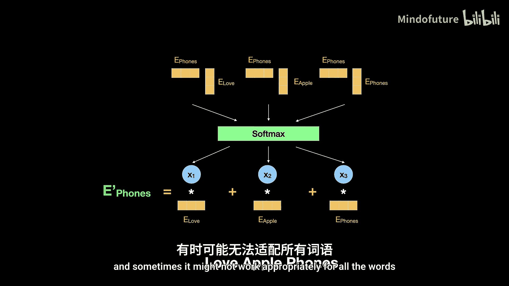
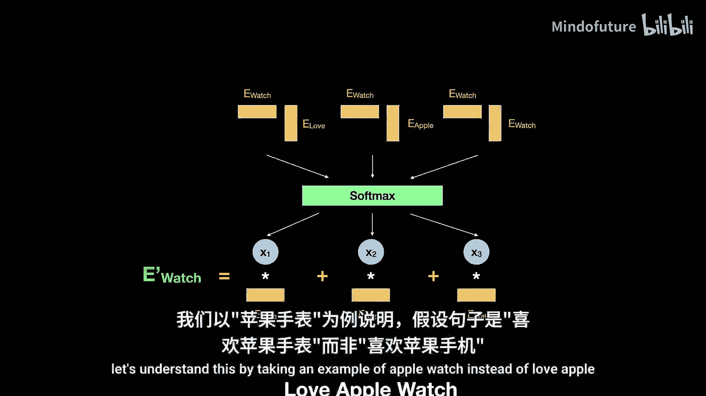
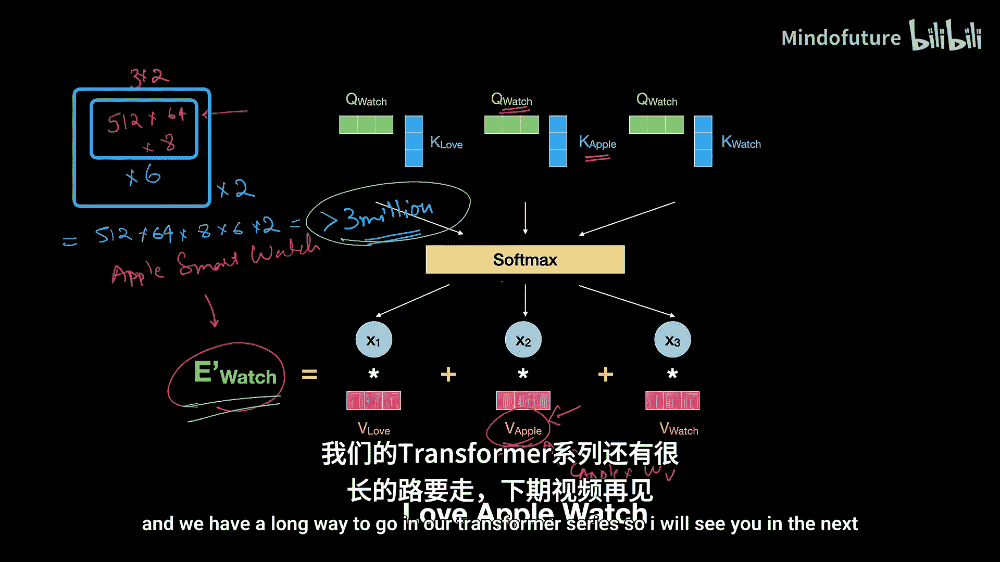

# 深度学习中的Transformer架构 ｜ Transformers In Deep Learning ｜ Learn With Jay p03 P03_Linear_Transformation_in_Self_Attention-Transformers_in_Deep_Learning-Part_ -BV1Mdt9zXEpE_p3-

Hello everyone。 welcomelcome to another video in our Transformer series。 In this video。

 we are going to talk about linear transformation in self retention。😊，In the previous video。

 we saw that we need to multiply the input embeddings with this W Q， W K and W V matrices。

 This multiplication was to add some learnable parameters in our self attention operation。

 we wanted to capture the similarities between the words by training the model instead of just general static word embeddings and the overall new word representation that self attention generates should also be based on training。

 For that reason， we added these W matrices。 This multiplication of any vector with a W matrix is called linear transformation。

😊，The previous video got a bit longer， so I could not go in detail on this， but in this video。

 we will be looking at the detailed proof why this lean transformation is game changer in self attention and how it can help us to capture the relevant similarities with the help of mathematics we will prove why the captured similarities after introducing these learnable parameters are a lot more relevant and the overall word representation that is generated after introducing these learnable parameters is an accurate representation of that word。

 So are you ready for this video， let's get started Before we start this video。

 let's take a quick recap of what we saw in the previous video of self attention This recap will help you to ingrain and remember the self attention operation by heart and it will also set the basis for what we are going to discuss in the rest of the video So let。

😊，By talking about why do we need self attention。 What is the purpose of selfre。

 We saw that in English， the same word can mean different things。 For example。

 if I have sentence love Apple phones and love apple juice。

 then Apple in both of these sentences mean differently if I'm using Apple with phones。

 then it means I'm talking about Apple technology company， if Im talking about apple juice。

 then it means I'm talking about apple fruit， So the static word embedding of apple is not going to be an accurate representation of apple in both of these sentences my word embedding of apple can have some properties related to technology company or can also have properties related to fruit。

 but if I use a word embedding of apple which has some fruit properties in this sentence。

 then this apple won't be an accurate representation of apple in this sentence， and similarly。

 if I use a word embedding of apple which has some technology properties in this。😊。

Then this apple wont be an accurate representation of Apple in this sentence。

 so I need to come up with a way to represent Apple based on the context of this sentence and how is the context of the sentence decided。

Isn't it decided by the other words in the sentence Apple with phones is Apple technology company。

 Apple with juice is Apple fruitruit， So this means that if I am representing Apple in this sentence。

 then this apple needs to be aware of the other words in the sentence and if I am representing Apple in this sentence then this apple needs to be aware of the other words in this sentence So what we will do is that we will represent Apple with all the words of that sentence in this sentence my new word representation of Apple can be given by 0。

1 times love。Plus 05 times apple。And 。4 times phones。Similarly， my new apple in this sentence。

Can be equal to 01 times love。5 times apple。And point four times juice。So。

 this way we are representing Apple with other words in the sentence。

 so what is going to happen is if the initial word embedding of Apple has some 50% technology company properties and 50% fruit properties then after representing Apple in this way the overall word embeddings is going to shift more towards the technology side。

 why because if you look at this operation then we are adding some component of phones to the existing Apple embeddings。

Ps is going to have some properties related to technology。

 thus the word embedding will be shifted more towards the technology company side。And similarly。

 for the second sentence， if the initial word embedding has 50% technology properties and 50% fruit properties。

 then after addition of these juice properties to the original apple properties。

 the overall word embeddings are going to shift more towards fruit side。

 This new word representation of apple is a better representation of apple in these sentences。

 then our previous old representation， because it more accurately describes that word as per the context of the sentence。

 Similarlyly we will be representing all the words of the sentence。

 we can say that my new word embedding of juice is made up of 0。1 times love of 。4 times apple 。

5 times juice， and in the original embedding of juice。

 we are adding some embedding of apple making this as a juice of apple。 Okay。

 But now you would be having one question in your mind。

 What are these numbers representing how are these numbers calculated。

 we need to come up with the mathematical way。😊，To calculate these numbers these numbers are representing the relationship between Apple with other words in the sentence for example this point4 is the relationship between Apple and phones this 0。

5 is the relationship between Apple and Apple this 01 is the relationship between apple and love similarly if we come to Jews then this  point1 represents the relationship between juice and love this。

4 represents the relationship between Jews and apple this 0。

5 represents the relationship between Jews and juice right so these numbers are the relationship between every pair of words and there is a mathematical way to calculate the relationship between words。

In a word embedding space， if two words are close to each other then they are called as more related to each other and if the two words are far from each other then they are unrelated to each other or sometimes even opposite to each other So in a way this relationship between two words。

Can be called as the similarity between two words， because if two words are close to each other。

 then they are more similar if two words are far from each other then they are less similar and in mathematics there is a clear formula to calculate the similarity between two vectors。

And that is given by the dot product between the two vectors so this 04 will be calculated by multiplying e of Apple with e of phones because this 0。

4 is representing the similarity between Apple and phones and similarity in mathematics is calculated by multiplying the two vectors between which we are calculating the similarity similarly this 0。

5 will be calculated by multiplying e of Apple。With your apple。

And this point1 will be calculated by multiplying e of Apple。With you of love。

But isn't that this multiplication can be any number， It can be a large number。

 or it can even be a negative number， though in our example， I have。

Represent it the number in such a way that their sum is always equal to1 if you look at any word then you will notice that I have chosen these numbers in a way that there sum is always equal to1 so we need to find a way to convert this large number or negative numbers into probabilities so that their sum is equal to1 and we have an operation called soft max that can convert any set of numbers。

Into probabilities so after calculating these similarities we need to pass these similarities into soft Macs and then use them to generate new word representation。

So overall， it would look something like this。 if we are creating the new word representation of phones。

 then we will be calculating the similarity between phones and all the words in the sentence。

 and these similarities will be calculated by just the vector multiplication of these embeddings。

 This vector multiplication will give us a singular number for each similarity and it can be any number。

 It can be a large number or a negative number。😊，We pass these large numbers into softms。

 which will convert it into probabilities。 So the sum of x1 x1 x3 will be equal to1。

 and then we will multiply these probabilities with the embedding vectors again。

 and by its edition we will get us the new word representation。

 So this is what we saw in the previous video。 but calculating these new word representation like this has few problems in this entire operation we are not using trainable parameters or learnable parameters anywhere。

 this entire operation is pure mathematics。 And sometimes it might not work appropriately for all the words Let's understand this by taking an example of Apple watch instead of love Apple phones。

 I'm considering this sentence， Love Apple watch and let's try to see if we calculateal the new word representation of watch like this。

 will this new word representation。😊。

Be an appropriate word representation or not first regarding the similarities how do you think these similarities will look like ideally in this sentence the word representation of watch should be generated in such a way that it should represent Apple smartwa。

And for that to happen， the word representation of watch must have some Apple technology company properties along with smartwach properties so that this can represent Apple smartwatch but its not going to happen without any trainable parameters if we plot the word watch in the word embedding space then it would lie somewhere in between the words like C observe or clock time etc because watch a synonym or related to all of these words and the apple would lie somewhere in between the words related to fruit and the words related to the Apple technology company and looking at this word embedding space the similarity captured between Apple and watch won't be that much because they might be extremely far apart from each other。

Thus， the capture similarity between Apple and watch will be very less。 Instead。

 the captured similarity between watch and watch will be highest。

 so the new word representation of watch can look something like this where it is made up of 01 times love。

😊，01 times apple。N。8 times watch。So， the new word representation will be majorly madeed off the existing watch rather than any edition of Apple。

 so the first problem is it is adding a very little component of Apple to it and whatever component of Apple it is adding has properties related to both Apple technology company and Apple fruitru。

Ideally， this new watch should not have any component of Apple fruit。 otherwise。

 this new watch won't be an accurate representation of Apple Smartwa。

 So these are the two problems to overcome these problems we need to introduce learnable parameters in our operation we need to introduce learnable parameters while capturing the similarities。

And also need to introduce learnable parameters here so that we don't just add the existing embeddings as is。

 So what we decided is that we will be multiplying these horizontal embeddings with some W Q。

And these vertical embeddings with some W k。And these vectors with some W V。

This way our captured similarity will be based on training and the vector that we are adding after the softm operation is also relevant to describing this new word this is what I already covered in the previous video。

 but the purpose of this video is to see and mathematically prove that by adding these learnable parameters in this way the new word representation will be accurately describing that word in that sentence in this video we will mathematically see if this Apple watch after adding these learnable parameters can represent Apple smartwa。

😊，Or not。And how so， but before we can prove this， we need to understand in detail what is happening by this matrix multiplication of W。

So， this multiplication of any vector with a matrix is called linear transformation。

 at least this is the word that is used by the authors of attention is all you need but it is nothing fancy if you have studied neural networks with me then you would remember that the values of any layer in the neural network is captured by this equation。

Where what we do is that we multiply the input parameters with the W weight matrix。

 add some bias and pass it into some non nonlinear activation function which generally is relu or 10h。

😊，While in linear transformation， all we are doing is we are dropping the use of bias and non nonlinear activation function。

 The crux of that operation is still the same。 What it is doing is if I have an input of size 512 dimension then after performing linear transformation。

 That vector will be converted into a 64 dimensional vector because if I take an input of size 5 and2 comma 1 multiply it with some weight matrix。

 let's say of size 64 comma 5 and2， then the resultant matrix will be of size 64 comma 1 So the input 512 dimensional vector is converted into 64 dimensional vector。

 This linear transformation helps us with two major things。 One is changing the dimensionality。😊。

And second is。Extracting。Richard。Features。From the vector that are more relevant for us in the prediction。

Let us look at both of these points one by one first let' us look at the changing of dimensions as it is impossible for humans to visualize 64 dimensional vector I am going to give you an example of three dimensional vector let's say if our input vector is of three dimension where the value of that vector is 322 which is what here I am representing if we plot this vector in a three dimensional space then it would lie somewhere here。

After performing the linear transformation， it will be converted into a two dimensional vector。 Now。

 you can see that this vector has become two dimensional vector。😊。

And the space in which that vector was is now reduced to two dimensions。

 So that is what linear transformation does。 It changes the dimension of the input into some other dimension。

 But along with this reduction of dimensions。 the main purpose of linear transformation is to extract and magnify certain features from the input。

 So what I mean by that is if the initial word embedding has 512 different features that can range from technology。

 fruit， food and 50 other such random features， then after linear transformation。

 the resultant vector will be a representation of only the required features relevant for the further prediction。

 let's say we are making a chat board for an electronic store。

 and we have trained these weights to capture only technology related features from the input。

 the original input word embeddings can have。😊，512 different random features。

 but after linear transformation it will only capture features related to the technology these weights govern what the values of these green circles will be if the weight corresponding to the technology related features are high than these values will be majorly influenced by the technology related features of an object and other features from the input will have very less influence or will be discarded and the resultant vector that we get from the linear transformation will be a measure of technology related properties in an object。

😊，To understand this with the help of mathematics， let's take an example of three words， Apple。

 orange and watch。 And for simplicity， let's assume that this word embedding is of three dimensions and is measuring is tech is watch is fruit。

 The embedding of apple has high value for ist and is fruit。

 The embedding of orange has only higher value for is fruit and the embedding of watch has higher values for the features is tech and is watch。

 And let's assume that the weights we are using for the linear transformation operation look something like this。

 The weights corresponding to this feature is 4，2，0。

 and the weights corresponding to this feature is 3，1，1。 Now。

 we are going to perform the linear transformation of all these three words。

 and we will see how the resultant vectors will look like the linear transformation of Apple will look like this。

😊，Where we will multiply the input word emit meaning of Apple with this weight matrix。

And the resultant vector will be。A two dimensional vector whose values will be obtained by multiplying this vector with this vector and then this vector with this vector。

 So let me do a run on this。 lets first multiply this vector with this vector and the resultant will be 2 and 24 plus 0 and 22 plus 2 and 20 and that will be 8 and then will multiply this with this and its value will be 2 times 30 times 1 plus2 times 1 and that will be equal to 8。

So， the resultant linear transformation of Apple came out to be 8 comma 8 similarly we will be calculating the resultant vector after linear transformation for orange and watch so let me do that quickly。

For orange， we need to multiply 0， comma 0 comma 3 width。

This matrix and the resultant value will be equal to 0 here and 3 here。And for watch。

 I will be multiplying1 comma 3 comma 0 with the same matrix。

And the resultant value will be equal to。10 comma 6。So this is for Apple。This is for orange。

And this is for watch。If you notice I have chosen these weights in such a way then the weights corresponding to ist feature is high while the weight corresponding to is fruit feature is very low thus we can say that this trained weight matrix is extracting the technology features from the input ver and you can see that it turns out about right the value of apple is 8 comma 8 which you can say is high while the value of orange is0 comma 3 these low values in this vector corresponding to orange tells us that orange has very less technology components this proves that if we train a model for an electronic store then electronic store will be extracting certain features related to technology because those are more relevant for it to make further predictions and this model will be able to take more benefit by using this vector rather than this vector of Apple because。

😊，This new vector is going to tell the model more about the Apple technology company rather than the Apple fruitruit。

 I hope this is making sense in a nutshell multiplying the weight matrix W with any input embedding extract some richer features from that embedding if the input has three properties is tech is watching is fruit then the resultant vector after linear transformation can have some properties only related to technology it can be is smart。

😊，Or is callable。 something like that。 These new features can be anything。

 But if the model is trained to extract technology related features。

 then these new features will be representing technology in certain way。 So the input vector。

 which had many random features are now converted into richer features that are more relevant for the prediction。

 I hope this is making sense。 Earl， we started with this problem that if we do not multiply the embeddings with any learnable parameter。

 then the captured similarity for Apple and watch will be very less。 Now。

 let's try to see if by multiplying it with W Q and W K。

 I this captured similarity high or not with whatever discussed here。

 let's say this weight matrix as W Q In that case， our E of watch multiplied by W Q is going to be 10 comma 6。

 So this 10 comma 6。😊，Is our cu of watch。Similarly， we need to generate k of watch。

 which will be embedding of watch。Multiplied by some WK and key of Apple。

Which will be embedding of Apple multiplied by some WK。

 and then we need to calculate the similarity by multiplying Q of watch。With key of watch。

And cu of watch。With key of Apple。This will be the similarity between watch and watch。

 and this will be the similarity between watch and Apple。

 Our purpose is that this value should come out much higher than this value because we want to extract the similarity between watch and Apple。

 Let's see if this will happen or not。 I will say that my w of k will have these values。

I have assumed these values for now。 lets try to calculate the key of watch and key of Apple with this weight W K。

 our key of Apple。Is equal to e of Apple multiplied by W k， so that will be 20，2 multiplied by。

This matrix。And the resultant value will be equal to 10 comma 6。And similarly。

 our key of watch is going to be E of watch multiplied by W K。 that will be。1，3，0 multiplied by。

This matrix， and that is equals 2。4 comma 4。And now。

 if I multiply Q of watch with K of Apple that is this vector and this vector。

 then my resant value is going to be 136。 And when I multiply Q of watch with K of watch then my that value is going to be 64 this way you can see that the captured similarity between Apple and watch is much higher than the captured similarity between watch and watch in this example。

 I have purposefully chosen these weights in such a way that the similarities higher between watch and Apple rather than watch and watch Why。

 because that is what our model will do we will train the model with lots and lots of sentences and with every sentence we will tell this learnable parameters to adjust itself in such a way that it captures the relevant similarities First。

 we will pass the sentence love Apple watch and in the back propvocation we will tell the model that you need to capture the similarity between。

😊，Watch an Apple thus adjust your weights in such a way that you can identify this dependency coming back to this。

 we did prove that how using the learnable parameter the captured similarity is highest between Apple and watch and you should also notice that this view of Apple was generated by multiplying E of Apple with some W V and by performing this linear transformation operation here。

 this view of Apple that is generated will have richer features of Apple that will be more relevant for the prediction in our case this view of Apple can mainly have properties related to Apple technology company this way the resultant E of watch generated can be represented as Apple smartwach。

And you might come to me and say that， ja， here you made this very obvious with Apple smartwach。

 But what will happen to hundreds of thousands of other words in English language。

 How will our model understand which similarities are relevant。

 What kind of features will be extracted。 And my answer to that is we do not know in this example。

 I only took a weight matrix of size 3 comm2， but in the original transformers paper。

 they are using the weight matrix of size 512 comma 64。

 and they don't use just one such W matrix that I have shown you here。

 they use8 such W matrixrices to process just one single word。

 and this is also just one block of multi headeded attention。

 There are six such multi headeded attentions are used in a single transformers model。

 And that is just one encoder block of the transformer We have decoder as well where the similar or more number of parameters are used So you can say to process。

😊，A single word， let's say watch one block of transformer is using 5 and2 comma 64 comma 8 comma 6 comma 2 number of parameters and that is more than 3 million parameters to process one single word we do not know what these 3 million parameters due to a single world。

 but they somehow able to capture certain features from words that are more relevant to make the prediction and generate the overall new word representation in such a way that it accurately describes that word in that sentence。

 I will cover all this encoder block multiheaded attention and decoder block in the upcoming videos。

 but I hope with this long discussion that we did， you are able to at least visualize what is going on by multiplying the embeddings with the weight matizes after training the models these millions of parameters will be adjusted in such a way that it will be able to identify the complex relationship between。

😊，And understand with similarities to capture and generate appropriate predictions。

 I hope this video was valuable。 I know this video could be irrelevant for certain people。

 All I have done is that I've taken a single statement that I had mentioned in my previous video and we had a long discussion on that but I wanted to make this video to help you visualize how things work inside any deep learning model and what is the power of the wait parameters so I hope you are able to learn something from this video and if you did please hit the like button share it among your friends do subscribe to the channel and let me know what do you think of this kind of explanation down in the comments below and we have a long way to go in our transformer series so I will see you in the next one。

😊。

🎼The。

