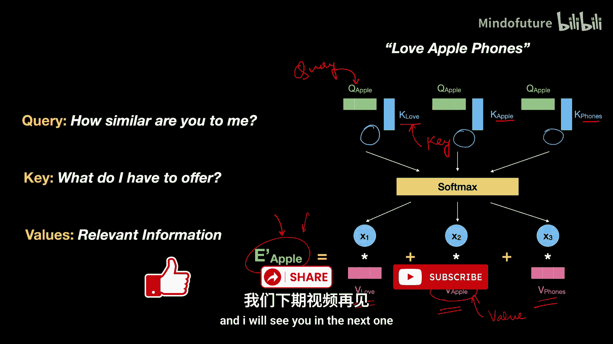

# 深度学习中的Transformer架构 ｜ Transformers In Deep Learning ｜ Learn With Jay p04 P04_Why_the_name_Query__Key_and_Value_Self-Attention_in_Transformers-Part_4 -BV1Mdt9zXEpE_p4-

What's going on， everyone， This is Jeff Patel and welcome to another video in our Transers series In the previous video of self attention。

 we saw that we multiply the embedding vector with W Q， W K and W。

 and now you might be wondering why did I specifically choose this name Q， K and B。😊。

These resultant vectors are called。鬼的。机。And value vectors。

 So this video is going to be a short one the only purpose of this video is to see why the authors of attention is all you need decided to use these names query key and value so let's not wait further let's get started with this video in computer science this query key and value has specific meaning let's try to understand this meaning with the help of this dictionary let's say you have this python dictionary which maps the animal name to its sound if you take this dictionary you can say that this dictionary is acting as a query and the input to the dictionary。

Our keys， this dictionary in a way， is asking the key a query。

 It is asking what is the sound of dog and what we get from the resultant expression is called value。

The values is the actual information the dictionary is going to ask the same query to different different keys and based on the key the value will change。

So the similar analogy is used in self attention。If you remember in self attention we compare the query vector with all the key vectors of the sentence。

 lets say our sentences love Apple phones and we want to generate the newer representation for Apple。

😊，Then we will be comparing the Q of Apple with key of love， key of Apple and key of phones。

 and based on this comparison， it will generate a similarity score for us。So in a way。

 you can say that this cu of Apple is asking a query to the key vectors。

 It's asking these key vectors how much is the similarity between you and me and in response。

 the key vectors are like answering what do they have to offer。

So that is the reason these vectors are called query and key vectors query vectors are asking the key vectors a specific question they are asking what is the similarity between you and me and the key vectors are responding with an answer and overall the vector multiplication of the query and the key vector returns us the similarity score between those two vectors once we have the similarity score will pass it into the softmax function Somax will convert it into probabilities and these probabilities will be multiplied with the value vectors Now there is also reason why these are called value vectors If you notice different composition of the value vectors form the new word representation of Apple overall this new E of Apple is made up of varying percentages of these value vectors so the value vectors are the actual or relevant information that is getting passed along to generate this new word representation。

😊，And because it is like the actual or the relevant information that we are passing along。

 these vectors are called value vectors。😊，So that was the relevance of query keys and values。

 It was a really short video but I wanted to cover this concept because transformers are a very important concept and to set the foundation of modern day AI so it's important to learn every nomenclature in every term used in the transformers you might get asked a question on the query key and value vectors in the interview so I hope you found this video valuable If so hit the like button share it among your friends do subscribe to the channel and I will see you in the next one。

😊。

