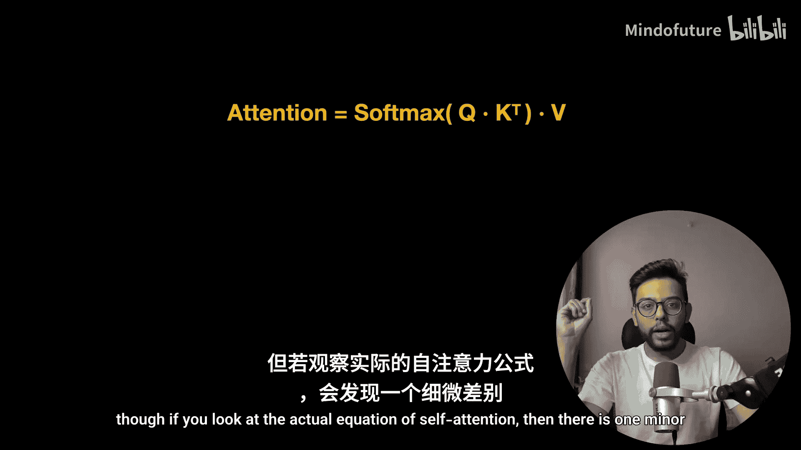
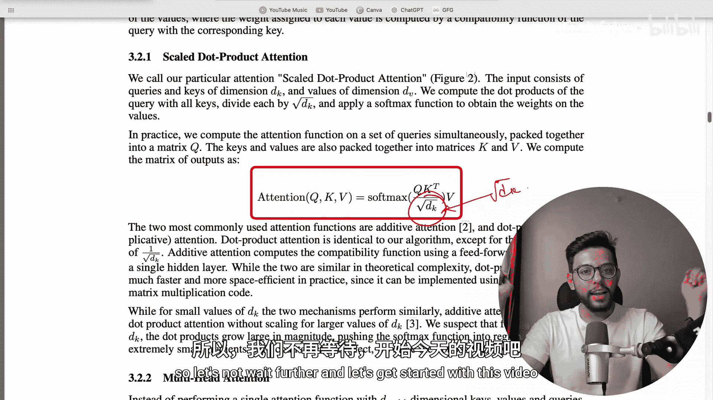
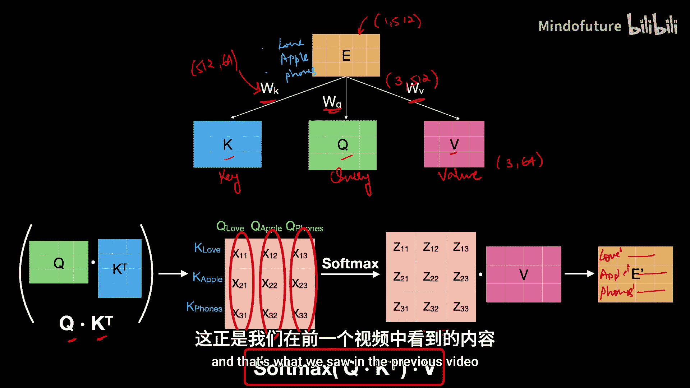
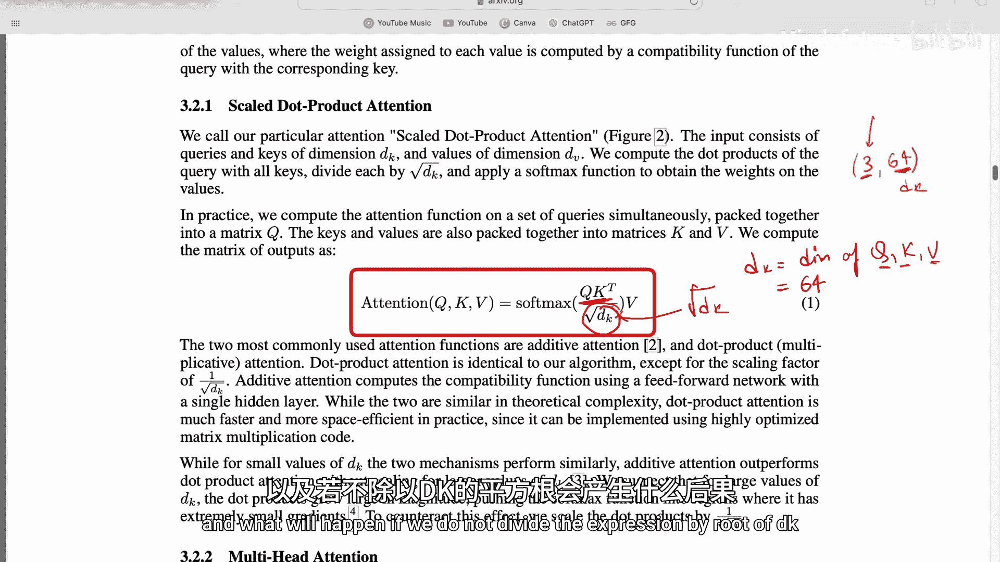
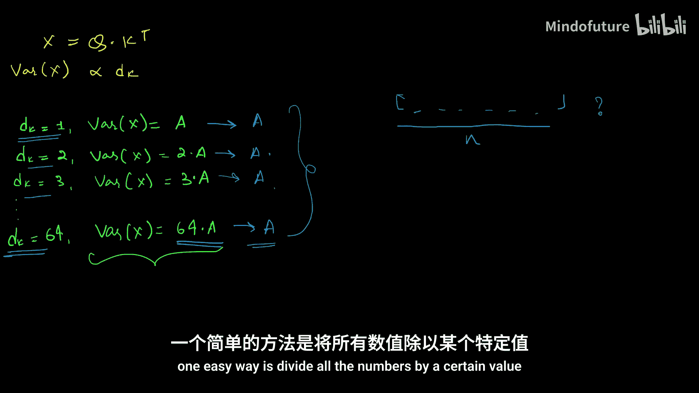
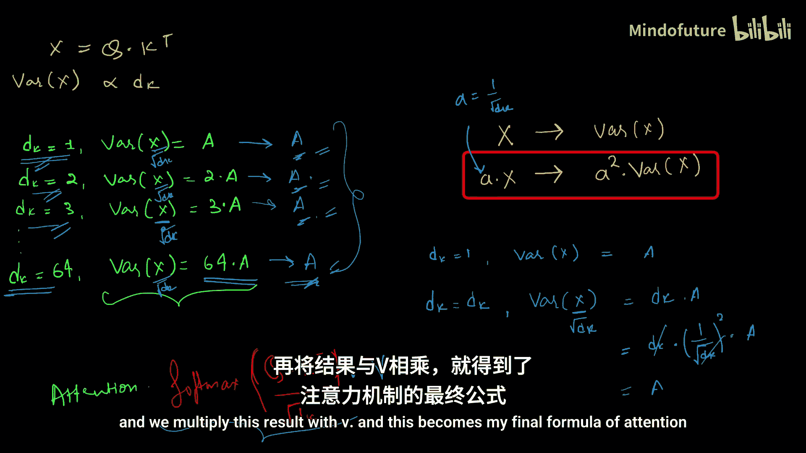

# 深度学习中的Transformer架构 ｜ Transformers In Deep Learning ｜ Learn With Jay p05 P05_Why_Scaling_ -BV1Mdt9zXEpE_p5-

Welcome to the part 5 of Transformers series In this video。

 we are going to discuss the scaled dot product attention In the previous video we derived the equation of selfat directly from scratch and it looks something like this though if you look at the actual equation of selfatten then there is one minor difference and that is this division by root of D So what is this and why is it required that is what we are going to discuss in this video I could have covered this in a single line in my previous video like the 99% of the resources online but that is not what this channel is about this channel is about diving deep into the fundamentals of deep learning and understanding how every single component work and what role do they play So if you stick around till the end of this video。

 then I am pretty sure that you will gain a lot of mathematical and intuitive insights on the working behind deep learning models and if you haven't subscribed to this channel then click on that red subscribe button because。

😊。

We cover a lot of detailed explanation behind every single component in machine learning models。

 and through that we understand how the entire model works。

 so let's not wait further and let's get started with this video。

Let's first start with a recap of what we saw in the previous video。

Let's say if we have this sentence， love。Apple。Pones。

Then what we will do is that we will take the word embedding of these three words。

And create a matrix out of it。 So this vector will be the word embedding of love。

 This will be the word embedding of Apple， and this will be the word embeending of phones。

 let's say each word embedding is of size 1 comma 5 and2。

 Then the overall size of this matrix will be 3 comma 512。

 We will multiply this word embedding matrix with three other mates。 That is W K， W Q and W V。

 These three matrices will be our key query。😊，And value matrices。

 And let's say if the dimension of these W K W Q and W is 512 comma 64。

 then the dimension of this K Q and V matrices that are generated will be equal to 3 comma 64。

 All right， then in our self attention mechanism。 we will multiply the query matrix with the K transpose matrix。

And this matrix multiplication will give us the dependencies between the words。 For example。

 this x12 will be the dependency between the word apple and love in that sentence and this x22 will be the dependency between Apple and Apple in that sentence this x32 will be the dependency between Apple and phones。

 So this way we will get the dependency or the relationship between every pair of words in our sentence and once we have these dependencies generated we will perform this soft max function on the vertical axis。

And the softm will convert these values into probability。 So if you look at this vector。

 then the summation of Z11 z to1 and z31 is going to be1。

 and once we have passed this Q k transpose into softm we will multiply the result with the value matrix and this will give us our new word representation for all the words in our sentence This vector will be the new word representation of love。

 this will be the new word representation of Apple and this will be the new word representation of phones and our final expression of self attention will look something like this and that's what we saw in the previous video but if you look at the original attention is all you need paper。

 then you will find that the equation of softm is given by this same expression with the difference of only this factor the authors have decided to divide the result of this matrix multiplication with。

😊。

Root of decay here。 D is the dimension。Of。Q K N V matrics， and that is equal to 64。

 So this D is a hyperparameter， which is the dimension of the query key n value matrices in our example。

 the dimension of Q K v was 3 comm 64 where this 3 is the length of the word while 64 is D。

And the purpose of this video is to understand why this division is required and what will happen if we do not divide the expression by root of decay。

So we have to divide by root of decay because of this following property in mathematics that states that the variance of the result of the matrix multiplication is directly proportional to the dimension of the vectors being multiplied。

 What do I mean by that is Let's say here we are multiplying two matrixrices Q and kt transpose and this matrix multiplication the value x11 is obtained by multiplying this vector with this vector and the overall variance of the values in this result is directly proportional to the dimension of this vector。

 and this dimension is our decay。 The size of the cube matrix is 3 comm 64 and the size of kt transposees 64 comma 3。

 So here3 is the number of words in the sentence。 and 64 is our decay So there is a property in mathematics that states that whenever we multiply two mates。

😊，The variance of the result is directly proportional to the dimension of the vectors being multiplied。

 which is 64 in our case， or we can say decay， given this what I am saying is if my value of decay is let's say2。

 then my size of the Q is going to be 3 co 2 and kt transpose is going to be 2 comma 3 as the value of this decay is very less the variance in this result or the variance of these values。

Is going to be less。And as we increase the size of decay。

 the variance in this result increases note that it does not matter what the size of this matrix will be。

😊，Even if my D is 2 or 64 or 512 or even 1000， the resultant size is going to be3 comma 3 only。

 but the variance of the values inside this result is going to be higher with the higher value of decay。

 So what is the relationship between this property in mathematics and division by root of decay。

 My answer to that question is whenever we have high variance and deep learning。

 it leads to vanishing gradient problem and vanishing gradient problem hinders the overall training of the model So as the variance of this matrix is directly proportional to the decay。

 which is 64， the variance is going to be high and high variance is going to lead to vanishing gradient problem and it will hinder the training of the model。

 So we divide by root of decay to lower the overall variance once the variance is low。

 we will be able to avoid vanishing。😊，Radian problem and we can smooth out our training process and this is the explanation that you will find in most of the resources online。

 but this channel is not about giving you one liner definition this channel is about diving deep into the ys why certain things work like that Why do we use something the way we use it so in this video we will first look at the proof of this property in mathematics why the variance increases with increase in the dimension of the vectors being multiplied then we will look at why high variance leads to vanishing gradient problem and then we will see the exact reason why we divide by root of decay why only this number So let's first start by diving deep into this property why the variance increases with the increase in the dimensions of the vector being multiplied So intuitively we can understand this by taking few random two dimensional vectors and multiplying them。

Here I have generated few two dimensional vectors whose values lie between minus 10 to 10 if we multiply these randomly generated  two dimensional vectors then the result will look something like this in this result you can see that the maximum value is 23 and minimum value is negative of 23 while the mean of these values is minus0。

5 let's convert this into an integer for simplicity and I'll consider the mean close to0 so you can get the overall idea of the variance in this result for those of you who have forgotten what variance is variance is the deviation of values from the mean so if my mean is 0 then the variance in a set of number is the deviation of all the values from0 so in this expression you can say that my overall variance deviate from minus 23 to 23 and you can get the overall idea of the variance now。

Repeat the same exercise， but this time we will take five dimensional vectors and the result will look something like this in this result。

 you can see that the minimum value is negative of 49 and the maximum value is 122 and the mean of these numbers is approximately 66 So at this time the numbers are deviating from 66 to 122 that is approximately the difference of 56 and on the negative scale the numbers are deviating from 66 to -49 and the difference is more than 100 so clearly the variance in the result where we were multiplying the 5 dimensional vectors is much higher than the variance in the set when we were multiplying two dimensional vectors。

And the reason why this happens is because of the number of terms that we are adding as the dimension of the vector increases。

 the number of terms that are getting added in the overall result increases and thus the values in the result increases for example。

 the highest value that you can get out of two dimensional vectors in which the values range from minus 10 to 10 will be by multiplying 10 comma 10。

With。10 comm 10 with 10。And that is going to be 2 times 100。While， on the other hand。

 the highest value that you can get out of five dimensional vector will be。Equal to 5 times of00。

 so as the number of terms that are getting added increases。

 the overall values in the result increases。And thus， the variance increases。So。

 this was an intuitive idea why the variance increases if you want to know by exactly what factor the variance increases then you can say that the variance of sub matrix c that was generated after the matrix multiplication of A and b will be equal to n times。

Vance of a and variance of B。This condition will hold true if we assume that the entries inside the matrix。

 A And B， are independent。Random variables with。0 mean And assuming that the entries of A And B。

Have identical variance。But this is an ideal condition。 We might not always have 0 mean for A And B。

 but generally， we can say that if our mean of E N B is roughly close to 0。

 then the variance of C can be roughly。Equal to n times。Villth of a。NB。

I have even attached a proof of this down in the description box。

 So if you are a statistic enthusiast and you w to know more about how this equation was generated。

 then check that proof out。 It will give you a good idea of statistics and mathematics behind this。

 But at least I hope now you are assured of this property。

 So let's move on to our next discussion where we are going to see why this high variance is a problem in deep learning。

 It is a problem because we are going to pass this high variance matrix into softm function and the nature of softm is such that it converts the large values into larger values and small values into smaller values。

 So it amplifies the difference in the values。 For example。

 if I have a two dimensional vector with values 7 and 3 and passing into softm function。

 and it will be converted into 098 and 002 here you can clearly see that the difference of 70% to 30%。

😊，Is amplified to 98%。And 2%。 So softm scales that difference even further。

 So whenever we will pass a high variance matrix or high variance vector into softm。

 it's going to scale the difference even further。 So it can convert the vector in such a way that one of the value can be 099 and rest all values could be close to 0。

 Also understand that this vector is going to be further processed with weight parameters。

 So when you multiply this vector with weight parameters。 The overall result。😊。

Will be only based on the weights associated with this neuron these weights won't be contributing in the overall prediction because these weights will be multiplied with0 and its values are going to be nullified so this is the problem that our model will face because only these three weight parameters are contributing in the overall prediction our model will only train these three weights and it will ignore all the other weights the weight training happens in deep learning is at first we initialize these weights with random values。

And we pass an input to the model and make a prediction because these weights are initialized with random values。

 this prediction is not going to be accurate， so we will show the actual value that the model should have predicted and will ask the model to adjust its weights in such a way that instead of predicting this wrong value the model learns to predict the right value and this nudging of weights or changing the weights happen in the back propagation step。

 but if any of the input in the model is something like this。

 then these weights are not contributing to the overall prediction So the model will only adjust values of these three weights because adjusting the other weights does not make any impact in the overall prediction and this is how the training of the model will be stuck we won't be able to train the model appropriately because the model is not utilizing all the weight parameters So I hope you can understand why high。

😊，variance is a problem in deep learning Okay so now lets move on to the final chapter of this video and that is to discuss why we need to divide by root of decay so let's say x is equal to  Q times kt transpose what we have already seen in the video is that the variance of x is directly proportional to d given this let's assume that when the decay is equal to 1 the variance of x is equal to a then in an ideal scenario what will happen is if decay is equal to2 then the variance of x will become2 times of a when decay will be3 the variance of x will be to3 times of a and so on when decay is equal to 64 the variance of x is going to be 64 times a remember that this will happen in an ideal scenario not always so this。

can be anything but we can say that in an ideal situation it can produce something like this and this is where the problem is as the decay is increasing the variance is also increasing what we want is despite the value of decay the variance of x should remain the same。

So， even if decay is 23 it should remain same even if decay is 64 it should remain the same so this is what we want to achieve now think about it。

 what are the ways to reduce the variance if you want to reduce a variance of a set of numbers then how can you do it when easy ways divide all the numbers by a certain value。

For example， if I calculate the variance of this vector then it will turn out to be 200。

 if I divide this vector by 10 and then calculate its variance then it will be 2 so to keep this variance same I have to divide x by some value but the question is what that value will be so to rescue us we have an interesting property in mathematics it says that a variance of any matrix is ver of x and if I multiply some constant number a to this matrix then its variance will be equal to a square of ver of x and this is the property that we can use to keep the variance constant if for decay equal to1 my ver of x is equal to a and for some decay lets say equal to decay my ver of x is equal to decay times of a。

Then I can divide this x with root of decay， so here a will be equal to one upon root of decay and that is going to be。

1 upon root of D square of a。And this and this will be canceled and we will have a so if I always divide my x with d。

Then no matter what value of DK I have here， my resultant variance is always going to be same。😊。

And that is why in the result of Q kt transpose。We divide this result by root of decay and once we have divided this only then we perform the softm operation and we multiply this result with V and this becomes my final formula of attention。

So that completes our discussion of selfat through the last four videos we have got an in-epth understanding of selfat and it will serve as a solid foundation for the upcoming videos you can finally say that now you know the in and out of self attention in the next video we are going to look into the multiheaded attention where we will be just applying the multiple instances of these self attention and before you go if you found this video valuable then please do it the like button。

 subscribe to this channel， share this video among your friends and keep supporting this channel so that I can make more such future videos and that's it for this video let's now move on to the multiheaded attention。

😊，🎼。

