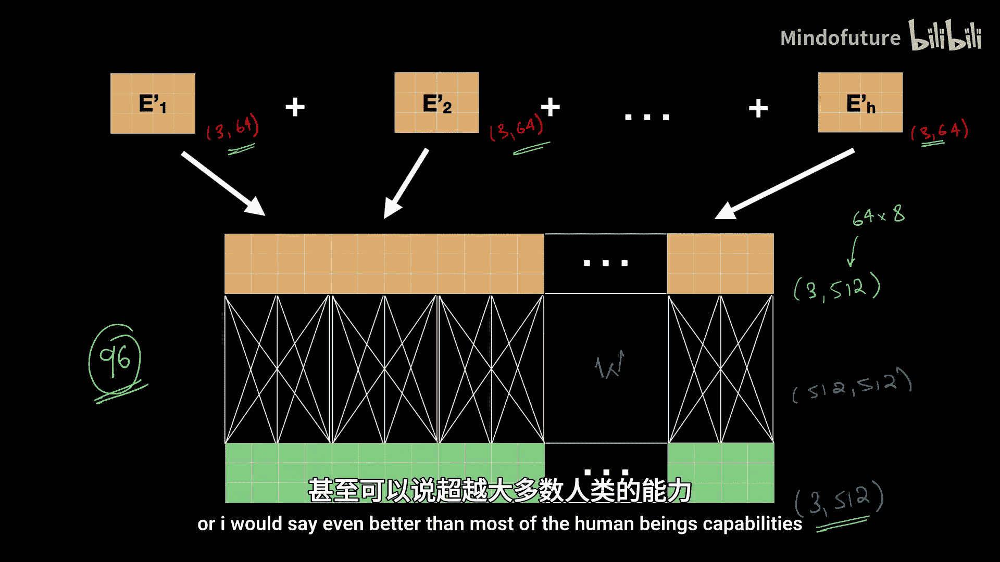
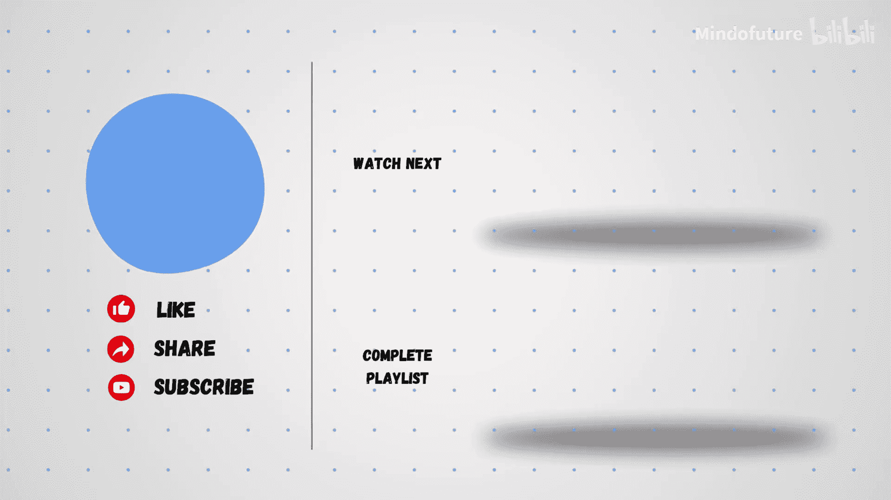

# 深度学习中的Transformer架构 ｜ Transformers In Deep Learning ｜ Learn With Jay p06 P06_Master_Multi-headed_attention_in_Transformers-Part_6 -BV1Mdt9zXEpE_p6-

Transformers uses multiple heads of attention and not just one。

 This gives it an ability to interpret the sentence in multiple different perspectives。

 So far in this series， we have seen how a single head of attention works in detail。

 Now we will take it one step further。 and we will see why one head of attention is not enough。

 And how multiheaded attention is a game changer。 By the end of this video。

 you will have a clear idea on multiheaded attention and it working in transformers。

 it is one of the major reasons that has enabled modern AI to interpret the language as fluently as we human can。

 So let's not wait further and let's uncover this powerhouse of transformers。 In the previous video。

 we saw that language is complex。 The same word in English can mean differently in the different context。

 When I say light。 What comes to your mind。 Probably the visible spectrum of electromagnetic waves。😊。

But when I say light weight， the context completely shifts to the measure of weight。😊。

When I say light blue， now I'm talking about the shade of blue and when I say lighter candle。

 it means that I' am using light as a ver。 Similarlyly。

 Apple can mean differently in different context。 When I use Apple with phones。 I mean。

 I'm talking about Apple technology company When I use Apple with juice I mean。

 I'm talking about Apple fruit。 The same word can mean differently in different context。

 and we did solve this problem with the help of self attention。

 Se attention generates new word representation for all the words in the sentence based on their contextual meaning。

 For example， if previously， Apple had 50% tech properties and 50% fruit properties。

 self attention will generate the new word representation of Apple in such a way that it will be relevant in that sentence。

 here I'm using Apple with phones thus self attention will shift the word embeddings of Apple more towards the technology company side。

 Similarlyly， when I use Apple with juice， self attention will change。😊。

The word representation of Apple and move it more towards the fruit side。 And this way。

 we can generate new word representation of words based on their context in that sentence。

 but the problem is language is a lot more complicated than that to understand the true meaning of language we need to form complex relationship between words we need to simultaneously find the relationship between subjects。

 objects， locations， emotions and more and it's even possible that single sentence can have ambiguous meaning and multiple possible interpretations。

 For example， when I take this sentence she saw the man with the help of telescope。

 it can have multiple interpretations。 One of the interpretation can be that she saw the man who was holding the telescope and the other interpretation can be she used a telescope to see the man Now both of these interpretations are valid in the first interpretation there should be a strong dependency between man and the telescope。

😊，Identifying the telescope is being possessed by man and in the second interpretation there should be a strong dependency between she and the telescope which identifies that the she is the one who possesses the telescope As you can see if we want to generate two different interpretations of a sentence we need to generate two different attention patterns of that sentence and if we only use one head of attention we cannot capture both of these dependencies。

 a single-headed attention will not be able to capture multiple interpretations and our model might predict inaccurately and that's not just it the language is so complex that a singleheaded attention will be practically incapable of generating the full understanding of the sentence for example。

 when I take the sentence that keys on the table belong to Sarah then we need to capture at least two attention patterns for keys one where there is a high dependency between keys and on the table capturing the spatialial relationship like keys are placed on the table。

And also， we need to capture that the keys belong to SA。

 which captures the possession of the keys by SA， so practically a single head of attention cannot capture both of these dependencies。

😊，As the size of the sentence grows， capturing more and more dependencies for a single headed attention will be almost impossible。

 There will be only a limited number of relationships that we can capture to effectively highlight a strong dependency between the entitiess with large sentences。

 it will be not possible to hold multiple dependency patterns using just one head of attention。

 and this is where our self attention will require an upgrade。

 We will need a more powerful version of self attention mechanism to capture such complexities in the sentence。

 But the good news is that this upgrade can be achieved very easily to understand why we need multiheaded attention。

 Let me take a quick det to computer hardwares。 Imagine that we have a single ram module in your computer。

 It's fast， It's efficient and it can handle certain task seamlessly。

 But when the workload becomes more complex。 like running high resolution game or processing large data sets One Ram module simply isn't enough。

😊，Sty slows down and will fail to handle such tasks。

 So what do we do to handle our day to day efficiently， We simply add another Ramm module。

 upgrading the size of Ram by two times we have more powerful engine to handle over complex tasks If two ras are not enough。

 you can even add more eventually increasing the capacity to handle bigger processes a single head of attention is just like one Ramm module it focus on capturing certain patterns or relationships in the sentence like identifying the subject or tracking the meaning of a word in that context。

 but as the complexities of the language increases its full nuances。

 long dependencies and layered meanings cannot be captured effectively by a singlehead attention and that's where the multiheaded attention comes into play with multiheaded attention Each one specializes in focusing on specific part of a sentence or a type of relationship like one attention head might identify the spatial relationship between entities like。

where the object is placed and another might identify the subject verb object relationship and another might identify the relationship between entities through different time or another head might interpret the sentence in altogether different way All these different relationships provide richer and diverse context of entities in the sentence It's just like using different filters in convolutional neural network If you have studied CNNs then you would know that CNN has filters and in one layer of CNN we use multiple filters where each filter identify unique patterns from the image One filter might identify vertical edges。

 another might identify horizontal edges or another might identify the color pattern Overall these filters produce rich feature maps through which the image can be interpreted by the model The similar strategy is used in transformers Consider selfat in transformers as a filter in convolutional neural network each。

😊，Self attentionten head identifies the relationship between words to produce contextual features we use multiple attention heads to identify different and varied relationship between words in the sentence and all of these relationships combined provide us with rich and diverse features extracted from this sentence which helps us to make highly contextual aware predictions and understand the full nuances of the language so exactly how does the multiheaded attention works in transformers lets see that。

😊，Let's revisit our simple example of the sentence， love。😊，Apple phones。In self attention。

 the key components are these key query and value matrices which are obtained by multiplying this WK。

Wq and WV a single headed attention looks something like this。😊。

Where we first multiply the query and the key， which identifies the relationships between the words in that sentence。

 we divide the result by root of decay， where decay is the length of this query key and value。

 Afterwards， we pass the result into soft max and multiply it with the value matrix。

 This generates the new word representation of all the words in that sentence。

 where this vector is the new word representation of love。

This will be the new word representation of Apple。And this will be the newer representation of phones in multi headed attention。

 all we do is that。😊，Instead of using one set of learn matrics。

 I use multiple sets of WQWK and WV matrics。😊，And this generates multiple sets of queries。

 keys and values where each set will help us to capture different perspective of the same input。

 Notice that the input is same， but we multiply this input with different sets of W matrixs。

 and it generates different sets of key query and value for us。

 So one head of attention will be processed with the help of this key query and value。

 Another head will be processed by this key query value and so on。😊。

The entire mechanism of attention is same in every single head。

 and that is to generate the new word representations based on the contextual awareness。

 But instead of generating only one new word representation。

 we will be generating H number of new word representations for every single word in that sentence here。

 H is the number of heads of attention， which means that this vector will be one of the new word representation of Apple。

 this will be another new word representation of Apple。😊。

And this will be another new word representation of Apple。

 so we will be generating each number of new word representation for every single word in our input sentence。

😊，And each of this output will be capturing different aspect of that sentence。😊。

If we have a long sentence， then one of the head might identify the relationship between Apple and iPhone。

 specifying that the Apple and iPhone is a single entity instead of two different entities and then another one of the head might identify that the Apple iPhone is resting on the front shelf capturing the spatial arrangement of Apple iPhone while another head might identify that it's Jake who is holding the iPhone and there could be another head。

 which might identify that this Apple iPhone is replacing the old phone So different heads of attention captures different aspects of the sentence。

 and the newer representation of Apple will be based on all of these aspects。Now。

 once we have obtained the output from each head of the attention， how do we process it further。

 What we do is we concatenate these outputs and create a single matrix。

 This means that this long vector that you can see is a concatenation of。Apple dash1。Apple dash 2。

Apple dash3 and so on till Apple dash H。 and then we process it even further by performing the linear transformation on this and this linear transformation will create the final unified word representation of each word in the sentence。

 and that means that this vector will be the final unified word representation of Apple this linear transformation is performed by multiplying this matrix with a learn parameter W。

 So if suppose we call this matrix Z， then this final output Z dash is obtained by multiplying Z with a W parameter。

😊，And I know you might be wondering， why is this linear transformation even required？😊。

To answer this question， lets go back again to our convolutional neural network analogy。

 remember in CNN we have an input image we convet this image using different filters and each filter extract some feature patterns from this image one of the filter might extract the horizontal edges one of the filter might extract the vertical edges one of the filter might extract the color patterns and different features produce a feature map Now if you remember CNN architecture once these feature maps are produced after the convolutional layers we added a fully connected layer at the end。

😊，This fully connected layer is similar to the linear transformation step here。

 What this fully connected layer does to CNN is it interprets the feature patterns produced by the convolutional layers。

 each filter of the convolutional layer extracttract some feature patterns from the image。

 Now it's this fully connected layers job to interpret different feature patterns generated from the convolutional filters and makes sense of the entire input image。

 And that's what linear transformation helps us in multiheaded attention。 First。

 we started with the input word embedding of Apple。😊，Which was static。

 It had no idea about the context of the sentence。 Then different heads of the attention creates different feature patterns of Apple。

 Each head looks at Apple in different perspective and create these feature vectors。

 but understand that we still have to interpret this concatenated output。

 and it's also possible that one of the head might have interpreted Apple as a fruit disregarding the possibility that it's an Apple technology company and that interpretation could be irrelevant。

 It's this linear transformations job to keep only the relevant features and create an appropriate unified representation of Apple。

 This unified representation might have the overall context of Apple in that sentence。

It would know where Apple is present， Who possesses the apple， what are the features of Apple。

 how the apple is used and everything。 If you struggle to understand linear transformation。

 then click on the upper eye button I have created a dedicated 30 minutes video on linear transformation explaining end depth of what goes behind linear transformation。

 but this overall covers our entire multiheaded attention before we wrap up this video let's talk about the dimensions of the matrixrices here and also answer the question how many attention heads should you use in the original attention is all you need paper every single embedding is 512 dimensional So if you assume that our input has three words then the input will be of size 3 comma 5 and2 This input will be linearly transformed with the help of w matrix of size 5 and2 comma 64 resulting into three comma 64 dimensional key queryarian values Each head of attention will process this。

😊，Key query value and generate an output again of size 3 comma 64。

But in total we will have edge number of such outputs in the original attention is all you need paper this edge is taken as 8。

 so they use8 number of heads in their transformer model。

After concatednating these83a 64 dimensional output。

 we get a resultant matrix of size 3 comma 5 and2 where this 5 and2 is 64 times8 and then this is again linearly transformed with the help of a w matrix of size 5 and2 comma 5 and2 resulting in the final output3 comma 5 and2 size notice that we started with an input of size 3 comma 512 and we ended up with an output of the same size。

 but now this output is highly contextual aware and is even able to capture different interpretations In't it mindbing when I finally understood how this works I could make sense why chad G could understand everything I ask it no matter how twisted I write the question it understands what I mean and produces a highly relevant answer Do you know how many attention heads are used in G 3 model the answer is 96 So G。

😊，3 can interpret every sentence in 96 different perspectives。

 providing it the capability like we humans have， or I would say even better than most of the human beings capabilities。

 So this wraps up our entire discussion of attention in the next video we move into the positional encoding。

 I hope you found this video valuable。 If so， hit the like button and support this channel by clicking on the red subscribe button。

 let me know your thoughts down in the comment section and if you're coming to this channel for the first time then you can check out my complete playlist on transformers by clicking somewhere in the right side at the end of this video。

 So that's it for this video。 I will see you in the next one。😊。

🎼。

