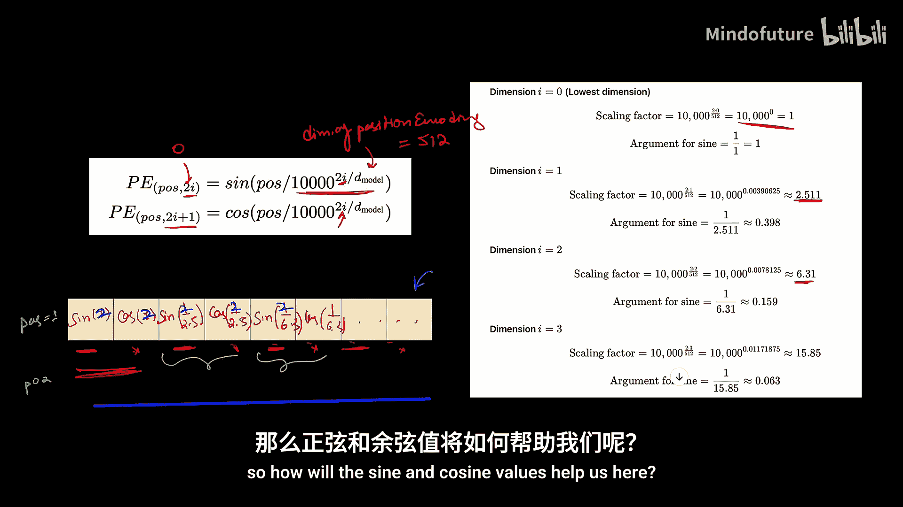
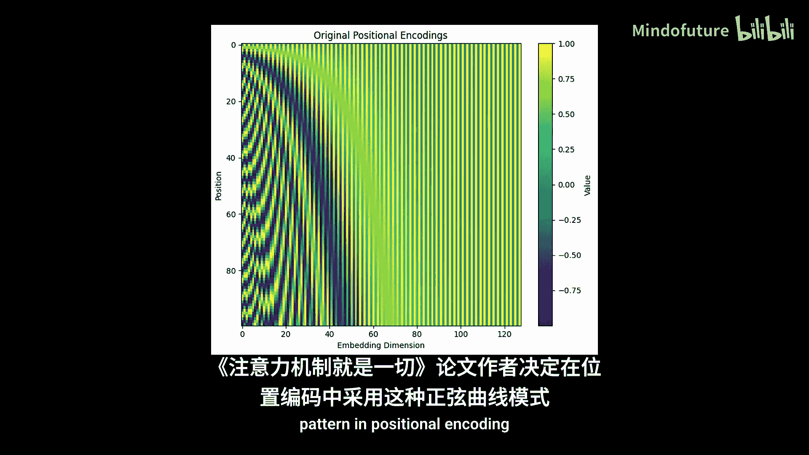
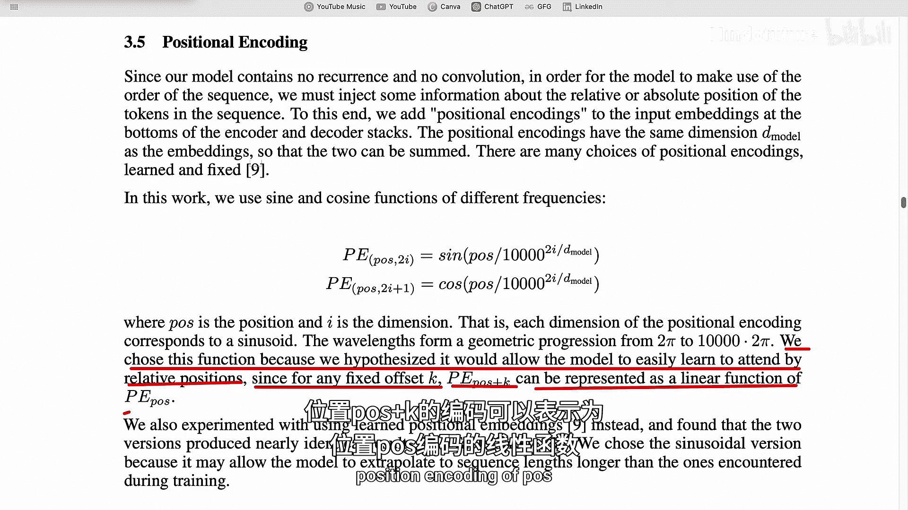
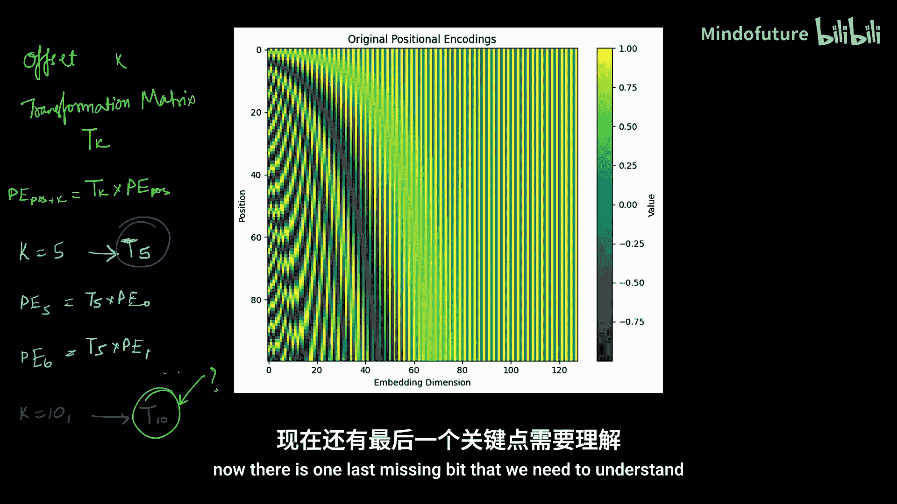
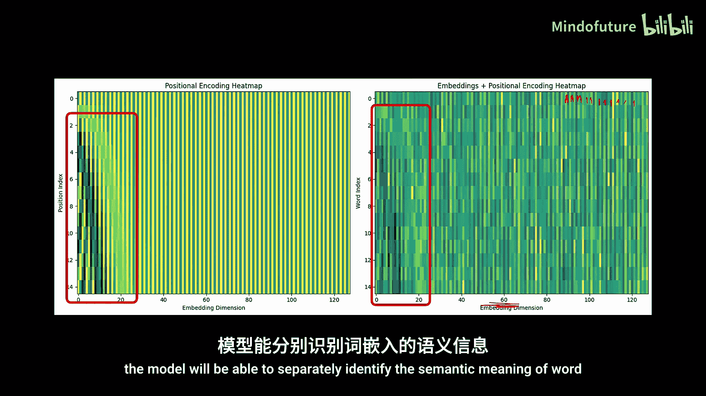
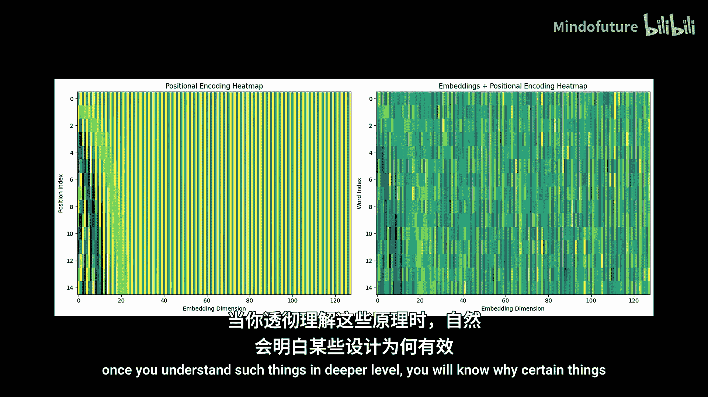

# 深度学习中的Transformer架构 ｜ Transformers In Deep Learning ｜ Learn With Jay p07 P07_Positional_Encoding_in_Transformers-Deep_Learning -BV1Mdt9zXEpE_p7-

Transformers processes words in parallel。 This means that they inherently do not have any sense of order。

 We need to find a mechanism through which we can inject the positional information of the words so that the model can interpret the sentence and a sequential order。

 And that's where the position encoding comes into picture。 In this video。

 we are going to answer why we need position encoding what it is and how it helps the model to find the sequential order of the words。

 We are also going to dive a bit deeper into questions like why position encodings are added to word embeddings and why despite this addition。

 They are not interfering with each other。 And overall。

 how does the model make sense from all of this。 So let's not wait further， Let's get started。

 Se attention is an incredible mechanism that processes words in parallel。

 This parallelization not only makes it significantly faster than traditional R N。

 But it also enables it to capture long range dependencies effectively。😊。

We've already seen some of its powerful benefits like generating contextual word representations where the meaning of the word is determined by the sentence context。

 like the meaning of Apple is different in Apple phones and Apple juice。😊。

This capability makes self attention a game changer for NLP task。

 but this parallellyization is both advantageous and problematic for us。

 it helps us to process all the words incredibly fast。

 but it also means that self attention inherently does not have any sense of order。😊。

And that's a problem in NLP， NLP requires knowing the order of the words。😊，Take these two sentences。

 The cat chase the mouse and the mouse chase the cat。 Both the sentences uses same words。

 but their meaning changes entirely because of their order。

 If you pass these two sentences to self attention mechanism。

 It will generate exact same attention pattern from both of these sentences as if they are identical because it processes all the words parallelly。

 it is not aware of the order of the words。 and this lack of sequential understanding is a significant limitation of self attention Without taking care of this。

 we cannot use self attention for NLP task。So how do we solve it should we go back to sequential processing like we did in RNN the answer is absolutely not。

 the authors of original Transers paper proposed a brilliant and elegant solution to this problem once you will understand it you will appreciate how cleverly all the pieces of transformers work together to make it so powerful and the answer lies in positional encoding。

😊，Before we jump straight into their proposed solution， I want to take you there step by step。

 If you and I were given this task to design position encoding， how would we go about it。

 How would we approach this problem， Since we aret processing word sequentially。

 the only way we can pass the position information to self attention is by somehow encoding the order of the words and pass that information along with the input word embeddings to the self attention mechanism。

 So what I'm saying is we know that the input to the self attention is word embeddings。

 We need to pass some additional information along with the word embeddings through which the model will get an idea of the order of the words in the sentence。

 And throughout this video， we are going to discuss how should we encode this positional information and how it will help us to identify the relative ordering of the words。

😊，One naive approach could be that I assign each word a discrete value like 1，2，3，4 and so on。

 This means that I will extend the word embedding by one dimension and I will keep this final dimension to assign the order of the words and Ill just explicitly specify the order of the words by discrete natural numbers like 12。

34 and so on and I'll pass this combined vector as the input to self attention mechanism while doing this I am also hoping that somehow our model will learn to interpret this final dimension as the positional information。

But can this really work。 Can we really do that， Actually， no。

 by assigning discrete number like these is not good for training。 neural networks。

 like continuous numbers rather than discrete numbers。

 model cannot interpret that one correspond to first position 2 correspond to second position and 3 correspond to third position and so on。

 It's not very easy for the model to interpret these discrete numbers as the humans can。😊。

And this also has a couple of more problems。 If the length of the sentence increases。

 let's say to 100 words or 1000 words， then the value of this position will also increase up to that。

 And introducing such a large value like this is going to skew the focus of the training and will lead to unstable gradients。

 Remember， few videos back。 we saw how high variances lead to vanishing gradient problem and unstable training of the model。

 That's exactly what will happen。 If we pass a discrete， unbounded， large numbers like this。

 So our problem is， we cannot use discrete numbers。 we cannot use unbounded values。😊。

And we cannot use numbers which is not good for training。

What we want is a function that generates continuous values and all the values should lie in a particular range。

And along with this， it should be good enough for the training through which our model can interpret the ordering of the words。

 See， we need to provide this model with a specific pattern that encodes positional information。

 It will understand if two words are close to each other or if two words are far apart from each other。

 This overall might sound a bit difficult to achieve。

 but I promise it's not very difficult if we go there step by step。😊。

So let's move one step at a time and we will start by solving this problem。What we want。

Is a continuous function that lie in a particular range。 What if we use sine function for this。

 Sine functions are continuous periodic， and their values lie in a specific range of -1 to 1。

 and our model will love it。 if I can somehow generate unique values for every position in this sentence using this sine function。

 and somehow ask the model to train itself in such a way that it can capture the position information from this bit。

 then my problem is solved。 What I can do is the first position could be represented by sine of1。

 which is this value。 The second position can be represented by sine of2， which is this value。

 And similarly， third position and so forth can be represented with sign of 3，4，5，6 and so on。

 Instead of using discrete numbers。 if I use a value of sine function。

 Then it will make sure that the values lie in a particular range， and it will。😊。

Also provide a smooth continuous and periodic nature to it and we can solve the problem of discreteness and unboundedness but I know there is another obvious issue with this and that is its periodicity I know you will come to me and say that hej it's possible that somewhere down the line I will have some number x whose value will be same as the value of the position we have already encountered before which means that there will be some number x whose sine value will be exactly equal to sine of1 and similarly sine of2 might also be exactly equal to some another number if we just use this sine function to encode the positional information then what will happen is two positions will end up having same value and this will confuse our model it would mean that two words are exactly at the same position even if they are far apart from each other so we cannot guarantee uniqueness in position if we just use a single signine function to encode position。

😊，value Okay that's one hurdle。 How do we solve it What if instead of using only one bit to encode positional I use two bits to encode a positional value which means that instead of using a scalar value I use a vector of two values if I use a combination of two values the chances of these vector being exactly same as the other vector is much less with this given consideration I can say that instead of using just s what if I use a sine and cosine pair and that means that the first position will be not encoded by a singular value but a vector and we will use sine cosine pair to generate the values for this vector the first position can be encoded by using sine of1 and co of one which is this value second position can be encoded by using sine of2 and co of2 which is this value。

😊，And similarly， s of3 and co of three will correspond to the third position and so on。

 by using a sine and cosine value like this， I reduces the likelihood of two positions having identical values。

 but I know you will again say that hej， it's still possible。

 because this pattern itself is perioding in nature。

 there could be another x for which the value of this pair could be exactly same。

 though the odds are reduced， but it's possible that if I take a long enough sentence。

 the pair might become identical again。 And I would say， yes， you are absolutely right。

 So to handle that， what if I use another pair of sine and cosine。

 But this time I will use a different frequency for them。

 This means that instead of using a two dimensional vector。

 I will use a four dimensional vector and the positions will be encoded like this。😊。

For the second pair， I will use a reduced frequency like one by2。😊。

And the value of the first position will be given by two pairs of sine and cosine。😊。

Why reduce frequency because it will allow me a longer range of positions before which I will get this vector identical again。

 this further reduces the likelihood of two vectors being identical but still it might not be enough so what if I keep on adding the sine cosine pair and generate a long enough positional encoding vector that can sufficiently handle an extremely long sentence and that is exactly what the authors of the original transformers papers did they used a 512 dimensional positional encoding value which was derived from 264 pairs of sine and cosine。

😊，Every pair will have a reduced frequency like first pair will have frequency x。

 the second pair can have frequency x by 2 third pairer can have x frequency x by 3 x by 4 etc ceter。

 so this position2 can be encoded by taking sine of 2 co of 2 sine of 2 by 2 co of2 by 2 sine of2 by 3。

😊，Coss of2 by 3 and so on till I get a 512 dimensional positional encoding if I use a positional encoding of 512 dimensions with a sine cosine pair like this。

 then I can sufficiently handle an extremely long sentence like a sentence greater than tens of millions of words and this approach will guarantee that the all values are continuous。

L in a particular range and are uniquely able to identify the position。

Let me show you the exact equation used in the transformers paper。

 Every position is encoded with the help of this equation。

 This D model is the dimension of position encoding。😊。

Wwhichch is equal to 512 and this I is like an iterator just to basically populate the values of the vector。

 this2 I indicates even positions and 2 i plus 1 indicates the order positions so all the even positions are populated using the help of the sine function while all the order positions are populated with the help of cosine function so I will start from 0 and the first two positions will be populated by sine of 1 and co of 1。

😊，Because if I 0， then this entire term will be equal to1。 the second pair will have a division by 2。

5， So this will be obtained by sine of 1 by 2。5 and this will be co of 1 by 2。

5 and similarly the third pair will have sign of 1 by 6。3 co of 1 by 6。

3 and so on its exactly how we had discussed。 Every pair will have a reduced frequency and this was the encoding for position 1。

 If you are encoding it for position 2。Then we will replace this one by two。

And you know what this entire technique works。😡，It might seem a bit mathematical at first。

 but let me give you an analogy that will make it clear。 Let's answer this pressing question。

 How in this world can our model identify the position of the words based on just s and cosine values。

 at the end， what is important is we provide this model with a specific information。

 through which it can identify the relative positions between the words， In this case。

 we want to provide a model with a certain pattern through which it can get an idea of the relative ordering of the words。

 So how will the s and cosine values help us here。 The answer to that question lies in this beautiful diagram。

😊。

The sunoidal waves that we have designed follow a definite predictable pattern。

 which look something like this here what I've done is I've generated position encoding for 100 positions and each position encoding is of dimension 128。

 and if you plot the heat map for these 100 position encodings then it will look something like this。

 you will find that it follows a predictable and consistent pattern。

 see how the gradients of the color shift smoothly across the spectrum as we move down across the position you will see that the values in the higher dimensions gradually increase while the values in the lower dimension are rapidly increasing。

 This is because of the fact that we are using lower frequency curves in the higher dimensions and higher frequency curves in the lower dimensions。

 but heres where it gets interesting。😊，If you take any two positional vectors。

 then you will find a predictable pattern in them。 If you take any two nearby positions。

 then you will see that the most of the values of these two vectors are almost similar。

 only the values in the initial few dimensions change。

 but rest of all the other values are almost similar。

 and no matter which two nearby positions you pick， this pattern is consistent。

 you will always find that the most of their values are similar。

 only the values in the initial few dimensions change。 But now。

 let's say if you pick two positions which are far apart from each other。

 then you will start to notice the difference in the higher dimensions as well。 Now。

 there is more difference in these two vectors。 you will notice the difference even in the higher dimensions as well。

😊，And this pattern is consistent no matter which two positions you pick。

 what if I told you this pattern is so much predictable that if you know any position。😊。

Then you have the power to predict any of its neighboring positions as well This means that I know position encoding of 20 I have the power to predict the position encoding at 30 at 40 at 50 and so on and similarly if I know the position encoding at 80 I have the power to predict position encoding at 900 and so on and because of this predictable property the authors of the attention is all you need paper decided to use this sinusodal pattern in position encoding here is what they are saying we chose this function because we hypothesize that it would allow the model to easily learn to attend by relative positions since for any offset k the position encoding of POS plus k can be represented as a linear function of position encoding of P now what does this mean it means for any given offset。

😊。

Okay， if I know the position encoding of any position。

I have the power to predict the position encoding of P plus k if I take k is equal to 5 and I know P position encoding of 0。

 then I can predict the position encoding of 5 if I know position encoding of 5 I can predict position encoding of 10 and so on Similarlyly if I take k is equal to 10 and I know the position encoding of 0 then I can predict the position encoding of 10 and from position encoding of 10 I can predict the position encoding of 20 and so on the reason it is possible is because the way we have designed this sine and cosine waves。

Has this interesting property that says that for any offset k there lies a transformation matrix。😊。

T of k for which if we multiply T of k with any positional encoding。

 we will get a positional encoding of P plus k。If I take k is equal to5 then I have some transformation matrix T of 5 which will allow me to travel at an offset of 5。

 if I multiply t of 5 with position encoding of0 I will get position encoding of 5 if I multiply T of 5 with position encoding of1 I'll get position encoding of 6 and so on and similarly for any other offset k is equal to 10 there exist another transformation matrix t of 10 which will allow me to travel at an offset of 10 Now what is this t of 5 and t of 10 we don't need to worry about it right now if you want to go in deep and know exactly what this is then I will attach a link down in the description box which you can check out but for now just understand that it is mathematically possible to predict exactly what the neighboring position look like and that is why this specific position encoding pattern works the model will learn to identify this predictable pattern during the training of the model it will learn。

😊，Identify what the relative positions look like we are not explicitly telling the model to calculate the difference between two positional vectors。

 but all of these is learned implicitly because of a specific predictable pattern the model will get an idea of this offset k if you show any two positional vectors the model will be able to interpret the distance between those two position encoding vectors because of this definite predictability the model will learn to identify the pattern and interpreted meaningfully I hope you are understanding how the relative positioning is captured。

😊，Now， there is one last missing bit that we need to understand Earl I mentioned that we concatenate the positional encoding with the word embeddings。

And pass this entire vector as an input to self attention。

 So instead of just passing the 512 dimensional word embeddings， we would pass。😊。

The 1024 dimensional input vector which is a combination of word embeddings and position encodings to our self attention mechanism。

 where the first part will be word embeddings through which the model will understand the semantic。😊。

Meaning of the word and the second half will be the position encodings through which the model will understand the ordering of the words。

 But you know what， there is a drawback in this。 Remember。

 I told you that we multiply the input embedding with the W matrix。 these matrix were W Q。

 W K and W V。 So instead of passing just the embeddings as the input。

 If I were to pass the embeddings and positional encodings as the input to the self attention。😊。

Then the dimension of this W must also increase with 512 dimensional embeddings we were using a w matrix of size 5 and2 comma 64。

 but now if the input is 1024 dimensional then I will need to use a W matrix of size 10。

24 comma 64 So every W will now have 512 into 64 number of additional parameters and this will be the case with Wq Wk and W and not just that we are using multihead attention and we are using multiple layers of multiheaded attention in transformers model So overall the total number of parameters will significantly increase and this will slow down the training of the model as well as will take more time for the prediction。

😊，And that's another hurdle that we have encountered。

 We somehow need to optimize this performance as well。

 It doesn't make much sense to add so many number of parameters just for the positional encoding and the performance of the model is extremely important for the day to day tasks。

 So can we optimize this solution even further， I there a better way to combine position encodings with word embeddings。

 What if instead of concateating them， I perform an element wise edition。😊。

Both of these vectors are 512 dimensional。 thus， it's possible for me to perform an element wise addition and generate a 512 dimensional resultant vector But hey。

 this might sound counterintuitive If we add to vectors。

 won't they interfere with each other and distort the information they carry I mean。

 if I give you a number 5 how can you identify that this five is made up of 4 plus 1 or 2 plus3。

 won't the positional encodings distort the semantic meaning of word embeddings and similarly won't word embeddings distort the positional encoding pattern that we had observed at first glance。

 this concern seems valid。 but here's the genius of position encoding They are designed in such a way that they do not interfere with the semantic meaning of word embeddings。

 I can add a position encodings with word embeddings and both of these two components will remain independent and won't interfere each other。

 The moral will still be able to。😊，Interpret them separately。

 How is this possible The secret lies in the structure of position encoding because position encodings are generated using sinnooidal curves of varying frequencies they have a specific pattern that is distinguishable from the word embeddings and they do not interfere with the semantic meaning of word embeddings to prove you this。

 I ran a simple experiment。 First I took few 512 dimensional word embeddings and generated a scatter plot of them As expected the words with similar meanings were grouped together into clusters。

 Next I assigned unique positions to each of these words and added their corresponding positional encoding。

 and then I plotted the resulting vectors again。 The result the semantic structure is still intact。

 You will notice that these vectors have now shifted toward new space and their arrangement in the cluster is also different but still the semantic meaning of word is still intact。

😊，Similar words are still grouped in clusters and it is because the sign and cosine waves do not interfere with word embeddings。

 They have a definitive structure which is very different from the word embeddings and similarly。

 the word embeddings do not interfere with positional encodings if I plot a heat map to visualize the combined vectors after addition then you will find it something like this the color of the plot in the righthand side looks different but you will notice that the intrinsic pattern is still intact。

 you will see the dark and bright lines all the way and you will also notice that this initial portion is also similar and thus the pattern of the position encoding is still preserved the model will be able to separately identify the semantic meaning of word embeddings and the positional ordering of the words and that is why the authors of the original transformers paper decided to perform an element of wise addition between position encoding and input word embedding This is such a clever move。

😊。

It fascinates me how tiny details and transformers make huge difference by adding the position encodings。

 They avoid the computational overhead of large input size。

 This significantly reduces the training size without sacrificing the model's predictive ability。

 I'll attach the code I've used for these visualizations in the description box。

 you can try it yourself and verify the results。 Many resources online skip over these final details。

 but I believe that it's crucial to question every component of the model and understand why it works Once you understand such things in deeper level。

 you will know why certain things work。 I share all of this information for free。

 So if you found this video valuable， please do the like button and subscribe to this channel。

 It takes tremendous amount of energy in doing all these research and present it to you in a structured easy to understand way。

 your support will make sure that this effort is meaningful and it will motivate me to keep creating more such content。

😊。

In the upcoming videos， we will uncover more aspects of transformers， so till then keep learning。

 be curious and I will see you in the next one。😊，🎼The。

