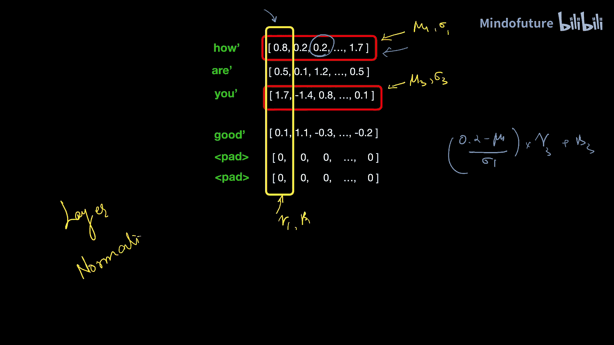

# 深度学习中的Transformer架构 ｜ Transformers In Deep Learning ｜ Learn With Jay p08 P08_Simplest_explanation_of_Layer_Normalization_in_Transformers -BV1Mdt9zXEpE_p8-

Training a deep neural network specialty transformers is challenging。

 It involves billions or sometimes trillions of parameters。

 with so many parameters involved issues like vanishing or exploding gradients are common。

 layer normalization helps us to stabilize the training of the model In this video。

 we are going to understand what is layer normalization why it is needed and how it is used in transformers。

 So let's get started。 Before we dive into layer normalization。

 Let's first understand why normalization is essential in the first place。

 normalmalization improves training speed and stability。

 Here's an example to illustrate why Imagine that we have a data set with two columns。

 One is these square feet area of the house。 and other is the number of rooms。

 using these two features。 We want to make a prediction of the house price。😊，But there is a problem。

 The values in these two columns have very different scale。

 The size of the house can be in thousands while the number of rooms range from 1 to 10。

 this kind of data， when there is a huge difference between the scale or the range of the data values is known as unnormalized data whenever we feed this kind of unormalized data into our model。

 the contour of the cost function becomes elongated。😊，And this has serious implications。😊。

With an elongated cost function contour， we cannot use a high learning rate。

 otherwise it will overshoot and the training will not take place。😊。

So to stabilize the training we will have to use a smaller learning rate。

 but the smaller learning rate will mean that it will take more time to converge to the minima and the training will be slow apart from this the data also has high variances and we have already discussed how high variance can lead to exploding or vanishing gradients which is a serious issue while training any deep learning model This is where the normalization comes in but what exactly is normalization normalization means scaling the data in such a way that its mean becomes zero and standard deviation becomes one So if initially the data was arranged in an asymmetric way something like this then after normalization。

It will be centered around the mean， which is0。😡，Thus normalization arranges the data in a symmetrical distribution which is centered around  zero so how do we transform this data into this data mathematically it pretty straightforward all we do is subtract each data point with its mean and divide by standard deviation so if this is my data I will calculate its mean and standard deviation and then subtract each of the data point with its mean and divide it by standard deviation and this will transform the data into this form。

Taking the example of our square feet area column what I did is I calculated its mean which turned out to be 1710 and its standard deviation which turned out to be 605 so to normalize this column we have to subtract this with its mean and divide by its standard deviation so after applying this normalization operation you can see that the most of the values are centered around 0 once we have normalize the data the contour of the cost function becomes circular and with this kind of circular contour we can even use a slightly higher learning rate and that will ensure that our training will be faster。

So， normalization helps us with stabilizing the training of the model by avoiding vanishing or exploding gradients and it also leads to faster convergence of the model。

 but in a very deep neural network normalizing only input isnt sufficient enough。😊。

Because these kinds of deep networks undergoes something known as internal。Covariate shift。Now。

 what is this thing lets break it down step by step The turn covariate shift refers to the difference in the distribution of data between training and testing for example。

 suppose you train the model to recognize red roses。The model learns to identify red roses perfectly。

 You show it any picture of red rows and it will be able to identify it with high confidence but what will happen if you show an image of white rows during the testing This will totally confuse the model because the input distribution is different from what it has seen during the training and similar shift in the distribution of data is happening continuously in these intermediate layers during the training of the model in a deep neural network like this the input to the subsequent layer is the output produced by the previous layer while trailing the model these weights are changing continuously in the back propagation operation and this in turn alters the output produced by each layer so that data fed to this layer in this iteration will be very different from what it has seen before it is like these layers see very different data at each iterations and because this distribution of data is continuous。

😊，changing in the intermediate layers of a deep neural network， this is known as internal covariator。

😊，This is like learning a new language。 Imagine if your instructor teaches you completely new gammar rules every single day。

 Wouldn't it be overwhelming。 You have not reinforced what you have learned before。

 And now you are bombarded with loads of new information。

 What you actually need is a gradual change in the distribution so that the training process is smoother。

 So even if you have normalized the input to the network。

 because it has been processed so many times the output produced by these layers are not gonna be normalized。

 So we need to normalize these subsequent intermediate layers as well。

 And that's where the relevance of layer normalization comes in。

 So now the obvious question is how do we normalize these intermediate layers。

 We have already seen how to normalize the input data。

 But how is that normalization process applied to these intermediate layers。

 Let's have a look at that。 What I have done is I have kept an inverted image of one layer of a deep neural network。

 Imagine it's one of those intermediate layers and these are the weights。😊。

Attached with the previous layer。And this layer is going to produce some output。

We want to normalize the output produced by this layer during training the input of the model is a batch of data so lets assume that our batch size is three data point and this layer has one2345 neurons so in total we have three into5 data values this is one batch of data and this is the value of the activations produced by the first data point this is the values of the same activations or neurons produced by the second data point and so on。

Now， what we want to do is we want to normalize the activation separately。

 which means that I want to normalize this activation， this activation。😊。

And this activation separately。 So for these three data points I am going to calculate its mu and sigma。

 let me call this mu1 and sigma1 for these three data points I'll calculate mu to sigma 2 and so on。

Now to normalize this， I will subtract each data point with its corresponding mean and divide it by its standard deviation。

So this data point can be normalized by subtracting with mu 4 and dividing by sigma 4 and similarly this will be normalized by subtracting with mu 5 and dividing by sigma 5 So we are normalizing the data batchwise for each activations separately and this is how normalization is applied to an internal layer but wait we dont stop at just normalization there is another operation that we performed over this and that operation is called scale。

😊，And shift。So， let us say if z was my initial data point。

 I have performed the normalization process。😊，And I got Z normm。 I process this zenon separately。

 What I do is I multiply a gamma parameter with zenon and add up beta parameter。

 These gamma and beta are learnable parameters。😊，Their values are adjusted during the training of the model。

 just like how we adjust the values of the weights and biases。

 So instead of just normalizing the data like this， we also perform a scale and shift operation。

Where we multiply the normalized value with the learnable parameter gamma and beta。😊。

Now I know you might be wondering why is this scale and shift operation performed doesn't it counteract the normalization process because in normalization what you are doing is you are subtracting by some value and dividing it by some another value while in the scale and shift you are multiplying it with some value and adding another value So this operation is completely opposite of what you have done in normalization What if after trading the model your gamma turns out to be equal to your sigma and your beta turns out to be equal to mu in that case what is going to happen is。

You're going to end up with the exact same value where you started。

 So this scale and shift looks like the reverse of the normalization。

 So why do we do that and its answer is flexibility sometimes few layers do not need the data to be normal they perform better with slightly unnormalized data。

 So we allow the model to decide for itself what is best for it。 these parameters。

 gamma and beta are initialized with1 and0 before training the model during the training of the model。

 Their values are adjusted in the back propagation operation just like how the values are adjusted for the weights and biases and the model will decide for itself how much normalization it needs So normalization stabilizes their training。

 but the scale and shift let the model learn the optimal transformation and this entire two stage process of normalizing and scale and shift that I have highlighted is known as。

😊，Batch normalization。Because we are normalizing across the batches for each activation separately。

 did I say that right batch normalization was in the video about layer normalization not batch normalization。

 Why did I cover batch normalization then it is because there is a little difference between batch normalization and layer normalization。

😊，The process of batch normalization is very common in deep neural network。

 but it cannot be applied on transformers Transformers used for NLP task needs to be applied with layer normalization and when obvious question still persist。

 how this normalization is going to be applied on transformers so far we have only looked at simple neural networks but how is this going to be applied on transformers let's see how layers in transformers consists of selfre and few other blocks。

 We want to normalize the data produced by these layers。

 we know what self attention does it takes the input word embedding and create a new word representation for each of these words。

 If my embedding vector is 512 dimensionals then it also produces another 512 dimensional output for that word which is a new representation of that word while training the model it takes data in batches let's say our batch size here is two with every batch we are passing two sentences。

And each sentence has the maximum length of three words and each word is a 512 dimensional word embedding。

 so I have an input matrix of size 2 cross 3 cross 512 notice that for shorter sentences I pad them with zeros so that it matches the maximum sentence length when I pass this input to the self attention block it will generate new word representation for each of the word and it will generate another two cross 3 cross 512 dimensional matrix these paddings will be unaffected because whatever you multiply with0 is going to remain0。

 Our goal is to normalize this two cross 3 cross 512 dimensional matrix how do we do this let me try to apply batch normalization on this the batch normalization is applied across the batch for a particular feature so to do that let me stack the two sentences on top of each other so that my matrix becomes 6 cross 512 dimensions。

😊，So I have 512 dimensional features and if I want to apply the batch normalization then I will be applying it for a particular feature across the batch and it means I will calculate its mu 1 and sigma 1 and then perform the normalization operation and for the last feature I will calculate mu 512 and sigma 512 and I can simply perform the normalization like this。

😊，But wait there is a problem with this can you identify that problem The problem is this data contains zero padding and these zeros are going to be a part of this normalization process and it is going to affect our mu and sigma values actually I only want to normalize these four data points but during normalization if I also include these zeros then it is going to affect my mu and sigma do you think that if we keep these zero paddings in our normalization process do you think that the normal values will be the true representation of the data No it won't be because these zeros are going to skew the result so we need to exclude these zeros from the normalization and that is the reason why batch normalization。

Cannot be applied on transformers so instead of normalizing across a batch what if we normalize across a particular data point and that is exactly what layer normalization does unlike batch normalization layer normalization operates independently at each data point so the value of the mu and sigma will be calculated for a particular data point but my gamma and beta parameters will be added for a particular feature。

So， the normalization in is in this direction but the scale and shift is in this direction。

 so if I were to show you the normalization for this point2 then it will be obtained by subtracting it with mu1 dividing by sigma 1 multiplying it with gamma 3 and adding with beta 3 and this completes our discussion of layer normalization。

🎼If you look at the original attention is all you need paper。

 then you will notice that this layer normalization is applied after every single layer in transformers。

 This non part is the layer normalization in real world applications and models like G and Bt we stack multiple transformers block which makes the entire architecture extremely deep This makes normalization crucial for the stability of the training。

 Even the normalization is a simple concept。 It's extremely important without it。

 the training won't be effective and it will be a simple waste of time and money and that's it for this video。

 if you found this valuable make sure to hit the like button do subscribe to this channel so that you do not miss out on any upcoming modern AI videos leave a comment down below What do you think of this video Did you find any valuable insights from it your feedback is very important to me I'll see you soon in the next Transers video till then happy learning。

😊。

