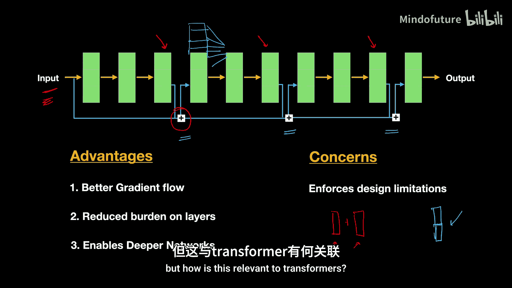
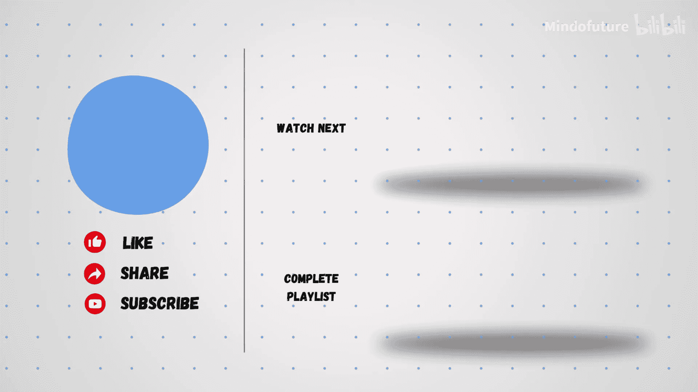

# 深度学习中的Transformer架构 ｜ Transformers In Deep Learning ｜ Learn With Jay p09 P09_How_Residual_Connections_in_Transformers_stabilize_its_training -BV1Mdt9zXEpE_p9-

Deep neural networks like transformers are difficult to train。

 They often suffer from vanishing or exploding gradient problems。

 making the training challenging In our previous video， we studied about layer normalization。

 which helps to stabilize the training of the model today。

 Let's discuss another powerful concept That is residual connection。

 What makes training deep network so difficult。 Imagine an untrained deep neural network with randomly initialized weights。

 When you pass an input through the network， it gets multiplied by these random weights at each layer。

😊，This process gradually distorts the input leading to information loss for the initial few layers。

 this might seem insignificant。 However， as the input propagates through multiple layers。

 each transformation causes additional loss and by the time the signal reaches the output layer。

 almost all relevant information is gone leaving behind mere noise Now in the back propagation the model will try to update its weights based on what it has seen in the output prediction as the output prediction was mere noise。

 the weight update in the later layers won't be effective and not just the later layers but the weight update in the earlier layers won't be effective either because when the gradients flow backward during back propagation they shrink exponentially as they travel through many。

 many layers。😊，The value of these gradients are small and less than one and to update the weights in the initial layers。

 the gradients of all the subsequent layers are going to be multiplied。

 and when you multiply a lot of small numbers the result become close to 0。

 This phenomena is known as vanishing gradient problem。😊。

And that is why while training a very deep network we see almost no decrease in the loss function for an awful lot of training time。

 it is even possible that our model never converges and if we cant train it the deep sophisticated model that we created becomes practically useless。

😊，So what do we do about it， What is the solution， The solution is quite simpler than you think See。

 our goal is to provide meaningful information of the input to all of the layers in the network。

 no matter how deep the network is the problem is as this later layers relies solely on the previous layers to provide them with the input information。

 the information is lost because of the multiplication with many randomly initialized weight mats。

 So these later layers are not getting relevant input information and in the back propag the weight update is also not very effective because of the vanishing gradient problem So to solve this。

 what if we have a better pathway for the information flow instead of having this long pathway highlighted in the yellow line。

 what if we had can have a shortcut pathway for all of these layers to get better access to the input。

😊，And that's exactly what residual connections do。 Instead of having a single pathway for the information flow。

 residual connections are about adding another shortcut pathways to pass the input to the later layers。

 And now the input information will flow in two pathways。

 One is this longer pathway highlighted in yellow。😊。

And other is this shorter pathway highlighted in blue in residual connections we divide the network into blocks。

😊，An input to each block is the addition of two vectors。

 one vector is the input of the previous block。😊，And other vector is the output。😊。

Of the previous block。Which means that instead of directly passing the output of this layer to this layer。

 we perform an element wise addition of this output with its input。

 and then we pass that to the next block。 So now the network has better flow of the information inside the block。

 the input will flow through the regular path highlighted in yellow。 But outside the block。

 the input will propagate in a shorter direction highlighted in blue。😊。

These shorter pathways are called skip connections。

This design ensures that the input data reaches properly through all of the layers of the network。

 It is like giving a kickstar to the training process。

 Imagine that you go to the gym to train yourself。 What if you start with extremely heavy weights from the first day itself。

 Will you be able to lift and make any progress No， right， you might need support from the others。

 training a deep network is just like that。 Instead of asking the model to do all the heavy lifting from the beginning。

 we supported by providing the better access to the input information。

 This ensures that the training starts gradually right from the initial few epochs and we should see a steady decrease in the loss function right away。

 but it is not just this。 There are some other advantages that is offered by residual connections。😊。

The first advantage is the better gradient flow with residual connections。

 we not only have a better information flow in the forward direction。

 but we also have better gradient flow in the backward direction the gradients now have a shorter path to arrive at the early layers and the weight update will also happen in two path one through the longer yellow line。

😊，Other through the shorter blue line， while we are training the model initially。

 we see that the longer paths struggle with the weak gradients and the vanishing gradient problems。

 But now as we have the short path， this will ensure that the meaningful updates happen right from the beginning。

 This should lead to immediate and steady loss reduction。

 and as the training progresses And when the longer path becomes effective。

 the loss will continue decreasing， allowing the model to outperform the shallow networks。

 the advantage number2 is now each layer has reduced burden。

 as each block of the network has access to the almost unchanged input。

 the burden on these layers reduces。 They no longer have to figure out every important detail of the input on their own。

 Instead， these layers can focus on learning the residual information。

 they can focus on what extra information to add on top of the input to enhance the information flow for better protection。

 This makes their job easy。😊，As they now have simpler information to learn and thus comparatively faster training of the deep network and now as we have the shortcut path for the information flow and a way to pass this information to very deep layers we can increase the depth of the network it will be possible for us to train even deeper networks and that is why modern architectures can go far beyond traditional shallow network this can make it robust to learn extremely complicated information the only concern with using residual connections is that it enforces some limitations to the design of the network as we are performing elementwise addition we have to make sure that the dimension of this layer is same as the dimension of the input because if you want to perform an elementwise addition between two vectors their size has to be same and that is why certain layers in the network has to have the same shape as the shape of the input If you do not want to perform the elementwise addition then you can also perform a concatenation between these two。

😊，With concatenation you can have different dimensions Remember that whenever you perform a concatenation the overall dimension will drastically increase and so does the weights associated with it this will mean an explosion in the number of parameters and that is why the element wise addition is usually perform rather than concatenation。

😊，Nonetheless， residual connections are a great way to improve and stabilize the training of an extremely deep network。

 but I know that you still have one question in your mind。 You might be saying that J。

 this is fantastic。 I know about residual connections， but how is this relevant to transformers。

 How do we fit residual connections in transformers。😊。

And my answer lies in the beauty in the design of the transformers。

 Each layer of transformers network produces the output of the same size as its input。 For instance。

 the output of the multiheaded attention block is same as its input。

 it takes 512 dimensions vector per word and also produces 512 dimensional vector for each word。

 and similarly， this feed forward network also maintains this dimension。

 The input to the feed for network is the output produced by the multiheaded attention。

 and that is a vector of size 512 dimensions per word。

 The feed forward network also produces 512 dimension output per word and this design is consistent no matter which layer you pick in the entire architecture。

 This add part that you see after every layer。😊，Is residual connection。

The input to the multiheaded attention is added to its output。

 The input to the field for network is added to its output。

 and this process continues for all the layers we will go in detail about this architecture in our next video we will look at the entire design of the encoder block as well as the decoder block and how each layers stacked on top of each other but I hope you understood the importance of residual connections and its usage in transformers The addition of these residual connections in the transformer architecture ensures its stability during the training here you can see that the encoder block is multiplied n times which means that we are going to stack a lot of encoder blocks on top of each other and then we will have a lot of decoder blocks on top of each other and in the models like GP the depth is extremely huge and that is why residual connections play an important role in the training of the model tiny details like residual connection and。

😊，Normalization significantly impact the stability and the performance of the training they might not receive much attention in the original paper。

 but they make deep learning breakthroughs possible now I can say that you are fully equipped to learn about the encoder architecture which we will cover in the next video if you found this video valuable be sure to hit the like button comment down your thoughts below and subscribe to this channel for more deep dive AI content that's it for this video and I will see you in the next one。

🎼。

