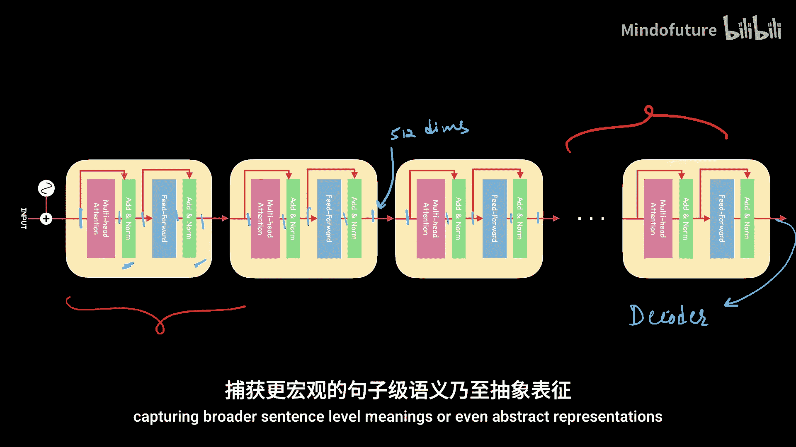

# 深度学习中的Transformer架构 ｜ Transformers In Deep Learning ｜ Learn With Jay p10 P10_Encoder_Architecture_in_Transformers-Step_ -BV1Mdt9zXEpE_p10-

A lot of you have asked for this video。 the weight is finally over。

 We are going to study about encoder architecture。 Through past9 videos。

 we studied about individual components of encoder。

 All of those videos are going to help us complete the understanding of encoder today。

 And if you have not watched my previous videos。 then no worries。

 you can still go through this video。 You need a little bit of understanding of self attention and position encodings and a little bit over all idea of transformers。

 Then you are good to go。 But I highly recommend you to go through all of my video。

 special the main topics。 to build a solid understanding of transformers。 So enough for the intro。

 let's get started。 We are going to start with the blank box and will slowly keep on adding layers one by one。

😊，First and foremost， let's start with the input to the model for NLP tasks。

 the input can be word emddings。 Word embeddings is a great way to represent words into numbers。😊。

Word embeddings are the kind of representation that can provide the context of the word or its meaning by comparing two word embeddings。

 the model can tell if they are related or unrelated。

 but there is a problem with using word embeddings。 They are static。

 they are created ones based on the general text out there on the internet and then use repeatedly。

 But the language is context dependent and static word embeddings don't adapt to the different meanings of the same word。

 For example， when I say the word light， what comes to your mind。

 Probably the visible electromagnetic waves that produces site， right。

 But what if I say light weight。 Will string think of the word light as an electromagnetic waves。

 The context is completely shifted to the measure of weight。 What if I say light blue。 Now。

 the context is shifted through the shade of the color blue in English。

 the same word can mean differently in different context。😊，But as the word embeddings are static。

 you will be using the same word embeddings for all these three contexts。😊。

And so the prediction cannot be accurate。 What we want is a dynamic way to shift the values of these word embeddings based on its context。

 When I say I love Apple juice， the word embeddings should be moved more towards the fruit side。

 And when I say I love Apple phones。 The word embedding should be moved more towards the technology company side。

 These dynamic shifts will make sure that we are using contextually aware words。

 and that's where self attention comes in。 Se attention is the core mechanism behind the success of the transformers。

 It allows the model to dynamically adjust word representation based on the context of the input。

 We have already explored the working of self attention in depth。 So I won't go over it again。

 But let me give you a quick refresher。 Se attention takes word embeddings as input and generates new context aware representation for each word。

😊，This context of a representation is generated by looking at these surrounding words。😊。

It captures the dependencies and relationship between the words of the input sentence。

 It will create a map that will tell that the certain words are more closely related to one another。

 Like there could be a strong dependency between the word eye and love。

 specifying that these subject eye is performing in action love。

 or there could be a strong dependency between the word apple and phones。

 specifying that these two words are related and go together。 Based on these dependencies。

 the self attention generates new word representation for each word in the sentence。

 These refined word embeddings obtained from the self attention will capture contextual meaning more effectively。

 leading to more accurate and insightful predictions。😊，And that's great。

 But one block of self attention is not going to be sufficient。

 The language is so complicated that to fully comprehend the context of any sentence。

 we will need to form more complex relationship between the words。

 we need to form simultaneous relationship between subjects， objects， Lo， E and more。 For example。

 consider this sentence。 Keys on the table belong to Sarah。 here。

 we will need to capture at least two attention patterns for the word keys。

 One where there is a high dependency between keys and the phrase on the table。

 capturing this spatial relationship。 And second， there should be a relationship between keys and the phrase belong to Sarah。

 specifying the possession of keys by Sarah。 And as the sentence grows。

 capturing more and more dependencies for a single attention head will be almost impossible。

 And that's where our self attention will require an upgrade。

 Instead of using one block of self attention。 we will use multiple self attention blocks to capture different patterns。

😊，う。It's like upgrading your system by adding more RA modules。

 One RA module is powerful enough to handle a particular task effectively。

 but when you want to handle a lot more of such tasks simultaneously you will need to upgrade your Ram modules by adding more RAm Similarlyly。

 each block of self attention will focus on a particular type of relationship between the words One block can identify spatial relationship。

 other can identify subject word object relationship Third can identify time fourth can identify position and so forth。

 all of these blocks combined will provide us with a rich and diverse features extracted from the sentence in the original attention is all you need paper we use8 attention heads Each head processes of 512 dimensional input word embedding and generates a 64 dimensional new word representation So if your input has three words love Apple phones。

 then the total size of the input is going to be three comma。😊。

512 this same input is going to be passed into eight self attention heads each head is going to generate a new word representation based on different word relationships in the sentence。

😊，So each of these outputs are three comm 64 dimensions and we will have eight such outputs Now these eight outputs are going to be concatenated to produce a single vector This means that this concatenated vector will be of size 3 comma 512 where we have concatenated these864 dimensional vectors and these concateninated vectors are going to be passed through linear transformation where well multiply it with a weight matrix w of size 512 comma 512 which will produce another output of the same size 3 comma 512 notice that we started with 512 dimensions and ended up with the same 512 dimensions but this output is highly contextual aware it knows about all the object relationships in the sentence and is even capable of capturing different interpretations and this covers one layer of encoder block internally the multiheaded attention block look something。

😊，Like this。 But that's not it。 There are some other advantages that this layer offers。

 The entire multihed retention operation processes words parallelly。

 which means that we not only have multiple attention heads processing words parallelly。

 but each self attention block also processes words parallel as if the words have no order。

 we have already covered about this parallelization and the internal working of self attention in detail。

 If you haven't watched that video， go check that out。 it's going to be very informative。

 This parallelization allows us to use multiple GPUus to process words simultaneously。

 So whether the sentence has 10 words or 1000 words。

 it will take the same amount of time to process it。

 because all of these words are processed parallelly at the same time。 And thus。

 training becomes extremely fast。 allowing us to train large language models。😊，But wait。

 if the words are processed parallelly， then doesn't it mean that it has no ordering between the words。

 And isn't the ordering important in NLP。 I mean， take these two sentences。

 the cat chase the mouse and the mouse change the cat。 both of these sentences have same words。

 but the meaning is completely different。 Now， if we don't take the ordering the words into account and process them parallel。

 Then both of these will become equal， and we will lose the true meaning of the sentence， right。

 and I would say， yes， ordering is crucial in NLP。 The model has to know the order of the words。

 So how do we solve this problem。 At this point， I think I should admit that I was lying to you the whole time。

 when I say that the input to multi headeded attention is word embedding It's not。

 but it's actually the element wise addition of word embeddings with positional encodings。

 positional encodings are the vectors that provide positional information of the words to multi headeded attention。

 these position。😊，Encodings are generated using pseudonooidal waves and they follow a predictable pattern。

 This pattern is so much predictable that if you know the positional encoding of 10。

 then you have the power to predict the positional encoding of 203040 and so on Now how is it possible to predict the position information I'm not going to go over that in this video because I have already covered it in my positional encoding video if you haven't seen it go check that out it will probably be the most remarkable video you will find in this playlist but for now I just want to remind you that the positional encodings are designed in a way that the model get an idea of the relative ordering of the words and we perform an elementwise addition between input word embeddings and positional encodings before we send that to multiheaded attention Both of these word embeddings and positional encodings are 512 dimensional vectors so we can easily perform in elementwise。

😊，Between both of them and the input that the multi headed attention will receive will be the addition between position encoings and word embeddings Okay。

 so I hope you understand so far we have covered two most important blocks of encoder that is multi headeded attention and positional encodings。

😊，Now， what comes next， after multi headed attention， we have added norm layer。

 Not the arrow connecting the input of multi headed attention to the add norm layer。

 What does this sign， This added norm layer performs two key operations。

 The add part is a residual connection。It adds the input of multi headed attention to its output and second operation it performs is layer normalization。

😊，Both of these will help us to prevent the notorious issues of banishing and exploding gradients。

 This mechanism is crucial for stabilizing the model's training。

 See there are few challenges while dealing with deep neural networks the input is processed through many。

 many layers by multiplying it with a W matrix and when the model is untrained。

 these W matrics are initialized with random values and when we multiply input with a lot of random values the information is going to be distorted and by the time it reaches to the final layer。

 we will completely lose out on all the input information and what we will receive here will be pure noise So the model will struggle to train because the model is trained in the back propagation operation using the output prediction。

 If the output prediction is mere noise the learning will not take place。

 So the residual connection is about providing a shortcut path for the input to flow deeper in the network with this blue shortcut path。

😊，The input will be able to travel with a minimal processing to the output layer and these shorter parts are these skip connections where we perform an elementwise addition between the input and the output of a certain layer and we will use similar residual connections in our encoder architecture just note that as we are performing elementwise addition the size of the input and the output has to be same and that is why we have kept the same input and output size of our multiheaded attention remember the input is 512 dimension and the output is also 512 dimensions which means that we can easily add these two vectors so if the input of multiheaded attention is z0 and the output is z0 dash then both of these are going to be added element wise and once we have done that we will pass it to layer normalization now while layer normalization because in a deep network it is not only necessary to normalize the input。

😊，P but it is also necessary to normalize the activations of these layers by normalizing the activations。

 we will make sure that we prevent the problems of vanishing and exploding gradients。

 This ensures the stability of the training of the model and faster convergence。😊。

Coming back to our architectural diagram， this is how our added norm layer looks like we are going to use this added norm layer after every major layer of encoder as well as decoder by using it it after every major layer we will make sure that training is stable and we avoid banishing and exploding gradient problems So I hope everything is clear so far now we are going to talk about the layer which I have never covered before in this series。

 but it's super important before we jump onto that， I am going to break your heart。

 What if I tell you that there is still a loophole present in the design so far。

 I know it took us a lot of intelligence to design the layers we have seen so far but it's still not enough。

😊，The loophole is that in all of our operations so far， we have never introduced non linearity。

 never introduced non linearity。 What does it even mean， See。

 all of the operations we have performed in multi headed attentions are linear operations。

 It has linear transformations used in calculating the attention scores。

 This linear transformation is a multiplication of any matrix with another matrix W in multi headeded attention。

 We have used these linear transformations。 And in these linear transformations。

 we have never used a nonlinear function。 and that's a problem。

 Because if we use only linear operations， Then our model's ability to learn complex pattern is severely limited。

 real world data is often nonlinear。 Imagine this， a linear model can only create a straight line as the decision boundary。

 Do you think this straight line can fit on every type of data。 No， right。😊。

We need nonlinear decision boundaries that can bend and curveb and fit on the data there is another problem with using only linear operations without nonlinear operation using multiple layers or creating a deep network will be ineffective or could be useless because all of the layers can be reduced to a single layer see a linear operation is represented by。

😊，This operation where we multiply the input with the weight matrix W and add some bias if this is the output of the first layer and we pass this into our second layer。

😊，Then both of these can be reduced to1 Ill replace a1 with these equation and it will become。😊，Now。

 expanding this， we will get。And now I can reduce this w1 into w2 as some w dash and this as some B dash。

So， my a2 will become same as what we had in the first layer。So。

 no matter how many layers you have in the network all of those layers can be reduced to a single layer and that will be a big problem to avoid this reduction of multiple layers into a single layer all we have to do is use a non linear activation function。

😊，If we have a nonlinear activation function between two layers。

 then this cannot be reduced to a single layer， and that's where the feed forward network helps us。

 which is the next layer of encoder。 This is how our data flows through a feed forward network。

 Let's say Z1 is the output of this added non layer。 This z1 is 512 dimensions per word。

 This means that if the input has three words， then this will be a3 comm 512 dimensions size。

 Now this will be the input to the feed forward network。

 The first layer of feed forward network has 2048 neurons。

 This means that the input of size 512 will be expanded to the size of 20，48。

 and this layer is represented by re of input。😊，Multiplying some weight matrix addition of bias。

 So this is a simple neural network layer that we have studied in deep learning basics。

 which is also known as dense layer。 The intuition of these layers is like this。

 If you have studied about convolutional neural networks。

 Then you would know that we pass an input image。This image is coned using multiple filters。

And this happens for multiple layers。 and at the end。

 we have fully connected layers before we produce the output。

 so similar to the fully connected layer in convolutional neural network。

 we have a feed forward layer in transformers。 This is just a simple dense layer。

 which is represented by this mathematical operation in one feed forward block。

 we will be using two such dense layer One of the dense layer will expand the input to a 2，0。

48 dimensions and the second dense layer will reduce it back to 512 dimensions。 This expansion to 2。

0，48 dimensions will increase the model's capacity to learn the complex features。😊。

Think of it as widening the model's perspective。 This expansion layer will allow us to capture richer patterns that lower dimensions fail to capture。

 The intuition behind this is same as using multiple layers in a deep network。 If you know。

 we increase the depth of the network。 to understand more complex patterns from the input。

 And that's the purpose of this expansion layer。 and reducing the size back to 512 will make sure that our input and output are consistent。

 Remember， I told you that we will be using add and non layer after every major layer。

 That's what we are going to do here。 We will be using the add and non layer for the feed forward layer as well。

😊，And for that it is important that our input and output dimensions are same so if the input had three words then the input of the feed forward network would be of size 3 comma 5 and2 and the output will also be of size 3 comma 5 and2 so in short feed forward network helps us with two major things One is it introduces non linearity。

And second is it increases the model's capacity to understand complex patterns from their data。😊。

We use twice the number of parameters in feed forward network then we use in multiheaded attention multiheaded attention has about 1 million parameters while feed forward layer has about 2 million parameters and there are experiments conducted by creating transformers model without feed forward layer and their performance and aurs have found to be significantly reduced but this entire combination of using position encodings multiheaded attention add a non layer feed forward network is a complete package。

😊，Now， you clearly know how one block of encoder looks like using this。

 We will create a deep network by stacking multiple encoder blocks on top of each other In the original transformers paper。

6 encoder blocks are stacked on top of each other， which means that the output of the first encoder block is passed as the input to the next encoder block。

 Similarlyly， the output of the second encoder block is passed as an input to the third encoder block and so on。

 This process continues for six times as there are six encoder blocks。

 When we are stacking encoder blocks like this。 There are few key points to remember here。

 All these encoder blocks are different from each other。

 which means that the parameters used in the first encoder block is different from the parameters used in the second encoder block and so on。

 This multi headeded attention layer and feet forward layer has weights and biases associated with them。

 these weights and。😊，Basees are different for different encoders。

So all these are six different encoder blocks， all of these parameters will be trained in the training process and second thing to note is that the positional encoding is used only in the first encoder block which means that the output produced by the first encoder block is passed as is to the second encoder block without any processing。

So， there is no processing happening between two encoder blocks the output of one block is passed as is to the input of the other block and we are using positional encoding only once third is if you look at any input or output between any layer or any encoder。

You will realize that the input and output dimensions are exactly same。

Because we are using the added norm layer， we make sure that the input and output are always of the same size。

Now， the output from the final encoder layer is going to be passed to decoder。

But we will understand this in the next video。 The overall intuition of using multiple encoder blocks is same as using a deep network with a deep network。

 we want to find complex patterns and relationship between the words in the data and similar to any deep neural network the lower layers might capture the final details such as word level relationships while the higher layers or the later layers might build information on top of this capturing broader sentence level meanings or even abstract representations so I hope you understood the encoder architecture with ease。

 people keep scratching their heads while trying to understand what's going on but if we go there step by step then nothing is difficult and we can master complex topics easily Similarlyly we will go through the decoder architecture as well。

 but before we can jump over it， I need to cover one important topic that is mask multiheaded attention which we will cover in the next video。

😊。

Then you will be able to finally say that you have master transformers design and you would have learned it in a way that you can even teach to other people so if you found this video valuable do hit the like button subscribe to this channel comment down below what do we think of this video because your support means a lot to me so thats it for this video and I will see you in the next one。

😊，一？🎼。

