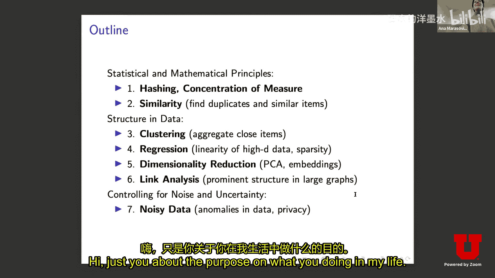
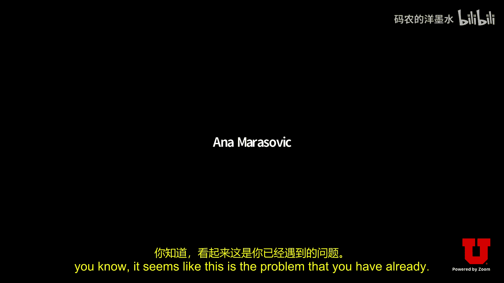

# 犹他大学-CS6140-数据挖掘-中英字幕-1080P-p01-Lecture-1---课程概述--BV1j1mLB9EAB_p1-

。

Yeah。你你嘅。好。我。三す。那嗯。这我说。你话。So's that。I。嗯。Ohla。All right， good afternoon everyone。

Welcome to data mining I am Professor Anna Maravic I use she her pronoun pronouns and I will be your instructor for the course I will start by saying that I have really sentimental values with this course because before I decided to do research in machine learning and natural language processing I was majoring in math just math no CS whatsoever and I took a course like exactly like this one and I was like wow this whole world exists and that's kind of what motivated me to start taking more machine learning courses and eventually I became a researcher in natural language processing I kind of hope that not maybe for all of you but at least for some of you this might be one of these courses which really spured your curiosity。

I want to make a note that these slides are borrowed from Professor Jeff Phillips。

 like the most of this material for this class because he was original designer of this course。

And today we are not going to have like a you know proper first lecture。

 we are going to go over the logistics of this course。

 it'll take probably around 50 minutes to go over everything and then we'll take a little break and then I'll go over some of the topics we are going to talk about in this course to kind of give you a sense of what this course will be about。

All right， so the logistic of this course will not have any slides associated with them unlike the other part of this lecture。

 and this will be actually the only lecture where I will use slides from an next Wednesday I will write on iPad and you will get get my writing projected on the screen kind of to simulate using the whiteboard。

Okay so I say here on the slide no slide see the recording yes this course will be recorded actually it is live stream so there is a YouTube channel called Ufo data science where you can watch the lecture at the same time it is presented in class or you can see the recording later I want to emphasize however if there are some technical difficulties that arise that we cannot fixing like about five to 10 minutes I will just go ahead with a teaching in person and there will be no recording so you are taking a little bit of risk if you are rely solely on the recording to follow this course it is up to you whether you want to come in person or watch the recording which you know at home live stream I do want to。

Emphasize that you try to kind of keep watching these recordings as the lectures are given。

 if you kind of have too much to watch at once and you fall kind of behind it would be really hard to follow the rest of the material and it will be very hard to do your homework assignment if you have a plan of maybe doing your homework assignment just by checking you know the parts of the video lecture that seem relevant it's going to be as hard as well so do whatever kind of is the best for you but I do recommend that you try to at least watch it at the same time we are presenting this in person。

Okay。If there are no questions， I will。好鸡。Relevant information。

Already so the first thing you should know about is that there is a syllabus on the canvas page so if you open the canvas and then you find the courses and you go to syllabus you will find most of the information you need for this course first of all that there is also a website associated with the course however there are everything that's in syllabus iss not also on the website so you kind of they are kind of complementing each other so think about is two separate resources that you need both of them to kind of go through the through the course。

On the web page you will see some basic informations together with this link to the YouTube channel that I have mentioned here you will see okay this is me this is my email these are my office hours which are after each lecture in this room we can stay here for about five to10 minutes but there is another lecture happening 10 minutes after we end so we can't kind of be here cr we have to go into that other room and Ts will also be there with me so if there are plenty of you don't worry because there is also many of us。

Okay， so here is our TAs， we have L today Jo， we summer in Behi。

 we have Han Nate and Vinuta and they all can help you almost as much as I can so please talk to them if you need help but I will talk more about how to find us and you know how to communicate with us in a bit。

Again office hours everyone's office hours are here and some of the office hours will be offered over zoom so for example on Tuesdays from four to five and on excuse me。

 Thursday as well 12 to one， you can have zoom help hours which might be helpful if you are kind of navigating let's say work and studies and you will rely on the recordings and so on。

All right。In this website， you can find the schedule if you go down below。

 so here you basically have what we will talk about on each one of these dates。

And you have details of the project components I will talk more about projects。

 but all the details about projects can be found here。

 so here you have everything you need to know about your project component of the grade which we will talk more about later。

And also here I will share lecture videos excuse me actually。

 since everything will be on the YouTube channel I actually wont share the links here and we will have lecture notes here。

So going to the calendar let me just like walk you through how to read columns of this calendar in the first column you have the date in the second column you have kind of like a general theme of few lectures so for example here we are going to talk about similarity and that's going to span these five lectures in the road topic you have like the topic of the lecture and then here you will have lecture materials so you will have for example slides which will be those notes that I write while I teach and you will have notes here I put the playholder for the recording maybe I'll put the specific recording or maybe I will tell you okay there is a playlist on YouTube and you just find the lecture I will see what exactly I will do here and then here you have readings which are almost all pointers to the three books I will mention。

And in the final column you have dates where you have certain either homework assignment or project components due。

And I recommend that you rely on canvas for seeing when the exact dates and times are because that's where you are going to actually see the assignment。

 for example， a homework and where you are going to upload it。

 but this might help you to kind of map where the important dates are and you can see there is。

Very consistent flow of homeworks we have eight of them so kind of try to already see for yourself where those important dates are besides homework and project components important dates to have in mind are midterm exam in on March 1s and the final exam on the third of May and these exams will be in person so really already kind of put that in your calendar that you must come to person and so your exam。

All right， let's go back to syllabus， any questions so far？All right。Okay， moving on then。临事。你边。

All right， so few of you have already asked me what is a good， you know。

 what we should know before we take this course and there are no formal requirements for graduate students。

 but there are some formal requirements for undergraduate students， for undergrads。

 the formal requirements are that you take the foundations of a data analysis class and one of these software development classes。

The reason for this is because in this CS 3190 you will go again through the basics of linear algebra and probability and here in this course we assume you have really solid grounds and solid understanding of both of these subjects so if you feel like you should need to you know you might have forgottening something about this。

 please go and revisit that I will point you to chapters of one of these books where you have basically all of these basics written up and if you feel like you need to do that I recommend strongly that you do it because I will not stop at every detail of linear algebra and probability I just assume that you know some of these things such that we could cover more advanced techniques in this course。

The reason why CS3500 here is a requirement is because here also we are going to give you programming assignments where we won't give you a very super clear instructions how to how to go about this assignment by design because the idea is that in the real world you also don't get super clear instructions about how to program something and this should in a way simulate that so if you have never taken any course where you have to program something without being explicitly told what to do you might have to spend a little bit more time on homework assignments and it might be a little bit more challenging for you also this course is a mix of different students so it's not only a course that CS major stake you have people who are setting data science or mathematics or other fields。

And in some of you might have never taken that rigorous programming course。

 which means that some of the homework assignments that might take a really short time to some of your peers who are major in computer science might take a bit more time for you and if you have never really programmed it might take way more time。

 so that's another thing to consider about homeworks and you know what your background is。

I said that I will point you to chapters of the book that might be useful to go over。

 so these are chapters  one3 and first parts of two57 in mathematical Foundation for data analysis again written by Professor Jeff Phillips and there is an online version here so references are to the online version not to the hard copy that you can purchase it has more more examples and more exercises if you would like to do that but all the pointers to the book will be for this free online version。

Okay， so maybe we can open it just to see how it looks like here these are the chapters。

 chapter12 three are the ones that kind of cover these basics， but the next Wednesday。

 we will talk about some of the chapters in some of the sections in chapter two。

 so if you need to do something on your neuro and better focus on sections one and three。是。

Okay let me go back and see whether I miss something yeah so in a previous instances of this class there was no requirement for which programming language to use but I really strongly encourage you to use Python because it kind of now converged to being a programming language of you know any job that uses the concepts of data mining data science。

 a lot of good libraries are written for it a lot of data is kind of put into files that you can easily process in Python and so on so if you have a preference for some other programming language I'm not necessarily stopping you to do that but we do recommend that you use Python for this class。

Okay， I think that's all about。Orrequisites。I did mention that this class is a mix of different students。

 so we do have extra bonus points in our homework assignments which are kind of tailored toward okay maybe there are students quite interesting in this topic so try to look for those and see whether that might be some something that's interesting to you and you can play around it。

 another place where this kind of diversity of the crowd will be embraced is in the project component of the grade where basically you have lots of flexibility on what you can work on and there you might kind of show this you know your own expertise and knowledge that comes from your own major。

Okay。Any questions so far？Yes。All right。So I mentioned there are three books that this course is based on the first one is as I mentioned already mathematical foundations for data analysis and there are also lecture notes which are written by again Jeff Phillips that I will kind of use those notes to you know prepare myself for teaching I might add some notes to that and I will if I add anything I will of course share that with you so these notes will be available here if you go back to the website and then click notes for each lecture you will find them。

So they are basically kind of like a less polished version of this book that we keep mentioning。

 which I will call now M4D and there are also come in a different order than what's kind of how the book is structured because the lectures also don't come in the same order as the book other two books that discourse is kind of following is are mining massive data sets and the other one is foundations of data science so this one has less mathematical and formal you know notation and proofs and so on while this other one has it's all about proofs for the things we are going to talk about and then the M4D is somewhere in between basically。

So none of these books are required for you to purchase。

 but they are all available online so you can of course read Xri if you wish so。

 especially if you are more interested in proofs you should definitely look into these book foundations of data science while we will have few proofs now and then will be there won't be too many of them and here you have plenty of them if that's what you're interested in。

All right。Moving on to how you can reach me and Ts so we will use Canvas for any kinds of announcements we have and we will use it the discussion portion of Canva or any questions you might have for about homework or projects or material about schedule and so on so one kind of rule you can employ about whether to post something on Canva discussion or whether you should email me is to think first can Ts answer this instead of just instructor and does this question concern more people or just you personally if you have personal emergency。

You should email me if you have a question about homework that you think other people might have in class。

 it's better to post it in the discussion and then you know we answer it once。

 everyone see the answer and there is a smaller influx of question and we can address other questions that have not been addressed yet。

嗯。Canvas discussions is the preferred way to communicate with us just because there is more of us who can look at it so there is a higher chance that we will answer your question faster if both me and Ds can look at it if you just send emails to me I will try my best to answer them but if there are too many of them of course there will be some delay we also have organized such that there is always someone checking the canvas every day so we have dedicated time to that every day so we really want to answer all of your questions that you might have。

All right we will also use canvas for turning in your assignments。

 also the homework assignments will be posted on canvasva as well your Port components will be submitted to Canva we are going to communicate grades so most of the things is going to happen on canvas so。

That's the place to go。嗯。So I did say to post anything you have in mind basically on Kevins unless it's your personal emergency。

 but do not post any homework answers if we do see homework answerss in kind as we are going to immediately remove such messages。

Other activities， as you have seen while I was going through the webage。

 such as the schedule and class notes and videos will be through this public facing website。

All right， so if you need to reach out to me personally。

 you have seen my email at the top of this syllabus。

 apparently if you just click here on inbox it's the same as sending email so it might save you you know 15 seconds to switch from one app to the other。

But besides sending the email which I think is the least efficient way of contacted us。

 you can come to the office hours and please send us an email if you can't make it to any of these office hours。

 we can find another time to meet with you so here are listed all the office hours that are also listed on the webage。

And as I said， there is a mix of in-person office hours and zoom hours so hopefully there is enough variety for you to get the help you need and of course you can ask your questions right after the lecture as I said if they are short you just quickly need an answer for five to 10 minutes but then there are office hours after each lecture in that room ME be 3515。

Yeah， so we designed office hours such that because homework will are always due on Wednesdays。

 there is more office hours on Monday Tuesdays and Wednesdays assuming that you will need more help just before you turn in your assignment so there is plenty of help hours just before you need to turn your homework assignments。

 but there is also help hours on Thursdays if you are starting to work on things earlier。

I personally don't work weekends at nights so you will not get an answer from me on those days unless there is a huge exception。

 so just have that in mind if you are posting on the weekend Ts might answer on their own discretions I don't know but we will have we will check canvas by you know Friday evening and then first in Monday morning so just have that in mind。

Okay， yeah， I mean the bottom line of all of this is that we really want to be there for you so if there any way we can help you please just tell us and we do want to you know give you any help you need to be successful in this way so please make use of these office hours and talk to us。

Any questions about this？And。Oh。All right， let's go down to the evaluation part。对。Yeah。All right。

 so you are going to be evaluated in three different ways。

First you are going to be evaluated by your homework assignments that's going to make 40% of your grade there will be two exams as I mentioned they are going to be in person please again check those dates and mark them in your calendar。

And don't have a conflict with those dates， and then the final big component will be projects that will make 40% of your grade。

For homework， we are going to have eight homework assignments and they are going to roughly cover main topics in the class like first half of the class and then the second half。

Excellent no， that's another I want to say this I just wanted to say that each homework will cover kind of the main topic。

 so here let's say here we have homework on statistical principles and hashing and then LSH and so on so it's always going to be a homework around one topic。

嗯。And usually they consist of analytical problems， but sometimes they will require a programming exercise and as I said。

 a preferred language is Python。And then what I said for homework actually applies for exams。

 two exam will each cover the first section of the class and then the second part of the class。

 there will be open notes you can bring one sheet of the paper and there will be no computers or calculators allowed there will taking in person and there is no accommodation for not taking that exam at that time in person unless you have some kind of medical emergency or a conflict with another exam if you do have a medical emergency we will require documentation from your doctor or counselulate。

All right， and the final component is about projects and this is the one where we have more to say。

So actually I will open for this。The project page and this will take a little bit to go over with over because there is a lot here so bear with me first of all project has multiple components we have project proposal data collection intermediate report final report and postal presentations。

Each of each bring different points and each of these project components will be due at a different time in a day。

 so please pay attention in canvass when you look at when a project component is due when is the actual time when it is due。

And actually the project components that is due first project proposal is coming rather soon。

 I think on January 25th， so have also that in mind that this is starting kind of immediately and you know it is a bit kind of weird to think about what are you going to do for a project when we didn't talk about all the topics but another option for instead of that that we could do is to have you know all the project components in the last two weeks and that wouldn't be good for you either so what I recommend is kind of look a little bit into these topics and see what might be interesting to you or think about the problem that sound vaguely interesting and talk to us like tell us hey I have I have heard about this problem or I'm thinking about this problem or I have seen this data what do you think would be a good way to you know a set of topics。

This course to explore and so on so again come to help hourss and talk to us。

 we are happy to help you out with this if you want't use you know techniques that we covered early in the course。

All right， so here are some of the dates that kind of spread out throughout the entire semester。

 but please do review them， please review this hear this column you know seriously just to get a sense of how much work you have to do throughout this semester。

The teams for projects should be of the size two to three ideally three and the project scale of the project should also scale with the number of people you have so there should be a good justification for having three people in your group from your proposal it should be visible that there is work for three people to work on that project so also yeah have that in mind when you form groups that what is the scale of your project what is everyone going to do and in some of these reports you will have to write about that。

If you would like to be a you know work just on your own， we really don't want that。

 but if you have a very compelling reason for that， for example。

 maybe you're already working somewhere where you have access to some data that cannot be shared and you really want to work on it。

 talk to us， these should be really exceptions to this rule。All right。

As I mentioned yeah the scale of the project should scale with a number of people this is more administrative you shouldn't double dip between projects so maybe you're taking I don't know machine learning course simultaneously with data mining course and you kind of want to。

Have one project for both of these classes this is not allowed。

 you should have interpreted project from the projects you are submitting to other classes。

If you have questions about this， let me know again。

And then this is just a note about late submitting things late。

 which I will actually come to later when I go over the late policy。

If you believe there is a narrow grading you can request a regrading in a week after we have given you a grade and this holds for not only project but also for homework and for the exam I believe that the only extra points you can earn on the project components are in your project presentation so I mentioned you can earn some extra points on your homework you can earn some extra points on project presentation and there consists of all the I think extra bonus points you can earn in this course so have also that in mind and once the final grades are shared that's it there is no option to get more bonus points the grade you have is final。

Also the project components like the other components of this class are operating under the School of Computings policies and guidelines。

 including the academic misconduct policy which is kind of serious。

 so please read it carefully and please try to avoid any kinds of cheating。Okay， so。

I don't want to read now this entire thing， I think I will put you all to sleep。

 but maybe just for project proposal because it's coming soon here are the things you should write as a group。

 you should prepare a 00 to 200 word document kind of outline your plan。

 saying who is in your group or data you plan to use and where you plan to get it from。

 what structure you want to mine from the data and why this problem is interesting。

 what is new or what the instructor will learn so kind of try to already put yourself in mindset that you will need to write something like this and try to kind of imagine how much time you will need to answer each one of these components that are requested here and then actually write them in a document。

Please please try to use grammatical sentences， there are so many good tools right now like grammarly you can integrate it with letter you know just dropping text in Google document it will give you plenty of suggestions myself I'm not a native English speaker I use all of these tools and try to make myself sentences coherent。

 please if I see ton of ton of grammatical mistakes I just know that you didn't even use any of these freely available tools which makes me sad I' I wonduct points for this but it is not nice to read a text that's incoherent。

ok。Oh。I won't go through other stuff， maybe i'll mention that there are all these links with potential data you can explore I highly recommend KaL there is so much there that you can check and play around with so look at these resources to try you know to kind of start brainstorming what the data and what kind of problems you might work on。

And the last thing I want to mention is about poster presentations。

 so I said one of the components of the project is the final presentation and this will be conducted in a form of a poster can you raise your hands and say whether you have ever made a research poster before。

All right， there are a few， have you now raised hands， everyone who has seen a research poster？

Okays that's more so I want to show you one poster I have presented last month。

 so this is an example of a research poster it's from one of my own papers it looks something like this you have like a gigantic title you have some kind of motivation for your problem kind of trying to convince the person why this problem is interesting in the specific paper we have collected some data so we had a huge portion of the poster going to explaining how we did collect that data some statistics about this data and then you have some baseline performance and a little bit of text about what are the mean takeaways from this paper you might include a QR code where people can easily access your Giub repository with your code and a data so this is how it kind of one example of a research poster try to have as much white space and as little text as you can。

And figures are always better tables and so on。So this is what you are going to make and we are going to then have a huge poster presentation which will take about at least two hours you will need to prepare a little like a pitch of your of your project this is how it's typically done in research conference as you spend next year poster and then people come they have attention span of a three year old and you need to convince them that you had the best paper ever so you didn't need to prepare that little like two to three minutes you know each and you have to prepare it that means you have to practice it until you're like you can say it in your you know for this class you won't go as far as know practice it to say it in your dream but it should be like quick and coherent like there are currently about 130 students who are enrolled in this class if you all make groups of three。

That's about four groups if each one of you gives two minutes presentation that's already 80 minutes of listening to the project presentation so unfortunately time is limited so you really need to practice this but it should be fun you know you're also going to see what your peers have done and I think this is a great way to learn about how to apply techniques you have learned this to interesting problems and also not just sit in the class you will walk around and be more engaged and active。

All right。We will come to all of that， we will need to have very careful logistics here where you will you know give your first draft of your poster。

 we will quickly check to see whether it makes sense and then give you like okay this is this is your final version or we will tell you。

 okay you should change this and then you send us final version and then we are going to print all these posters and present on 24th of April so that timeline has to be very serious otherwise all these posters won't be printed on time。

Okay， are there any questions about projects？Are you going to help us form our groups or are we expecting to email ourselves？

Honestly， I didn't think about it。Kind of thinking it will be self arranged but now when you ask me I can see how it can be also hard to form a group so yeah let me think a little bit more about this and give you more concrete instruction on Wednesday。

真系。啊对。嗯h。😊，I can imagine that this could be possible to get from so I will ask past instructors and see whether I can get that information yeah thanks。

Okay。因。I personally don't have limits that you should use upper limits that usually use there are probably lower limits like if you have 10 examples it's not data mining anymore if you can do it manually basically analyze your data so yeah in terms of upper limits no in terms of lower limits perhaps so if you think your data is very limited please talk to me and I will tell you whether it's a large enough if your data is too huge if can be an interesting problem to work on but it might be also challenging to produce any outcomes but you know it's easy to try with the largest data that you can then figuring out oh I need one year to get the analysis I want and you can downs samplele until you find the size of your data that's more reasonable。

I recommend using the resources。Yeah， but。You know there are also good web scraping tools these days so if you for example maybe you want to do analysis of certain genre of music lyrics and you can actually scrape those lyrics and collect data your own but I want to emphasize that that data will be unlabeled so you will probably not going to go into the effort of labeling any data where you ask a person hey can you give me a category for this instance the reason being that you then wont collect many instances more likely to make any of these techniques we are going to go over。

Useful also something I will mention a bit later is that we in this course we are now going to focus on classification where you are trying to classify things into labels using the supervised techniques because that's way too similar to what is taught in machine learning course and we kind of don't want to teach the same thing that wouldn't be the best use of your time or you know our time。

Could we use machine learning models settings to probably say something about the data and then you could fix some subset of the data session。

Yeah so that's something I will mention we will not talk about classification techniques at all。

 so none of these supervised machine learning techniques will be mentioned in this course and。

We will not allow to use， you know， let's say a neural network to predict something on the data you have because that's not part of anything we are going to teach in this course。

 but if you are going to apply maybe a classifier to do something with data and then given that classification you might apply some of the techniques we have used that might be you know allowed。

 but any of these scenarios where you feel like you are maybe doing not using any of the techniques we are kind of talking about in this class。

Reach out to me then I realized that you know we are going to start with projects before we go over all of the course material I will kind of give you a quick tour at the end of this lecture today to kind of give you a sense of what is going to be taught here and that might give you a sense of what kind of techniques you might use for your project but yeah you know once you have some kind of sense of what you are going to use talking to us it's the best idea。

Yeah。Sorry， it's not super concrete， I know。Yes。ok， let's move on done。Mayor Arvin？Yes。

All right that's how you're going to be graded and let's go over some of the course policies so I will go over the policies I have specific lib region and then there are all of these university policies that it would be unreasonable to now go over all of them so every lecture I will go through one to kind of cover all of them but not at the same time to not be extremely overwhelming。

So as I mentioned， all of your assignments will be submitted on Canvas。

And you can find due dates for all of the assignments at the bottom of the syllabus and please pay attention to times so all homework assignments will be due before the lecture on Wednesday at 245。

But project components will be due at different times in a given date。

Please don't just assume that every single thing is due at 245 pm only homework assignments are。

All right。Everything is submitted on canvas， please do not submit anything over email。

And we recommend that you use Latte for writing up homeworks。

 can you raise hands to just to get a sense of how many of you have used Latte before？

All right that's a great portion still plenty of you who haven't used it before so basically La is a tool that allows you to easily write equations and for a while it was like the mosting thing to use when you write anything much related now La is well integrated in let's say Google Docs or slides or whatever so you can use it elsewhere but I still think it's easiest easiest way is to just use it directly and previously people will would compile their La source code locally these days most people just use overly so here I have provided you one example of an overli document and basically this is the source code and then you have the outcome of compiling this source code in this PDF here when we submit release the homework assignments we will also provide source。

slatter code for that homework assignment so you can kind of put it into in an overlift and then you can write there and then you can compile let's say here will be a recomple and then you have just download PDF you will have your PDF downloaded that you will upload to Canvas to upload the project into overli。

 you just go to home new project and then upload project and drop your zip file with files we have provided into overlift so。

Oh， like a Jupiter notebook。So not everything is going to be a programming exercise so。

Yeah it's I don't see how it will work for any kind of homework assignment but you can write mark now which kind of is very similar to latte I think it's fine with me you in do submit a PDF so I mean you can kind of like whatever print the Jupiter notebook I think it's easier to just do it in the overlay but as long as it's readable。

I don't really mind using any of these tools what we want to avoid you is what we want to avoid is that write homework by hand this will most likely be a disaster and will cause all kinds of issues so definitely you don't do that。

 but if you write your homework either by using Ghi overle or if it's stupid or notebook is easier or if you use Google Doc with La integrated。

 I think it should be fine with us。If we have really good handwriting， can we can you can test me。

I would recommend not on the unit。UYeah， I'm afraid if I say yes yes to one students who actually has a great handwriting。

 then other people do it， who don't have such a good handwriting， then we are in trouble。

But it's you know， it's good to get used to writing these things in later anyway so it's a good exercise there be any the？

Yeah， we will use grade scope， but that's about it。Yeah。一哦。做个 homework。You把 the requirement。他多。

Of the size。Please。Yeah that's a good point what J has said is if you all use the same files we have sent you and you fill them in it's kind of easier for us to grade as well because we know exactly where each thing is yeah so we kind of prefer if you do it in the way I have just shown you but if that really takes much more of your time will survive by having some some of the homeworks written differently。

Okay and you know， overlife is also I want to emphasize used when you do any kind of research project collaboration。

 it's the main tool like if you decide to do research。

 this is the web page you will see the most probably in your life after email。

Yes you can yeah that's why it's so appealing because multiple people can work on it at the same time。

 which is much better than previously when overli didn't exist people have told me I have never lived in that cage or word that in word I definitely lived I never did research at that time people would。

Have all these weird versioning things to you know like someone would write and then the version of other people then work on it and was it was a hot mess so yeah this is great。

Okay， and you don't need to use overlift， you can compile things locally。

 which means that if you use MacBook you need to use something like tech Live and then usually you need to download packages and whatnot and with overlay all of that is done for you so it's way easier to start with it。

All right， as I mentioned， Home CA's projects， everything operates under the School of Comput policies and guidelines。

 including academic misconduct， which works on strikes like if you have I believe two strikes due to academic misconduct。

 you will be subsequently bar or registering any additional School of Comput courses immediately dropped from their respective degree program and will not be admitted to any future School of Computing program。

 so it's just not working。Yeah。All right that said I can understand how it can be confusing what is academic misconduct or not like can you talk with your peers can you get you know help from each other yes of course you can and we encourage you to form study groups and to discuss assignments but in the end once you are done with discussing and so on you will have to write that assignment on your own in your own words and it will be immediately clear that these are different like solutions to the homework I mean the solution might be very similar but the way it's execute and then written will be different and that that's what we are looking for so please talk to your peers and it will make your life so much better and easier but when you actually write your solutions you have to do it on your own。

All right and do not ask or copy assignments from other students or the internet and do not let the other students copy from you you should also cite all sources that you refer to especially in your project components where it's less you know evident where you follow someone else's suggestions and this just reflects academic integrity this is extremely important habit to have in your you know research。

Okay， and I already mentioned that there is no double dipping now for late assignments。

You have to submit assignments on canvas on canvas by the due time in case you are late there these things happen you are allowed to be late with at most two homework assignments homework not project only homework assignments no more than 24 hours without any penalty so two times you can be late for your homework and you don't need to notify us or anything and nothing will happen however。

 after that after you're late with your third or subsequent homework then you will have the following penalty you will lose 10 points for the first 24 hours and then from 24 to 48 hours you will lose 20% and then after 48 hours we do not accept any homeworks。

Also， if you had been， let's say late three times， but some of your homeworks was better or you feel like it was better。

 there's no negotiation about which one will be you know affected by the penalty， the first two are。

You are accepted to be late and then every one after the second when you are late has the penalty and that's it。

Okay。I just want to emphasize again， that this。Being late without penalty applies only to homework so for projects if you are late you immediately go into this territory where for the first 2 or four hours you are get 10% deduction and then for the next to get 20% reason being that you are going to be a group and then it's hard to you know see。

With late second or third time more on。Okay。Again， emphasizing that projects are not always due at 245 like homework。

 and if you are late with your project components that mean everyone in your team is late and everyone gets the penalty or zero points depending how late you are。

嗯。哦。All right， and I mentioned that for exams， if you have medical emergency。

 we might give you another time to have your exam when you provide us with documentation。

 assignments will be posted two weeks before they are due and therefore no exceptions to having them at a different time to submit at a different time will be accepted。

 especially with this you to homeworks that you can submit late for basically free。嗯。

If there is a case of prolonged illness， of course， this won't apply， you will just let us know。

Any questions about late assignments？Yes。一。Spectations over their projects is not their should we submit their proposals and date for eachB in ourH。

你啲 something天十间减照。Yeah， I recommend that you first you start thinking about this as soon as possible。

 you get some kind of impression of what you are going to do if you are pretty convinced that confident that the idea you have come with is good。

 there is no need that you talk to us so let me just go back to project proposal so we had this components。

 who is in your group what data you plan to use what structure you will mind for from the data and why the problem you're working on is interesting and what is new or what the instructor will learn if you feel like it's unclear whether any of these you know if you have fulfilled what is required here come to help hourss and you know we will give you a suggestion of whether you should change anything that said。

 I dont want everyone to now like go and check with us。

Whether you are whether it's good enough or whatever， if you had submitted。

A reasonablea text here is probably good enough and from there we can kind of tell you hey you did know complete this project components by submitting this document but we think you should work more on this step and so on so I feel like after the project proposal we will have much more feedback to give to you so don't you know overthink of whether this is good enough we want to be strict or unreasonable and we do not want to deduct points as long as this when we read text this seems reasonable to us it should be fine。

嗯。Okay， as I said for errors in grading， you have one week after you get your scores。

 there are some extra points on homework assignments and the poster presentation once we share the final grade that said there is no opportunity to get you know to do extra work to get extra credit the final grades will be posted by May 15 and this is a standard way of mapping numerical grades to letter grades。

And all right， and now with these accommodations we start with kind of university policies and I will go through each one of these every lecture basically a little cover one such that it's not overwhelming。

 but we do go over everything such that you do understand the policies。Okay。

 questions about logistics of the course。不是。行下。All right。

 so I will go then quickly through to the topics we are going to cover in this course but before that I will just give you two minute break I will try to do every lecture to kind of just give you two to five minutes to kind of refresh and hopefully you can follow again yeah so two minutes and then we'll have20 more minutes of the lecture。

Oh yeah so yeah we are grading everyone the same when we when you when people form projects and youre I don't know coming so undergrads and grads we will consider that for the scale of the project so you know I think it's fine that undergrads do maybe be slightly a less intense component of the project and again there are all these extra points you can earn that I feel like。

You are not in a big trouble of losing the good grade We are going to consistently check that our distribution of rates is similar to the previous years and if we do see that for some reason and our undergrads have lower grade than they had previously we will think about getting some extra assignments for extra points or whatever so we are thinking about these things but we are st with everyone being graded usually with this exception of them maybe scales of the project being slightly smaller than if you work undergrad does that make sense yes so big undergrad side right now yeah yeah if you feel like you know for some reason or another you might be pulling behind what's their desired grade or whatever you know again talk to us and as long as we hear there is a concern we can。

I'll do something about it， but the course is designed such that you can get a good grade and like as an undergrad。

我系可以。然后。对啊。你个。嗯嗯。嗯Yeah。你你过系这啲司。你。你管是。嗯没啥。把上。Yeah。So。you weren。不要。呢讲。你弄的。Yeah。All right。

 let's finish up this first lecture， so let's start with what's data mining。All right。

 we are continuing。All right， let's start with what is data mining and it's definitely not an easy question to answer in you know different academic setups you might hear okay is it finding structure in data or maybe it's machine learning on large data or it's unsupervised learning meaning learning from labeling any of the data you have large scale computational statistics and you know these are all reasonable answers and you might use any of this if on the border of entering US URLs this question like me last month but in this course what we want you to get from this course is that you are trained in how to do data analytics and again you might think okay data mining or data analytics is the same to me so let's try to be a little bit more specific here so。

Thinking well about data analytics means that you areverse in these three components。

 you understand the principles of converting messy row data to abstract representations so。

Let's use an example of perhaps you are a program chair of a conference you want to see whether a paper a research paper that has been submitted is plagiarized or not whether it's too similar to some other research paper that has already been published so you get this road text of this scientific article and now you have to represented in some form to be able to measure the similarity of that paper some with all the other papers you have in your database。

So the first step is to convert that， you know， what you can think of long string into something that is more。

That we can actually use to computationally measure similarity。

 so that's the first step you have to do。Then once you have decided on that representation。

 and let's say here you have managed to find some kind of vector representation for the entire scientific articles。

 you want to see find some algorithm that tells you whether this paper represented with this vector is very。

 very similar to some other paper that exists in your database。

 so you need to find you need to know what are those algorithms that I could use given this way of representing this object。

All right and the third component is that there won't be one way to go about this there will be you know many algorithms you will learn here and elsewhere and then you need to understand the scalability of these algorithms for most so you can find very very slow algorithm to search for similarity of your one paper with you know millions of other papers that already exist so you need to consider that okay I need to do this fast my program chair can't wait for months they need to do this job right away。

The second thing you will need to embrace is that these algorithms are quite different from potential equality different from algorithms you have seen before like let's say sorting where there is just one way to sort your your stream of data here you will need to become familiar with the concept of error so you do know what would be the ideal solution to your problem but the algorithms you are going to use will give you kind of like approximation of what you want and you will need to consider that there is an error and you will need to know how much error is acceptable or how to think what is an acceptable error so。

Think about again of paper plagiarism if you have you know。

 you are using some kind of vector similarity to say something is too similar。

 you need to decide how what is。What is too similar， you know。

 and you will get some error to it there。And finally we have a component of modeling here and what might be not super comfortable to you right now is that there is not one way of how to model your your data so what we are what you are going to talk about in this course are what are the best strategies to take once you need to make certain choices and。

I have to tell you that this is one of the hardest part of being you know when you do research as a PhD student。

 these kinds of choices are the basically the main thing you are doing while you are implementing your desired thing for the problem you are trying to solve。

 you have to make so many choices and kind of starting to think how to make the best choices is a skill you truly need and of course not only if you're deciding to be a PhD student if you were in a company where you are solving a problem。

 you as well have to provide a solution to that problem and you have to deal with this modeling choices frequently。

Alright dear。Yes。Okay， so another way to think about all of this is that you have these two intertwined objectives where you know。

HowWhat you have seen previously in your algorithms course is you know how to make the algorithms the most efficient as possible and then in the statistics you have the kind of other side where you want to model stuff and modeling is something that sometimes you can't do efficiently and the way that you can think about data mining is to place it somewhere in between and this is not specific only to data mining it' also a way to think about you know machine learning and related fields like deep learning。

And you know every university has a data mining course and they do not teach it in the same way so in this class the way it is offered in this class is such that you focus on techniques for very large scale data we want to cover as many topics as possible so when I went through the calendar you have seen a lot of topics there and a lot of some of the topics we' group together so you have like different themes and many topics and we will focus on recent developments。

However， this course is always also designed such that the way we introduce techniques are very formal and in a way mathematical and we want you to be familiar with this mathematical notation to talk about all of these things。

 some of the data mining papers are written in a way that you really do need to understand that notation。

 not every paper and I would say perhaps if you apply data mining to you know I don't know specifically to text。

 you might not need all these mathematical notation you might just express yourself in your own words。

 but it is a very efficient way to you know for example。

 collaborate you might have very poetic way of describing your problem and how you would go about it but usually the best way to communicate it to your collaborator is just to put it in some you know abstract objects that we can all think about in our own way。

As I mentioned， there won't be many proof， there will be some proofs and if you are really looking for more of them。

 please refer to that book foundations of data science。

And we will also focus on stuff that is useful in practice。

 mostly driven by what is used in big companies， for example， we will talk about Pagera。

 which is driver behind Google search。And finally， we will not shy away from probabilistic algorithms。

 which I understand that can be conceptually a little bit hard。

 but we will try to overcome this immediately so in the next lecture we will talk about some of them and actually we will go go through some foundations that you need to talk about probabilistic algorithms and randomness and the first assignment will be all about this to kind of really put you in a good place to think about this stuff and I mentioned that Python is preferred programming language in terms of match as I said。

 you do need to have， you know we expect that you have solely understanding of linearar algebra and probability again sometimes you hear those topics and you had maybe even a great grade in them but you know with time you forget I did mention in the beginning of this lecture that I was met。

And that was kind of a long time ago and you forget things and all youll need is to just refresh these things a little bit to kind of be in that place where you have heard about these things last time so kind of go through this even if you feel you mega comfortable with all of this it doesn't hurt you to open that textbook I referenced and these chapter that you have seen here and just see whether you are fine with these topics。

But yeah， when I present things， I won't go into nitty gritty details of all of the things。All right。

 so this categorization is how you know data mining has been presented at least previously。

 so you can think about。About datamining as that you have your data and your data is coming in to you in two different forms。

 there are label data where for every instance you have a label which is usually manually labeled by an annotator so I'm trying to think of an example here。

 there are so many of them， but let's say you want to categorize scientific papers into domains such that you know let's say。

you want to automattize whether on archive those categories are not put manually by thes rather you say this is a paper in biology。

 this is a paper in math， this is a paper in computer sign and not only that maybe in computer science this is anLP paper。

 this is a systems paper you can start by actually someone labeling this and then you get not only the paper but the corresponding label label and alternative to that is that you just get the paper without the associated label and then if you have label。

 you can think about kind of two major families of algorithms one is regression where giving this label data you kind of give some kind of scalar one real value and then alternative to that is classification where you actually label this example automatically as I don't know biology paper or math paper so when we talk when we。

Tk about label data， we talk about prediction and then with unlabel data you might do something like you are kind of trying to find  structure in your data so for scientific papers that you're trying to group into different domains you want to find sets of papers that correspond to each one of these groups and you might use techniques such as dimensionality reduction or clustering and again they differ in this whether you are getting continuous output out or you are getting something that is discrete some kind of offset。

And now you have already kind of hinted on like oh data mining machine learning like it is how it's same how it's different。

 so classification is something that is well covered in the。

machine learning course and we will not talk about classification at all in this course so and the only reason being that otherwise there will be a huge overlap between these two courses not we do not want to say that classification is not relevant for data mining it is but we will focus on another set of techniques in this course such that if you take data mining and machine learning you have kind of gained way more knowledge than if we would teach classification here as well so。

It's not here， but it is generally important。And so here is finally the outline of the course in the first。

Kind of first two the first two items you see here are all about statistical and mathematical principles so as I said next time on Wednesday we will go more into foundations you need to think about probabilistic algorithm and randomness so we will talk a little bit about hashing and concentration of measure you have probably heard about one type of hashing hassing table we will talk about another type LS stage so here in the next lecture you will probably get a good foundation for thinking about all of these things。

And then。After that we are going to focus on similarity so you know I think I have mentioned already at least a few examples of where similarity is relevant。

 like if we are checking for plagiarism of two papers and we represent them with some vectors maybe we want to check some kind of similarity of these two vectors to say okay these two papers are to similar and therefore they are suspicious and knowing about similarity is kind of the basis for everything else we are going to talk about so in the previous slide I said we are going to focus on regression。

 the imality reduction and clustering so having a good language for similarity will be crucial to understand all of these topics after and you know you have already seen some types of similarities before。

 like Euclideon distance for example， but that's not going to be the only way to measure。

Similarity and going back to what I said about making the best modeling choices。

 what is the best way to measure similarity will also depend on your problem on your data and you might make different modeling choices of which kind of similarity is best suited for your own problem。

So this is maybe slightly different from the types of similarity you have。

 namely the Euclideon one you have seen before。Besides this clustering regression and imageality reduction。

 we are also going to talk about link analyses which are going to be most useful for analyzing large graphs。

 such as maybe a graph or a social network， or when we talk about pageing。And finally。

 we are going to talk a little bit about。Controlling for noise and uncertainty so your data unlike in your homework your real world data is going to be messy and you should be prepared for that so you will find anly some kind of outliers in your data and the first step for you is to first of all to identify these outliers and then decide what to do with them you might remove them because you're like oh this is a complete rubbish I don't know what's up with that maybe someone has submitted a paper with only one word repeated for eight pages and don't know you don't need that。

So that's one thing you could do with outliers， the other thing is okay。

 maybe you have it seems like an outlier， maybe you have worked with a data where I don't know。

 maybe you are making hiring decision and for this job predominantly women were higher than now you see a single man and that's not anomaly of the real world its just that your data has this one outlier and you should be more cautious about what to do with this one outlier and you can also make use of noise to make some to do something pretty cool like to ensure privacy。

 so noise can be added in into the data to kind of prevent people from understanding private information from the people you have represented in the data so we will talk a little bit about differential differential privacy as well。

So yeah， I want to stop here， I wanted to go through each one of these topics in more detail。

 so if you open these slides you will have more information and feel free to talk to me about any of those。

好啦，嗯。Okay。谢。Hi to you about the， I have previously working on a。😊。

Sp the servers and all the information which is being between the servers and working with another day on this data said with an online research advisor like peerin。

yeah that's perfect we are going to talk about clustering we are going to go over like hierarchical can and other graph clustering so yeah this product fits perfectly with what you have in mindYeah just have in mind also to find teammates for you know it seems like this is the problem that you have already。

