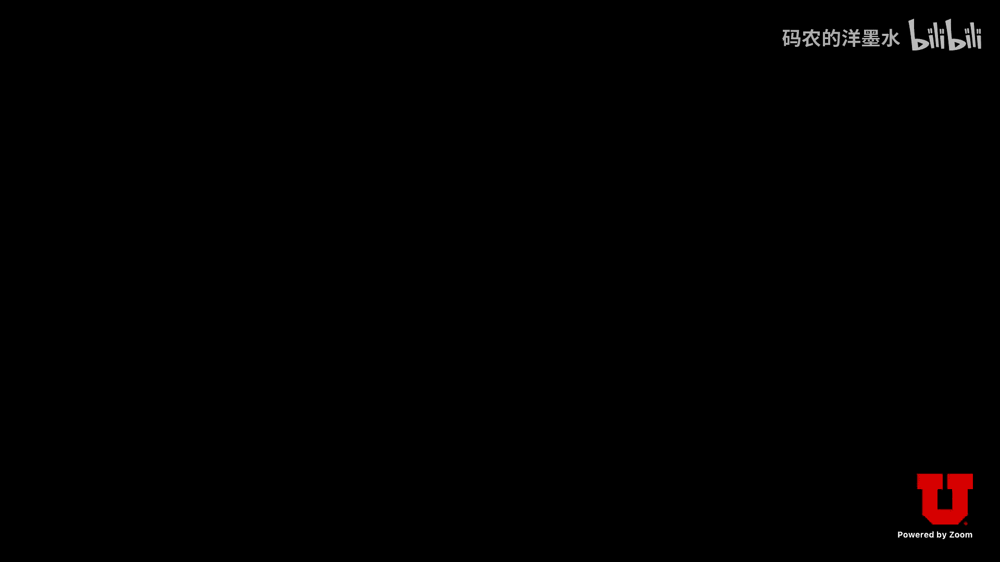

# 犹他大学-CS6140-数据挖掘-中英字幕-1080P-p02-Lecture-2---统计原理--BV1j1mLB9EAB_p2-

He sorry。6。没意。嗯。嗯。好，谢谢。😊，有地方。Yeah。All right， good afternoon everyone， let's get started let me。

All right this is a little bit better all right let's start with some administrative stuff so first of all is the change in help hours we made some changes so please review them either on the website or if you go to the syllabus you can find information about when the office hours are happening in communication last Monday we said we are going to be available after that we miss it was my fault I recorded the wrong room so we were kind of。

Looking between rooms say if you have been waiting for us and then give up apologies for that and we should be there when we say we will be there in the future。

All right so please check that out last time you also had lots of questions about how to form projects and to help you out with that we had started basically these groups where you can assign yourself to any of these groups。

 I think just a moment I'll go into your view because it's slightly different from mine。嗯。

So here if you go to groups so under people groups you should be able to select a group here it looks like like I cannot do it but another student can had confirmed that they can do it so I believe you will be fine with you know just picking a group randomly other option is to go under discussions and there is an official thread for forming projects so here you can also post some of the students who have already written something are good examples of what to write here you can say what your interests are you would like to work on and maybe some other people will be interested in the same things so there are these two options and eventually if you didn't form any team you didn't assign yourself to any group we will just assign you randomly into groups of three related to groups someone else had asked is there。

diifference between grading undergrads and grads and there are no differences in how we approach graD that said if you are forming a group and you want to emphasize you must emphasize who will do which component if the component that an undergrad student will do is smaller then the component that a grad student would do is fine with us but this is something we will kind of check when we look at your proposals and if we deem that something is too small we of course lets you know and you will revise it。

You also ask for example of projects and next time I should come some physical posters here so you can check them out and see what kind of projects are suitable for dis course。

All right there was also a question about how to navigate this calendar so Ill just quick to go through that so here after each lecture i will link the recording so here is for example the recording from the last time and then slides will be basically what I will write in the lecture today so last time we had actual slides but today I will write here and then I will turn this into a PDF and you will see that。

And the notes are what has been written by the previous professor who has previously。

Though this course so if you click on the notes you will find those notes that I basically use to prepare the lecture and just to emphasize recording and slides will be available only after the lecture so if you click now on any of these you will just get the website again。

All right。Next big announcement is that the first homework is you which you should be able to see and I sincerely hope this works out。

 it works great just go under assignments and then you have a one statistical principles here is a PDF of the problem set and then here you have two files that can that you can use to write your solutions in La so you just don't download these two files put them in overlay compile and you will get the PDF out and you submit that PDF again in canvas。

I just also want to make a note that these homework assignments are designed to help you really learn the material that we are covering in these lectures and if you really work on them on your own you will probably have no issue with midterm and final exams that will be done in person on paper so yeah I suggest that you really take this homework seriously and use them as opportunity to really learn the material we are teaching here。

All right， and I believe that's almost everything。The last thing I want to talk about before going into the lecture is one of these policies that I said Ill go over every time。

So this。是。Unnicible into。All right， good。Great so I'll just read one of these policies and every time I will do this so that you know all of the information in the syllabus so here we have you online student expectations though the online form allows students great flexibility will complete their work this course has have a structure and done as such as the following accepted of all students in this class students must be self-motivated organized and willing to stay on top of their schedules。

 students should take control of their learning while in this course students are expected to follow the core rules of netiquette at all times while participating in the class and communicating with others students will log into the course a minimum of three times per week students are not expected to interact with their classmates in person。

okay gotcha all right sorry I didn't realize that before all right then this doesn't really apply because now we move into person sorry I should have really read read this beforehand。

All right so then we should go into COVID campus guidelines I believe that here you should just know that there is this website and there are all this information I believe this information and not regularly update so for example it says that actually this refers to University of Utahah health facilities so if you go to a doctor you still need to wear a mask but as far as I know in in the buildings and here as you see by all of us you don't need to wear a mask you can find another information here such as vaccination any guidance you might need and so on so yeah please refer to to this website if you have more information about this and there are also other resources here and my only expectations regarding this is if you are feeling really sick I would ask you to。

You know look at the live stream instead of coming here in person。

 you will probably get very similar experience and it'll probably be better for all of us to do that。

All right， any questions about this there。不是。No worries。为 one are materials foundation necessary。No。

 the foundations， the book is more comprehensive than what we are actually going to cover in the course。

 so we recommend that you read those readings but probably the readings will include the you know more information than what will be covered in the lecture and also what will be required from you in homeworks and in exams。

 especially for homeworks if there is anything specific in the book with think you should look at it will be referenced。

Yeah， it's quite a lot of reading to understand reading everything might not be feasible。Okay。

 I think this is it regarding the administrative stuff。Okay。Okay， so let's move into the lecture。Yes。

All right。嗯嗯。Okay， let me just see how can I come back here？Right。

I'm trying to make this window a little bit larger。And I will move this， to make it。Les distracting。

All right。If this is too small， let me know and I will try to fix it。

All right so the goal for this lecture today is to revisit some basic high level statistical principles and we will do that through hashing and examples of random processes and kind of associated behaviors that come from these processes and the reason why we want to go through this is because this exercise will be useful for you to think about these probabilistic and randomized algorithms those algorithms that include some degree of randomness in their logic and processes so we are going to start with the first principle you should know and that's IID assumptions。

All right。How many of you have heard this term before， can you raise your hand？

Quite a lot of you this is yeah this is great and I think it comes from the fact that machine learning has becoming more and more mainstream and this is one of those core core principles that everyone needs to know so what IID stands for is first eye is for independence。

Yeah。An ID here stands for identicalally distributed。

And what these things mean is that you have some kind of data set you are going to work with and this data set has some data points。

And independent means that some of these two points， X aren't going to be independent of each other。

And identicalally distributor means that this Xi and Xot come from the same distribution。

And sometimes when we talk mentioned this assumption in machine learning specifically。

 you might hear a slightly different version where and they're identicalically distributed。

 you might see something like， okay， if we have if we split this data set into our train and our test set。

 then our train and test set will be equally identicaldentically distributed so we can have the detrain。

 it will be equally distributed as，The test。And why do we care about these assumptions？

There are at least two reasons for them in the context of machine learning when you have the train set and test set being equally distributed。

 then you can tell something about expectation of how the training error will how similar the training and test error will be if they are identicalally distributed。

 you can expect they are going to be similar。So why？One is to study。Relation between test and。

And train error。And the other reason is that this fact that these data points are independent enable us to optimize more efficiently。

 specifically we will have something like。Calculating the probability of joint probability of end points given some parameters。

 and then if these points are independent。Then we know that this equals to their product of individual probabilities。

And now when we apply logarith to this， we know that。This turns into a sum， right？

And this sum is way easier to calculate。So these are some common reason you might see why this IID assumption is important。

 but you will also see throughout the course that when we bring some kind of theor or some kind of formula for expectation that we will also based it on the assumptions that these things are identicalally distributed and independent of each other。

嗯。Do you think this is a valid assumption？But。Mhm。😊，I will try to。嗯。For some reason。

This doesn't work， which is a bit annoying。Okay sure。

 but it won't make it wider and if I can make the window winder I can kind of zoom it here on iPad。嗯。

Is this sound better？Yeah。that's a perfect observation and you are entirely right this is assumption we make and it makes know mathematical framework neatter and allows us to do stuff with it。

 but is it valid assumption always it is not so an example where it is valid assumption is if you roll a dice for example。

 what you get in one turn is independent of the other but for example。

 if we are trying to generate text， we know that what we have generated so far influences what we are going to generate next right because language has structure and grammar so this is not always a valid assumption and because we sometimes assume it but it's not valid in practice in the result in issues and those errors that we have mentioned last time when it said。

We'll have these algorithms and they will come with certain errors and we have to understand whether those errors are acceptable or not。

Right。W。Oh here here this is it's not really important for what we are talking about right now。

 but if we are looking at let's say machine learning and some kind of classification problem usually we would have certain parameters of the model that we are learning to solve the task so for example。

 if you're learning polynomial the weight of the polynomial that can give you a solution to a problem so that's like the X is given the model。

Xs given Xs Xs are the data points and given those data points you are trying to estimate data again this is not really important so let's not spend too much time on it more important point here is that if you are assuming independence and you apply the logarum to it you turn the product into sums and that helps you to have more efficient optimization so this is a place where this kind of assumption is really really useful。

Okay， so we are going to shift gears a little bit now and introduce some of the notation we'll need for this lecture。

I will try to write bigger。All right。So this is specific to this lecture。

 so we are going to start with some data set x12 x n。And this is going to be IID data。

 which again means that these data points are independent and equal independent and identicalally distributed。

And each one of these Xs。It's going to be an integer from one to n。

And we are going to denote such set like this。So every time you see。This。

 it means it's a set of integers from one to n。And this symbol means that this element is part of that set。

And this is our definition。So what are some examples of M？Of this set of integers。

It could be all possible。Words in a dictionary， for example。

And this is something you will see commonly in natural language processing where you will have a vocabulary of all the words in English and each one of these words will be associated with an integer。

 not only that we are going to break those words into subwords so we are going to have actually a vocabulary of all possible subwords。

 that are commonly used in English which is usually 30。

000 of them and then each one of them will be represented with an integer。

But it can also be other stuff， all possible IP addresses。Or birthdays and so on。

And you might wonder why are we representing these things with。With like this with a set of integers。

 why don't we just make a set of actual strings and the reason international is for simplicity。

This will allow us some notational and implementation。Possibilities basically。

 so it is not necessary to do it like this， but it is convenient to do it。And also today。

We are going to assume that the probability of each one of these Xi equals to an integer is uniform。

So for every possible integer， the probability of this data point being assigned this integer is equal。

O。So。Again， similarly to。IID assumptions， do you think this is realistic？对过啊。The example likeYeah。

 yeah。So again， my question was， we are assigning uniform probability to every possible birthday。

Is that realistic？Okay I see some headshs which is a correct answer。

 it is not realistic because we know that some birthdays are for example more frequent than the otherwise if you look at the data statistics in the US you will see that summer is the most frequent period of birthdays so it is again not a realistic assumption。

 but it is the one we employ。So not always。And I'm keep mentioning these assumptions that are not always true because it is important to embrace that that a lot of times when we are dealing with these mathematical frameworks。

 we are using assumptions that might not match what you are working with in the real world。

But for today's lecture， that's what we are going to work with。

So nowYeah we can go through it slowly， so this is a probability that a data point here。X I。

Equals to an integer yacht。equals to1 over n where n is number of the integers we are working with。

 so it means that every integer in this set has equal probability of us assigning that data point to that integer。

And if it's not in the set of one to n， the probability equals to zero。

So I know it's an issue here if you like to sign an a like words and victory and find ordering and just like back。

These words went now I have no even so。Do they still， I mean。

 like how do they how do they go about that problem to like a sign number just word so they don't really have any impact ordering。

I can tell you what happens in NLP concretely， is this the question you're looking for？

Like is the question once we are assigning the number to a word， what do we usually do with it。

 is that the question because word doesn't really have？

Yeah that's true I mean this this what we are going to kind of get into now is hash tables so this way of representinging these things gives you just a way to index them so in then be specifically what you would do when you are assigning these works so we would have。

Your vocabulary。Of size， let's say。30，000。And then。You will have values for one to 30，000。

 but this first word first index might relate to the word I don't no dog。

And then you will have an add matrix。Which has equal number of rows as your there are words in your vocabulary。

 which is 30，000。But it has some very high dimension D and then knowing that dog is a sign index one。

 you are going to retrieve the first row here and that's going to be vector representation of your word dog。

 so this is how this is used in anpy。But yeah， let's not go more into into that because that's a whole other topic。

As I said the point of this analysis is to go over some of the principles you will need to think about these probabilistic algorithms and one of them is hash table that you have probably seen before it's a data structure you have seen maybe in CS24 to 20 I believe is is the name of the courserus so this is more what we are going to go through now is more like a review of hash tables。

So first of all， it's a data structure。But the most important component and the one that's most interesting to us in this course is hash function。

谢谢。All right。And to define a hash function， we need a family。哦。Fash functions。

And then we are going to draw for sample one hash function from this family randomly。

 so small age is going to be element of this set of all of these possible hash function and it's going to be randomly。

Draw。So when we say a random hash function， the random part is connected to the fact that we are randomly selecting this hash function for the set of。

Hsh functions， but the function itself is deterministic。

 So we will say that this hash function goes from some。Set of all possible strengths of land decay。

Capital Sigma K denotes a set。哦好。Strengths。哦。Lft。Okay。

 and one concrete example you might see in these textbooks is sigma K that's。

Cosists of zeros and months of length。So strings of bits of。L kit。

All right so this was a little direction of what sigma K is this is going to be our domain for hash function age and we are going to map it to again that set。

Of integers from one to n。This function is going to be determined。

 so don't confuse with what is random here hash function is not random。

 the choice of hash function is random。All right and one of the important properties of a good hash function is that is uniformity which means that you want to assign you don't want one element one integer to be assigned lots of lots of data points if that had happened then all the benefits of doing hashing methods will not be achieved basically the efficiency won't be there so one important property。

Is uniformity？嗯。And again， using the probabilistic notation。

 we would write that probability over the hash functions。That。The hash function of some string。

Is equal to。The hash value of the other string is again， equal。All right。

 so just repeating that again， the probability over hash functions that hash value for one string equals to a hash value of another string is equal to one over n。

So if we have that， then all of these positions in from one to n kind of have a same chance to get elements assigned to it。

 and that will kind of give us this uniformly that we don't have certain values。

 certain integers coming too many values associated with them。Allright。

Another thing important to mention here， which I kind of said now informally is the concept of collision。

And that's when a pair of strings are assigned the same integer， a same hash value。

And basically you don't want to have too many of such cols， as I said。

 because then one hash value will have too many elements associated with it。

So one thing you might be wondering about is okay， I get that， I get this mathematical notation。

But how do I go about this point of choosing the has function？

So let's see what are the options you have。So one option is to use whatever is built in Python。嗯。好。

 sorry。And one such hash function is called Sha one。

And what this particular example is doing is giving you the following hash values。

It's calculating some kind of shell function， but it's concatenulating certain string with the string you are given it。

And this is that random part， so you can sample different different strings a here to get different different hash function here。

 so that's why we have this special subscript a here because we have this additional。

 you can think of it as a parameter that we are kind of associating each of these hash functions with。

All right， and the string age is also part is just a string of certain length L and you can call it a seed string。

But this thing， this concept is also known as。So。Okay， so that's one option。

 the second option is multily caiv。I think。Where again。

 you have a parametermeter H a and here you're going to take a floor function of n times。Fraction of。

X times a where floor is， for example， if you have 23。

15 floor will be whatever is before decimal and the fraction part will be everything that's after the。

The decimal。And it is， again， this is， again， what is known as salt。

And it is suggested that this is some kind of a big integer number。嗯。

That has in its binary form like a mix of zero ss basically want to avoid having a number of deaths power of two here because it might cause some disability issues。

And then maybe the most common one you have seen。Is modular hashing？I like these other ones。

 it's just Hx。X mode。M has no associated。Parameter A with it。嗯。And there are reasons why this。

 despite being very commonly suggested as a hasing function is actually not a good hasing function。

 so the first problem is that if you。Take two numbers that differ by one。

 they will always have different hatchh value because the modular will always be different。

But then if you have。Numbers that differ in m positions days will always have the same the same hash value so this hash function has too much structure and therefore it is not a great choice。

 especially given this other options that you have that's you might see in the literature variants of these modular hashing that kind of strive to fix some of these issue for example。

 they use a large prime number or instead of M that is still smaller than m then you have a little bit less regularity but it still it's not a great option to use。

I'm sorry before blowing into the microphone。All right， so。

So far we have seen some of the notation that is going to be important。

 we have talked about IID assumption and we have covered what are hash tables and hash functions and so some examples of them now we are going to go into some more concrete random processes and try to analyze them and get some observations that might be useful for us。

Are there any questions so far？All right， yeah， this is a little bit straightforward。

So second sorry for or string this one。Yeah， that's a good question。I'm not sure， yeah。

 I would need to come back to you about that。I mean， I can understand why are you asking this。

 what would be the flu and fractionction of a string right？This is the person time maybe a。

Because you're saying that aids friendly。So this is different from your random of collecting the heat on the set of the state aid。

Yeah yeah so let me try to be more precise basically by using a you can construct a family of these different hash functions with these you know specific formulation and then you can pick one randomly so the choice of a is not random you can pick as many you know like you can have many options there and you can maybe construct them from all the possible strings of of the land L so there doesn't even need to be random as there。

This say not。A is another string yeah that's right yeah here you have I dennoted it as a is an element of a set of whole strings of length L well L is that you know。

You know， maximumim length of the prefix you want to have。Okay。Let's move forward。

 I think that the stuff that's coming up is slightly more interesting。

 so we are going to work with a concrete example here。We are going to have some as an input。啊四。

Of M distinct strings。So this is how I will denote sequence of strings。

 so I will use the same records， but I will have here subscript and superscript so this is a sequence。

Of M。Distinct。Srinks。So SI is different from S good。

We will have assumed some caching function here that puts these strings into integers from one to n。

And。There is this very general question that might come arise is and that's that how many。

Strings we need to see until we get。后列上。So this is one general question and maybe another way of saying it's like what is the expected number of strings maybe we need to see until we see two equal strings and this broad question is actually has a concrete problem associated with it which is called。

Birday paradise。And Per paraox says that if only。Approximately 23 people。Are in a room。

Thenhan the probability。Of a pair existing that。Has same birthday。Is larger than 0。5。

Can someone tell me this what is paradoxical about this？Would you expect？我系。

Yeah exactly that' that's the correct answer so here what is paradoxical about this is that 23 is way smaller than 356。

 which is the usual number of days we have in one year。嗯。

Have you ever been in a class where you simulated this birthday paradox can you raise hands？

Okay just a small number let's let's try to do that for the fun of it to compensate for a lot of math in the beginning。

 so what we are going to do is to try to see how many of you are going to ask for your birthday until we reach a point where we found two of you that have the same birthday。

All right。嗯。All right， all right。Maybe we can start with our Ds。Okay。24 okay。

We we're going to stayed right maybe December 11th。May 17。Sorry， you want to go next。seventh。Great。

 November 27。November 22nd okay， sorry I could second February 27。All right。

 I think in the second row we stop somewhere， I think your next August 22nd， all right。嗯嗯。March 1。

 March 1st。Thanks。February 13th。They go there。Ju 1Ju 18th。Right behind 。7。July。All right maybe。

Maybe we can go like through third row October 13th。对。俾嗰边。May 14th， oh， this is taking one。

We are an Emily， like my weekend goods。😊，June 19th。So close， yeah。September 28。He maybe else here。

I can't believe this is taking some on us September 1， May 4th。😊，嗯，等一下。M8March eight。Oh no。

 so many slide。😊，你系你。May 21st。Okay。14 oh，14。Okay， ju 7。不。Of56 feet。You have all right， yeah。

 thanks thanks。😊，I really appreciate。😊，All right， so we will learn another lesson through this exercise and that's that we are dealing with random processes so there might be certain expectation。

 but that doesn't mean you are always going to be close to that expectation which happened kind of here as right now let's see how many trials we have1234567891011。

12， 13， 14， 15，16， 17，18， 1920， 21， 22， 23， 24， 25， 26， 27， 28，29，30。All right。

 we had 30 trials while our paradoxes saying that there is with if we if we have seen 23 people there is 50% probability that this is going to bring us collision so in a way it's not two far far away。

 but maybe if none of you had conflicts and only at the end we reach out to the person who had this would be like a serious anomaly。

O。😊，So。Let's try to derive this more formally and just to kind of remind you maybe this is too fun and how you forgot what the question was。

 the question was how many distinct drinks until collision and a concrete example of that is given all the burs in a year how many people we need to see until we reach two people who have the bur on the same day。

And we want to find a more formal way of saying that this that we need 23 people to achieve this probability so that's what we are doing right now so what is the probability that the first person will collide。

Z that's right there is no one to collide with so first。Person colliding。Is equals zero。All right。

 Dan。That probability that the second person。Is colliding。Is equals to where n equals 356。

 that's the number of birthdays we can have。Oh my gosh， yeah。You're sharp， that's good， okay。

All right， going back to the question， what is the probability that a second person will collide？是。

我觉小小结果。one over 365 yeah one over n so basically out of all birthdays there is only one we can actually collide with so that's how we come with the number of one over n which is one over 365。

嗯。Okay， opposite of that would be probability of second person math colliding。Is then one minus1。

Oh and which is。3664 over 365， which is approximately 0。997， this is approximately 0。0。3。Okay。

So these are only two examples now we want to generalize this to seeing gay people。

If we see gay people， so I would write this as。General case。OkayOkay people。

Then the number of pairs we have between gay people。Equals to。K choose2， which。

Is equal to k times k minus one over2。Okay。That's how many pairs we have now we are interested in probability。

Yes。That there is no collision。With。It be bears。And now imagine that。

We have whether a given person will collide like whether one pair will collide is completely independent of whether there were any collisions before。

 so we are assuming there is some kind of independence here and then if given that we know that。

This is the。Given that this， the probability of not colliding equals to one minus one over n。

Due to independence， we can just multiply these probabilities as many times as we have pairs。

 which is k over two。All right， so what we have employed here here is independence so we know that。

If their two teams are independent at then。With this this thing holds。All right。

Birday paradox tell us that。With k equals 23 people。

 we should have a probability of collision being approximately 50 percent so we have K equals 23 people let's plug this into this formula。

So we'll have 23 times 22。And。Oh。This will be equal to 253。Our N is equals 365。

And then when we plug in。So let's denote this with star。If we put。

They seem going to start than we have。One minus1 over 3 65。On the power of 253。

 we have said before that this is approximately。0。997 of power of 253 and that will be equal to approximately 0。

467 and that's the probability probability that no collision will happen so probability that collision will happen is one minus star so that's one minus 0。

467 which equals to 0。532 which is close to the number we were looking for。

 we were looking for the probability of a 50% to say that with k with the number of people equal 223。

 we will have probability of around 50 that there will be collision between the bur of a pair of people in those 23 people。

O。So there is a few problem with these with this specific derivation。Can you。

Identify maybe some of the problems。So。Remember how I keep saying that some of assumptions are wrong。

 yeah go ahead。The assumption that all， living uniform。Exactly yeah。

 the problem is with assuming again independence here and more specifically。嗯。

What will happen is when you have more than more people than there are days in a year。

So if you have a K number of people。Equal to 366 you know that there must be some collision here in terms of birthdays。

 however， let's calculate what happens so the probability of seeing collision with K with the number of people calling 366 should be one right because this must happen and this is also connected to something called the pigeon hole。

Principle。So this principle says。If an items。耳兔子。In containers。Where M is larger than M than。

At least one container must。Must contain。At least two items。

And items in the original forms are pigeons and boxes and this is this is a principle that is widely studied in in math so according to this principle the we know that the probability of colliding should be one。

 however， when we put if we hear in this derivation，If we put k equals to 366。

 we will get the value that's very， very， very close to one but it's not exactly one。

 and that's a problem。So we need to fix this derivation we have。And not the student independence。

So we will have probability。Of not colliding。And I will denote which two stars to separated from the other one。

Yeah。嗯。嗯。Right， so。Sorry， just a moment。😔，so here we'll have actually probability of colliding。

In this version， we will have again。1 minus so the probability that the first person will not collide is equals one right then the probability that the other person will not collide is one n minus1 over n because there are n minus1 and n minus one options birthdays one can take to not have collision over all the possible birthdays now when we come to the third person if we do not want this person to collide with the other two people we have seen before that means we have n minus two options for assigning ver to this person to not have collision and we will do all of that。

Until end minus。Last person。Over again。All right， and and I said where to write this is like this。

And this is more precise way of calculating that probability that they will be colliding。

where we didn't consume that these things are independent when for example here。

 we have considered that there are any minus two possible options given that we have seen two people All right and now if you put an a equals 300 66 here you will get the probability of one because one of these components will be equal to zero。

Whats。I guess the firm like n minus1 and minus2。Isn't the probability that it's going to collide like what did that go on it you have more people in the sample except of like down the probability because there's like。

What the numerator be getting data in relation to the eminator？

So I can I can explain it to you differently the way to look at this is so you want person this is the。

Probability that the third person。Will not collide with other two people。

Oh it's like one minus whatever here yeah yeah it is a little bit confusing so basically。

What is in the records here is probability of not colliding。

And then if you have one minus one of probability of not colliding， yeah。

 sorry that wasn't clear enough。Yes。Okay， and one thing that is going to be useful for you is kind of like a rule of thumb of how many。

How many people you need to achieve certain probabilityba so there is this approximation so the probability given k people is approximately k squared over two times n。

 which means that the number of steps you need to achieve certain probability equals to ta time two times n time。

Prob team。So let's put some concrete numbers here if we had n equal 365 and probability equals to one half。

 so 50%， we will have k。Of two times 365。Divided by two。And this number。Is approximately my team。

which is not exactly for any tree， but it is somewhat close。

 so this is kind of an approximation you could use to see how many steps you need to achieve a certain probability of seeing the collision。

If we had n equals 365 and probability equaling to one。Then we would have K。Two times。365 times samp。

And that would be approximately 27， I believe。So this is one approximation you can use and。

And in the homework， for example， we kind of has these simulations of these experiments and you get some concrete numbers by doing these trials trying to actually get these collisions and then you get maybe some expectation from your experiments and you can compare that with the kind of rule of thumb approximation of how many steps you need to achieve certain probability of seeing collision and then you can compare those two values and if they seem somewhat close you can say okay this is reasonable to me and if not you should。

You should kind of look back into your code and see whether you made any mistake and it's like a general thing to remember that you will have these guidance。

 analytical guides to what you should expect and you will do things by implementing them and then comparing whether the thing you are actually getting computational matches that analytical expectation is a really good habit to if you are doing data mining。

All right， so if you remember where all of this begin you begin with the question one where we ask how many distinct things we need to see to get the collision and now the answer you can say well approximately this many if we want to have a concrete formula for it and another thing that it's kind of obvious but I also want to emphasizes is that when you' are dealing with this random processes collisions exist right so you will by drum randomly these people you will get the collision of their birthdays。

Okay so that's everything I wanted to talk about related to the birthday para yeah I just jump from one thing to another so there wasn't any anything you have seen what from what I derived before to the rule of thumb so you know these kinds of things are disconnected so it's a little bit funky I see that but try to think about it like this if you have this probability that this is the first part here it's a proper derivation of how to calculate this probability great now you want some approximations to kind of get this number of steps this thing here doesn't come from it it is just you can use it as a fact you know like this。

This is a rule of thumb people had discovered that you can use for these things。

 so it is a little bit。I don't know how to write it that is opposed to like the one about it。

The one above it doesn't really give you the number of steps， it just gives you the probability。

 right？Oh， so we tape like that。Yeah。Yes。是。Yeah， I don't have momentarily the better way of explaining this。

 maybe I can come back to it in the next lecture for right now。

 just think about this probability of colliding as a formal way of finding the probability。

Kind of okay， we are done with that and now there is a rule of thumb of how many steps you need and that doesn't come from this previous derivation。

 but maybe the next time I can show how we can actually come to this how we can derive this number of steps which I don't know by heart right now。

Okay。So the next question we want to have is we want to answer is when do we see all birthdays？嗯。

Or in other words， how many people we must see to kind of find a set of people that have all the birthdays in the year。

 another an example that might be closer to your heart is how many happy meals we need you need to buy until you get all the toys that you possibly can get in a happy meal。

And this problem like the Bur Paradis has a concrete name associated with it and that's coupon collectors problem。

All right。😊，So。So let's try to formally answer what is the unexpected number number of items we need to see until we complete an entire set and one people you might you know jump into if you are not cautious is to think okay。

 I need you know and items to complete a set of any items but when we are drawing things randomly then we might be very unucky you know you might keep buying those heavy meals and you never get another toy so how many we need is going to be larger than the actual number of possible items but let's see how how much larger。

All right， so again， we are going to have a sequence S one2。SK。

And you can think about let's focus on the example of buying happy meals to purchase all the toys。

 each one of these items here is related to the event of buying and then for each one of them you can have the outcome of whether you get a new choice or you do not get a new choice。

And of course， in the first step you are going to get the new toy and then maybe the second one there is also which chance you'll get it and by the third one you might have you know need to have more and more steps until you actually get a new one so let's introduce some notations that we will need to get the actual formal work how many how many happy meals you need to buy to get all the to so with capital D we are going to denote the expected number of steps。

Until deal。I。Distinc pre so。How many had meals we had to buy until we got the it distinguish doing。

And then with small DI， we are going to denote。The difference between。

 I'm sorry this microphone is very annoying。The difference between capital tiI and capital T minus1。

Yes。At least it wake you up a little bit。All right， and this is the expected number of steps。

One need to take between。Between。I minus one distinct。And the following。🎼All right。

 so this is a little bit dry， these are all the stuff need so tea。

Expected will be expected number of total happy meals we need to need to get all of the toys。

And then to get all of the toys， we need just to sum all of these steps， TIs。

This gives us it's the same way of saying how many in total there are to get all of the noise。

So number steps。Or。Those。Okay。All right， now we want to calculate the probability of seeing。Is。

Distinct。Given。I minus1 is state。Obser。And again， as we have seen it in the previous example。

 this is just the probability of outcomes， so how many are there left to you know how many distinct toys there are left。

 there is n minus I minus one of them because we have already seen I minus1 over all of the possible toys。

Okay。And。This probability maybe rings a bell to you and maybe this expected number of Se between two successes also rings a bell so and maybe that bell is that TI follows。

Geometric distribution of trial。Yeah。And maybe。That also reminds you that the expectation of a geometric distribution of trials。

Is equal。1 over the。We will call this probability fee。

So this is how we get the expected number of steps here。

And that's going to be just the inverse of this thing， which is ns and minus。Allright。

So far this clear。Okay I hope the durationvation is straightforward the only little jump is understanding that this follows geometric distribution which you kind of just need to know from the previous courses and then we want to calculate tea which is the total number of steps total number of happy meals we need to buy before we get all the toys so。

Oh。All right， actually we need what we need is the。嗯。Sumation of these expectations。

Maybe this is I jump too much。Basically， what we are doing is expectation of T。

Equals to expectation of sum of I equals Nti。And then due to the property of expectation。

 we can go to the expectation inside of the sum。Which then means。That the expected number of total。

Happy meals we need to get equals to this。All right。

 and we are just going to refactorize that a little bit， we are going to write it。

 we are going to put an in front of the sum。And if we kind of write this this sum in a more。

 you know， without making it compact， what you would get is for one。

 you would get1 over n plus one over n minus1 plus1 or n minus2 and so on。

And another way of writing this is。And times。🎼I equals to M。

Two let me just figure out what is the end here。嗯。To on。嗯。Okay， I forgot what is here。嗯。

Let's ignore that for a now， but basically you can rewrite this this thing here as a summation of one over I where I goes from certain points to the endpoint and apologies I will figure out that later what are the exact points。

 but this is then。This number here。It's called the end harmonic number。

And the harmonic number doesn't have a closed form， but it's we'll call it HN。

 but it has kind of an approximation。Which is given by another constant。咁吗。Plus natural logarum of n。

Plus some。Constant。And this is approximately 0。577。So what this mean is that our total number here。

 expected total number。Equals to。N times Hn that comes from here。And that's approximately n times。

Some constant。Last logarrium of n， which is approximately and for us what we need to remember here is that this is close to n。

Look and。All right， so the question was that we started with was when do we see all birthdays or when do we see all of the possible toys that are possible to purchase with a happy meal and if you have。

If there are any such birthdays or toys， then the answer to this question is N log N。Is that clear？

Yeah，是ulating。Oh percentage of the accountss。What what certainly like like if we're given。Like。

 you know， 400 people like what whatever there's chance they can get every birthday or we're not going go of that paper。

Probability that you are going to get， so let me see。嗯。Yeah， I don't know of it。

 but that doesn't mean that such a thing doesn't exist。

Okay so I want to stop here next time I will briefly mention something called probably approximately correct or PAC just to make some of these ideas more general but it's going to be very brief and you don't need to for homework now forget that the homework is due in seven days so next Wednesday by 245 pm it has to be submitted premise okay。

呃，对。清。Yeah。Yeah。

