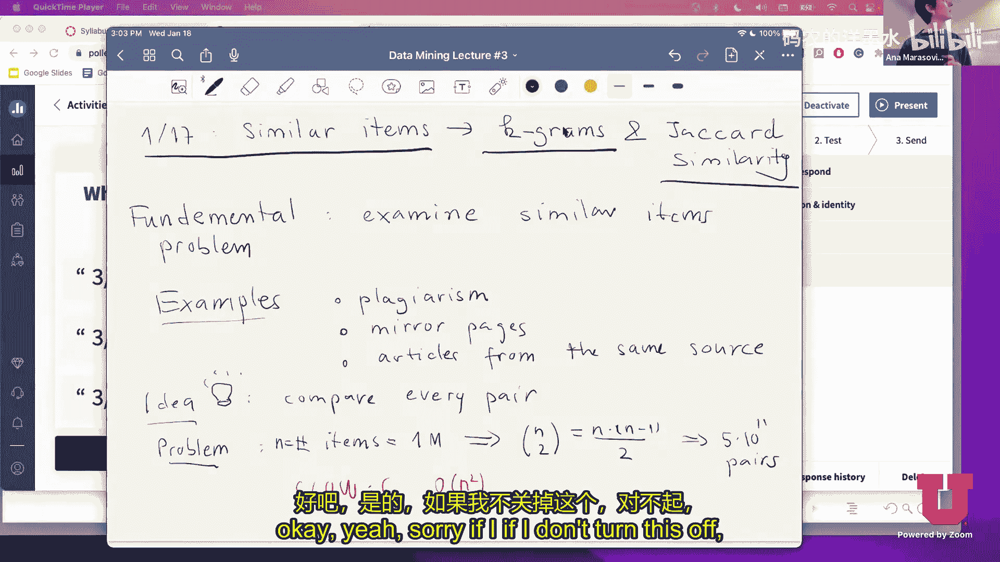

# 犹他大学-CS6140-数据挖掘-中英字幕-1080P-p03-Lecture-3---k-grams-与-Jaccard-相似性--BV1j1mLB9EAB_p3-

Yeah， and my。咪咁。哎，有。好。Yeah， yeah， that' that's nice okay， we need to get started。

All right good afternoon everyone let's get started first thing we are going to go over is line of our policies and today that's drop or withdrawal policy it says that students may drop a course within the first two weeks of a given semester without any penalties student might officially withdraw from a class or all classes after the drop deadline through the midpoint of a course W grade is a recorded on the transcript and appropriate tuition piece I address the grade W is not used in calculating the students G and for deadlines to the withdrawal from full term first and second session classes C to use academic calendar I do want to mention something else that's related to this withdrawal in the first two weeks without any penalty I decided that I will require some of the homework assignments to actually write some Python code specifically to use some Python libraries and this shouldn't be。

anthing too difficult or super complex， but I think it's important for you to finish a data mining knowing about this library and you are going to go through some basic usage of them so this might concern you。

 I don't know if you feel like this might be too hard。

 you might consider this option but I really believe that this shouldn't be too complicated but you need to decide for yourself。

So that's one change in the sea levels that I'll make another change is regarding communication so what became apparent once we have published the first homework is that there is a lot of questions and a lot of questions go straight to my inbox where you would like to hear my opinion compared to the T's opinion and that's really hard for me because I have to do research I have to give service to the university I need to give service to the research community and so on so your messages get mixed up with all these other messages and I can't prioritize your messages or the other so what we are going to do is switch to Piazza that has one useful feature and that's where I can endorse message so if you see that I have endorses T's message you can just conclude that I would tell you the same thing and there is no need for reaching out to me directly of course that will always be personal circumstances where you will reach out to me directly but Piazza。

as all the options for you to reach out to instructor directly。

 indirectly make things private hidden， so I think it's going to be a little bit easier for me and therefore better for you because you will get my response in a timingly manner。

Okay， so these are two things that are going to happen。

 they are not implemented yet and once we have implemented them， we will announce them on canvas。

Okay， so I won't go into details of some of the stuff that were unclear in homework yet because we have those two in the late policy I can you get two free passes for being late so some of the people might not have submitted their solutions yet and it wouldn't be fair to people who have submitted them that I now discuss solutions so we are going to do that on Monday。

 but I want to go over some of the stuff that were unclear that I didn't explain to you well enough last time。

Are there any questions about the changes in the syllabus and what else did I say about Piazza？

YeahOkay。都能。All right please， then let me navigate this thing。确定。All right， please。

we are going to so these are the lecture notes from the last time and there were at least a few things that were unclear because unclear how to use multiple architecturalative hashing for strings and basically well need to convert strings to integers and there are ways to do that I won't go into them but that's what you will do。

Then another thing that I brought up is that there is this rule of thumb that you can use for the number of steps from that comes from this equation and righteously there was a question of where this came from and I didn't provide an answer to that so I added to the notes how you would how do you come to this rule of thumb probability from the equation we have。

They arrived when we assumed independence。So from this equation here。Okay。

We have this equation and you can use some steps to get to that approximation more specifically。

 so this is that equation that I have just。🎼Highlighted。

 I think you would need to induce is binomial theorem and realize that one that this term here。

You could write， you can expand using binomial theorem and you would use the fact that。

The powers of two and higher will be very small will be very small for us very small x。

 or in other words here we have one excuse me。Okay。

Just a moment I have a little iPad difficulty here。All right， so if N is large。

Then one over end will be small， right？And if when one in。Or any small。

Then a power of two and higher will be even smaller so you can kind of say that this thing here you can approximate with this thing because Xon power2 and so on will be very small and when you combine all of that together you will get this formula here。

And then you will use the fact。That you can also approximate。

K chooses two with the same principle so here we have very large k k on power2 is way bigger than just k and therefore you can approximate it with just k to the power of two over two and when you combine all of these together you will get that formula yeah well illustrate yeah okay yeah。

All right， so that was unclear last time， if you're now a little bit fuzzy of what's going on。

 just open the notes on the web page and everything will be clearing。

And the last thing I believe two things that weren't clear， so here here on this harmonic number。

 I was confused and I didn't set the range for our eye correctly so now there is that and it's correctly brightening your notes。

And there was a question about if I can you give me the probability given K purchases。

 can you give me the probability I will see all the toys that's something I didn't know how to how to derive last time and actually that's turns out to be a well studied problem the derivations from the formula that we have seen are not trivial they are possible but it takes a little bit of efforts to do it and if you actually look at real solution in the match to that question I recommend looking at this stack exchange course there is one way to do it if you know what sterling numbers are so you could use that to get that probability and this is something I will share share on canvas or piazza depends whether we make Pis available here so I won't go over all of this but just know that it exists and you do need to know a little bit more。

Mt techniques that we will cover here to get to this。Okay。

 so that's all about the previous lecture and these， as I said。

 these notes with these corrections are available on the website。I'm trying to close this there。

 which is my possible。Okay。All right， and before we go into the new lecture I want to remind you that the deadline for the project proposals is coming up and that you to submit the project proposal you need to form a team so we have set up a deadline for you to set up teams I believe on Thursday tomorrow at 6 pm so if you don't do it by then we will just randomly assign you to groups and as I said in the first lecture you have to have a very compelling reason to be a team of one so you must be in ideally group of three not more。

I have also brought some posters here so that you can see what kind of projects are you know。

We expect for this kind of course， but in general for every class I would really ask you to not stay outside of the class but rather meet us at that room we have booked for office hours I know there is you know you just want to ask me a quick question and go home but it makes it a bit hard for us to answer all the questions and there are also our Ts who can help me to answer your questions and if you're in a crowd you don't don't see them so please unless you really really hurry please come to that room instead of waiting for us outside so I said that because Im bring the posters with me into the room and you can come there and look at them at an easier pace。

Okay and yeah the last thing is that now the new homework is released and for this homework you have two weeks and we will try to keep that rhythm that we release homework two weeks in advance sometimes depending on my schedule for example。

 if I travel that might there might be a small delay so it's not fixed in stone that it is always going to be two weeks in advance but we will try to do it like that。

All right， so now we can finally go into our new lecture yes please。

Oh that's a good question so today you will hear everything you need for the first assignment。

 so first excuse me problem in the assignment。I believe that already in this next lecture we will cover。

So next two lectures will cover the rest for sure。Yeah， so right after today's lecture。

 you can start working on the first problem。Excuse me， I need to navigate between iPad and laptop。

 which is sometimes a little bit cumbersome。All right， so。

What we're going to do today and is going to span the next three lectures is a problem fundamental problem of data mining and that's finding similar items or examining similar items in your data so let's write that down so fundamental problem。

East。Okay， and some examples of thats。Some examples of that are for example detecting plagiarism like you might have as I said。

 I'm a part of the organization committee for a conference as we get a ton of papers and now we need to see are those papers in a way too similar to some existing paper that already exist in the scientific community and there are so many papers so you have like a huge pool of papers so plagiarism is。

玩络灯。Then we might have on the web we know that different pages have different mirrors to share the loads。

 so we might want to also identify that these are similar。Or maybe we have news articles。

 you know how one news outlet writes the first article and then everyone else types of bits and pieces and refraing it a little bit。

 especially if they are translating it to another language， so you might also want to know， okay。

 what are articles from the same source？So these are just some example and I bet you can think of many others it's really like a very prevalent problem and you might have like an idea to okay I know how to go about this I will just compare every pair right and I will see whether two pairs are too similar and if they are if two papers are too similar I will say well these paper pla plagiarize this other one that was pla visual before so that could be your。

Totally ill legit idea。And the problem that comes that occurs is when we deal with the big data。

 which is the thing we are dealing with when we deal with data mine， so if you have let's say。

 number of items，Equals to 1 million。Then。And let's call this n then in the last lecture we have said。

 okay， then we have N choose two pairs。So we have。N times n minus one over two pairs。

 which is then for n of one million that's already five times10 to the power of 11 pairs。

And basically， if you would compare one if you would。

Compare 10 to the power of six pairs in a second comparing this many pairs would take five days and if you have 10 million items this would take one year so obviously this is not this obvious thing to do is not what we would do when we are dealing with the big data so we cannot do this because。

え一と数。Because we have this problem， right？And what the point of these three lectures is going to be is to see how we can do this more efficiently。

 right， how we can actually compare pairs of items such that we don't lose so many times and have actually useful applications。

And the actual solution we are going to work too。It's called locality。Sensitive hashing。

Where we will actually deploy those hashing functions we have learned last。Time。

 so it's very nice when we use something in stats that we are going to actually apply for a very。

 very real problem in the world All right， and the idea of locality sensitive hashing that we are not going to go into details today either next time。

 but in one week is that okay， you have to。T documents。嗯。

You are going to just use a bunch of hash functions。To hash them。Many or one and the other。

And then you' are going to say， well， my two items， two documents， D1 and2 are similar。If。They hash。

If they have some hash for some of these。Some of these hash functions I。Have。Use。

And if there isn't such a hash function。Then you can conclude that there's this similar。

And this will be way faster so basically you are randomly backing them and they if they do not end up in the same place you can say they are dissimilar and since we have like in your homework and the last time you realize okay I need less trials than there are actual items to achieve that collision。

Okay， so this is what we are going to work to to this locality sensitive hashing， but we will need。

Few techniques before we can actually be able to do that， so our roadmap。对。

To an stage will look like this。Today。We are going to go over how to。Represent documents。

 textual documents。With sets so here we have two documents and each one of them will be represented with some sets。

And then we are going to use set similarity to compare them。

 so specifically Jacquard similarity and then we can say they are similar or dissimilar and this is what we are going to talk about today。

 how to go from text to the sets and how to use Jaquharard similarity to to compare these sets that represent text and then next Monday。

We are going to talk about a problem where this set here can actually be。Large。

And then you run into issues again。So we are going to use technique called min hashing。

Where we are going to represent this with smaller sets。And approximate Jaquard' similarity。

That's what we are going to do next time and then。On Wednesday， we are going to combine the idea of。

Of LSH。With what we get。From Lincoln Washington。Okay。

So this is how we are going to go about doing this locality sensitivity action。

 so just put your mindset into， okay， we have three steps toward this and each lecture is appear us there。

So as I said today， we are going to go from documents。Two sets。And since I will need textual example。

 I will use some slides here。To go over this bit。Yeah。Okay。All right。

 so here we will have the running examples of these three of four sentences。

 I am and I am I do not like green eggs and he and I do not like them Sam I am it's a little bit disturbing to read it y。

Okay so the first thing you can do is very common procedure， you can define your vocabulary。

 you basically use all the words that exist in these four sentences and you do not duplicate them in you basically deuplicative word had a appear twice you will just put it in here once and then each word will be represented with one integer so usually we put them in the just of a peical order and numererate them so there isn't any kind of hesing or anything here as this might be a little bit confusing single of that this is just making a list of words and giving them integers。

And then what you can do and this is called bag of words is produce the vector that at each position is putting the count of the corresponding word in the vocabulary that appear in that sentence so for example word M had actually appeared once in the sentence and you are going to put it once here excuse me。

 you will put it the number one here， then and do x green ham。

 do not appear in first sentence so you will put all zeros then you come to word I it occurs once。

 you will put number one and so on。And you can do that for each one of these sentences。

 and here is the only occurrence of a word count being twice more than one。So these are bego words。

 super simple way of representing words。But there is an issue with this approach and does anyone identify what's wrong here or what could be better？

exactlyactly so we have two sentences here I am Sam and funier version of it semi and we do not capture that with this bag of word representations they are exactly the same so basically we kind of completely discardlet syntactic information about this sentence and that's not great for example if you are working with these vectors to decide whether a text is formal or not you would not have a great representation because although this second sentence is very more informal it would not be captured with this vector so we want to do something a little bit smarter and we use what we call kgrams and specifically here we will focus on kgrams with words。

So what are kgramms so basically you take from each one of these sentences sequence of k words and if we have k equals one that means give me single words in this collection of sentences so we have。

I am Sam and so on， however we could have requested two grams which would mean to take a sequence of two words so we would have I am and Sam Sam Sam Sam I M I I do do not and so on and in NLP and I think more broadly when we have one grams we will call them unigrams when we have two grams we will call them by gras three grams are trigrams and then from four we just say four grams and so so if you look for you know if you encountered these words they are super standard and I encourage you to use actually say unigrams and sounds more if you're know what you're talking about。

Okay so we have these kgramms and okay what might happen here is that we make small spelling mistakes which are super common when we have you know textual data on internet that we are dealing with when we deal with data mining so we might say something like this movie is awesome and then someone might slightly misspell it this movie is awesome and then w because w is very close to E in the keyboard and if you do these kinds of kgramms with words this will be the main word will not be captured basically the word awesome will be very different from what we have in the vocabulary so another idea you can exploit our kgrams with characters where you are looking for a sequence of K characters so for example if we have K equal3 then we would have I。

A as one trigram here and so on I won' to read them alllaloud so they are quite useful for checking these kinds of spelling errors they're also very useful in morphcological and rich languages。

Yeah， go ahead。嗯。So this does not consider like7fold。你就好的。

That's a great question so the way that here we are doing it we have listed all of them as if they are part of the same document。

 however if you consider them to be set like IM Sam is one document and Sam I am is this second document you will look for their kgramms separately and then you will do some kind of similarity between these two sets of kgrams from document one and documented yeah that's a great question。

So not to confuse you， this is just an example where we are kind of。

We consider this to be one document and then we calculate kilograms from it does the ordering of the kilograms matter？

What kind of forwardering？I mean， if you like mix the words up or like the words that are next to each other。

 yes， so if you if you mix words together and you use unigrams it won't matter。

 but if you are looking at bygrams and you mix words because you're looking at the sequence then it will matter and that's the point right that you capture that difference in the ways things come。

Okay。So these are programs and so on and this is the way we are going to represent our text today this is the set representation that I have mentioned before。

And then we are going to do something with this set representation。

Okay before I move forward I also wanted to highlight that you might be aware of some distributional or vector dense vector representation of words and you might be like are you cheating us like I know we are using something fer here and you would be right that these days in NLP we represent words with vectors that have continuous values not those vectors bag of words vectors we have you know integers that are counts in their values and next time or excuse me once we are over with LS stage I have a goal over these vector representations however I want to emphasize that。

嗯。These kinds of sets of engrams or kgrams are very useful still to this day because there are a lot of reprocessing with text。

 for example we want to know which language the text is written in and it's way better to use this kind of you know lightweight kgramms approaches than trying to train let's say a neural network to predict whether you are going to to tell you which language the text is written in or you might be aware of something called large language models and for them as well when we scrape the text to use this kgrams so there is a lot of applications of these sets despite these more fancier versions existing right now so this is still very much important。

Okay， any questions about kgrounds？整lish。Can you you for one as for instance that， you know。

 you are one which is all the above from online， for example， lighting like all those can do that。

So you would start with a document and document would have an actual execution of text right so if a word like appears there you are and you are using tris you will have the you know basically you will have。

Excuse me。From word like， let's say you will have I like this and then ignore what happens from here。

 we will have LIK。IK， E and so on， but if you didn't have word， so let's say that word liking。

Doesn't appear in this text actually you wouldn't capture the engrams that character the engrams that are specific to that word so it has to appear in the text for you to actually put it in the set of kgramms Also I will use k grams and engrams interchangeably so don't let that confuse you I use engrams but in the lecture from previous years there was kgramms you use it doesn't matter you can use ngrams or lgrams whatever but K and n are more frequent and I am use2gramms so engrams will slip so don't let that confuse you that's the same thing。

Yeah， that's a great question， so it is a modeling choice。And actually yeah， thanks for reminding me。

 I should have told you that we have made several modeling choices when we were constructing these things before again need to navigate between those things okay here we go so let's see let's go all the way back here so here for example we excluded punctuation periods and commas from our vocabulary。

Should we have done that it depends it really depends on your task so for example the use of punctuation is really important for news architects and you probably wont to model it if you're working with tweets it's less important and you just might be like let's discard them one thing I didn't mention is what goes into vocabulary here I have included everything except punctuation and periods but very often when virtuallyly these things we would collect all of the words collect their frequency some corra you are working with and then cut the vocabulary depending on some count of the words so we'll say the word must appear three times to be included in the vocabulary because these other ones are so weird that we want to get anything from them。

So that's something we have done here then you mentioned the character the white space so here we have discard them for example。

 in homework I have said include white space to in your kgrounds so you might see both of these versions。

I think that's all what that we have okay another one is that we we lowercase the text here and there is another decision you make are you going to lowercase it or not if you have a lot of proper nouns you should probably not lowercase and because that gives you information that we know that a lot of names everything written by capitalizing the first letter so you don't want to lose that information so yeah a lot of modeling decision one always has to make when dealing with text computational。

Yeah。Yeah。Okay， let's move on。Keep forgetting， I need to go to the next page on iPad on laptop。

All right so we have now represented our documents with sets here right and now the goal of today's lecture is to define similarity between sets such that we can say this two document text documents are dissimilar or these dissimilar so okay I could write what I just said but I will just hope you remember that and one concrete metric we are going excuse me not metric one concrete similarity measure we are going to use is called jacard similarities so let's see how it works on a toy example that doesn't involve any words but some integer instead。

Okay， let's have A， B1。0，1，2， five，6。And let's say B equals。0，2，3，5，7。な。O。And Jaquque similarity。

Has the following formula always not just for this specific example。It is equal to。

The size of the intersection of these two sets。Divided by their size of their union so basically you're saying these two sets are as similar as we are going to measure how similar they are based on how much shared items they have relative to all the items that exist when we collect all the items from set one and set two。

So here maybe you remember or not the set operations， so I will go over that。So we have。Said we。

Have set eight。Wow， this is really funky。illustrateustrated it but this is an intersection right。

 so this is a intersection B。And then。No。A in union B。

It's going to be everything that's in both sets。That's a union B。Okay。

 so I guess that should be pretty into it right there isn't much to it and then if we plug in our concrete。

Concrete values for AB， let's see what we get。So。All right。

 can you shout at me what is an intersection of A and B？Zero。对。Oh， we've heard two different numbers。

 what's the next one？I will pretend you all said to let's tell them in the order from smallest to the largest and then the last one。

Some someone is impatient okay， then what's in the union of these two things？0。Okay。

You sound like a bad quiet yeah。And then we take the cardinality of each one of these things。

 so in the first one we have three in in the union we have one， two three， four five。

 six seven eight。All right， and that's。I believe approximately 0。375 Okay。

 and then if we imagine for a moment these A and Bs are representations of two documents。

 then we would use Jakar similarity like this and we would say that they are this similar。

Okay and maybe if it's not obvious the max here that we can achieve is one right then everything that's in the intersection is actually in the union。

Okay， questions about this。So。Okay。So this is not the only measure we can use and there is actually a whole family of them so we can use a generalization of set similarities there is a formal lab for this。

All right， so formula goes like this， we have parameters X， I， Z and z prime。

And they are all larger or equal to zero。And when we take similarity of A and B。

 it is equal to x times cardinality of the intersection。Plus y times a union B。

 but then we take the complement of this thing。 So what is that again。

 we have our universe of all possible things that could ever be put in any set in our world we have set。

诶。😊，We have set。B。😊，And imagine where is the union now we take everything in the universe that's not in the union and that would be something。

Like this， so everything that's outside of union is the complement of the union。Alect。

Then we have another set operation that we haven't seen before。

 this is cardinality of symmetric difference。Okay。Again， we have。诶。嗯B。Okay。

 so difference of A and B it's it's not this like you can't swap A and B here so everything that's in A and that's not in B。

Is here and everything that's in B and is not in a。

Is here and this is the symmetric difference of A and B。Okay。

 so basically you discard from the union what's in the intersection。Okay， and the denominator。

Looks very similar。But here in front of thesymmetric distance， you have a prime。

 so the only difference is this guy here。Okay， so this is a formula you can use to actually get your Jaquard similarity。

So we are going to go over four excuse me， five examples of concrete formula。

That you get when you plug in。Parameterters， X， Y， Z， and Z prime。No。Okay， so first one is。

You your cards similarly between A and B。Which is equal to that generalized formula where we have parameters one。

 zero， zero and one。So this is x and this is z prime。So we have X time。Excuse me， I won't write it。

 so here one time。诶。Intersection B。Y and z are zero。

 so nothing else goes above and then again we have one times a intersection B plus one time a symmetric difference B。

Now you might be looking at this and telling me well this is different formula here than you are giving me right here。

 but it's basically the same thing because here we have intersection and then here we have everything that's in union except intersection so together we get the entire union right so we get。

A intersection B。Over a un deep。Is this clear？It just requires that you visualize those set operations。

All right。That's one example then we have。Havinging similarity。Which you might have heard of。

 if you know， hem distance。They are related and we are going to have the whole lecture on distances so I won't go into similarity versus this transing right now we will just focus on the similarities so having similarity again we can get it from that generalized formula if we put values of our parameters to be1101。

Okay。Let's do that， we will have one times a intersection B plus one times a union B complement or z is zero so nothing else。

 and then we have one times a intersection B plus one times a union B complement plus one times a symmetric difference B。

Okay。And you won't use it in this ugly form here， we'll do something a little bit nicer。

So let's see what we can do here， we can first observe what this thing above actually is。So， we have。

Two sets okay I will stop coloring them because they that's taking a lot of time so we have here intersection and then we said okay。

 we have a union B complement is everything outside union。Here。So a different way of saying this。

 okay we included everything in the universe that's not in the symmetric difference right the only thing that's kind of excluded here is the symmetric difference and let's say that your universe can have atmost and examples。

So you will have excuse me。You will have n minus cardinality of symmetric difference。Okay。

 and then below we would have three things again， we would have a intersection B。

 then we would have everything outside of union。And we will have symmetric difference。

Which basically means that we have included everything right when you combine these three to three things together you have included everything every possibility so what it's going to be in denominator is just the size of your universe and this is the standard standard way of writing having similarity actually you would do this。

Wwhich is yeah very similar yeah so this is the the last thing I have written this is what you are going to see as heming similarity。

 but you know it's useful to know that it comes from this generalized set equation and that you just put certain parameters and do these kinds of set operations to get to this final final solution。

All right， any questions so far？嗯。Okay， can you follow oops excuse me sorry？你。Yeah。

 I guess it would be useful if it's always up there。😊，Let me know when youll write it down。嗯。

一一个 head so this over just the basic point。Oh。They're useful in different situations so one like a different way of asking what you are asking me right now is which one should I choose and again this is a modeling decision so。

嗯。There are some you can connect for example one of them to F1 score and you can say okay。

 this is not great if you are excluding false positives and stuff like that so there are different and depending on your application one might be more useful than the other and again if you are de some mathematical you know conclusion you might use one over the other to get to that so under one similarity you might get what you need。

So the type of the similarious case is defined by X Y z and Z prime yeah exactly。

 and when I'm writing these forms here you can see I'm putting the X。

 Y Z Z prime as a subscript for S。Yeah。Yeah， so in the lecture in Home we focus on Jaquard's similarity。

 but these other ones are useful to know it's not like theyre lessworth Yeah。

Okay you to get all these formulas， you can imagine going about this other way around imagine like mathematicians in the world have proposal kinds of formulas and then someone has said oh guys you can write all of them in a one using one way like you have one formula and you need these parameters to tweak them so basically there is not much to it you know you need these two parameters to to get all these other formulas that we are deriv yeah。

对。And maybe someone who had arrived the first this generalized formula had seen a principal way of doing it。

That I don't know， but maybe there is more to it。All right， let's continue with our examples。

The next one is called the be。是。Yeah。AB， so here we'll have similarity of 1002 A B。

 plugging them into our general formula will give us one times a intersection B。

 one times a intersection B。Then0，0 so nothing above and then finally I。Sysymmetric difference B。

And again， we'll need to do some set operations to get to the actual actual。

Formulation that's standard for this similarity。 so what we are going to do is。Basically， oh no。

 that doesn't exist with that。We're going to。Here we have two times a intersection B。

 let's just write them in a more silly way， just write them twice。

And then let's examine what these two things give us。We have。Intersection。

And we have symmetric difference。So this means we have covered the union， right？

And we are going to just write it like that， a union B plus a symmetric similarity of B。

 and here we had a intersection B。Okay， so that that's the standard form for this one。

And we have two more。😀Yeah。😊，You are really enjoying this yeah yeah Ill try okay。

 let me try my best speed writing I can do okay we have registered any mo。😊。

Have RRT A B equals to S1102 of A B。Which equals to。A intersection B plus。

A union B complement plus a intersection B。Plus a union B complement again。Plus two times a。

Sysymmetric B。And then again， looking at what these things are， you would get。

The cardinity of the whole thing。A symmetric difference。Minus2 plus a B。All right。

 so that's the final one and okay I will then maybe go quickly through not go over all the set operations。

And we have the final one， you made it。This one， it was proposed by I believe biologist Soenscent。

 but then actually written up by Dce， so it's usually known under Dce's name。S 2，0，0，1。AB。All right。

If you think I'm enjoying this。Okay I skipped overall all the different ways to combine these sets to kind of speed things up yep。

我 their。Yeah I mean yeah again try to think about them coming first before the generalization so all of these things come with certain nice things that enable you to evaluate other things and measure the similarity and so on and have different applications making a connection where the similarity would be useful and then you know writing it up okay maybe now it's obvious but it wasn't back then so yeah if you now choose someone something else for your parameters and name it after yourself probably you won't get enough credit unless that's very useful for something and there doesn't exist similarity metric that that for that specific purpose it doesn't just exist。

Will we discuss each of these and whether it was fall for different things？No， yeah。

Not today I didn't plan plan it to go over all of these things but yeah I can see why would why would you like to know more about this information so yeah the answer is no but I can definitely share on Piazza once we activated you know different resources where you can read more about these things I guess I'm not sure why detect one of these over another yeah I can say that yeah let me then just share more materials and that will include this information。

嗯。Okay， but your you know question kind of gets to the one point， which is。You know。

 how do we choose these things and。For basically all of them are reasonable choice。

 no one would you like be surprised that you use them if you are calculating similarities of the sets and then which one you have to choose maybe there are as I kind of hinted with my answer so here we are kind of the question is which one to choose。

So if you're working on a problem and other people have discovered that for your specific problem。

 one of these similarity measures is better than the others you would just go along with that one because someone already made the effort to discover that it's really good for your use case。

 so this is generally the case you would not only for set similarities for every modeling decision you do and you do you are going to check what other what prior work has done。

And you can tell I'm an academic because I use prior。

 meaning there are prior publications in you know industry setting。

 there is always going to be a colleague that has worked on a similar problem that you can get an input from of what would be a usable thing here based on their prior experience。

And then another thing we use， especially in you know。

 like machine learning is we typically have train and development and test splits of our data so you could try all of these metrics on your development set。

 so one2 five。Excuse me and then you find out， let's say that the fifth one is the best on the depth set then you would report it on your test set。

 just the fifth similarity and you would report that when I use this similarity metric I get these test results depend I don't know what exactly your task would be but that's how you got about it。

嗯。我好き。All right。不。Okay， so I will go back to slides and we'll go over how。

How to use your card similarity there， and then I actually will ask you。To calculate。

Something for me。嗯。Case。All right。Okay， going back to the example with our SM。

Let's try to apply what we have now seen for Jaar's similarity to the concrete example with actual text so what we will do is we let's say we choose words and we choose k of size too and again this is another modeling decision whether you want to choose words or characters and what's the size of your of k depends on your application so if you have very long text you might use larger values of k and smaller otherwise if you have lots of very informal text the possibility of spelling mistakes is very high you might want to use characters and so on。

Oh I have a question silver language for you。if you are using unigrams on the word level。

 they you just capture you know the form， the whole form of the word so let's say unlikely you would just。

Consider word unlikely if you are using characters。

 then you will or let's say you are using characters of with k equals two。

 you would capture the prefix on and then the rest of them， which will be very useful。32。好。

Eat and ate。Yeah， yeah。I mean there is no classification here you're just splitting your text into into a set right so you're not classifying them you're just deciding on how to split the text so yes if you are just using words they are going to be spliting into individual words and of course these are completely different words so they won't share anything together but specifically when we work with NLP models these days we use something which we call subword toization which is somewhere in between words and the character so these are very frequent sub words so I give you an example of unlikely so here you have an prefix that typically indicates an any then you have like which is a actual verb and you can kind of capture with the last character that you are talking about I believe prove so。

In actual NLP， we would use this sub organizations when you're trying to model something like build a classifier on top of it。

Yeah， and if you use tokenizers that are available for you in libraries such as let's say hugging face。

 you just use that tokenizer and you say tokenizer dot tokenize and then you give that text and it will split this text for you in those sub tokens。

Yeah， and you wouldn't know， I would believe。Like it wouldn't be like the easiest thing。

 like it wouldn't be as easy for you to provide these meaningful subvers as it is to split text time in these things。

Okay。Let's move on so what we are going to do when we are calculating jakarta's similarity between different documents we are going to represent each document with these kgramms reminder we have chosen words with K equals to vigrams so for sentence I'm Sam we' have I am and for semi IM I will have semi and I am and so on for the rest of the sentences so basically here we don't have bracketlets but these are the items of the set we have talked about。

All right， this is the formula for arts and millity and then for the first sentence we will have that I am are the shared big bys so we have one in our intersection and there are three distinct bys here IM and Sam and semiI and remember this you need to look at it when you are doing the union here are looking at distinct things so there are no duplicates when we deal with sets。

ILike when we deal with sequences Okay， so we will get that this is0333， which is。

It was just decent similarity again it's hard to kind of interpret it in e you will compare it with similarity of other things。

 but one thing I want to highlight is if we go back to our back of word representation and if we use for example Euclidean distance as a way to measure similarity we would get that the distance here is zero therefore similarity is let's say one minus zero it's perfect。

 which would mean that these two things are perfectly similar so the choice of using Euclidean distance or whatever Euclidean similarity would not be the best choice here because it wouldn't get past this the fact that these things are not perfectly similar unlike Jaquard's similarity which gives us that when we use bygrams and again it was important to use bygrams not uniograms to get this information out。

Okay sorry I now everything see on the screen here every possible combination。😊。

Yeah that's a great great question so here it's not relevant because we're dealing with your art similarities so we don't need to know that number what this would be you would take all the words that exist in all the documents in your corpus and construct all the backgrounds from the entirety of the corpus and that would be your universe so as many distinct backgrounds there are in the entirety of your corra that would be that number。

Communic and poverty， most of these business measuring。So to say like what's the out property？

chaYeah so here we are not talking about distances and similarity are just you know whatever they don't have the mathematical properties you are talking about so I don't want to confuse the rest of the students here we will have a entire lecture dedicated to distances we will enumerated all of the properties that as mathematical distance have to fulfill and you are right not every distance will have corresponding similarity so for example hemming distance has corresponding heming similarity so when we have seen hemming similarity here we could say there is heming distance that will not always be the case。

Okay then for D1 and D3 we get that they are very dissimilar because the similarity is zero then D1 and D4 is one over8 which is smaller than 0。

3 and so on so basically the highest similarity we get here is 0。

3 which is intuitive right because we can tell that I am7 and semi Im are the most similar pairs of documents here so I think for me at least it's way easier to interpret it data similarities when I look at them with respect to other similarities if you look at the absolute number is this high or low you know okay max is one and of course if you are having 0。

9 it's。Probably close， but it will again depend on application and so on。

 so I recommend looking at these things in the relative to each other。Rightect。

 at least for this example。Okay，Is it on the to。Use to paid grant measures and then combine those suit get to understand the single letter completely to。

That's a good question I have not seen anyone doing that but I don't see a problem with doing it right you can combine all of them。

Yeah， I think that's totally reasonable yeah， nothing prevents you from doing that。Yeah。

There must be some kind of practical call。If you with it maybe like maybe probably if you're calculating tris。

 you kind of capture a lot what diagramgrams are giving to you。

 but you I can still see value of understanding let's say individual words uniograms and then looking at tris to make more distinction between the documents so I think it's a good idea。

All right， so we are going to do a little bit of experimental teaching today and I'm going to ask you to calculate oh。

 no， not the solution。Calculate the jaart similarity for a specific example with specific parameters。

 however， we are going to use。A poll to。对的。Okay。All right， so I believe this works like this。

 but this is me trying it for the first time you are going to use this link above and then you will be able to submit your responses。

 but let me give you the。They are distinct again。All right。So this is the thing you need to solve。

Read the parameters。Precisely。And then you will go to this link and submit your answer and let me know if there are any issues because as I said I'm doing this for the first time。

 so there might be some issues with it Do you see a link when I do this。Or is it now too small。

 it's over here？Okay。I have too much hope for all of our eyes I see okay I will do it differently we'll call it like this no okay let's first open the link and then we I will return the actual questions。

😊，是。嗯。Okay。Yeah。All right， I feel like this might be okay。

 This is the link on the link you submit and this is the the text that gives you instruction。

Can everyone see everything they need to see right now？All right， let's do this。🎼you are name。

You can put your name or made up name it's doesn't matter this won't be great or anything so。Yeah。

 better not put any UIDs。Just in case someone is scraping this data。Yeah。喂。你直个别认的。Yeah。

 include periods， yeah， it's written there。嗯。没有。嗯。Yeah。嗯。But。嗯。嗯。嗯。对。对。嗯。好，嗯嗯。是。不行。是的。Okay。

 I'm getting the sense that we are finishing this up。Okay。Al right， see。

 We have lots of similar answers， great。Not all of them are the same， right？Okayase。All right。Okay。

There is some variation here， so let's go over the steps and I just can just hope that I have done it。

The way。You have done it， and that's my in card。All right， Ke。The Simons say。

 what is the value of Jaquard's similarity where Maria represented D1 and D2 with character trigrams and include periods。

Okay， so。All right， I didn't say we should include white spaces here。

 so we might get in different answers because of that here we go。

First let not learn but if you include whitespace， these are will be your trigrams so you would have I whitespace a。

 whitespace and so on， so I hope this is clear how you would construct character tris。

You are completely right there is also a mistake here these these are four characters not three great。

Okay， so we have that。And then the next step we are going to do is calculate the intersection and union of these two collections of sets。

 actually two sets， which are a collection of height。

And we would have that in the intersection we have all of these。

And in the union we have all of these so imagine let let's pretend that there isn't a foreground here and let's see what we will do next in this thing we would then calculate a card similarity by counting how many items we have in intersection and how many we have in union now I get incorrect tensor because there is a mistake here I have included foreground and luckily we will never do this by hand we will always use Python or whatever you are using to get these kinds of things for us。

For any Latin， about languages like include character we like most you make words like by buying many different article that you hear in order。

喂喂喂。一。that's a great great point and unfortunately the state of these techniques is such that it's driven by high resource languages so predominantly English。

 German and so on so like this techniques when we represent them they are most studied for English and I actually don't know how well they would do on specific language you have in mind and you might be right that there are languages for example。

 where one character is way more complex than one character in you know English for example。

 there is very neat so maybe you have heard of GT3 which is one of these language models that people are using these days and they have provided a little tool where you can put how much one character is worth and I have seen someone recently sharing on social media that they put I don't know which language but it was character from that language and then GPT have said okay this is way their tool has said this is way more。

Hostly for training gT like model then doing own English so yeah you are completely right that depending on the language you have in mind。

 this might work。Not sufficiently well。All right， now I'm really curious what the answer is。

 but I guess we will use an estimation and based on the number of times the three over seven had occurred。

 say that's the answer。Z yeah， this is like just like I'm just going to put some number i'm not sure about this all right so yeah maybe I will calculate it and let you know what the correct answer is here。

😊，All right， and we have just two more minutes。 So I want to go back to our。

Road mapps for what we are doing here。And just remind you that now we have done one of the three things we need to do。

 we learned about how to represent text with sets， we have learned how to measure the similarity between these sets next time we will going to talk about what happens if these sets are too large and then we are going to talk about LSH which gives us the answer to the problem of how to efficiently find similarity of pairs of items。

All right， thank you so much。So just a second， just a second okay， I need to find okay。

 yeah you put it out sorry if I don't turn this off， then you guys are in。

