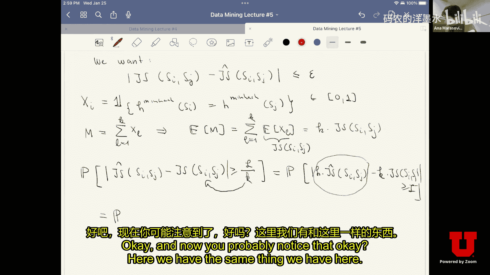

# 犹他大学-CS6140-数据挖掘-中英字幕-1080P-p04-Lecture-4---最小哈希--BV1j1mLB9EAB_p4-

系正。

在。嗯。嗯。Okay， let's get started good afternoon everyone let's start with one of our policies as always this one today is about。

But。We started can you sit down please thank you all right so the policy that we are going to go over today is course materials copyright which basically says that if you are using these materials from this course you can't use them for to get any money basically that's the gist of this policies so yeah the content is made available only for your personal non-commercial educational and scholarly use and if you want to read more about that you can go to code of student rights and responsibility and then there is a section regarding use and distribution of class content。

Yeah。All right that's all about policies I did send an announcement today about I'm looking basically for a team of two that is willing to take another person onto their project so if you are such a team please contact me or the Ts immediately after the class and we will add another student to your group we would highly appreciate that such that we don't have to have a group of one so if you' are in a position to do that please please be generous and do it。

Okay， besides that， there aren't any special announcements。

 we did release the third homework today that's due in two weeks。

 so just have that in mind that if you haven't started to work on the second one。

 which is due in one week，It's probably a good idea to start now such that you don't have too many at the same time。

嗯。Okay， so let's move on to our lecture which is basically finishing up mean Hahing。

 we didn't tell every everything thing we wanted to tell last time and then we are going to go into the details of something that's called localology sensitive hashing or LSH so going back to the previous lecture。

We kind of finished up on a note of saying that we can estimate Jaar similarity by calculating those signatures and then comparing two signatures of two different data excuse two different sets by checking how many times they mention their dimensions that's what this formalized saying and here we have one factor which is this number k here。

 that's the number of mean of the hash functions we are going to use and there was a question of how many hash functions we should use to get a good estimate A Jaar similarity。

And。That's not something we had covered last night so let's get into into that so the question is。

Sorry， my think iss phone up。How large。Should K be？

Where k is the number of hash functions we are using to construct our signature。

 k is also the of the signature because we are going to put the outcome of the hash function into the signature。

Of each one of them， all right， all right， how large should K be？And to answer this question。

 we are going to use a more general framework， not a framework that's not only applicable to this question in this specific situation。

 but a framework we are going to use to think about how to aggregate more and more data to get better estimates in general in data mining。

And this framework is called probably。Approximately。Correct or short or it is back。

Which makes for a great band name。嗯。All right， so to talk about probably about pack we need to introduce some variables first we are going to have our X head。

 which is an estimate this is a random。Variable。And if you remember from the lecture last time。

 we had defined one such variable， let me try to find it。

Here we have defined one such random variable where we had this K random variables XL。

 and then it took their sample mean， and then this is what gave us the estimate of Jaquard's similarity。

All right， we are going to introduce oh no， this is uglygline。

We are going to also introduce the expected value of this。Of this random variable， so in our example。

 that would be Jaars in la。And we are going to need two scals， one is deelta。

 which is going to be in the range from zero to one。

And that's going to be our probability of failure。So this is how much failure we accept so if we have delta equal to 0。

1 we accept 10% of failure so in 10% of situations we won't get a good estimate of let's sayure car similarity。

And then we have epsilon， which is some number greater than zero， which is our ado tolerance。

And this serves to say， well， how good an estimate is and you will realize how it is used in a second。

 so when we talk about PAC we are basically talking about bounds。That have。

This this formulation that the probability of a difference between。Random variable。X head。

 and its' expected mean is larger than epsilon。Should be smaller than deelta so being larger than epsilon is unwanted。

 we don't want it to be larger than epsilon that means that this is not a good estimate and we want that to happen less than delta times if deelta was 0。

1 less than 10% of the time。Equivalent way of writing this is to say this is a probability of the difference between the X head and its expected mean is smaller than epsilom。

 which is a desired is larger than one minus delta so our。

Randall variable will be a good estimate of let's say Jaccarts variable if their difference is smaller than some number epsiloms。

 a small number should be larger than let's say 0。9 so in 90% of situation we should have a good estimate Jakart similarity。

Okay， so now。Usually we when we talk about PAC， at least in this course。

 we will talk about something called Cha hoing inequality and how we get to that we won't derive it completely。

 but I will just mention one basic ingredient that you need and that's central limit tiring。Okay。And。

You all， I'm sure know what this is because this is the most classic theorem you have covered in any probability course you have ever taken。

Let me just go。Like this， like this。Okay。对。Wch basically says if you had let's say n random variables and they are distributed you don't even know how they are distributed you just know they have some meaning and variance if you take a lot of them if we push it to infinity then their sample mean when we take their average we will get a random variable that's normally distributed that's what central limitium is saying so when we write it in a more maty way we have you know n random variables and each one of them。

Is sample from some distribution， F F is fixed。Potentially unknown。Has but has。Has a mean of。

Mule and。Avariance。Sigma square。And then when we take the sample mean of these random variables。

Which means that we just take their average。And if we take many， many of them。

We know that then this random variable will behave。Normally distributed variable。对。

And this will go to zero because if n goes into infinity， one over n goes to zero。All right。

 so that's the classic theorem we know， and then if we would apply this combine this TorM with PAC。

We would get something called。Chaharedoff。Or if。Think inequality or bound。Right。

Just a heads up that if you look at the class calendar and click on those notes。

 this part about pack and this bound is actually in the notes for the second lecture so basically what I'm writing here you can also find there just in case you like to look at those notes。

Okay， and if we would combine CT with pack， which we will not derive here。

 you would get the following formulation that if we have our。Random variables。

Which are independently。And equally distributed。And also。

 they are such that they are bounded by this capital delta here。For every one of them。Okay。

 we don't have to write that。Then if we take a random variable。A， which is their sample mean。

We would get this bond。That the probability of a being different than its expected value is larger than some lambda。

Number that's larger than 0 is smaller or equal to two times e to the power of。R lambda square。

Over two times deelta squared。So that's the bun。And。That's not the only formulation of this bound。

Another useful formulation of it。Oh， sorry， oh， okay。不总。This。你时啊讲得。I remember like they were so well。

对。You can call it anything， basically。Yeah， the notes have used this for these letters so I to quit that。

Yeah。清。Yeah， I you what this quantities are here in the negative parentheses areL。Yeah yeah yeah。

 yeah， okay， I don't know how to make it to。Yeah。That's basically。

 if you remember the mean of normally distributed random variable。

 that's the connection basically and that's how it occurs and that's what we get from the central limit here。

Okay， I am moving on。 I that okay， yeah， go ahead。It can be different for each random variable in a specific example we'll see in a second they will all have the same bounds yeah。

Okay。All right， moving on to the different formulation。Os。So this is just another form of the。

Cage bond。Which will be useful for us in a second， so again we have our。Random variables and again。

 they are。Limited by some numbers here A and B。And we will define Delta I as the difference between B and AI。

We are going to define M as the。Sample me。Not a simple mean because we don't have one over M here so we don't have it。

 so it's a slightly different。Notation。And we have alpha equals sorryina alpha lambda greater than zero than the probability that M and its expected value。

Are larger than lambda。Is again smaller than two times e。

 but we will have slightly different version here， we'll have minus two times lambda squared。

 and then we are going to sum these R delta I。这样。Now just check that I didn't make a mistake in my notes about whether we do have denominator here or not。

Yes。Okay， yeah， this is correct， so we don't have the denominator for the random variable M like we had before。

Yeah it is so if you go at notes for the second lecture statistical principles at the end of it。

 you will have both of these bounds written there。Yeah。Okay。

 so this boundary is going to be useful for answering the question we have。

 which is how random how many hash functions how many hash functions do we need to a build estimate of Ja card similarity？

Yeah， so if you go on the previous slide， Delsta I assume constant where these survive and maximum makes life it some important to be the art eye。

No， because they can be different for every eye， we are defining we have different AI and B for every random variable X so the X。

They can come from different distribution and still have different values like counting something。

 you know， right？Okay。两。Okay， moving on to what we want。Is that Jaard similarity between two sets。

 S I SJ， and their estimated Jaard similarity is smaller than some small number epsilon。嗯。Okay。

 let's remind ourselves of how we did we define Xs in the previous lecture so we had the indicator function remember which is a function we takes one if something is satisfied otherwise zero if it's not so we get value one if the。

Mean hash values。Of S I。Art。いこ？Okay， and we know now that this is going to be bounded by zero and rhm right because this random variable detects the value of0 or1。

 we are going to define m as their sum。Okay， we have K of them。

And we know that expectation of this random variable equals to some of the expectations of these individual variables and last time we have talked about how much this is。

 basically expectation definition is the value times the probability probability equals the Jaquard similarity and we only count those where we have one zeros cancel out so we will this basically equals to Jaquarard similarity of Ssj and when me sum some K of them we will get k times the Jaquar similarity of SISJ。

Okay。All right， so now we are going to go and use some of our bounds。

We are going to measure the probability of J our estimated Jaquard similarity。嗯。

And the difference with the real jaquard similarity。

 and we are going to set this to be larger than alpha over k。

And don't think too much about why this is alpha volcano because。

The point is that we are going to use some other numbers to kind of get to what we want。

You can think about。If you are looking back at those random like bounds as they said these can be any numbers。

 so just bear bear with the derivation for a moment。

 we put this we can then this is equal to writing you know you just put K inside the absolute value so we can have K times jaquard estimated jaquar similarity。

Minus k times Jaquart similarity， so this is basic artrithmes。

And this is going to be larger than lambda。Okay， and now you probably notice that okay， here。

We have the same thing we have here。

