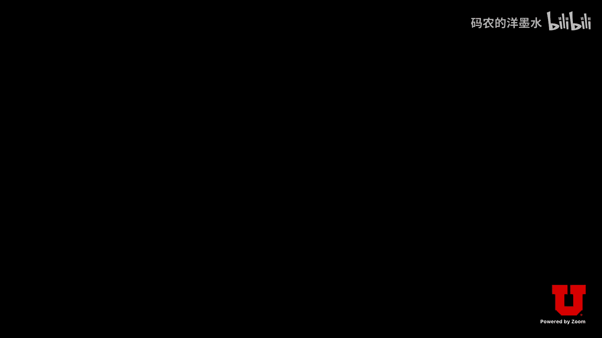
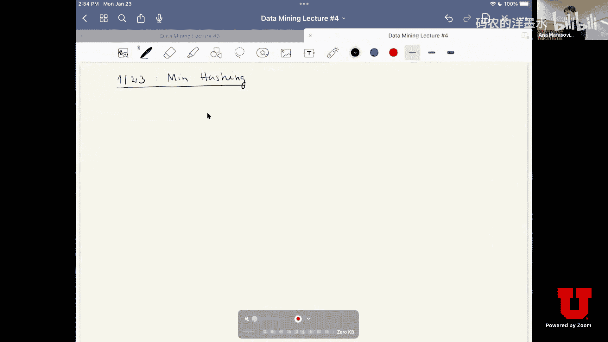
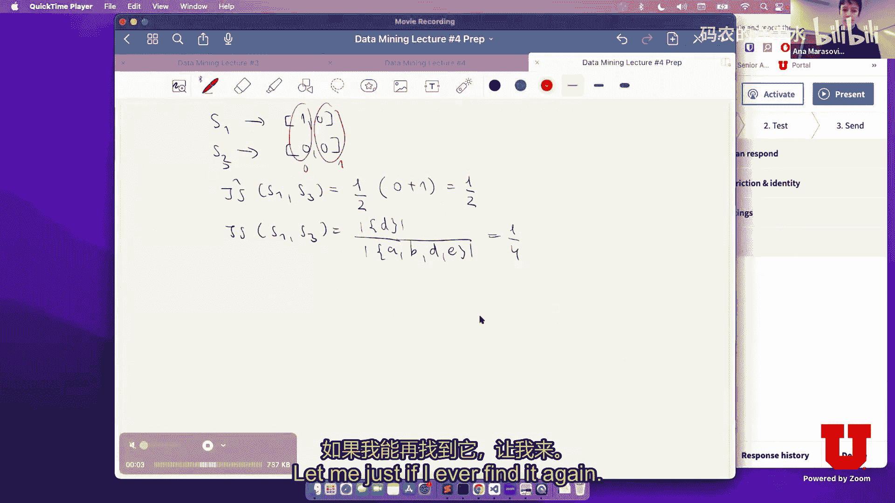

# 犹他大学-CS6140-数据挖掘-中英字幕-1080P-p05-Lecture-5---完成最小哈希--BV1j1mLB9EAB_p5-

对。

。right let's start Okay today there aren't many announcements I will just remind you that we have enabled Piazza so this is now the way we are going to communicate between each other we have therefore disabled discussions in canvasva because we don't want you to cross post between the two platforms so you need us for something this is the place to go a bit to reach us directly or to share reps。

Besides that， as every time I will read one of the policies。

 this one is about plagiarism and cheating， which we have already talked about when we went over the syllabus。

 so basically I want to read it out loud because we did talk about it but it does says kind of reminds you of the academic misconduct policy in the School of Computing and University of Utah so if you have any concerns and questions about that。

 there are more more materials you can see here， including a code of student rights and responsibilities。

Okay。Now there have been plenty of questions about project proposal。

 which is due very soon on January 25， which is two days from now， if you haven't seen this yet。

 you should really look at it today because you do need to submit information about who is in your group。

 what data you plan to use and where will you get this data。

 what structures you want to mind from the data， why this problem is interesting and what is new or what ID instructor will learn。

So this last point highlights that this is not just another homework。

 it's not like taking what we have learned in the class and just applying it to like whatever data that you have found it' will be similar in maybe spirit you will use techniques we have you know or will' cover in the class but there has to be a reasoning for why this technique is appropriate for the problem and of course there were questions from you about how could you know like what can you use if we haven't talked about these things yet。

And I understand that but again we have a lot of available materials so first you thing you can do is first you should find a problem that's interesting to you regardless of this course and find some data for it and we have linked many of those resources where you can get the inspiration for both the problem and the data you might want to work with and then what I recommend you to do is just think on your own like what kind of you know data this is is it a text is it an image is it like bunch of demographic features what kind of data are you thinking about and then you can go over the course material in the calendar and check the notes for the lectures we didn't uncover usually the first paragraph kind of describes what is the point of this sequence of lectures so for example here we have started to look into the problem of finding similar items and that kind of what motivated in one of these notes so what you can do you and your teammates。

Divide and cover some of these nodes and see okay I have a sense that this technique would be you know useful for our problem and you can also look at what kind of inputs corresponding algorithm mistaken you don't need to understand all the details you just need to have a good sense that you think that this might be applicable to the problem you are looking at and then again you know data mining is a hot topic these days so there is a lot of resources on the internet usually if you search you will find lot of ideas if you have you know you want to apply graphs to a problem and you didn't see anyone applying graphs to that exact problem that can either mean okay you find something super interesting or maybe you know maybe you are trying something that is not really a good idea so kind of two extremes and you can also ask us whether we think that's actually a good idea so。

To kind of summarize what I suggest is look through these notes divide the workload。

 don't let one person look at everything， try to get a sense of what would make sense and then when you write your proposal if it turns out that you had you know try to apply something some algorithm to the data we think is not if we think that's not a good use case for it we will tell you and you will not lose the points for it so the purpose of this proposal is also for us to give you feedback on whether your project makes sense so as long as you submit what is written here you should be fine and if we think you need to pivot your project we will let you know。

Second question that was frequently asked is about whether you can use data and tasks you are working on for your machine learning project。

And this is a little bit yeah I don't have a like super strict no or yes here basically ideally what I would like you is to work on completely other problem and on completely other data the reason being is that finding the data and thinking about this data and finding way to represent this data is the major component of any data main project so it is a one of the crucial part of the project you are going to be working on now if you already had you know prepared data from before that kind of you know that part is getting lost That said I can understand if you are very passionate about certain problem or if you're a PhD student and you want to kind of do a little you know digression from your research but still work on the same problem just you know use completely different techniques it should be fine you will still need to justify that what you you know submitting for you。

Machine learning project is notably different from what you're going to do in the data mining project and of course there is a question what is notably different So for me here notably different would be that you are using very different technique so for example if you' are using and you will use classification machine learning project then it might make sense okay to apply clustering technique in your data mining project because classification and clustering are very conceptually similar then being conceptually similar doesn't mean that clustering is a good approach for the problem and you know you need to kind of justify that this other technique you're going to use in the data mining project really makes sense for the program you are looking at and ideally that other technique would require you to represent your data differently and therefore your preprocessing of data will be different as well so if we do see。

Okay you are working on the same problem but you can justify well why are you now using this data mining approach in this project and there is sufficient differences in our opinion you should be fine。

 but I can't tell you like right now how exactly are we going to quantify it because it's such a weird thing to try to quantify so ideally you just wouldn't submit to like you wouldn't work on the same problem if you still have doubts reach out to me directly and I can let you know what I think we will check whether the projects are too similar to those submitted in machine learning that's going to be very easy for us。

So yeah， any questions about this？嗯。Yeah proposal can you change。U。

So just a clarification question is， are you talking about data that you， for example。

 wanted to scrap or the data that you are hoping to find？

Hoping to find okay yeah that's fine I think you can specify that you are looking for data of certain properties that are needed for your problem if you do not find the data then you are in a little bit of trouble because then you need to also change the underlying problem that you're working on but that's fine just try to figure it on time because。

The next project component is going to be due。On。February 15 so yeah try to try to figure it out on time whether you do have the data for the problem and if it turns out that you actually can't find it anywhere and you can't scrape it from anywhere。

 it paper didn is totally fine。Yeah， any other questions about projects？不行么。哦，嗯。诶这个个那。😊。

It should be 100 to 200 words， so this much。Yeah and less it's always better if you can be as concise as possible。

 we won appreciate it because that means less reading for us more than 200 words。

If you really can't fit it in 200 words， yes， sure， a little bit longer is fine， but not much longer。

 so try to be close to 200 words。我广州的保那什特别方简的。😊，No so basically here let's go over this stuff okay which data do you plan to use or write you say I will work I don't know this kind of problem I am looking for data for that problem right now or you already found the data set and you will just say okay I will use this data what structure are you going to mind from this data you will say okay I'm working with text I will represent this with let's say sets and then you don't need to specify anything else about the actual algorithmic approach you are going to use it here you can mention it if you want to like I'm thinking about these techniques and then you will tell us why why working on this is interesting and what might we learn from the way you go about this so you don' need to like specify a little bit because it's going to be hard to answer these two questions if you don't say anything about how you plan to。

about this， but you do not provide any details yet。

There will be other components of the project for that。

Okay I think that's all again we have office hours after the lectures。

 so if you have any other questions， if you want to run something by us come there and we'll talk about it there。

Yeah。Okay， I will turn this thing to。Oh。

Correct， let's start with the lecture then。怎么的？

So just to remind you what are we doing here， this is like a second part of our three lecture series some finding similar items so our goal is given huge collection of instances for example。

 huge collection of documents we want to find most similar instances and most similar documents and we want to do it fast we don't want to take this to take you know a week or a year。

So that's our main problem if you remember and then we said okay we are going to do this in three steps last time we have converted documents into sets of kgrams so for example。

 sequences of two words and then we have measured similarity between the two documents by computing jaar similarity between them which is the ratio between their intersection and union。

Okay， so this is what we have done last time and we said okay today we are going to focus on a problem where our sets that represent our documents become large。

 so we have too many， let's say， kgrams if we are working with characters。

Which can totally happen if our documents are long， which is a completely realistic situation to be。

So what are we going to do today， so I will just write it down for the record problem we have right now is that we have large sets of kilograms。

嗯。And what we are going to do today。Is we are going to try to convert these large sets。

Into small vectors。Which we are going to call signatures。

But we want to convert them into signatures such that。

We can estimate Jaquard similarity from these signatures of these sets。So here。

We have vector representation of power set。And when we compute the estimate of jaquars similarity between two signature。

 we get approximately。Jaquar similarity between their sets。

 so we need to have this property we can't represent。

 but or at least we are not trying to represent them with any vectors， these vectors。

 the signatures we are going to construct today will have this specific property。Okay。

 and this is all we are going to do today， then on Wednesday we are going to utilize this thing。For。

LSH， which is a solution， the final solution to our problem of finding similar documents in a large collection of documents。

Okay， so this lecture today will look like a sequence of things we need to construct to actually get to these signatures。

 so first thing we are going to construct is something's called characteristic matrix。

And what this is。Is a matrix where in columns you will have your these columns will represent your。

Seets， let's say we have none of them。And in your rows， you will have the elements。

From the universal set。From which we are constructing our。S。Okay， so elements of S1 to SN are these。

Some of the some of the items AI to A and in this matrix we will have values one and zero and one will be in particular when an element。

Is actually。In this set。Okay， so that's it so we will have some zero and one inside it and this is not how we actually。

Store the data。Because it's two sparse sparse we will have too many zeros so it's going to be more efficient for us to actually remember locations in these metrics where we have one so this is not how we are going to practice actually construct our representation of data but it's very useful way to visualize data so when you think about this problem conceptually you can map something like this in your head but you will not actually implement something like this。

Okay。I'll quickly write this down。Okay， so let's look at an example of how we could construct this method。

 so let's say we have S1 equals to AD D， S2 equals to C。And S3 equals to B D E。And S4 equals2 ACD。

All right， so we have four columns， right？And we can take our universal set to be all the elements that occur in these documents。

 so we would have AB C， let me just do something。Correcting， well have a， B， C， D E。

 but we will actually represent these elements with integers just like we did it in the first real lecture we had so we will have zero。

 one， two， three， four。ok。嗯。And then。Will'll have。Here one， because a is in S1， then we'll have0，0。

 then again1 because d is element of S1 then zero， then we'll have here0，01。

1 because C is element of S2，2， other zeros，0，1 because b is element of S3，0，1，1。And then for a four。

 we'll have 1，0，1，1，0。Okay， so this is one way to represent our data and right now I'm working with mattresses I want to represent all of these four sets together。

 but you can also kind of remember from this that now each set is represented by vector right each column is a vector representation of corresponding set okay and in the problem with documents what we have here in rows would be our kgrams so what we call here ABC D E and so on this would be those kgrams we have collected from our corpus。

And if a document had an k gra， we will put one for in the corresponding row and zero otherwise。

IT to kind of connect this with the problem we have talked about last time。All right。

 now we are going to introduce mean hash value。And again。

 this will not be a way we are going to compute。Mean hash values in practice and we will come to how we will actually implement this。

 but this is again a nice way to kind of conceptualize this we start with this ideal thing and then we will try to make it more efficient in the implementation so we need to go over this but this is not actually what we are going to implement so I will write here concept。

Not implementation。And i'm sure some of you are wondering why are we talking about this thing right now。

 again we are in the process of constructing that signature vector which will be a smaller vector representation of that large set so we are just putting things in place here and in the end they will connect to this thinging which will give us this signature so bear with me for a moment。

Okay， so the first thing we are going to do here is going to permute。The rose。

Of our characteristic metrics。Okay。And then we are going to define mean hash。Value of。好了吗。Okay。

 off this set， let's say S， it's going to be actually the mean hash value。

Of its corresponding column in the characteristic matrix。And it's going to be the number。Of the row。

Where we encounter。First one。So if you look here， for example。Oh。For S1。

 our first one was here and the corresponding row number is zero。

 so its mean hash value would be zero if we took the perittuation of the rows that are exactly in the original order。

Okay， so。Mathematically， we can write this down as。As taking argument。From not argument。

 just min min from all the roses we have， which are。From one to M。ok。😊，嗯。We'll take all the case。

 we'll take a permutation of the column where S age is and then take the K version of it。Okay。

 so this is just another way of writing what's written there in wordss。Okay。Okay。

 so what I would like us to do right now is try to practice this again using that poll。嗯。唔清。For that。

 I need to get out of here。Okay， we'll have three posts today all right so what I want you to do is do the following we'll have this four sets you will represent them first by changing the letters aBC D E to the actual integers01 to34 then you're going to pick the order of rows B E A DC for your characteristic matrix which is the first thing we need to do when we are commuting the。

The min hash value and then you're going to compute and report the mean hash value of sets all of these sets in the order that I ask so let let's make up some numbers let's say we had min hash values to be1234 or S1 S2 S3 s4 you will just report sequence of numbers one comma2 comma 3 comma4 that's what you' are going to put here。

嗯。ok。Would it be useful to open the slide as well where we defined them in hash value， okay？

So that's the question。Okay。嗯哼。😊，All right。So just a reminder of how we are calculating mean hassh value。

 we need to permute the rows in some order， usually we do this randomly， but in the question。

 I have given you a specific way to permute the rows， so do do that permutation of the rows。

And then you need to calculate for each column the number of the row where we find the first one。And。

Coun the rows from zero to 01 to not from one。Okay。

 do we think we can do this or is it too complicated？你你。That's that's a good question Okay。

 so here we have a characteristic matrix right and the order is in the original order ABC D E。

When we stay permute to the rows， this means you just take these rows and switch to their order。Yeah。

 and the specific order I'm asking is B E A DC， so all right。

 what I think it will be useful right now is to keep this specific slide open write down the permutations of the rows。

Specific ones。So this one， okay，申清。All right。So the first thing to do here is look at this matrix and change its throws in disorder。

 which is B EA， DCC。F。Okay， this， this permutation， B E A DC。

 maybe write this down so it will be easier write the permutation down。对不起。Okay。

 and now permute the rows and then when you are done let me know and I'll tell you what the next step is。

TheyProute the roast。Just do it， don't think too much about it， it's an instruction。十。啊就拜讲。

Sor of second。Oh对。What's happening？Okay，6。Christma。Okay。

Raise of handss for everyone who knows what they are doing right now。Okay。For're mututing the roads。

 okay。Okay， I sense this might be a little bit confusing。

 so let me write this down so we have permutation is B。A D C， right。

 so now we are going to have rose B， E， A， D， C，0，1，2，3，4。Okay。That one。All right， so。

Let me use some colors here maybe all right so let's find where the row b is in the original matrix this is row B so now we are going to put the values of row B。

As our first row， we changed what is the first row now B is the first one， so we have zero010。

Then we look at the second one we need to put here， it's E。

 we are going to put row E in the second order， so we have zero，0，1，0。

Then the next one we need to put is a， so that's our first row， and'm going to put1，0，0，1。

Then we have R D， which is。This one here will have one，0， one， one， and finally see0，1，0，0，1。Okay。

 so this is perutation of ropes， we just switch their order in the matrix that's all we do。

And as I said， we do meanh when we calculate actual mean hash values。

 we would find this permutation randomly， that's important， but here I had just given you one。

Okay so this is now permuted matrix that's our first step in calculating mean hash value now the second step is that for each one of these sets we find the where is the first one in the corresponding column and report the row where we found it。

Here we would have。Just a moment。Okay， so here we had for S1， let's calculate it。Okay。

 so this is going to be confusing。啊，是来呢。嗯。不。Right。All right， so here we have our first one is here。

Which is row2。Okay。And then for H mean hash。As to。We have four。And so on。Yes。0。是。Okay， so excuse me。

 I didn't see that this is overlapping。But that's it。So we had， these are the hash values。

 mean hash values that we have found for these sets。I when we can the road。

Change the letters assigned to the row， but we tend that obviously pick the matrix part。

 but we keep the indices of the rows So the zero1 you people on a left sign that stays in that order yes。

 I think so， but now。I'm alreadythinking it， and I am not 100% sure。Yeah。

 it should be the number of the first row where we find the corresponding value。嗯。不。Okay。

Let me just double check that I'm kind of afraid that I don't tell you the wrong information here。嗯。

是。Actually， that's not correct apologies I switched this up so it should be a0。B one。十嘅 o 系先。Okay。

 let me just find my cursor。K。啊对。3，4 okay， so it's not the it's not the row。

 It is the actual element in the Permud order。 Thank you like I completely switch this things up So for S1 it will be0 and then for S2。

I's going to be two for S3 is going to be1 and for S4 is going to be zero。嗯哼。😊，All right。

 so that's mean hash value。I hope it is clear how to go about finding it。

And you might wondering now what is so special about Minhash value？咁今要一一。嗯。对。Yep。

 if is saying no matter what communicate like what I don't matter what word you do with it if you' you can say members playing。

As all right。Yeah， the answer shouldn't be the same， right？

Because the D was the top road and it these3。没。Because we're reassigning we're keeping the numbers with yeah。

 yeah， yeah， basically this road that。We had presentation P， E， A， DC。

 then here we have our I mean has value for this one。H。is there one final question that it are。

These are better。What do you mean by together？We are going to put them into a vector and represent them together actually we no sorry we wanted that we will use different hash functions I mean maybe I don't know but that's not what we want to do is there a specific situation you are thinking of right now where you want to do that security。

好。3行。I don't know about security that much to make a connection there right now we are just going to make a mean hash value for every of these sets separately and then later on we are going to do something with them but for us right now combining them in some way is not important for this specific use case of earning similar items。

All right。Good。Okay， so let's go further， so what's as said。

 what's special about this mean hash value？And an interesting property that。

Man hassh value it has is that probability of。Mean hash value for S。

One being equal to mean hash of S2。Is actually Jaquar similarity between S1 s2 and remember when I said in the beginning of this lecture we want to represent these large sets with these signatures but these signatures have to have certain property related to Jaquar similarity that the estimated similarity from the signatures have to be equal to the actual Jaquard similarity of the sets and this is where kind of that property is emerging okay so to see that these probability equals to the Jaquars similarity we are going to focus on the columns that correspond to in the characteristic metrics that correspond to these two sets so see S1。

And as still。And we can divide rows R。Into three categories。We'll have type X rows。Where。

R S1 and the value in S2 for that given row R are both1。Then we have type Y。And there， CRS1。Can be。

 for example， one and the CRS2 is0 another way around CRRS1 equals to0 and CRS2。Equals to one。

And then we have type zeros。That were CRS1。Equals to CR S2， and they are both0。Okay。

 so situations where the element in that row is both in S1 and S2 situation where it is in one and it's not in the other and the third situation when it's not in either of these。

And then we can define x as count of。Type X rows。Okay。

And since those are all the elements where this element is both in S and1 and S2。

 then that's equal to the cardinality of their intersection。Then we can count I rows。Tyied by Rose。

And these are elements that are either in one or the other element。

 but excuse me either in one set but not the other。

 and those are as we know elements of symmetric difference。

 so we have as many I rows as there are elements in the symmetric difference of these two sets。Okay。

 so now we are wondering about the probability of mean hassh。S1 equals to min hassh。As too。

That's our thing here and to answer that we are going to look at the probability that first through。

We are encountering is x row， so the row where the corresponding element is in both of these sets and we are just going to use the standard probability of outcomes So there are x such rows because we defined with small x excuse me this should be large x。

Large eye。And large Z。And small x is the count of typeex rows。 So there is x such rows divided by。

All the interesting rows for this calculation， so here there are x plus I of those。

 we can ignore z rows for this calculation。They are all zeros and there are too many of them。

 so they are not important there are one over Z where z is huge is close to zero so these are not important to us okay。

And then we have。We can look also if the first throw is excuse me。

 something else I wanted to say about this is that。Actually。

 let me let me go over this what if the first row is y type of row？

What do we know about mean hassh values there？Irows are those where we have one in one column and0 in the other。

 so we know that mean hash values of these two things will be different because if we had already encountered one in a row over a certain column that's going to be mean hash value of that column but we haven't encountered one yet in the other column therefore this element will not be the mean hash value of that column therefore these two things are going to be different so just try to visualize what mean hash value is it's the first time we encountered one in our column if we had encountered one in one of the columns but not in the others that then that directly implies that their mean hash values will be different right？

I expect more nodding on this point。M。Yeah呀。Is there anything specific to clarify here？Hello。对不。

Yeah me just explain it again when we're taking each row when you're comparing it with the set that you've seen so far Yeah so C here C is denoting the corresponding column of a set so here here this thing is telling us this is the first column excuse me this is the column of the set S1 and the other one is the column of S2 now we are looking at if you look at the rows of those two columns what kind of situation we might encounter we might encounter situation where we see in the same row of those columns to one that's one situation then the second situation is that we can encounter one in one column but zero in the other and the third situation is that are two zeros here now we are kind of making our progress to showing that the probability of mean hash values of S1 and S2 being equal equals to theres aard similarity and we didn't come to that point we are kind。

Diving the things we need one thing is that we need the how many。

Type X rows we have how many I type I rows we have These are the two things we have calculated。 Okay。

 now we are moving on to certain situations which will kind of lead us to the。

The conclusion that this probability equals Jaquards similarity。

 but we are not there yet thank you you got it。Okay。

 so we have seen that if the probability of seeing in the first rows of these two columns is x real。

 so we kind of make our progress towards this column and the first thing we have encountered is two ones。

 we will can find x over x plus y such。Situations basically so that's our probability now we are looking at the probability that the first row we are we have looked at is i type of row where we see11 and10 and i'm saying here that in this situation we know that mean hash value of s1 will definitely be different from mean hash。

Of as do。It's impossible for them to be equal here yeah。Together， when we look at min hassh。

Of S1 and again here we can safely ignore zeros then these two things being together。

Is actually equals to the probability that the first row equals to x row because。

If the first row is not X row， it's a I row， we know that the mean hash will be different。

 so the only possibility of these two things being together is when we have X rows。

And we have actually calculated what that is and that it's equal to x over x plus y。

And that we have seen equals to the intersection。Over intersection cardinality of intersection plus the cardinality of symmetric union。

 so this is x， this is I。And therefore， we know。That this equals to intersection over union。

 which is exactly our card similarity。Okay， and that's it。

We have now seen that the probability of two meanhash values of two sets being equal equals to the jaquarards similarity of them and this is just the probability and I hope what you have kind of figured out in the first homework we have is that you can be very lucky or verylucky and in the first trial you can get something that's not really reflective of these probability right so we like to talk about the expectations like in the in this first homework we did so we want a better estimate of this。

And how to do a better estimate than to repeat something multiple times， which for。

This specific problem means that we are not going to use one permutation of our rows。

 we are going to use many of the permutation of the rows right so we will have multiple associated hash values。

So there are reasonable things all furniture。咪好咯。It is not reasonable if you really want to implement this right and that's what we are going to get to next that we are actually not going to use these permutations of the rows this is I don't know have you been here when I said this is a conceptual framework yeah yeah this is not the actual implementation but is' going to be important to go over this to actually understand what why are we doing the implementationation we are doing basically kind of a spoiler is we are going to use another hash function that simulates the permutation of the rows we are not actually doing it but this hash function will kind of simulate where your element would end up if you permeute it。

Yeah。All right， so better estimate， repeat as always。Here that means multiple permutations。ok。是。

So we are going to use K perutations。And。Which means that we will have a K min hassh。

Hash functions so that mean hash value I was saying that's a hash function that gives you this value right and it depends on the permutation you have done depending on different permutation you would get a different mean hash values so that's what we are doing here we are taking k different permutations of our rows and from them we are defining k different hash functions and when we talk about hash functions we had said the choice the permutation here is random but then the hash function itself is deterministic right once we fix the permutation we always get the same value for our set。

Okay， so these are key。Mean hash functions。Determined by these permutations。All right。

 and what we are going to do is what's called signature metrics where we are going to have a values of each one of these hash functions for a given set put into a column so here we will have H1 S1。

Up to HK S1。And we'll do that for every one of our sets， which we have。I believe。Excuse me。

 this is wrong。We have。And of them。And that's it okay。So this is called signature Ma。

Okay so this is an important thing for us and this is going to kind of be close to what we want here if we chose k that's kind of smaller than our number of elements m let's say two we would already get this kind of little vector representation that we wanted again this is not actually what we are going to do but it's again useful for the just to think about these things conceptually so。

You can basically think about each one of these ageIs。The vector you get it。

 each one of these rows as an dependent experiment and then when you reduce some averaging we will get something which in estimate gives us the Jaqucarts similarity and to write of this down。

We will define a variable random variable XL， which is one when the mean hash value。

I will use M for mean hash just so I have less writing here between two any kinds of sets to be one if their hash values is equal to one。

Okay。And zero otherwise。Then， we are going to define。An average of these things。Okay。

 and let's now look at what's going to happen with the expectation of the average of the variable like that。

 so we are going to just put what x hat is， which is1 over k sum L from1 to k XL。Because。

The expectation is has nice properties， we can do the following。And now we know that。

Expectation of a random variable equals to the value times the probability of that value。Okay。

 and we know that here， the only things that are going to survive are those elements where we have the same hash value。

And the probability of such。Such such。Kind of outcomes is given by Jaquar similarity because we have just calculated that so here maybe it's not clear this will be now i'm running out of space。

This thing here， when XL， when XL equals to one， then this probability is probability of HML。

Mean hash value。Elp being equal。And we know that this value。

Because we have just calculated it is equal to the Jaquarts similarity of these things。Okay。

 so when we put Jaquartes similarity here。And we when we sum the summit k times。

 we will get k times the Jaquard similarity， but we have this。Normalizer here one overcase。

 so in the end we will get just jaar similarity of S1。S2。Okay。

So this is why we introduce these k mean hash values which are all corresponding to k different permutations。

 because when we take their expectation， when we do distinct k times。

 we will get better estimate of Jaquart's similarity than if we have done this only once。

That's the point of introducing the care of them。Can you explain again I said X is what that means in words Oh okay。

 this is this is called an In indicator function， which is a way to write this。

So this is equal to one。When H MLL equals S equals to HmLsI and zero otherwise。

So when two mean hassh values of sets SiI and SI are the same we this random variable will give you one and zero otherwise that's how we can write this down it's just a math notation for the same thing and then the X。

That's the average of these random variables， so that's a new random variable that you define by taking the average of these random variables here。

So how many times within that matrix there's a one。嗯。😊，Yes， but since this is a random process。

 it's how。It's better to talk about it than， you know， like including some randomness here。Yeah。

And let's see L L is just a way to you know， go over dis sumation。So this is the same as S you know。

1 over k S1 to Sk。So we just use L to go over the summation。嗯。Yeah。对。Okay， so we have。

Finally come to something that looks like signatures， but as I keep saying。

 this is not the actual thing we are going to compute。

How we actually computed it follows so computing mean hassh signatures。In practice。Or， you know。

 it's simple life。So the problem with doing something like this constructing these metrics is that each one of these mean hassh functions we have defined required us to permute those rows and we have seen an example of very small metrics but only five rows but remember the rows correspond to elements of our universal set there will be a lot of them so when you need to permute a lot of such rows that's going to be a costly operation it's not going to be cheap to do that you will actually also need to store all of these k different mates that correspond to k different permutation of these mates。

不是。呃，反你就是特别 smart。They're going to be very sparse。我哋有啲新意提出出台去。No。

 as I said we will not as I said this is just a visualization it's not the way we started yeah so we are going to now go over the algorithm how to compute these things and we actually won't store anything so we just going to make a task over the elements of the of this such and we are going to do some basically check whether something has happened and if it has happened we are going to do something with the vector that has as many elements as we have this mean hassh。

Yeah。That's correct。All right， so the problem with what we have seen so far is。

So just to kind of the problem is making these permutations and storing large mat。

 but we do have nice properties of the things we have seen so far。

 the most important thing being that the estimated estimation of the variables we have defined will be equal to yourar similarly so that's that's a really nice thing that we have so we want to have something。

Which is more efficient， but exhibits those kinds of properties。Okay， so we are going to construct。

So just to record this problem。Large mattresses。So we have know multiple of them as many as we have permutations plus。

That is time perm。Ding de roast。And this is going to be slow， which is。

Being of our existence in this course。Okay， so what we're going to kind of do now is。

Try to simulate permutations basically so we are not going to calculate these permutations we are going to introduce hash functions。

 which will at least conceptually we want them to have a property that when we hash the row that we row value that we get the position where that element would end up if we had actually permuted it so。

There is no guarantee that's really going to happen。

 but this is kind of the motivation for this approach。对。是。Rightrrect， so here it goes。

 we will call it fast mean hassh algorithm。First thing we are going to do is we are going to choose K random hash functions。

And I know that now we have so many introduced things can get a little bit confusing。

 but when we calculated min hash value， we have a specific mean hash function for it that is determined by the perturbation excuse me permutation of the rows。

Here。These are not the hash functions we are talking about these are just any random hash function you want so we can define them by let's say H I goes from some domain let's say some representation this if you remember these are sets from。

0ro to m and let's say these0 to ms represent some elements in your universe and you will has them to again some integers up to n prime and it's not really important what n prime is except that it should be large and I will come to that point when we go over the algorithm why it should be large Okay so let's say imagine that we are dealing with。

3 gram characters here we would have as our domain so this thing would look like， for example。

 we would have sigma which represents all letters in English language ABC。

 so on and we will put it on three so that would be one domain okay。

In the the first actual lecture when we talked about hash functions we did introduce some。

 we had said there is some that are building Python there are these and that。

 so these are the hash functions one could use here okay。All right。

 so we have chosen K random hash functions then for a given set S。

We are going to calculate its mean hash value by first of all， initializing what we call signature。

Okay so excuse me what I have said here for a set as we are going to calculate mean hash value we are not calculating that we are calculating that signature。

 which is that small vector that represents the actual set and then what we are going to do is estimate yourar similarity from those little vectors and that's going to be our estimation of yourar similarity so here we are actually calculating signature and we will call it V。

And let's put S here to remind us that this is this is for the set S and this vector will have as many elements as there are hash functions so we are going to have k elements and we are going to initialize it with infinity okay。

Is this notation also clear when we have brackets and then subscript and subscript like this。

 does just mean that we are making a sequence of these many elements。没有。

Doesn't mean we can do it like this as well。And we can say there are k of these。Yeah。Okay。All right。

 so now the algorithm goes like this for every element。That's in this set。

And for every possible hash function so we have K of them。You are going to。Check is the hash。

Value of that element。Smaller than the current value of the signature at the same position。

 so if we took the first hash function， we are going to check is the first element of our signature larger than the hash value。

And if it is， we are going to then。Update。That specific value in the signature with the value of the hash function。

Okay， and finally our。Mean hash or whatever。Kind of so we are going to get this signature and this signature is。

For us kind of equivalent of the mean hash value。In the end， we are going to say that。

Minni hash value。One corresponding to one hash function J， excuse me， I。Is。

Equals to the same element in the signature。Okay， so this is a little bit I think funky to see it like this。

What will become clearer when you sip this is if you think about the values of hash functions for a given element as if that's where this element would end up if you randomly permuted the orders of your rows。

 so like if you are making analogies here the value of hash functions is the position where a certain element would end if we had actually permuted the rows。

 which we are not doing。How should we take Okay， that's an excellent question I will get to Doug。

 but it will take me like。10 minutes to go over， yeah。

But I will try to get to it if I don't get to it today， then next time。

Because I will try to make you solve one of these polls again。Okay。

 so I was saying that the value of hash functions here is kind of simulation of where row the element in the row would end up if we actually have permuted the rows and the value V is our analogy of mean hash value if we had actually permuted the rows。

Okay， but then if you go over this， you will see it kind of makes sense to do it in this way。

One important point here is that we just go over our elements of the set once。

 so we just go one by one， we don't store it， we don't construct these characteristic matrix we don't actually permute the row we just go over it on fly and calculate the signature which is great right this means that everything is very faster and I have said here that n should be large。

And the reason for this is that if so nothing prevents us that these hash functions are having collisions right so we can hash two of these elements into the same thing and when we actually permute to the rows they will never end up in the same position so that's not what we really want however if we make the and prime large then for small for small initial steps for small values of k it won't have as many collisions this is going to be a rare event because if you have huge n prime it will take a certain you know number until we get collisions so that's why we want n prime to be large。

So what is hJ of x again that you're doing like in the last one yeah so that's the value of a random function for that specific element and we didn't define them here but try to remember the first real lecture we had we have gone over a few options so here for example actually now。

Make you solve something， we can do it together for one。So。Okay， so。Let's take again S1 to be AD。

 which is the same S1 we had before。And we will turn AD into actual integers。 Remember， ABC， D。

 E is 1，0，2，3，4。All right， and let's choose now two hash functions so let's be let K be2 and let's take H1 to be。

X plus1， mod 5， modular 5， and let's take xh。Two to be 3 x plus one module of 5。ok。

Remember we said that this is not the best choice for hash functions because a lot of times there might be collisions or for some elements that will never be collisions might be prevented when we take you know a prime number here not the best choice of hash functions but just for the sake of demonstrations here are two of them then we said okay we need to initialize a vector that's our signature and there are going to be the size of this vector will be as many hash functions we have here which we have two so we have two elements in signature and we said we are going to initialize them with infinities okay now our algorithm goes set go over the elements of your set and then go over the hash functions for that element and check whether the current value of the signature is larger or not if it is larger than update the value of the signature so for first element which。

I we would take J to P1。Okay， then we'll take first hash function and the value of it for that specific element。

 which is zero， so0 plus one is one one module of five is one。Okay， is this value larger than v1。

 which is infinity， it's not great then what we are going to do is update the first value of the signature so we will have one and then infinity。

B， we are moving on to the next hash function。Which is J equals2。

And we are going to have the value of H2， so we have three times00 plus one is one。

 one module of five is one okay。Is this value smaller than V two， which is currently infinity？

It is smaller， okay， we updated so it'll have we want to be equal to。Be2 equal to one。All right。

 now we move on， we we are going to our next element， which is x equals3， we again look at J1。

J of1 for value of three is3 plus one is four4 modular of5 is four。Okay。

 is this value smaller than the current element V1？Currently in V1 is what？One， okay， it is not。

 we don't do anything。We go to J equals2。H 243 we have three times three is9 plus one is 10。

 10 module of 5 is zero。Is zero smaller than we two， which is how much？One， it is all right。

 we are going to update our signature。In second value， it will have zero， okay？

This is our signature for the set S1。And as I said。

 each one of these elements now represent what would be a mean hash value when we take a certain permutations of the rest。

What's going to be useful to go all the way to the beginning of the lecture is to compare signatures of to。

Signatures of two sets。And that's going to be estimate of our regard similarity。Okay。

 so what I wanted you to do is to calculate the signature for S3， which is BDE。All right。

Let's try to do that。嗯。嗯。Okay。So we have it here and just presented。😔，All right。So try to do this。So。

So the first thing we are going to do is initialize the。

The signature we are going to use the same two hash functions。

 so one is going to be hash function number one is going to be x plus one modular 5 and the second one was is going to be3 x plus one modulular5 two hash functions Okay k equals two we initialize the signature with bit infinity infinity and then we do the algorithm。

阿 down。What did you get。是。没觉。아。我清楚。行对原告完毕。你觉得。嗯对。Okay。不用不。Okay， since we are running out of time。

 I will stop here。I hope you are getting similar， something similar to this。Okay。

 so these are the steps。All right so basically you have three elements you will go over all three of them and you are going to check the hash function value for each one of them and in the end you would get some zero zero and one thing then that's important and didn't say is how would you estimate I will share this you'll have this so in the end how you would estimate jaar similarity is to check for how many dimensions in the signatures you get the same value so here。

Here we don't get the same value so you would count zero but here we get the same value so you would count one and you would do that if you had more dimensions in your signature we would do that so in the end you get that the jaqu estimated jaquar similarity is one over two but the actual jaquar similarity for these two sets is one over four so your estimate was not so great and this goes back to the question of what is the choice of k we would need to take for us to get a good estimate and there is actually an answer to this which I would not go into today I will go over this next time but we will use something called pack which are general bound we used to kind of answer questions and think about how to aggregate more and more data to get better estimates okay。

And that's for next time I'。You look like the last slide。这个法是。

Yeah so remember last time when you have biggrounds and then we have big。

 that's basically so whenever know no that's a good question to ask on that， but your documents。

 your birds or whatever else you're working it。So that comes to much more like a matter in those of families ways you have older the worlds of birds or all kgrounds that be something so basically when we are drawing elements to makes like a smart they' are growing elements from the universal so I think that just all the hoations right yeah。

😊，我么。Let me just turn off the zoom if I ever find it again。

家你发啊。