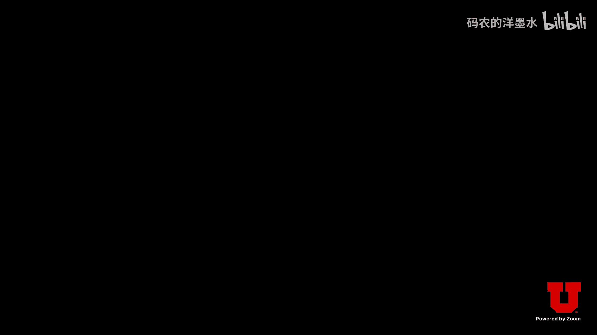
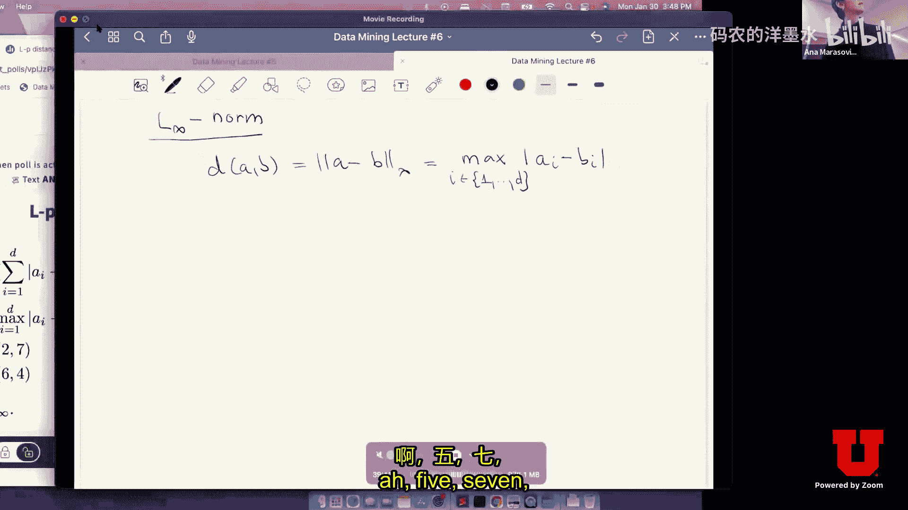
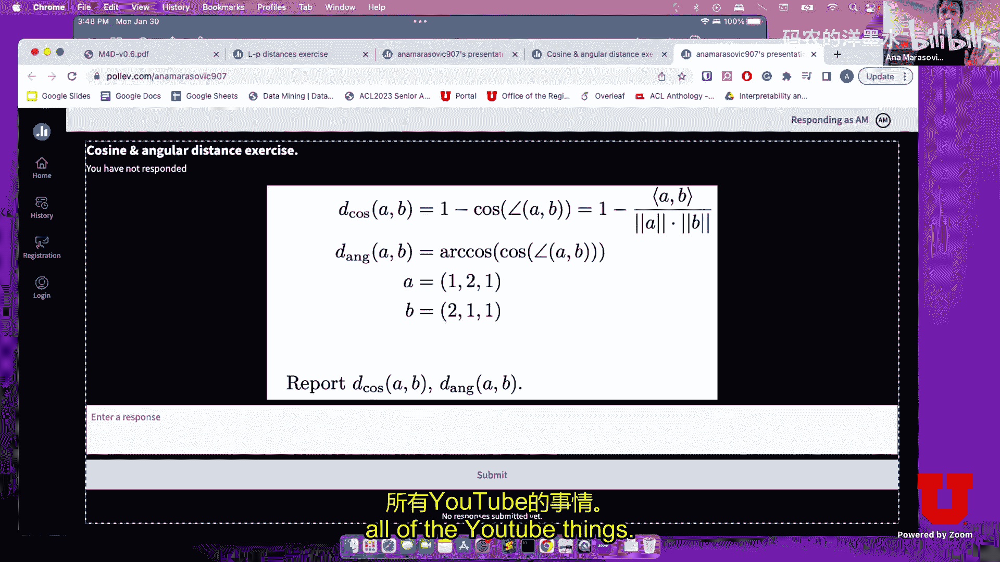

# 犹他大学-CS6140-数据挖掘-中英字幕-1080P-p06-Lecture-6---距离--BV1j1mLB9EAB_p6-

い都会睇出。Like。咁点佢真系。No。right。几月是。all right good afternoon everyone thanks for coming during such cold weather I think you all can or almost all can see your grades from the first homework now and I think you got the news that if there is any issues and you need you want have something to re you have week from the time the grades were released to do so so please make sure to do that on time if you would like us to check anything yeah the homework solutions generally look fine yeah go ahead。

The like half question of the phone is， but it seems like on canvas or on time very at scope that our phone is not 100 do instead of 100。

I'm not sure we can look into it that it's you know considered as a bonus it's definitely a bonus。

Yeah， so it was definitely a bonus point。嗯。All right， and this one's the second homework is due。

 so you know， don't forget about that。Last time the recording didn't work out。

 only the first 20 minutes of the lecture were actually recorded。

 so Piazi posted the materials that are closest to what I was presenting last time in case you want to kind of in case you are watching recording basically after the lecture。

嗯。Alrighty and for today's policy we are going to go over safety at the U and it's very short basically you have ton of helpful videos。

 your resources on Sa。utu and in any case if you see anything that seems suspicious to you you can call campus police and you have their address and other information available here。

Allrighty。Yeah I wanted to mention this paper that came in my archiveHve feed or my reading list randomly。

 but then it turns out that they used mean hashing with the Jaar similarity and I thought I could share it with you so basically they use that the technique we have gone through to find instances in the pretraining corpus that are basically duplicates they removed it and then trained the language model over it and got the better language model so it's kind of nice to see you know something you have just learned to be published in 2022 so very very cutting edge。

All right， we I'm going to close that。And can go over here。Okay。

 so I want to go over some of the things we had talked about last time。

 but I either rush through them or I didn't I don't think I maybe explain them sufficiently well one of them is that S curve that we have seen so we had。

Cve or the probability of being a candidate。And we have here Jacquarard's similarity。All right and。

A pair was a candidate if we had hash them their little subsignature into the same bucket。

 that's what a candidate being a candidate meant so it was dependent of the choice of the min hash of the function we have chosen and that function that gave us values in signature was min hassh function so that's important。

Okay， so ask her this this。So we said that this Jaquard similarity versus probability of candidate will have this kind of S curve。

 no matter what the parameters be or R we choose， it's always going to have S shape。Okay。

 and I have said that where this curve increases rapidly， that that point is important。

 basically that point here， this similarity here is similarity after which pairs that have true jaquart similarity above that threshold will have very high probability of being a candidate pair under the min hashing family of functions。

Of hash functions and this is， you know kind of like a soundness check， this is what we want。

We want our hash function to give us this kind of property that if the truly highly similar pair that they have a high probabilitybability of becoming offending up in the same bucket under that hash function so first of all this is kind of like we see it and we think okay this makes sense。

But another thing I don't think I have made super clear， so I said， okay。

 this inflection point will be approximately at1 over B1 over R and we can basically change B and R such that we shift this threshold to the left curve to the right。

And what I mean by that is， for example， let's say you want to have you want to avoid let's say false negatives。

 so you want you don't want to end up with a situation where you discarded some very similar pairs because you have used two you know two aggressive parameters B and R。

 so let's think about situation where we have avoid false。Neegatives？Basically。

 what we can do is we can pick。B and R such that our threshold D is lower。

 so basically this inflection point here will be a little bit to the left it will be smaller。

And also， we can have another situation where we are really， really concerned about about speed。

 so we want to have less candidatedid pairs in general。嗯。

And we don't want those false positives to end up in our set of candidate fairs。

 so we are wanting to avoid false positives because speed is important to us。So， we would pick。

B and R such that threshold D is higher。Okay， and I will show you just a few plot from the M4D book which kind of demonstrates this situation。

 I'll just wait a second that you all write this down if you're writing down。Okay。

So here we have basically these S shape curves for different values of B and R。

 so for example if he had two bends， but we increase the number of rows that each bend will have。

 then the threshold for S will become smaller and smaller。

 which means that for very small value of similarity s， your pairs will become candidate pairs。

And if you really want to avoid false negatives this is maybe a situation you want so now here one thing might be like immediately confusing for you and that's that B times r for different values of r and the fixed B doesn't give you the same number which is the number of rows in your signatures the dimension of the signature vector or the number of mean hash functions you are using so basically that means that okay if you really want to change where this threshold is you can also think about including more or less hash functions so for example if you want to have you really really want to avoid all false negatives you want that threshold to be really low you figure okay I would need B and R to be something like this and for that I would need two times 32 which is 64 hash functions so the point here is that depending on your problem。

You might want to avoid certain situations such as avoiding false positives or false negatives and these values of B and R and the number of hash functions that is the dimension of your signature vector player a role in that and this is something you need to decide as your modeling decision。

Okay， so that's what I wanted to say about that let me try to。Open mind。O。So yeah。

 that's all I wanted to say about this thresholding thing that wasn't clear last time。

And then if you remember when we have。Finished our lecture， we have made a definition。

Of being D132 p1p2 sensitive right and the reason why we brought this definition last time is to kind of say that this theory of LSA is not specific to the mean hash family of functions and Jaquarard similarity。

 we said we can use different families of hash functions with different similarity or distance measures。

Okay， so。I want to comment on that a little bit more， so basically let's return to that definition。

 so we had D1， D2 P1， P2 sensitive。And。Let's again visualize something， so here we will have。

Distance which is slightly different from similarity and that's actually what we are going to talk in the rest of the lecture。

 but distance unlike similarity， when it's small that means that X and I are similar。

 unlike similarity where you know if X and I have small similarity measure then they are not similar。

Okay， and let's say we have D1， we have D2， and we have values P2 and P1。

And here we have the probability that our hash function will put two points x and I to the same bucket and now we are talking about hash functions that are alike mean hashing in a sense that they will be useful for LSH technique。

 which means that Hx equals to H for us kind of means yes， make them a candidate pair， right？

And what the D1 D2 p1 P2 sensitivity tells us is just that okay， when we have。

That if two points are at most d1 apart， so the distance between them is small。

 which means that they are similar， then this probability should be high。

 it is at least P1 is the probability that they will hash into the same bucket and on the other hand。

 if they are kind of dissimilar， if the distance is larger than two。

 then the probability that they are going to hash into the same bucket is at most P2。

And this is nice right we want this property so I mean Hahing has that kind of property with Jaquart similarity and that's good because our end goal is that how these hashing functions put our similar examples into the same bucket and this similar example not in the same bucket。

 so this kind of definition of D1 d2 P1p2 sensitivity is kind of like a more formal way of saying all of that。

So just going back to this point that we want to find more distances with another families of hash functions。

 well they have to have this property because that's our goal basically。不。All right so yeah。

 please explain you read that。Grass again， they I confused about how it's only two quadrants or two。

而且。Which parts does it mean， like can you just explain how you do that？Yeah。

 so you have D1 right and if x and I which are some points or two documents let's say that you are comparing if are at most if there are distances at most D1。

 then the probability of two of them being hashed to the same bucket will be at least P1。

On the other hand， if their distance is D2 or higher， which means that they are dissimilar。

 then the probability they are going to hash into the same bucket is that most P2。

 which is some small value。啊，两进应该就改。Okay， so basically Jacquarard distance， which is。

One minus Jaquars inity and Min Hashing family。Have this property。And specifically， they are d1， d2。

1 minus d1，1 minus d2 sensitive。对。Family where we have that the1 is smaller than the two which is both of them are bounded by0 and1 I won't go into details why this holds it's very simple to derive it if you are interested in you can go to mining Ma datasets book at section362 on page14。

The derogvation is very simple， I just want to use time for other things。嗯。

Okay so as I has said probably two times at least today。

 the goal is that we are finding more of these families and more of these distances which you can combine to get the LSH technique and for that we need to learn more about distances right so today we are going to just go over a bunch of bunch of distance functions and they will be important not only to kind of understand what other at least one other you know distance plus hashing function family that we can use for LSH technique they will also be incredibly important for the rest of this course especially when we start going into clustering which is our next big topic so today we won't go over almost any algorithms this will just be here are a bunch of distance functions you will use in the future。

So in a way， it's kind of like a little detour， but it's important one。So title is distances。

Wch don dis。Oh， it's already end of January。S。All right。

We we have talked about one similarity measure that's Jaquard similarity and you know similarity measures and distance measures are relayed so with similarity we had that if two points X and I are similar。

Then the similarity value between two of them will be a large， right？

With very large depends on what is your similarity measure bounded with if it's bounded with。

 let's say one， then being close to one means that these two things are similar。At the other hand。

 distances。When two things are similar， then their distance between them will be small。

So I want to raise this just because it's going to be a little bit opposite of， you know。

 what we have talked about when we talked about similarities。And unlike similarity measures。

 which we didn't define you know， formally in a mathematical way。

 distance measure distance function have very specific。Mathematical definitions。

 which we will write down。So here we have， oops， I'm so sorry。All right。

 so definition goes a distance。D from some set of points x。Times steps so。

You take two points and each point is in a set of x。That maps to zero to infinite。

 so to all positive real numbers， including zero。Is a map。Which maps？Pears of points。From X。

Two non a negative。Ren。And we'll say that distance is a metric。If it satisfies certain properties。

First property is that it's。No negative。Please。So when you talk about， you know。

 how far is something from something else you give you know， zero or a higher number。

 you don't say something is minus something apart。Then I will'll say that。The distance is zero。

 if and only if A equals B。So。You know， if we talk about distance of walking to from A to B。

 it'll be zero only if you are at the same location。

Then we have symmetry that the distance from a to B goes from distance from B to A。

 so if we take the same path from location， I don't know from this room back to Merriill engineering。

 then if someone else goes with the same path back to us， we are going to walk the same distance。

That's called symmetry。All right and the final one。

 which is called triangle inequality just says okay， if we are going from location A to B。

 we take the shortest part from a to B， this is definitely going to be shorter than if we decide to let's say decide we decide to go grab a coffee and we introduce third location and we go to this location and then to B so the distance A to B is always going to be smaller than a distance from a to C plus the distance to C to B。

And you will see today in the lecture that we call something distances but that they don't fulfill all of these properties。

 that's why we kind of disangle them between distance symmetricsymmetric in mathematics very often these thingss will be just assumed to be the same so just be aware of that that sometimes you will read that something is is a distance is called distance and it will not fulfill all of these this property but sometimes people when they talk to each other they will assume that a distance is a metric and that's just not correct but have that in mind。

O。All right， so if property number two is not satisfied， then we'll call such a distance semetric。

And if property number three is not satisfied， you will see them under the term quasi matrix。Yeah。

 which yeah， it's not super important how we call these things， but you know。

 if you do encounter pseudo or quasi， try to remember that one of the properties is not satisfied。

Okay。Okay， and that's the definition of distance and metric。

Okay yeah go ahead quasiimetric one where we don't have a symmetry。

 so we'll talk about cosine distance and then you can have let's say you know you can make a full circle and these two points will kind of behave similarly but you know they will have same cosine or as well if they we increase their magnitude it won't be important because we are just looking at the angle between two of them。

Yeahep， this is only exist。But like feel for I mean， I just thought everyone。

Yeah yeah you are completely right I was saying you're shortest back to give an analogy of it something but not necessarily all distances are in Euclidean spaces yeah so that's why we said like a set of point X yeah that's correct。

Okay lets let's move on， so we talked about Jakquar similarity， there is。

 of course Jaquarard distance then。And it is defined as。You know， just one minus jaquar similarity。

So we'll have one minus jaquard similarity A and B。

 and yeah let's just quickly go over why this is a metric。So first one we'll have。

 it needs to we need to show that。It is larger or equal than zero and this will be the case because the cardinality of intersection will be smaller than the cardinity of union and。

Just a reminder that。诶。Similarity was。Jaquardt's similarity was defined as the intersection over union。

 right？So that will hold then we'll have the second property is that Jaar civility is。嗯。Sorry。Okay。

 that is zero only if if。So the second property says that the Jakquard distance is zero only if the two things are exactly the same and we know that okay。

 Jaquard similarity Jaquarard distance of the same point。

 like even the same point is equals one minus Jaquard similarity of。A with a。

 and then this thing will be one because the intersection of the set with itself will be exactly the same as union of the set with itself。

And then this is equal to zero okay that's good， but then what if we have two points that are dissimilar well then their intersection will be strictly small the cardinality of their intersection will be strictly smaller than the cardinality of their union so the jacquard。

Distance will strictly be positive， so we know that Jakquar distance can be zero only if we are talking about the distance of an element with itself。

Okay， the third one is that these symmetric， so the Jaar distance of AB equals to Jakar distance of B and this will be true because intersection and union operations our symmetric as well so if we take a intersection B。

 that's same as B intersection A， a union B is same as B union A。Yes。Okay。

Can I move to the next thing， I need to prove the triangle inequality。

 but I'll link a little bit more space。Okay。All right， so the fourth one。

 which is our triangle inequ qualityte says that the Jaar distance of A and B has to be smaller than Jaquar distance of A and C plus Jaquar distance of C plus B。

All right。So the first thing that's important to recognize is that the this。

Might not hold only for cases where we have C being a subset of both A and B otherwise if this is not the case。

 then this part here will always be larger than the part on the left because we are including something in the part or to the right and not including something to the part on the left so this case is the only one that's interesting to look at。

It is also good to mention here that if we reverite our Jakquarard distance。

 which is one minus Jaquard similarity， then we can get the following。

Expression that that's equal to the symmetric difference between AB over their union。

And reminder that if we have A and B， this is there。Symsymmetric difference。All right。

 so let's show that the triangle inequality holds even for this case where our set C is the subset of both A and B。

 only case where the triangle inequality has any chance of falling apart and we will actually start with the with the term on the right of the inequality and show that even for this case it's larger than the term on the left。

 which is jaard similarity between A and B。All right。

 so we are going to use this formula here and we are going to just rewrite it a little bit。

 so a union B is the same as cardinality of a plus whatever is in C without a。So to visualize that。

 imagine these are all set a and C， this is the everything that's in a and then everything that's in C is not in a is here and then。

When we assign these two things we get the same cardinity as the cardinality of the Union then similarly we will rewrite the symmetric difference as a everything that's in a and not in C plus everything that's in C and not in a。

And one thing you can notice here is that， okay， because the our set C is actually subset of a。

 this is C， this is a， then everything that's C and not in a equals to zero。

So this is zero and this is zero。Okay。And with the same reasoning。

 we get that here we have everything that's in C and not in B。And over the cardinality of three。O。

So another thing you can notice here is that whatever is the cardinality of a。

 that's going to be smaller than cardinality of a union B， right？

That just makes sense union will always have at least the same amount or more of the elements。

 so okay， if a cardinality of a is smaller than cardinality of a union B。

 then if we take the inverse inverse one over a will be larger than one over cardinality of the union。

Okay， so we know that this is larger than a without C。

 so whatever was we written before over a union。Same here。Okay。

 and this is then when we put it in the same fraction above the fraction line。

 we have everything that's not in a， but it is everything that's in a in not in C and everything that has seen C and it not in。

Okay， sorry this is a mistake here。嗯。This is not symmetric。Okay。So here we'll have。诶 union边。嗯。

And let me just think about second before I said something incorrect。对。Okay。

 so and this should be equal to the symmetric difference of A and B。

 where we'll probably use the fact that DCc is the subset of both A and B。

 which is exactly the Jaquar distance between a and B。So we then see we started with here。

And we have shown that this is larger than this value here。

 that is our triangle inequality holds even for this case where we had the only chance of its not holding so it holds for all the cases and therefore Jakquar distance is the metric。

咁。Did we write this down， all right？So now we are just doing our。

Super fun marathon of going over a bunch of distances。

 we are going to start with the one that you all know， which is the Euclidean distance。

And i'm not going to prove whenever distance now is a metric I will not you know show again that it's metric I hope this exercise with jakar distance was enough to see how you would go about that so the Euclidean distance between a and B will be equal to the square root of the sum。

Of all the dimensions。Of the squares of the difference of their dimensions。

And that's equal to the norm to norm of a minus b。Remember in the spaces where we have scalar product defined and the norm of a vector is equal。

Okay， I will use X here。So if we have x， it's too norm will be its scalar product with itself。

The square root of the scalar product that itself。So that's why this is。啊， to哪。Actually。Yeah。

 that's fine。对。Okay， and you know， I think we have all seen this gazillion times if you have two points。

 a1， a two， B1。め中。Then this is what they're。Euclidean distances。Right。是。嗯。

But this fact that this is the two norm of the difference between A and B it's kind of related to some other metrics。

 so let's look into a few of them as well。One of them will be Manhattan。Distance。Which is defined。

As one norm between。Of the difference between A and B， which is the sum。

Of the absolute values of their。Of the difference between each one of their corresponding dimensions。

And here now， if you have。诶湾。And2， be one。B2 so here we have point1 here we have point2 well we are not going to take this short test path from one to another。

 like we did with Euclidean this， we are going to go from。

A1 to B1 and then from a2 to B2 and that's why it's called Manhattan distance if it's the path you would take if you are working on a grid in a town like Manhattan or for that matter so exceeding and of course when I say that maybe immediately think okay this could be useful for some kind of traffic applications where we are actually moving on a grid instead of you know having the ability to just find the shortest path of the things。

And as I kind of hinted on， with the Euclidean distance。You know again。

 we had one norm of the vector difference between this two。

 we can generalize this and this generalization will be called LP distances。Where P goes from one to。

Infinity。And。It is equal to the P norm。Oh， excuse me。And the side between A and B。

Distance between A and B equals to the p norm between the difference vector of A and B。

 which will be equal to。For some of。AI minus B to the power of B。

 and then this whole sum will be put to the power of1 over B。

So if you put values p equals one and two， you would get Manhattan and the Euclidean distance。

All right and。There is one more L distance called next norm or L， we write it L infinity。

Norm where we would have distance between x and I would be equal to max norm。Excuse me。

 I can't decide being A and B。Okay， distance between A and B equals to a minus B in their max norm。

 which is basically you take when we calculate the difference between their dimensions， AI minus B1。

 we would take the one which is the largest。The idea being if you are you know putting fee in the previous formula to a very huge value。

 then the that you know the largest will kind of dominate everything else and therefore it's sufficient to look only at one of them。

All right， so I remember that writing a bunch of things is not super fun。

 so let's try to do a little exercise and calculate some of these norms just to be sure we get get them。

All right，y。Yeah。So。Because it's very hard to。😔，For you like to put the text of what I wanted you to do in one screen and then share the another。

 I uploaded this figure which tells you what to do， but you will need to open this poll here。

So basically here。😔，Okay， I can show this， yeah。Okay。

And then just kind of give me signals when you are ready to submit and I will bring back the other window where it's written where you should submit it。

Okay， maybe I should go there for a second just so you can see it。It's over here， do you see this？

Here。Once again， itll be great to have a shorter last name I could have been thinking about this when I was registering。

But I always forget。Okay， so that's the link and then I'll keep this one open。

 but let me know if you need to go back to the link。You人嗯。Okay。

 this is the link that will give you this and then you submit your solution and just try to report them like this the maximum in that order。

W。对。开开过啊。Sorry second it's not on。We'll figure that out。All right。So， it's active。对。嗯。

Then youll maybe refresh。Because it says it's active， so it should be。いすね。嗯哼。嗯嗯。Okay。Okay， activate。

About now。No。Those where我 all。嗯。Allright。对。嗯。I't believe I didn't manage to make it work a single time。

Okay。people respond where we can figure how people can respond。

IHow people can everyone no restrictions。Okay， there the。Okay。Yeah。

 we it seems like I clicked only via messaging instead of both website I messaging。嗯。Oh yeah。

 of course。Yeah。没有。Yeah。嗯。Yeah。对不对。Yes。Okay， are we done。So。Where are we second。嗯。对。嗯。咁。得。no系通个俾嘅电话啊。

The next， yeah， not artifact of those not。 We just talk， you know， the。

then just pick the one which is larger。嗯。So。It's just because it's called with such a fancy name that it confusing me I'm sure I was thinking it like。

I thats exponential because that's there's no one plus more than one plus。Okay。Okay。

 I think this is an enough time for this。Let now see。O。Just one。Okay。I think we can see the cloud。

What there is a smiley face。得见。行。Oh no， that looks terrible， but the smiling face does make me。😊。

Okay， all right。Five74 is colorect。L1 is 7，57，4。Okay， this is so slow， 25 oh。😊。

Who is changing the number L2 is actually five？😊，574 Okay。

 seems like there are mostly correct answers here。Okay， so。

Seems like we are forgetting to take it the square root of for the al two distance。

 so just don't forget to do that。 Al right， so I don't see any terribly。

Terribly incorrect answer is the English Thank you。Okay， great。

 so seems like you guys got a hold of it because574 is what you needed to get for。

This numbers。So yeah， then let's move forward， I want to you know。

 waste time on deriving it since you've got it correctly。

 just don't forget to take the square root when you are calculating Euclidean distance。

One thing that's worthwhile to mention with LP distances is Unial， which is。

The vectors that have norm one in this space， so let's say we have vector which is zero vector and let's look at all a element this space such that their difference their LP。

Distance equals to one。And something you will see a lot in the literature are the plots like this。

 and that's kind of why we are also mentioning it。 So this is your beads the initial point。

 so all the。Oh my god， this is terrible。There， okay。感 do them。Okay， so all a。

 when we are replaced in R2， such that the difference between a and you know zero vector is one in LP distance will make this circle。

However， if we are talking about Manhattan distance L1， then all such As will be here。On this。Square。

This should be or。Same， same distances， but I can draw well。And then if we had the max norm。

Where P equals the infinity， we will get a square like this。Okay so。Yeah。

 well I don't know if you or but it's only for like real value doesnt for the imaginary as well I mean。

 that's like yeah。Yeah， I mean for sure it exists even if you are you know talking about complex numbers we won't you know talk about these things it is it is like at least when we work with NLP has been shown if we work with complex numbers instead of real numbers it can be useful because of symmetry that complex numbers shows and the real numbers don't show so if you're working with say you want to predict some relation between two things working with this is called knowledgebased completion you're trying to find or link prediction trying to find a link between two things working in complex spaces can be useful if you reach out to me later I can point you to these works so yeah but we will not talk about it here at least today。

But another thing related to this， you know， are we working now with just field numbers is the fact that you know sometimes you won't have。

feeatures that are all corresponding to the same units so for example。

 the most I think normal thing you could see something like age and height and whatever weight to represent I don't know maybe a patient all of these things are have different you know scale when we talk about them so for age you know we'll probably talk about zero to maybe 120 and for height and weight we will use different units。

So you can't just make this feature vector put these numbers and then use LP distances because these things are representing completely different things if you had something like temperature in Celsius in January then you know in February and so on。

 yes， then you can use the LP distances because these things are represented with the same units。

However， in real data mining problems， very often you willt have exactly the first situation where you don't have these units and then you need to scale things to be kind of normalized to the same bounds。

 or you kind of maybe separate parts of your features that are represented with the same unit。

 calculate similarity for those parts and then combine them。

 just take a weighted combination of these smaller similarities together。And for all of that。

 there is one useful distance called Mahala Nobis distance。

Where you will actually introduce this scaling of different dimensions through a matrix called M。So。

The distance will have the following form， you will have a minus b transpose times matrix m B excuse me。

A minus。啊B。And this matrix will be element just the d times d dimensional matrix， your A andBR in RD。

But the metric sample will also be positive definite and。You all have taken a linear algebra course。

 I'm sure you have heard about this。Before we will not go into what this is right now if you have forgotten because it's not crucial for understanding what all of this is。

 but when M is positivelydeinite to them the DM， this distance is a metric。Okay。

 so basically M what it represents is how to scale coordinates。

 how to shrink some and how to expand the others to let's say get to the same bounds for each one of these dimensions such that you can then have a more meaningful representation and work in these spaces if we have identity metrics here then this Mahallanobi distance will be the same as your Euclidean distance。

So not super useful because you already have linear distance but。

You might introduce something like this， you might put。Use a diagonal matrix with values M1 m。

 so that means we the diagonal we have values M1 to M and zeros otherwise。

 and this values M1 M tell you how to scale each one of these dimensions according to whatever you think。

 you know， like let's say have maybe temperatures in Celsius and Fahrenheits。

 you know exactly the scaling factor that turn all of them into let's say temperatures in Celsius。

Yeah， I want to move on to another distance， so let me know when you write this out。Yeah。Yeah。嗯。Okay。

The next one will be cosine distance， which is very frequently used in NLP。When you deal with text。

All right， so we'll have this distance being defined。

As one minus cosine between the angle between A and B。And then cosine， if you remember from。

Whatever high school math is given by the stellar product between A and B or the norm of a times B。

Okay， or maybe you have seen this form that the scalar product keep us to。

A times the norm of A and B。Times the cosine of the Teta， which is the。

Anle between them so maybe that's more the formula you have seen more often。O。😊，And then。

If you forgot as well， the scalealar pro between。Two vectors is just the element why we do the sum of the product of their corresponding dimensions。

And the norm equals to the sum of square of the squares of the dimensions。Okay。Okay， so。

What do you think is this symmetric？It this summer。s similar but not exactly the same。

 so here we are taking the cosine of the angle and then angular distance。

 which we'll talk about next is the one where you just take the angle。

But hearing the concept angle then just few things can be the same。

So second but we come back to I'm going take this。Sysymmetric， yes。一个系。Oh， it's just。

This one is like an angle between A and B。Yes。Or， you know。Is our。A and B， then this is， you know。

 it's the same thing。Okay， so one thing that one hold is that the cosine distance between A and B will。

just a moment。Will not be zero if and only a equals to B for example。

 you can take the cosine between a and2 a and this will be zero because the angle between a and you know just a higher magnitude of a will be you know there will be on the same line and therefore the angle will be zero the cosine will be one so this is kind of like a contra example。

So we don't have this property to hold and we also the triangle inequality is not holding。So。

This is not necessarily smaller than this。And again， you can construct an example to show this。

 the one I managed to just construct is one0 b equals0 to1 and see equals to one over square of two。

If you plug these numbers into the inequality， which doesn't hold。

 you will see that the left side is larger than the right side。O。

So we don't have these two property to hold， let me see which numbers I used for them。I just want to。

This was the second property and this was the fourth property so these two things didn't hold。Yes。

But still， it is very widely used。And the reason why it is very popular is the fact that magnitude of the vector doesn't really matter here。

 or you are looking at is this angle。So for example with text you can have just a longer text and the fact that it's longer if we represent it with the vector that has counts of each words in its you know dimensions this kind of representation will immediately give to this longer longer document a vector with a higher magnitude but it's not really important if we are measuring the similarity of two documents the length of the one should just be irrelevant for this。

 so this is why it's very common when we deal with text。

 however as it was hinted on there is one distance which is similar。And。

And it's going to be actually super useful for us because we can build an LsA technique over it so the angleular distance。

Between A and B will just be the angle between A and B。So if we have， let's say B， please have a。

This will be angle between them。And let's call it Tita just to make our life easier。

And this one will be metrics。O。For some reason in the mining Maive datasets book。

 they call this one the cosine distance and that can be very confusing when you read that chapter。

 so I don't unfortunately have the number of the chapter here but the chapter name is cosine distance what they are talking about is angleular distance and then they say cosine distance is a metric which is not correct so just watch out if you are reading that chapter in the book that there is a little bit of yeah misrepresentation over there。

Okay， another way to write the angular distance。Is to use arc cosine。

 so arc cosine of the cosine between A and B， which is theta。

 and we have just reminded ourselves that the cosine A and B equals to the scalar product over the norm of these things。

嗯。If if these two vectors A and B are unit vectors。

 then you will have this formulation of angular distance， which we will also see in the literature。

 but this formulation called。Is true only if these two things are unit vectors。

So you might see these different variations。And now again。

 going back to high school or at least my high school。There is this property if you have A and B。

And the angle between them。The value of the angle in the raddiance is equal to the arc length between a and B。

So what you will see when people talk about angle or distance， they will also say， oh。

 this is just the arcland between AMB， which is true if we talk about the angle in radiance。

 not in degrees。So there is also that。Okay。Okay， what time is it？

Let me go over why angular distance can be used in LS stage and then if we have time we'll do another poll where we'll practice cosine。

And the。Anngular distance on an example。Okay， so if you remember ages ago when I said。

Jaar similarity and mean hasing family of hash functions is not the only thing which you can combine to get an LSH technique and now we are going over these distances to find another one and another family of hash functions so that's what we are going to do right now for one example then again Jakard then Angular with min hashing and hash functions we are going to see right now are not the only ones so for many of these distances you can find a way to use them in an LSH。

Okay， so。Let me see how Ill do this so for。Defining a family of hash functions with angular distance that will have all the nice properties that mean hashing family of hash functions head。

 we are going to need to define the set of all unit vectorctors。

In RD and usually we use the symbol like this。Okay， and for the sake of this illustration。

 let's pretend A and B are also。In the unit vectors。

You can compute angular distance with vectors which are not unique vector， but for now let's just。

Focus on the ones that are so now a family of hash functions that is basically the equivalent of our not an equivalent has the all the nice pro that the mean hashing family of hash functions had for Jakar similarity will be family where we are going to pick some。

Unit vector at random， so we are just picking a unit vector。Parenum。

And then our hash function will be equal to a sign。That we get when we。

Have a scalar product of that vector we have just picked with whatever other vector okay so。

To make me write it down a little bit with less compact。Or we pick you。Which is a unit vector。

And then， a hash function。Or some vector a will be plus one。If。

Scaar product between and U is larger than zero。And minus1 otherwise。O。😊，Okay。

 and now important thing for us will be that the probability of such hash functions are very choice of。

Unifactor。That the two vectors and B will end up in the same bucket。Will be equal to。One minus。

Anular distance between A and B over pi。So remember when we had talked about Jaquart similarity we had similar kind of formulation。

 we had that the probability of two things ending up in the same bucket。

 if we use min hashing as the hash function will be equal to Jaquart similarity here we are using this newly defined hash function and under that hash function we will have a probability of two things colliding equal to something that includes the angular distance。

Okay。All right， so let's let's try to。They arrived that。Okay。So let me write this down。嗯。Yes， okay。

那解释。I ask but I just hear what I want to hear Okay。

 so while we are on this slide I deleted that the A and B are factors here with this definition they don't have to unit factors but for the sake of illustration so if you had written there there are factors on this slide just delete yeah go ahead。

不这呢没人啊。系系。Yeah， this one is right。Yeah， can you go over the set of all half function definition again yeah。

 youll first pick uniform director uniform random this means you're just using a uniform distribution within over all the uniform characters so you are just picking one random mainly uniform distribution。

Yeah， this is just a mathematical way of saying pick a random regulatory factor。From my experience。

You do that and then your has function is defined by that unique vector remember when we had with mis hash functions then they were defined by the fermutation。

 this is similar so what was kind of like perutation what was defined the hash function unit vector is defined our hash function now so once we had created we managed to define hash function age view and just giving us the time of a sc product of that unit vector with any other vector we want and that's going to be has function of that vector。

嗯。Something that is incorrect here or not precise enough is this。

 so we are calculating the hash value of the vector a。

So we don't even it's a function of one variable。All right。I am moving on。

 so now for the to show why this probability holds。

We are going to use A and B whichchar on a unit circle， okay？

And I want to remind you that the angular distance between A and B， one interpretationdation of them。

Of the anglengular distance is that this is。minimal。A clients。

Between A and B and this is going to be an important interpretation of what aular distance is。

Or going over why this probability holds。Okay， so now let's look at all the。Vectctorors U。

 where their sc products with some vector A can be larger， will be no negative。So。

Let's say we pick this。This vector A。Then all vectors U that have a core positive cross product with vector A will be in this region here。

Okay。嗯。Otherwise， if all these vectors here from this region will have the angle that is not between minus 19 to 190 degrees。

 and then the co sign will not positive， that's the point。Okay， similarly。

 let's find this region for some vector B。So here we have vector B again we just look at all the angles。

 possible angles that are between minus 90 degrees to 90 degrees with B and all of them will be over here so these are。

Or you such that the scalar product between B&U is。Poitive。Okay， now gets a little bit。

Fky part try to kind of mentally merge these two circles together with that's what i'm going to try to visualize but I'm restricted by this pen and thisip so。

Here。We are having these two regions。One of them looks something like this and the other one。Is here。

Okay。We have a to here。And we have B。Somewhere here。Now try to in this one， in the third circle。

 imagine where deposit positive where both of these have the same sum。

 so region where both cross product A and cross product B is， try to realize that。

If you visualize that， it's going to be this region over here， right？

And this region over here where both cross border will be negative so only in these two sizes。

Here and here we have records view， their product with A will be positive but cross product will B will be negative another way around here will be positive with B and negative with a。

Okay， so。What we are getting at is actually probability that these two things will。

Not hash to the same value。And this is why we are looking at this region where the signs are different remember signs are what our values of hash function are。

Okay， now again a while ago， no so we said this is the arc length。

 it's basically the same as the angle Iranianians because we just shifted these things were 90 degrees。

These things are also。Have the same angle。So it's really simple。

 but you're just rotating things for this angle， that's why these things are also going to the same angle。

But we said that angle and the arc length are the kind of the same thing。

 so we know that this is the same arc length， right？If this was the。

 this was the and this is the two okay。All right。That's。

Useful visualization for showing that the probability of these two hash values are not the same。

Because we have two times B。Possible degree values。 and there are two times。Anular distances。

 values where we can hit you。Where these two things won't hatch to the same same function so this is just the probability of outcomes this is our world to B these are all the degrees okay。

 that's all the possibilities now I will add possible view where the half values will not match and these are this。

And we have two one thing and another thing of possibility， which is two。

So this gives us all together。A probability that is in small hash and then we know that the probability of them hashing is just one minus that。

嗯。Sometimes you will see this written in a slightly different form this is actually。

Here I will put it in bracket， sometimes you will see something called anglengular similarity defined and it will be equal to pi minus angular distance。

So。Yes。嗯。All right， so actually that's。那可能就是。So。Which means that this is equal21 minus S angleular。

Between A and B。Okay， because you just rearrange these things and you' will see this。Okay。

 we have shown this and。You can actually then make the same exercise you would do for Jaar similarity and me hash functions when we talked about their property of being D1 D2 p1p2 sensitive and then you will find that this one is also this one is P1 p2 p minus d1 over P minus D2 over P sensitive so just bringing everything back to that definition that both of these2 setups one being with mean hash family of hash functions and the other one being with this new hash family of hash functions where we take the sign have this property of being P1 p2 and D1 D2 sensitive special values of D1 and D2。

All right。Great， I managed to say this some time。I hope this kind of makes you happy that there is another one combination for the LSH technique we didn't go over all of the distances I didn't even plan to do that but if you go back to the nodes that I reference in the calendar you will see also k dirgs edit distance there is heing distance and so on so we didn't have time to cover every single distance in the world just know that there are more of them and then if you're working on a project that didn't need something different another type of distance that might be usefully for you might exist and also remember that there are more distances we can combine with certain family of hash functions that we use in a LSH these are not the only only do Also if you want to solve the poll because you don't have anything better to do Ill just activate it and leave it here。

Yes。Yeah呀。Okay， that's all thanks， I will just try to。

Yeah having distance there is some use for example you can do something very similar let me just turn off all of the YouTube things。

