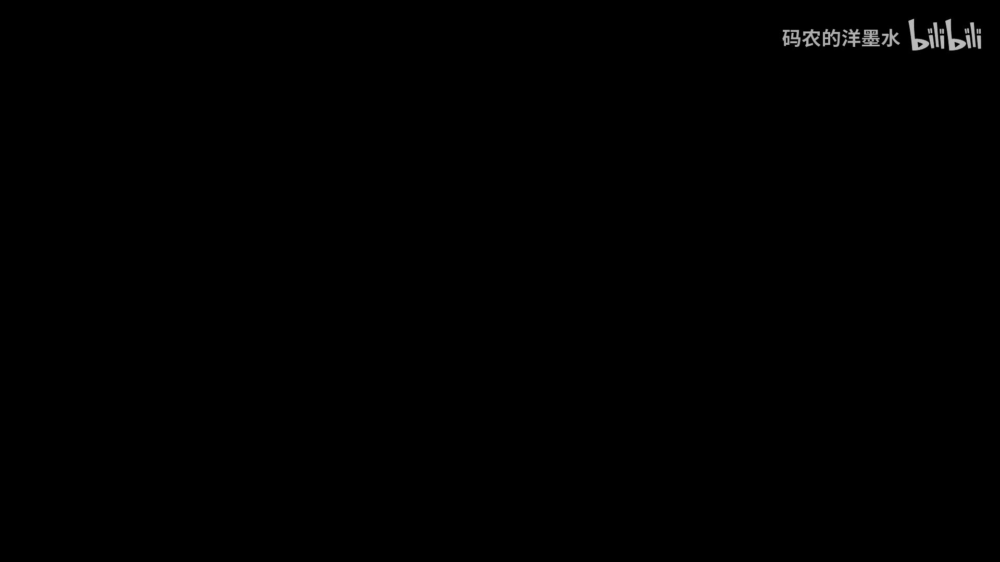
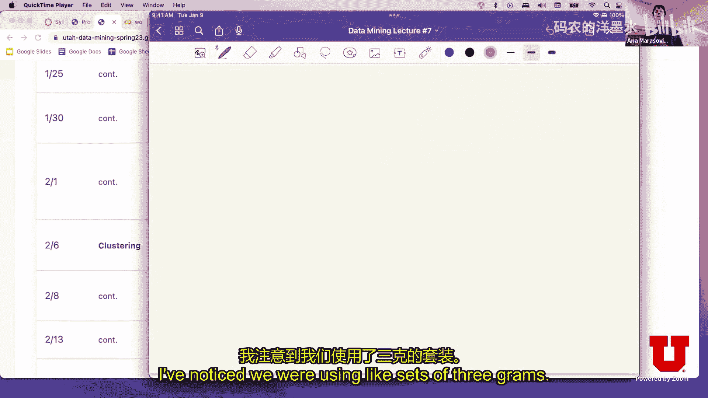
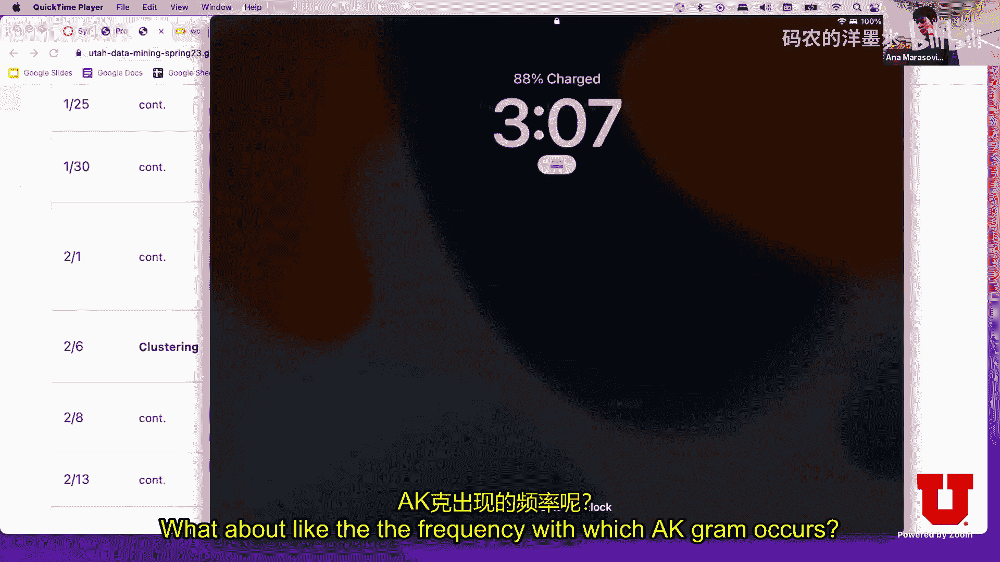
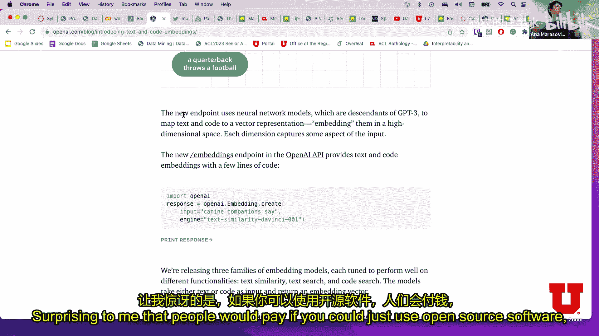
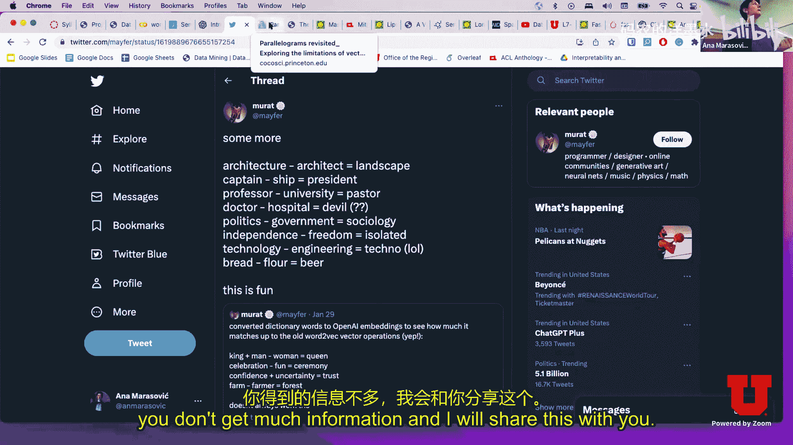
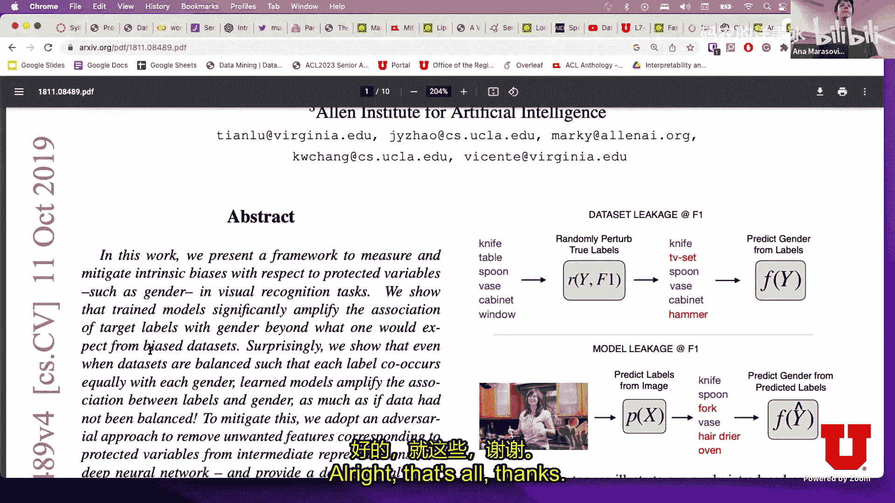

# 犹他大学-CS6140-数据挖掘-中英字幕-1080P-p07-Lecture-7---嵌入与表示--BV1j1mLB9EAB_p7-

你感。

Okay。Yes。谢。这直播几视频多说。S。All right good afternoon everyone。

 let's start with one of the policies that we have in our syllabus this time that's about addressing sexual misconduct here the university details that title X makes it clear that violence and harassment values and sex and gender。

 which includes sexual orientation and gender identity and expression is a civil rights offense subject to the same kinds of accountability and the same kinds of support applied to offenses against other protected categories such as race。

 national origin， color all age， status as a person with a disability。

 veterans status or genetic information。If you or someone you know has been harassed or resulted you are encouraged to report it to the university officials。

 you have TitleX coordinator and Office of Equal Opportunity Inative Action Office of the Dean of Student。

 you can file a police to report and contact campusus Police and Department of Public Safe team if you don't feel comfortable doing any of that they use victim support advocates。

 provide free confidential electronic informed support services to students。

 faculty and staff who have experience interper violence to private privately explore options and the resources available to you with an advocate you can contact the Center for Student A。

Okay， moving on。To something later that。All right， so I want to also remind you about upcoming deadlines。

 so today we had the deadline for the second homework I hope you all had managed to submit your solutions if you didn't you still have those two passes up to Friday at 245 pm so please make sure if you are unfortunately not going to make it today to submit it by Friday at that time after that we simply won' to take your homeworks。

Next week on Wednesday we have the deadline for the third homework and then on the February 15 there is a deadline for the second component of the project yes please go ahead。

deadlineNo， the idea behind putting them before the lecture is that you then come to the lecture and listen to a new material if you have deadline right after after the lecture no one would be here you will all work on your homeworks that's one what reason the other reason is that these homeworks are also grouped by the team so if you skip kind of like by the time we are talking about something new you have finished that homework so it kind of set you on a good track to you know follow the material before we start something completely different。

Yeah。我哋都唔分表。Sorry， I just put it so you know that it's， you know。

 you get like a canvasva reminder that does happening。

But you will come here in person and I won't give you just a minute to solve the exam so this is just to kind of have all the deadlines in one place。

All right， so I was mentioning data collection that's due on February 15th and we should give you feedback on your proposals by the end of this Friday。

 which will leave you kind of ten days to work on the data collection with our feedback in mind。

And to go a little bit over this component， let's open the web page。Oh。

 I don't need to interrupt you， I just had a question about binhaing。Yeah， let's maybe wait a yeah。

 yeah， let's maybe wait until we start the lecture。So data collection report again。

 you can go to the website of the course and then if you click on the projects you can find this description so this report should be at most one page long describing what data you have collected or are continuing to collect。

And often this part about collecting data is the most intensive part of your job as a data mining。

 whatever is the title engineer。So you need to report how you obtain your data。

 how large is your data in both format are you storing it。

 and here you need to think about this abstract data type and did you need to do anything to kind of change change the format of your data to another one。

 maybe if you're working with something that's very large。Okay。

 there are more things written here basically that you should focus on these abstract data types and that you really think about whether that data type makes sense for the data you are working on remember when we said last time okay you want to compare something with LP norms but if you're dimensions are corresponding to vitally different things that might not make sense and you need to do some extra stuff to actually make sense also you can't say okay I will convert I don't know string or document into just list of words we have learned better techniques by now and we know that just converting them into a list of words won't be enough。

嗯。Okay， so please read this carefully， maybe I forgot to mention something and please don't forget that there is a deadline for for that any question questions about this part。

Okay。All right。I also want to go a little bit over the schedule so basically with today's lecture we are finishing this whole story about similarity and then we are going to go on a new topic clustering which will also spend three lectures today we are going to talk about some other ways to represent text and images and this might be also helpful for you when you think about your project so this lecture similarly to the distances will kind of be important as a way to think about all the rest of the things we are going to do but in a way it's not we won't go over any algorithm specifically in this lecture rather we will use this stuff later on。

Okay that's all I wanted to say Haing question we just document that similarity in general I noticed we were using like sets of kgrams what about like the frequency with which a kgram occurs that is the like documents are more similar it wasn't restricted and just set yeah that's a great question so actually today we are going to talk about one another way of representing text called TFIDF where you are considering doing the frequency of a word in document and how many documents contain that word so you're right that there you could make a representation where frequency is relevant and that's exactly what we are going to talk about today。

Is it usually relevant or like？So we will talk about IDF today。

 then we are going to talk about a whole other way of representing texts using something called word embedding。

 sentence embedding or sentence representations。Again， there isn't。

Like a recipe of which thing you should use it really depends on the problem and and the size of the data you are working on so yeah maybe through the lecture I will have your question in mind and just kind of try to signal when I would use one thing over the other so yeah before the word embeddings were a thing you would just use the If and the frequency would be the main thing but these days we are going to use some other stuff which。

Doesn't include that information so explicitly。Okay， so yeah， today's lecture。Will be all about。

Word and sentence and image representations， let's call them like that。对。

Okay and so far when we talked about representing text we have talked about bag of words representation when we had that vector and each dimension corresponded to one word and the account of that word in that document right so we had be of word。

Vectctorors。Then we also had。Just sets of kilograms。

Then we also had represented text with min hassh signatures， which is also a vector， right？However。

 if you open。Any any kind of text mining course， you will certainly see some other ways of representing text and I want to go over some of them today。

For thinking about this other representation， what is useful to know is something called distributional hypothesis。

Okay， and distributional hypothesis tells us that words that occur in similar contexts tend to have similar meaning。

And we are going to exploit that to develop representations such that those are representations when we put them in a corresponding vector space。

 those that usually appear in the same context that their vector representations are close together and otherwise they are separate Okay so I would just write down what distribution of hypothesistamarines where that。

Ocur。In similar context。Tend to have similar meanings。Okay。

 so just have this distributional hypothesis in mind when we are going over the ways we are going to represent text today and the first。

Or the next way to represent text is using TF IDF。Okay。So here we will need a few components。

 one of them is called TF。BD， and that's just the。So when you read the textbooks you will see it defined differently。

 this should be just the frequency， so it should be count of the the token D in document D over the the number of words in。

Document。But sometimes you will just see it under the account。 So some in some textbooks。

 you will see the the。And removed so。It seems like it doesn't have a huge effect when you do these things computationally。

 so you might see either of these things。Okay， this is a raw count。And this is。Prequency。Okay。

 another thing you will need is。IDF， but we'll first introduce Df of a term in a document。

And that is the number of documents。Number of documents。That。Deoc。嗯。Okay。

 so what we are actually getting at are the terms that occur in less documents because those terms will make those documents special。

And there will be a way to kind of discriminate between two documents。

 so actually what we are looking for is IDF of a term， which is an over Df of the term。

This should be。Let's call it M as a number of documents。So basically what IDF is telling us is。

If a word occurs in just a few documents， the idea will be large and that means that kind of signals that there is something special about this word。

 so when we compare to documents， we are seriously considering this word。Usually we don't just use。

IdF in this form， we apply logarum of then to it， so another version。His idea of D is log of 10。

Of M over theftT。And the reason being is that if we are working with a large collection of documents now we can have values of one I don't know11000000 and these things become like very different from each other when we are applying logarum to them we're kind of squashing them so these differences become smaller yeah so n is the total number of firm and n is the total number of documents yeah n is the number of words in a document and M is the number of documents。

All right， so just as an illustration， if you have one then。

Log would be zero if you had 10 it would be 100 it would be two and so on so when you are comparing the log this even though something has occurred 100 times relative to something that occurs 10 times the difference becomes smaller when we squash squash it with the algorithmith that's the idea behind it。

Okay， and then finally we are defining the weight of the word in a document as Tf of the offering percent of the word multiply with this idea value of the term。

So this is Tf IDF weight。Well weighted value。For birth deep。In document deep， in document deep。🤧え。

Okay。😊，Yeah就。Inverse inverse Df， basically。Okay。So we are going to nowtake these values。

 so let's say we have。M words and I know this is a constant I think that confuses you so this could be if you had end documents you can kind of find all unique words in end documents and that would be this list of D to Tm or you can take if you're working just with words all the words in a vocabulary in English with kgrams it becomes kind of hard to just find all of the possible kgrams in English so usually you just take all the kgramms that occur in all the documents and you list them as your as your set of possibilities Okay so that that's what we have in the rows then in the columns we'll have our documents。

So D1 to， let's say， Dm。咁。是。This value here， this is where we'll put the Tf IDF value of the first。

Term for token in document one。All right， and that's how we are going to fill each cell in this matrix。

Does this make sense？Okay， so this metric is usually known as term document metrics。And。

In the literature you will see two ways to represent each document given this kind of representation you can just take the column right and I think that's the most frequent one with this is document。

Vor representation。But sometimes people have also defined vector representation of let's say。

 the document I as the vector representation some of vector representation of every word that occurs in the eye。

 so let's say D1 to。Vector representation of TK and this vector representation would be this rose。

Yeah。And then then divided by however， how many there are which is great so that's another option I seen this option way less than the first one。

 but you know。They're all reasonable options to try， so this is one and this is the second one。Okay。

Its the second of a name like centroid of word vectors。Yeah。Yeah。

And once you have these representations of your documents。

 then you can just use a cosine similarity between them to say that document one is this much similar to the other one。

 that's how you will measure the similarity between two documents represented with theF IDF。

And then as in forward where you use count vectorizer， you wouldn't go about， you know。

 doing something like this on your own implementing a thing that will give you these kinds of metrics。

 you would go just to psychic learn and find Tf。IdF。Vexorizer。Okay， and again。

 like with the count vectors， these vectors will usually be very sparse so that's kind of。

A common problem we see with this kind of representation， there is a lot of zeroes。

And that's a thing that another way of representing input text will help us with。

Before I move on to word em bends， I just want to measure that there is。

 you might encounter Bm25 and that's just more optimized。

DF IDF so you know how we were putting those log itemss and stuff like that yeah basically Bm 25 has the similar kind of tricks to count for some situations you might encounter。

 but again I see it to you being used way less at least in textbooks。有哦讲咗咩。Sorry。

 I didn't hear you well can you speakYeah， that's true because you are measuring the frequency of the term in the first document that will be more like general you are looking for okay。

 this is the frequency of this word in this document。

 but do I see this word in every single document， for example， common words like。

Whatever forms of word to be like is that's going to happen like they will be this word will be probably frequent in your document but also in every other document it will occur and you will be like you know what you are not important word and IDF will squash it so that's why you are kind of combining both what's happening locally and what's happening globally。

Okay。So let's move on to the next thing。The problem with the count vectors。

 back of word vectors and the problem with theIF representations is that they are sparks they have lots of zero and for example here the most common version of this is that you put TM to a T1 to TMB to be actual actual words in English so you can have a vocabulary of the size 10000 so that it's a huge vector but it's very sparse and it turns out that to that is not great and another technique has emerged and these are another way of representing text which are word embeddings。

You can also find them so for words specifically we'll find them under word embeddings very often in when we talk about where their sentence of paragraph vector representation vector I just said vectors we will say that these are representations and a line of work that is learning these representations is called representation learning so you will see terms like representation。

To be something very， very similar to a word vector。

And the line of work that gives us these nice representations is called representational learning。

Okay， so。A nice property that these word embeddings will have is that they're going to be short。

 their dimension is usually you know in the range of 52，000。

Values and theyre going to be dense now this is a term we use when we say that the entries in our vector will be real valued numbers and that there will almost never will see zeros inside it。

 So well just see continuous values and。Very rarely you would see a zero in the vector and then we call it dense so real value the entries。

Or numbers。No zeros。And there can be negaivity。Okay， have you heard about word embeddings before？No。

 barely。I see some ladding。Okay。Did you hear about where to work？Yes。

 seems like more people have heard about Word to E so Word to E is just a software that gives you these kinds of one kind of these word representation。

We're to back。Is。A software。Or you know package whatever and it has two algorithms associated to learn these nice representations for each word in let's say English vocabulary and one of them is called skip gram。

With negative sampling。嗯。She's also known shorter to be SG and S。

And it's one of the two you will see also another one which is called continuous back of words so if you see either SGNS or CBBAO this is just two algorithms under word to E。

Okay， so let's try to work through how we get word representations from this SGS algorithm。

 I won't go into all the details， I won't show you any training objectives or whatever like that。

 I just want to give you like a high level idea of how this thing was trained and I think that will help you when you think about these things in the future。

All right。Remember when we talk when I mentioned distributional hypothesis。

 I said that it says that words that often occur in similar context will have similar meaning and when we kind of。

Embrace that perspective to build this representation what we get is vector space where these word embes word vectors that occur very often in similar contents will be close to each other and otherwise they will be very far away from each other so what word to we or this specific algorithm is trying to do is trying to find find such vector representations that we have vector space with such properties。

So。Let's see an example。Here would be lemon， a tablesspoon。哦，是的。Iか。So。Okay。All right。

 and let's say aprico is our world we are looking at at the moment。

 then what your context is going to be are two words to the left。And two words do the right。Yeah。

That's the context。And the way that the word towe is going to be trained is that given this word aprigo and given this context。

 tablespoon of jam comma。This model needs to estimate a probability that this word aprico is part of this context based on its similarity。

 current representation of that word aprico is similarity to this other embeddings of the words in this context。

That's the general idea。U。So basically we can visualize that， let's say you have。是。Some vector。

Let's say dimension is something around 300， I think that's what word to x dimension is and this vector should represent your word eprico and you start with some randomly initialized values here。

 they are just random。Then you will pass this thing to Bt to V which is itself a small neural network and if you don't want to know what neural network is。

 it's not super important right now， just imagine you passed it through。

 you know you multiply this vector for aprico with another metrics and you apply some nonlinear function to it such as you just quaashshed all negative values to zero and now you get another vector out of it。

Then what you're going to do is you are going to do do product。

 which is one kind of similarity between the vector for apricot。

And each one of these vectors in your context， so C11。2C14。And of course。

 what we want to do is we want to maximize the similarity between these two。Vector representations。

 but to train neural network， we also need negative examples， you know。

 imagine a binary classification task you need。Positive and negative labels so what this algorithm will do is to us going to sample some words that are not in context。

 multiply them with do the do product with your target embedding for aprico and minimize that so we are going to maximize some similarities and minimize some others。

And then we are just going to do back propagation， which is just the thing we do to change the weights of these mattresses that are involved in this whole paradigm。

 including the values that are in our representation of the word apriant。And you will do this many。

 many， many times and then eventually you will stop and you will get this vector that was initially randomly initialized。

 will have now have some values that were learned through maximizing and minimizing these similarities。

Okay。Okay， is this somewhat clear， as I said， details are not super important？

Startve always been on that back the bottom right Oh I just wanted to say something like it's。

Not in the context， so I said not context， but you。It doesn't really matter。

 it's just negative examples， basically。These other examples are called positive examples because they're actually in the context。

 Africapri this actually in their neighborhood。Okay。

 so it's not super important that you understand all the bits and pieces of this。

 but is important that you realize that this vector of the word Africapri that we get at the end was learned such that we had maximized its similarity with the words that actually have been in its context in some text we found on the internet。

And its similarity words words that it had never appeared together with has been minimized。

 and that will produce as this vector space where words that have appeared in a similar context are close to each other and far away otherwise。

What is important to know when you're working with data mining applications is that now you diitch this whole word to vector algorithm。

 but you keep thebes so at the end of this whole procedure we had this vector for every word in a vocabulary。

Okay， and now what you can do is you can just use those vectors to represent your text， for example。

嗯。If we had， again， a tablepo。Of Apriica Jeff， that's your。

That's your sentence that you want to represent with the vector what you are going to do is go to gensm。

Library， you are going to import it， you are going to import where to work。

And imagine that this gives you a huge metrics。Where in each row you have word。

And columns are just the dimension of its vertu vector representation that we have learned with this algorithm before so basically what you can do then do is just do the lookup you can check okay where is the representation for a。

Let's say somewhere here。Okay， now you can retrieve each vector and you can momentarily store it then let's say tellel tablespo is here in。

Embbedding metrics。Again， you retrieve it。And so on。And in the end to represent your whole sentence。

 what you can take is average of these。Vectctors and you will get one vector。

 which will be representation of your entire sentence。

This is how you will typically use Word to work。Okay are there any questions about this yeah please Oh you would have a huge vector if you concatenate them so if you had the dimension is if I remember correctly 300 and if you had 100 words in your input now you would have what 30000 dimensional vector and that will make everything more computationally intensive so just averaging them out is the simplest way to get against small dense representation。

In the end， like at least in classification setup what you would do then with this sentence is train a classifier which means multiplying this vector with another metrics and if your initial vector was 30000 dimensional then you would have a metric that is gigantic instead instead of a smaller one and also the length of different inputs will vary so if you had concatenate them you would have different dimensional vectors for different inputs so now you can compare them with a simple cosine distance metric for example。

Yeah， but there is a reasonable question to wonder like what happens when you average。

 do you cancel some information， do you lose something and so on？Okay。

 so as I said you would use something called Gensim， I will share this stuff。

 I will show you a bunch of random things today and I will share them later with you。

 but to use word embeddings you will just import this library called Gensim and you will import then from Gensim Monel's word to Vck and then you would initialize it and then for let's say word speaker。

 you can find the most similar words to word speaker just by using one line of code which would give you here chair。

 chairman， chairirwoman president。Gentlemen tonight and it kind of diverges right yeah so it's very easy to to use it and get these representations once you have this nice library written for you。

As I said I will show you random things， so if you like worldle。

 there is also a worldle version with these kind of vector representation where you try to guess which word has a era similarity。

For the word you can't see， which is kind of hard yeah。ItGo back。All right。

Remember when we talked about bag of words representations。

 we did mention there is something kind of。Unappealing about them， they remember what was that thing。

Can you remind me what were the problems with peover wordss when we had counts？这是 things。

Sorry I can hear you Yeah exactly we kind of didn't consider the order in which the words are coming when we do this averaging we are also discarding the order another problem with these kinds of things is when we have words that have multiple meanings such as word bank can be a financial institution but it can also be a land next to a river or head can be you know body part it can also be a leader and header in a document with word to back and other similar representations of words we are completely disregarding that the word has a specific meaning in a specific context it will always be represented with the same word word em that is stored in this embedding。

Which is an issue and this is why something called contextualized representations had emerged。Okay。

 I do want to still mention something about world embeddings。

So I will come to this point about how to fix the fact that we are representing words with the same vector。

 although the same。On the surface storms they are the same。

 but they can have different meaning before we go into all of that。

 I want to talk a little bit about。Analy。Or relational similarity so whenever you read anything about word embenings。

 you will see this kinds of stuff that there was this。

Test in the 70s where you could do stuff like A is to B as a star is to what？For example。

 you could have。King is the man。As。Woman is to。And then you could guess queen。

And there is a specific model for doing this that comes from the 70s called the。Para logogram model。

Or analogy problems。And under this。Model， you would basically say， okay。

 let's say we have a vector for man。And king。You would say， okay， man minus king is this vector。

And if I add the vector for woman， I will get。In that location。Something like queen。

So here this point。Is you can if you have a vector space like the one we have。

 you can do just simple operations with vectors， you can do man。Vector of men。

 minus vector of kidney plus woman。If I take the nearest neighbor of whatever is here that exists in my embedding space。

 I would get a vector for queen。Similar stuff can be like。啊。Best。Minus France。Plus， Italy。我 do。

What do you think？R， yeah， so。We are kind of getting the information about capital of a country。Okay。

 so you all standly see stuff like that and this is kind of in a way when when at least I saw it for the first time it's mind blowlowing because analog reasoning plays a crucial role in human cognition when we learn new knowledge and when we learn how to understand and apply new concepts。

 so the fact that we have a vector space where we can do analog reasoning seems seems kind of like a huge achievement。

Some other recently， maybe you have seen it or not， if you have known about word embeddings before。

 is that OpenaiI， which is the organization that had produced GT has released their own embeddings。

 I honestly don't understand what is fancy about this because we have seen this technique in a while。

 but it can also give you these kinds of representations if you are willing to pay for it which again is surprising to me that people would pay if you could just use open source software。

 but someone because it has been released recently someone was trying this analog analogies again with openaiIs embeddings which found some really funny things to me like professor without universities is a pastor which I sincerely hope is not true or bread without flower is beer and technology without engineering is techno so yeah you can get a lot of funny stuff。

But it kind of goes along what I want to say next and that that there are line of work that also has evaluated this kind of analog more robustly and they have shown that the performance of whether you can do this kind of vector minus vector plus another vector really is limited to what kind of relations are you looking at if you're looking for simpler location relations you might see something reasonable yes。

So thats because Yeah that's a reasonable reasonable explanation。

 I would say there are multiple of like reasonable explanations for why it would have factually incorrectness。

 for example， maybe sometimes in the past some entities had been that entities predicts and it just doesn't consider that things have changed so there are basically there are many reasons why JupT kind of models can make factual errors but in the gist of it is that yes a lot of these things are represented by these distributional representations which are not discrete you know we't we can't localize in this vector where exactly this fact。

三。Which is one reason why it' better to use more simpler kgrams or TF IDDF approaches if you just want to check do some preprocessing of your text。

 you don't need to do something super super elaborate because。

With these kinds of things you have less and less control of what this is side of this representation。

 these dimensions in these vectors are not don't have a meaning basically。

Okay so I was saying how some of these relations can give you you know like really expected guesses。

 but for a lot of them like some of which we are seeing here。

 you don't get much information and I will share this with you but there are basically papers that explore this further and they show that yes when for some cases it's really neat what these things can do but for many things they can't they can't really do this thing so whenever you see this kind of analog they get also with a grain of salt so yeah the outcome of this paper is that parallel logoogram and modern alone is insufficient to how people form even the simple st and there is another one in a similar spirit so。

Kind of cool to see， but also lots of problems with this。

Okay another problems are any kind of biases that relates to society。

 so these models will not only exhibit what we see in the world they will also amplify it so with these analogies。

 for example， one of these papers。Okay， maybe later。

 you can say you can check what happens if you do vector of programmer。Minus oops， man。

Last woman will tell you that the closest thing is。I think homemaker， whatever that word means。是。

Or if you have a doctor。Without father。Plus， mother。It will get nurse so it's kind of。

Exhibiting what has historically been biased kind of biases of what kind of jobs women can do and this is called then this kinds of exhibiting this kind of bias result in what we call allocation harm。

So you will allocate resources such as let's say， credits or jobs to some social groups less than to others。

 just because maybe in the background， let's say you are representing people's resumes with these word embeddings and then because you are looking for a programmer and your word embedding doesn't associate that with women's names。

 it will not show you women's resumes， for example。

 so my point here is that you should really be careful when you work with this word embeddings and depending on what kind of application you are doing。

 you have to remember that you can cause these kinds of allocation harms with your algorithm。嗯。Yes。

I said that these things exhibit these known biases we have in society， but they also amplify them。

 which means。Basically， if you look at any gender terms。

 they become even more gendered than these vector spaces in the simplealing spaces。

 then what they were in the input statistics so if you take your data that your model is strain on。

 you kind of look at these metrics that tell you something about how about gender biases and then you look at these representations you use similar metrics。

 you will see that these metrics become even worse。Besides allocation harm。

 there is also representational harm。And this is similarly caused by these things when we just ignore certain groups。

Yes是。Ignore or you mean。Oops。So one thing that has kind of emerged as a team is the biasasing of these word embeddings these are algorithms that take your word embedding and try to remove anything that can be associated with certain demographics and it is really really hard to do this so I want you to remember this that there isn' a solution to this problem it is an open research question how to do this and if you see you know any algorithm that claims to remove any of these attributes there is no guarantee that has really happened and here I would really recommend reading this paper lipspstick on a pig which says okay we're just slapping this things that should debas them but doesn't really debias them this was published in 2019 is then a lot has happened especially in the group led by you of Goldberg so if you're interested in this。

Tins of things how to debi these bird embeddings， I recommend looking at the latest line of work from that group。

For amplifying biases， there is this paper and a paper that has first shown that or you know maybe it's the most prominent paper that has raised the issue that these representations could exhibit these biases is this one so a will link called all this paper in Piazza later on。

Okay。Okay， any questions about。About word embeddings before we move to contextualized representations。

Yeah。嗯。Okay。So I mentioned we contextualized word representations when I said that certain words can have multiple meanings。

 right？Okay。So the problem here is ambiguous work。Right， so basically what has changed in 2017。

 2018 is that instead of training these virtualtuwe models that learn these static representations。

 so I will write this down because it's important to staticbes。嗯。

So instead of learning algorithms like that， which for every word in your vocabulary you give you one vector representation。

 no matter how this use can later on be used， we have started to train models that make this word representation based on the context so basically you would have。

Your sentence。Tablepoon of agriculture。And now you would feed it into some model and here I don't want to go into details of what these models are the architecture itself is called transformformer I can link into Piazza another lecture I have given last semester when I explain what this is。

 but important ingredient of transformer architecture is something called selfat。

And what self attention mechanism is doing is basically measuring how important each one of this word in the input is for other words in the input。

So。You will learn the representation of the word depending of what other words you have seen Okay。

 so basically in this self attentionial layer you will have the vector representation of word A and you will do cross the product with representation of every single other word in input。

 you will combine all of that somehow and fit it into the next layer of your architectureure。

To train a system like that， what has been proposed in 2019 is to take one of these words。

 replace it with a mask。Token and then learn through the model to reconstruct that。

Word which is also forcedcing into the model to look what are the other words in the input and then based on those other words you can also get the sense of the word we are looking for so this is how these models were trained again。

As we were to we you can train the model and ditch it ditch the actual model and just look at these representation in the end usually these days we don't ditch the entire model we also can do some stuff later on such as a procedure called fine tuning where you can you know tailor your model and your representations for the model to the data you have so if you had slightly different kind of text you can do a little bit the model of this training where we wouldconstruct these mask tokens in the input and have better representations the way you would use one of these models is basically you would feed it your text and it would give you these representations at the end。

But now these representations are considering what other words are the input they're not static and a gra you can do just the averaging。

 however with certain models there were some special token is put at the beginning such as CLS token and you can reduce the representation of that token to say this is my representation of my sentence because every tonken has attendant to every other tokens so every representation in the output is actually considering everything you had in the input so here you could take just one of them but I think still it's more standard to average all of them out。

Okay。嗯。Okay， so I did want to show maybe how this looks like。

 I don't know whether there is a huge value to it， but maybe when I share later on just so you know this exists。

 this is basically one of these models is called birth it was strain with this mass language modeling objective I have described and the way you would use it is to having a sentence with token each one of these token spectral index and then in one of these in corresponds to a look in your and then we're going to feed those static the layers where you are going to use this self-atten to change every representation of every token and the input such that the information about other token is considered in the representation of a specific token and then end we will get vector representation to each one of。

That you can average to get your final。Fin note sentence representation and actually if you are going to do that it's better to use this library called sentence transformers where basically you get this in just few lines of code so here you will just have。

It will use model and initialize it to this second first folder。

You will delete sentences and then you will just em it by doing model dot and code so you can get all of this stuff for very。

 very easily。However， one problem with these sentence encoders and using these contextual representation is that there is the maximum sequence length you can set here because the following metrics will have will depend on whatever is the max sequence length here。

 so it's usually set to 512。And for some application that's simply not long enough。

 so there are now newer model coming out such as longform that basically help you with this text that are that are way longer by adjusting these self-attention metrics way beyond the scope of discourse what these longform or transformers for long inputs look like and how they operate but if you are working with a problem and you have long input and this input is longer than 512 tokens you just need to consider what you are going to do it you could truncs to whatever is in the first 50012 tokens but that might discard lots of information so if you are in a situation like that just know that these kinds of models exist and that you could use some of them for example。

 I have least recently learned about AI incident database which is a database where people can report。

That AI has done and here to kind of represent， maybe I can show you actually。

Each one of these incidents is。Is actually a news article so for example here on CNN so what they have done here is took this article related to that incident or article where an incident is reported get an embedding from a longform and then use some of these a dimension reduction techniques that we'll talk about later on to map it onto this two dimensional space and now you can see which kind of incidents are related to each other so this is just an example how you don't need to know anything about longform but you can use it to get kind of visualizations that might be helpful for you。

Yes。行。Okay， I believe that's all I wanted to say about text。

 but I do want to talk a little bit about images as well。

Any questions about representing text with embeddings？And sentence representations。O。So嗯。

You can tell I'm an a researcher because our images。Are not getting equal attention。

 but at least10 minutes。Okay， so with images， we will also have these kinds of representations that are very similar to word representations in a sense that we are going to get the output of some neural network and use that as a representation of our image。

 but before we get to that， the most prototypical way of thinking about an image is just as a matrix of pixels right？

And then each one of these pixels has a value if we talk about the gray scale。

Then these values will be from zero to one right however color is a valuable source of information so usually we would use RGB representation where we would have basically three mattresses。

 one for red。One for green。And one for。P。These three different mattresses are called channels。

And your image is now represented not with the metrics。

 but with a tensor because you have this third dimension of different channels， right？

So now this RGB representation of your image is a tensor because previously you had with a gray scale here you had just a matrix now you have three channels when you put them together you get a tensor do we know what tensor is。

Okay， and it's also good to know。嗯。Okay， so。The easiest way to explain what sensoror is is to think about it as just a generalization of a matrix right so we had a line then we have a vector then we have a metrics。

 which is has two dimensions now imagine a cube so you take。

And mattresses and you kind of combine them， you concatenate them together now you have these third dimensions。

Anytime you have more than two dimensions we are talking about tensors the concepts of tensors is incredibly important that's why we have a library called tensorflow whenever you do anything related to machine learning deep learning we will work with actually tensors is that's basically it there isn't much to say about it there are you know we will talk later about metrics factorization you can do tensor factorizations and so on but for now it just maybe think about it as I have a metrics and have I'm adding another dimension that's a cube and that's kind of what visualization of a tensor is。

All right， so I will write this down， I'm sorry。Okay。

 so each value here will be something from zero to 255，0 would be black。And 255 is white。Same here。

 zero is black。One is white。So basically each one of these， there are。Okay， doesn't matter。

There is also something called RGBAA stands for alpha and that's for opacity。

 so how much you know like the see throughness of the color so that would be from zero to100%。Okay。

And then before deep learning became a think， there was something called Sift features to represent images in a clever way。

 and you can read about it in the notes， I do want to go over over these deep learning outputs outputs of neural networks as a mean to get your representation of your image because that's something that is super widely used today。

 and I believe it's totally overtaken as a way to represent image。So。

One one common way to get a representation of an image is to get an output of something that's called。

Foster。R CNN。Can I get a raise of hands of how many people have heard about convolutional neural networks？

Okay， that's decent amount。Again， talking about explaining what the convolutional neural network is would take a lot of time。

 but I will try to just give a little hint of what's going on。

 you would get your you image or one channel of your image and then you would use a so-called slider window。

 maybe of size three by three and you would apply it to the patch of your image okay and you will multiply the corresponding patch of your image with that little slider weight matrix and you will get some number here。

And then you will shift your window and then you will get another value。

And so one that you are just going to concatenate with the values you had before。

 and this will give you a vector。So this is one vector that we are going to call feature map。

And that's going to represent your image and then you can multiply it with some output weight metrics to get some。

 let's say， probability of this being a clo， an image that represents a dog or not。

wayay more details are necessary to fully understand what the call is。

 but what I wanted to mention here specifically is that there is this model called faster RCNN。

 it is one convolutional neural network that has also been pretrained like the text representations were pretrained with text。

 this model is also pre traineded with some image data。嗯。Let me find the image in the paper。Okay。

All right。Basically what happens when you apply faster am to an image is that you get this image。

 you have lots of pollution and neural network layers。

 you will get some kind of feature map representation of your image， and from that representation。

 your network or predict what are the predicted bounding boxes are potential objects are。

 and then basically predicted for coordinates for because the boxes for coordinates。

 and then once it has these proposals for bounding boxes for each one of them， it will tell。

 I think there is a copy here， a chart here and a this here。

And you'll at that so classic for each one of these potential objects。

 but you will also get a vector representation for one of them， including the entire image。

So what the difficult中。You don't need to know any detail about how this works。

 but you can go to Pytorch。You will import Torch vision it comes withrch you are going to load thatNN here and then get this vector representations in front of these objects are as an output in just a few lines code and then one of them will be representation of the entire image and you can use that to do something else calculate some similarities in your data set or whatever your goal is。

In research we typically don't discard vector representations for those objects。

 we also include them because they are valuable to tell us， okay， these kinds of objects are there。

 but maybe for the types of problems you are looking in discourse。

 like similarly just representation of the whole image is sufficient。Okay， now。

As everything else open AI has overtaken。And for a while。

Fster R CNNNN outputs were just the thing we did I' would say since this paper was published to 2021。

 even today you would use those representations。However。

 last year or two years ago I can't remember OpenAI has released this model called C and this model is again a neural network that's pre trained on some image and text data so here you have bunch of images can have their caps such as some kind of and you would have as a part of your neural network。

 something that gives a representation of an image and something that gives a representation of a text and then you would combine these two representation somehow doesn't matter how to learn that these two things are custom that this is truly the fact of this image。

Once you are done with your。With your pretraining as we work to work as we work you can just use the representation that gets that you get out of this model so you can get the representation of a he by just using this image encoder and forgetting everything。

And this is what's happening these days， if you want to get the best representation of your image。

 you would go to click you would extract the features from this image folder。

 similarly how you extract that features from faster R CNN and then you would use it for something else in this course that would mean that you would go and get these features so that I' say similarity with other images。

That said， now。This is not a small model anymore and just finding a hardware that you can load this model and get these representations representations for your images path is is kind of a bottleneck you probably don't have necessarily means to do that so this is again kind of a situation where you need to think okay I know what would be the kind of probably the best but can I actually get that and if you can't you need to look into the less intensive resources such as those features that we haven't look into that are in the notes Another problem with both word to act and bird and with clip and with covenets is that representation will be great if you have。

Text or images that are like those that you have seen in the pre training data and now because our pre training data is becoming so enormous and so diverse。

 usually that'。Not really a huge problem， but for example clip has been portrayed on natural images such as images or dogs or whatever now if you want to work on X ray images that's a whole other line of you know images and representation you get from clip might not be the best one and basically researchers are now in the process of understanding like how you can still use these best representations to get even good representations for these other domains but that's something to be very mindful of if you are looking for representing your text or your image for doing something some actual applications or those representations that the out of domains is a huge issue so that's why typically people in humanities when I don't know for social sciences when they want to use this kind of representations they say that very often these things are so different from the text they are dealing with that。

Let's say using kgrams is more useful to them than working with this representation so again it goes。

Back to what kind of problem you have and what kind of data are you working with？

Just like word representations image representations are also not you know they are also exhibiting these social biases and amplifying them I really really like this paper lot I recommend reading it here basically they raise a point about how you know you have those thebiasing methods or balancing methods where you know all genders are represented equally whatever that means。

 but problem with images is that these models are really look good at making that associations of what's happening in the background with these attributes so for example you can mask actual person。

 but the models they say that for example in this image you see a woman because there are so many pictures of women on the internet with kitchen and babies in the background so despite that being irrelevant。

The model can still capture these associations and do the bias predictions basically so yeah that's something else to have in mind okay now you decide that I will use an output of conve to represent my image。

 but I'm working with some problem which might be really you know prone to propagating you know to propagating these kinds of representation and allocation harms。

 then you should really think about how you will go about this。Okay。

 so basically that's all I wanted to say about all of this， of course。You know。

 we just kind of touched on the high levels of all of this stuff and my goal wasn't that you really understand the details of each one of these algorithms I mean models we have that gives us this representation rather that you know that these things exist and that you can use them without knowing fully that how COV network or how it was trained or how B was trained or so on。

 these are useful representations。All right， that's all， thanks。

Yeah。It is， you know。Hello。