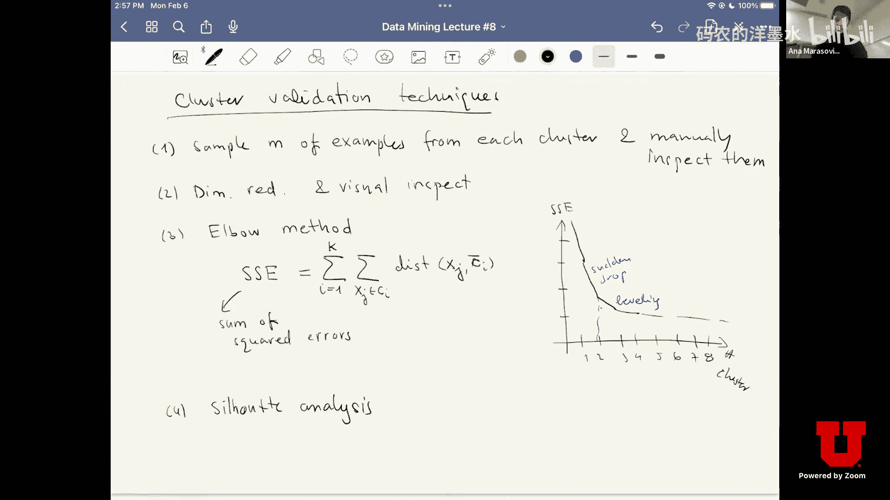

# 犹他大学-CS6140-数据挖掘-中英字幕-1080P-p08-Lecture-8---分层聚类--BV1j1mLB9EAB_p8-

问 is。

I。It。YeahSo dont know what was sad。All right good afternoon everyone let's get started we don't have panel of announcements today。

 I hope you have all seen that we have。Given your feedback on your project proposals。

I think most of the feedback was in case you have worked if you are working on a Kegel type of task that means that you don't have lots to do with preprocessing of data so we expect you to do a little bit more in terms of running experiments also there were a lot of public code basiss available for Kegel tasks and we will check whether whatever you have submitted is sufficiently different from those public code bases so have that in mind that if you are you know building of that code that in the end you have to show something that is substantially different。

We have given you also feedback on whether we think the scale of your project is good enough for the amount of people that are in your team mostly this is fine sometimes we just don't know since we don't have a concrete idea of what you are going to do so in the next project componenton when you submit your report we have asked you to be a little bit more concrete approaches you are going to explore for your problem and then we can give you also feedback of whether we deem that you know enough work for three people throughout this semester。

Are there any other questions related to project？Okay， so yeah。

 the next component for project is next Wednesday， so in 10 days。

 we have gone through that last time so I won't do it again， but in case you haven't been here。

 just go to the website of the course， go to project on the left menus bar and read what you need to submit in your data collection project report。

Okay， in terms of homework， this Wednesday there is a deadline for one of the homeworks that has already been released。

 I believe the third one and then this Wednesday we will also release a new homework which will be due two weeks from then so on February 22nd。

Next Wednesday you will submit project intermediate sorry， project collect。

Data collection for your projects report and then on Wednesday after on February 22nd another homework。

Okay， in terms of the policies we are kind of getting closer to them here this one is ADA policy that says that University of Utah seeks to provide equal access to its program services and activities for people with disabilities and basically you can reach out for Center for Dis and access if you need any special accommodations during this course。

 you have all of their contact including the website here。Okay。That's all about that。Okay， so。

Today we are going to start with is a series of three lecturers on clustering and clustering doesn have super precisely defined definition you might find for other algorithms。

 but some informal way of describing it would be that we are trying to group our data points according to some distance metrics。

 such that data points that end up in the same group in the same cluster are close to each other according to that metric。

 and points that are in separate clusters are far away according to that metric。

We can maybe write something down。嗯。我 sorry。Okay， so our goal in this series of lecture will be to group。

Points according to。To some distance。Which means that。Points in a cluster。

 let's say we have some kind of clusters points here and let's say we had。Cluster them。

So according to。The distance metric we have chosen whatever that is。This is small。

So this is some disputes and then on the other hand。Yeah。

We have some distance between clusters and we will talk about how we are going to define that。

 but let's say it is something like this。Then this distance is large。All right。

 so central to talking about clustering is a distance measure that we have cover extensive in every one of the lectures。

Sometimes you will see that this distance between two points in the same cluster。

 this one is called width。And the distance。Here。Between points in different clusters is called split。

 just in case you see those stories。Okay and situations we are going to focus in these three lectures are when our data is large。

 when we have many points， when our dimension of the vector representation can use for each one of these points is also large so when we have a high dimensional space and when our space is not Euclidean so we don't work with vectors of real values we for example work with sets just like we did when we talked about LSH so these are some situations you want to have in mind when you think about these clustering approaches so we have either large。

Data or。Very high dimensional space。Or。Non Euclidean space。Oh。Right。

 and just a kind of hint on some things that might happen which with each one of these situations is with large data。

 we might have so much data that when we are trying to group these points in this data together。

 we can't just put them all into main memory and we need to have some special way of handling points to navigate this issue。

You can kind of。Connect this with memory。Then the problem we have in high dimensional spaces is so called curve of。

Dmenionalality。Have you seen this term before in maybe some of machine learning courses you have heard about it。

 do you want to explain what it is？So what's following becomes like exponentially for our areas of more than value ever out。

Yeah， basically， you want to give a try。Iolation was difficult。

 like the policy of that exponential based on how many that do have over two dimension kids。

T linear su cooid cluster was for3 bumps， blood driving and four the。Yeah。

That's correct and the core issue underlying this is that when we have high dimensions then the distance between our distances between all of our points becomes equally kind of equal like all the distances seem to be equally far away from each other and another problem is that almost any two points are orthogonal to each other because you have so many dimensions so it's a little bit hard to work with the space like that when you know if you want to use your distance and everything is equally far away from each other then you know how do you find those points that are more distant from each other so I will just write down here。

For curse of dimensionality， we won't talk about this too much， but think about that。All points。

Become equally。Theyist stand from one another。And almost any two points are orthogonal to each other。

So some intuitions you might have when you try to visualize things in a two dimensional space might not apply so smoothly when you think about vectors in high dimensional spaces。

嗯。Okay， going back to the previous。Page I also had that we have worked sometimes with nonnuclear spaces。

 which means that for example， if you have now grouped your data and you have one cluster with three points there is a question of how you are going to represent the whole cluster and when you work with vectors it's easy if every point in a cluster is a vector you can just take the average vector to represent a whole cluster we will call decentcentroid and we are going to define that later on but when you have sets they are not represented with vectors what do you do then so things like this become a little bit you know not necessarily like huge obstacle but something where you have to stop and think about how you are going to go about this。

So in general， working with vectors is almost。Always easier to think about and implement。Okay。

 so we are going to have certain categories of clustering algorithms in general there are so so so many of them and we definitely won't cover even a tiny fraction of all the clustering algorithms that exist。

 but we are going to cover some main main categories of them that will kind of be。

You knowSuff for you to think about all these other variations。

 you are just going to learn about the ones you must know about and then figuring out these variations will be much easier so。

Some of the categories are。We'll have and what we are going to talk about is hierarchical。哦。

Aglomative。Clustering algorithms。The way this algorithms works is that you are starting with each point is its own cluster。

And then， you are going to combine the。Combine clusters by their closeness。是。

So clusters may have subcls and some clusters may have their own subcls and so on。

 and we are going to talk more about this type of clustering algorithm today。However。

 there is also something called。Point assignment。Where instead of putting every point in its own independent cluster in the beginning。

 you' are kind of considering points in the in any order they come and then you assign them cluster that they best fit at a given moment so。

Points considered in some order。Each point as fine。A clusterster it fits。It's the best。From the。

Current choices of cluster。This is usually these kinds of algorithms are usually preceded by a short face where。

Initial clusters are figured out， so we'll have short phase。For constructing initiative。Bussterters。

And we are going to occasionally combine or split clusters or decide at some point is。

Too different from anything and we won't include it into into clustering， so we will have combining。

Splitting。Fsters and oiting points。All right， so I also want to mention here why defining then。

Precisely what a cluster ring algorithm is。 so sometimes you will see that。

That two clusters have to be destroyed meaning that they don't have shared points and this won't be the case here。

 so here they might exist they will exist two clusters。That。Are not a disjoint。

Because you will see the way we are building this is basically building a hierarchy of clusters。

 so the hierarchy will the cluster that's higher in a hierarchy will contain all the points from the clusters that are lower in the hiarchy so this will never be the case。

I mentioned here that we have can meet points sometimes you will see that union of all clusters gives you the entire set of coin where this is。

Your set of points。If you're allowed that sometimes you omit a points because it's a huge outlier。

 then the union of all your clusters will not be the same as the set of your points。

So basically what I want to show here is that if you are trying to precisely define clustering it's hard because even though you might introduce some of these properties as clusters should be disjoint。

 their union should contain all the points， sometimes we don't really include that requirement。ok 嗯。

Again， going back to the categories of clustering algorithms。

 we can have a different division as well， which is hard and self clustering。

 which goes back to this point here that。The clusters are disjoint or not。

 so when clusters are always disjoint we are talking about。AHard bstering。

So for every combination of clusters， we don't have any。

Any pair of clusters where we have shared points， so all clusters are thisjo。Okay。However。

 there is another category of clustering algorithm called soft clustering。Where you allow that。

Some clusters are not disjoint。Excuse me， this was a mistake here I have written that they are not a dis jointint。

 but they should be disjoint。Feel free to shout at me when I'm a kiss，Okay， did we correct this？

So hard clustering all clusters are disjoint with soft clusterings they might exist some clusters that are not disjoint so this will be the case with the type of algorithms that we look at today hierarchical clustering there are also some types of clustering algorithms known as probabilistic clustering where basically for each point you give something like distribution over potential clusters you say okay it's highly probability it's in this cluster but there is a little probability it's in this other cluster as well and this for example one prototypical example of probabilistic clustering is called Gaussian mixture models which you might have heard from somewhere else。

是。Right right， there are potentially other categories you can introduce。

 but I think these two are domain one you should know about before we dwelll into into specific algorithms。

 any questions so far。Yeahep， say in the afternoon。Yeah， yeah。No。

 I just meant that you're kind of taking data as a stream and you start with the first point。

 it will become its own cluster， and then second point you can decide whether it's or going to be its own cluster or it will be merged with the cluster you have already produced in the first step and so on。

亮。I guess so。I mean， the point here is just that。In hierarchical clustering。

 every point will become its own cluster and then you are deciding about which clusters to merge together with point assignment you're kind of starting with the point data point by data point and deciding what is the best place for this data point right now。

 that's the main difference。For the last you mean that every data point is assigned to its own classroom without sharing to any other data No what comment is maybe it's good to give a visualization of this let's say we have something like this。

So with。Hard clustering each cluster will be disjoin meaning these are sets that don't share any items together。

 so this would this this is how you know three clusters for this little example could look like if we are doing hard clustering then if we are doing soft clustering。

Yeah exactly so here you know okay maybe I could also include this data point here with these points above but I can definitely maybe included with these two points to the left then maybe I can make this cluster where I take all these points all these four points but they could also be like separate clusters as well right so that would happen with soft clustering。

Yep， so to by themselves the really better to see if added can what begin because the ability create on your manual。

You're like， if you're like graph is like where X then uniform and Y before。

 it would have clusters to so like is there like I could say every cluster is just。

No that's a great question I think it might be relates to the metric called density where so if you had all your points being so random that will also be like kind of disperse right density measures that the clusters themselves are like you know these dense groups of points if your average density across all clusters is' pretty large that's kind of a bad thing so there are some properties of clusters themselves that you can measure to see that。

You don't have a situation like that you？With hierarchical clustering， you will have that。

Yeah so for example， we are going to come to herearchical clustering next but think about applications such as for example we are clustering research papers into groups now you have you know big umbrella of computer science papers than you might go into AI inside of AI might have you know core machine learning NLP and whatever vision so you can think about let's say NLP and vision and it's on some clusters but they will be part of a bigger cluster of AI papers or you know clustering species by their genome you can find a common ancestor and so on soing。

It's not the only soft clustering algorithm， so that hiarchical clustering is one。

 then there is this whole line of probabilistic clustering where you have kind of like a distribution of where your point might end up。

 which is pretty different yeah。All right， let's go into hierarchical cluster them next。嗯。All right。

 we'll start with our set X， which is a set of points we are trying to cluster。

And we are going to start， let's say this is our algorithm， it's starting now。Start or in it。

 whatever you like to use with。Every point Xi。Maybe I should have。So x is a set of endpoints。

 so x12 xm。Right， so every point Xi will become its own separate cluster initially。

We will have cluster C defined as just a point X in it Okay， so let's say we had。Points like these。😔。

6。是。对。Right， so in the initial step。We， this， each point will just be。It's on cluster， so C1， C2， C3。

 C4， C5， C6。Okay， then next thing we are going to do， we will have a while loop while。

It's not times to stop。Which we will obviously define next。You are going to do the following。

 you are going to find。The two closest。Bsterters。CI and CG。And then you are going to merge them。

Into a single cluster。And that's basically the whole algorithm。

So maybe you have found that these two are。You know， the closest one。

 then you will be there will be another cluster here， new cluster that contains two of these。

Maybe you have found and then these two are the pose then these two will become a new cluster。

 then maybe you have found okay， this coin C4 export is very similar to this new cluster then you are going to merge all of these。

Then maybe you found okay C3 is very similar to this new cluster I have defined。

And maybe then in the end， you are going to merge them all into one big cluster。

And you have in this process defined this here or here of the。Of clusters。

So just going back to kind of examples we have mentioned， this could be higher category could be。

 for example， this could be all papers。Or all CS papers， then this could be all traditional。

AI papers， and these could be。Or modern ML papers and so on。Okay。Okay。

 so obviously we have we need something that measures closeness of two clusters。

 so we need those distances we have talked about because we need to find two closest clusters。

We are going to go over how to。Measure the closeness of clusters first。

 and then we are going to go back to this point where。

We are doing this until it's time to stop and we're going to see what are the options for starting merging these clusters we don't need to go all the way to the to the top until we have one。

 we can also stop earlier if you wish。All right， so I want to go into measuring closeness of clusters next。

 any questions so far。要。WhatSo and so in hierarchical clustering there isnt such parametermeter basically because in every step you're just merging the two that you find the closest until you think it's time to stop merging so that's all you do with probabilistic clustering it's different and I don't want to go now and derail us from hierarchical clustering to talk about probabilistic one which we can talk about in the next lectures but right now all you are doing is the only parameter you need to think about is' when is the times to stop basically。

Okay， so let's talk about。Closesus clusters。嗯。And obviously here， you know。

 we have talked about closeness of something before， so we are going to use those。Distances。

 so basically when we talk about close closest clusters。

 we are kind of implyant that we will need to measure distances between clusters。All right。

 so we are going to go over five different options， so let's start with the first one。嗯。

The first option is to。Say， okay， let's say we have we work with Euclidean spaces。

 so we work with vectors of real numbers， then if we had。Two current clusters。

 the easiest way maybe to measure their distance is to think about some vector that represents that cluster and then compare two vectors that represent two clusters。

If we are working with。Real valued vectors then the easiest thing to do is to take the average vector of all points that are in that cluster and this thing will be known as a centroid and then we just compare two centroids of two clusters right super easy so。

For a moment， let's just talk about Euclidean spaces。

 so let's say we have C representing some cluster of K points。Then let's denote its small C hat。

 no see what would be this C bar， the average of these k points that are all represented as vectors so。

Let's say Xi is element of RD for every eye， so the easiest thing to do is to take the average。

And this vector will be known as centroid。So for example。

 let's say we had these three points here and some super far away points there， this would be C1。

This would be C2。Then the centroid of C1 would be somewhere here in the middle so we can call it like this。

北跟。And then the easiest option， as I said， is to say the distance between cluster one and cluster two is the distance between the centroids of these two clusters。

And that could just be if we are working with。Euclidean space。

That could be any of the LP distances we have talked about and we have said， okay， we can take。

The Euclidean distance here。嗯。Okay， so in algorithm here you need to find the two closests clusters。

 so basically for every pair of clusters you are going to measure the distance between their cents and then you can find the one that has the minimal distance。

The problem with this is what happens if we are not working with real value vectors， right？

And how we are going to represent a cluster then and you can think about， okay， what if my。

 I don't know points are kgrams or something like that。嗯。Okay。

 so what you can do is to define so-called clustersteroid， I don't know how important that turn is。

 but basically we are going to pick one of the points in the cluster to represent the whole cluster and you can let me just make this clear。

So pick one point to。In a cluster。To representative。And although you could pick， you know。

 a random vector， random， not vector random point that would be probably not the best thing to do。

 you could find a point that。Is to close us to all other points in the cluster so points that minimizes。

The distance between。To all other points in the cluster。You could also pick the point that。Has the。嗯。

That minimizes the sum of squares。Fer points。Or you can pick the point that minimizes。

The max is distance to from all other points so you measured the distances to other points。

 you find the one which is you know the largest and you want to find a point that has the smallest largest distance to all the other points in the cluster。

So you can do stuff like that。Where now here distance won't be your LP distance it will be something like if you're working with points that are set it would be Jaquarard similarity for example I mean Jakquarard distance so you have other options for distances that are not Euclidean you can pick those and just need to find that good representative point in your cluster and go from there I have mentioned in the class I will write it down。

This thing， so picking up one point in a cluster that represents them can be called cluster rotate。

Which sounds very fake to me for some reason。嗯嗯。You were first。

Every time you have cluster now if you have merged to clusters。

 now we have that new cluster and it will have different centers so you have to compute it again。

 believe you were next a new things。You can do this over this Im trying to do。

Do have engagement were not efficient status。For example， like themon no points on earth not。

Space on earth we can not。You will use this when you're not working with vectors so if you're yeah so let's say you're just deciding to work with strings and you don't want to deal with any vector representation of that string you might decide to use Jakar distance or hemming distance you just don't have a choice to work with Euclidean spaces right so you're stuck with other nuts stuck these are good distances right so you just need to find how to represent your cluster in a different way which is not the mean of the vectors。

Yeah， so imagine a cluster two clusters here oops。All right， so here is a cluster。

Maybe like this one so you would compute let's say we are focusing on this point here so let's call it anx with this procedure you will calculate its distance to other points so here distance one。

And distance two and distance two will be the one which is larger。

 so that's the max distance of x to other points in your cluster。

You can do the same for other points。So， here。😔，Let's say this is now the at the point you are checking in the cluster again ahead have the same distance with one and then this this one so now I kind of made it symmetric so。

This is the Mac distance for this point， they're kind of the same。

 but let's pretend that this one is larger。And then。We had a third point。

Its max distance would be to， let's say， to this one。嗯。Okay。

 now it's kind of weird because I should chose an example with three points so kind of both of them are good representatives。

But yeah， you would pick then one of them and you would say you wouldn't pick any of these because they're hypothetically their largest distance to the other point is larger than this one here。

 so this would be your representative point because it's。

Closer than to other points than other points are to other points in the cluster。Yeah。

 so just looking at what's the largest distance and you want to be the as small as possible。Yeah。

 in the gist of all these three options is that。You're picking a point that kind of the closest to everyone else in the cluster。

Okay， let's move on we have other options， so the first one is to define that centroid or plasteroid and then。

Compare the。Centates and that's how you compare the distance between two clusters。

You could also choose， let's say these are your clusters。

It also seem reasonable to choose two points that are closest and define that as a distance right and apparently this is good if you have things that have this two moon shape。

Like if you have something like this。Then if you use this kind of distance called single link。

The algorithm will first combine all of these inside these two。

I don't know being like moon like shapes instead of trying to connect connect these points cross bys the problem with this is that almost no real data looks like this。

 so you will see these examples but。It's。It's okay to kind of look at them if you are looking at some specific kinds of you know mathematical situations and some kind of monoifolds but real data doesn't look like this so usually this will't be the best choice for you so let it write nevertheless so we have let's say C one。

As x1。To x， K， C 2， Y 1，2 Y， L。Then this distance would say that distance between these two clusters C1 and C2 is the minimum。

Distance。Between， when we do check distances between the points in different clusters， so X I。I J。

 where I goes from  one2 k。Andject goes from one to L。

 so you just check all of the distances between a points in different clusters and choose the one which is the smallest。

嗯m。And if you do that， this is called a single link。If you replace this mining with Max。

then we talk about complete link。So complete link would be to take the farthest points。

In your clusters， which would be this distance here in red。

You might be also interested in the average case， so instead of taking mean or max。

 you could take the average， which would mean that you are taking all of the connections between points in different clusters which there will be k times l and then youll just take their average。

And this will be called average link。Okay， there are two more， this one three。Yep。

 is this distance measuring only the a for one day that stellar in teachers right？The last one。And播。

No， you can so distance taking the minimum you can take from any kind of number right。

 so it can be distance that gives you any kind of real value number， which all distances must。

You can take minimum of real numbers right， you can take the average of real numbers so nothing prevents you nothing constraintsstrain you to integers。

But I would like to hear why do you think it must why do did you think they must be integers for example data points the name or they。

I'd likeSo you're talking about taking distances of something that's not a number Okay any distance no matter what your input is will return you a real valued number that's no negative so zero or positive so no matter what your input is the output the distance between them will be a real value number and then you can do all these operations like finding mean max average so yeah I think that was just a little bit of confusion of what the outputs of distance measure is and what's the。

Why do we care about the max versus average in this case what do we use for yeah I mean I know this is the most disappointing thing why I ever say in this course。

 it's really a modeling choice。You know， if you can visualize your data and you know that your data。

 for example， has certain shapes， then you can think about geometry and think about whether mean max or average would be better for you like if we had these two moons or two beams。

 we know that finding the mean is better to kind of link them。

 the horizontally rather than you know crosswises， but in lots of these situations。

 it's it's a monoly choice。I would say if you work with the real valued numbers and with vectors。

 centries make a lot of sense because then centise is this like representation of your cluster。

 but yeah， I think you can see any of these depending on the application you work on。Yeah。

 what do know like。Where one week is like a winged chain and like the other linked thing is what do you mean I know like how do you know that there's two groups so that it doesn't just keep going Oh I mean you have finite amount of data so it can't just keep go you know it has to have kinds of ends if I'm understanding your question correct does it not know that there's like just one cluster that there are two clusters。

Oh， because。I mean it depends what your clustering technique is。

 but you are going to want to produce a certain number of clusters if you had as many clusters as there are their data points then that's bad and you have implemented it in a way that you didn't want to and you would change that so you would change something in your algorithm such that the number of clusters is not the same as the number of points you have。

Yeah。Yeah， so like with this one it takes a point and it finds the closest point to it。

 then where does it go from there like？Then if we were doing to hierarchical clustering。

 it would just continue merging things like this one， yeah we're right now。So yeah。

 so going back to algorithm the point where we are at now is checking the closeness of two clusters and i'm giving you options for that oh this is within okay I yeah great thanks okay let's go over two more。

There is also something called the radius of the cluster。

So that's going to be a max distance points between centroid and points in the cluster。Oh。Okay。

 so I don't know， maybe we had something like this。This is our cluster。

Imagine where the central it could be somewhere maybe here。

 then now we imagine where is the farthest point I keep drawing the symmetric clusters。

 so let's say this is the hardthest point then this would be the radius。And then as a。嗯嗯。😊。

As a way to measure the closeness。You can also combine。Two clusters。Was combined or。

Emerged or joined， whatever。Plulastster has the lowest radius。

And this goes back to this point about that that your。

Cluters shouldn't be dis dispersed clusters groups of data points you want them to be dense so the lower the radius。

 the more dense those clusters are and then you are enforcing that through your algorithm a similar thing is the enforcing the this kinds of stuff through the diameter so the of a cluster will be the max distance between。

Xi。An Xj。And so。And I and J go from one to k so you check all the points in your。In your clusters。

 so for example here。It would be these two points are farthest apart and this would be your diameter。

嗯。They're not the same things as radius and diameter of a circle。

 but very often these things are proportional， so yeah don't try to apply whatever you know about radius and diameter from circle to do these kinds of stuff。

Again， we combine two。W。The smallest。Diameter。Of there。是。Joint plaster。

 so you combine them and then you measure the diameter of the combined plaster and you'd pick the one which has the smallest diameter。

Okay， so these are five options you can take for for finding the two closest clusters that's not all we had in this algorithm we also had at this point where we do this until it's not time to stop so again there are some。

Different ideas we can deploy here， so maybe you can tell me what can we do here。

So when could you stop？Combining clusters yeah you can have like the distance between the two farth points and then when the distance between the center of any two given clusters gets to be a certain proportion of that max distance any it stop。

That's very specific I don't know whether I can follow exactly， but you are right that。

Measuring this stats between you know what happens when I combine two clusters。

 how does my whole group of clusters now look like whether they have growth properties that's one thing we can definitely do so。

Let's go here。Went to stop。U。Until。We construct。Produce and。A bad or inadequate。Paster。

So for example， here we could have that the。Average distance。Between a centroid of a cluster。

And cluster points。It's larger than some limit。And this again connects to this point that you don't want these things to be too too far away from each other。

 once you have a cluster that's very it spread， that that's probably not a good thing。嗯。

So maybe if I kind of can go back to your idea here you were saying that the max。

Inside a cluster becomes too large well I was saying like of the two furthest points because I was thinking if you were comparing the distance between clusters and we just had like a set threshold you might not know what that threshold is relative to like the spread of the total set of points and so I was thinking like a proportion of that proportion so there is something maybe similar to that it's called density that I keep mentioning is the ratio between number of points。

And basically you want to have some kind of unit volume of the cluster and to imitate that you can take the diameter。

 which is the distance of the two farthest points in the cluster to some power and this power can be。

 for example the dimension of your space that's very common。

 but it can also be just one so no power or two。Similarly， you can measure it with radius。Again。

 to some。没有。Howeverer。To some power。So I think this is very similar to what you're saying。

 basically you want this density to be appropriate and these are some ways you can measure that or you can forbid that the diameter or is larger than some limit。

 so you don't want them to be too far away or radius as well。

There is also something where that's a little bit more。Complicated where you don't want the average。

Diameter to。Increase。Too suddenly。So you could， during your me procedures。

 you could plot to the figure where on X axis， you have number of clusters。

And here you could have some kind of。You could have diameter。And。

Let's say your graph looks something like。This， but then it suddenly levels。So here。At point2。

You had sudden drop。是。This would actually sorry， I draw the inverse so。

Let's for a moment just pretend this is one over diameter and then you would here you would have leveling。

Okay， so you had a sudden drop or increase and then you had。

Leveed the average diameter that you calculate by measuring diameter of each cluster and then just averaging over all the clusters you have。

So here this means that you kind of had captured probably some natural。

Ocur of clusters and then when it starts to level， you can produce more clusters。

 but you are probably overfitting and just creating very specialized clusters that are not good。嗯。

All right so。Can I move to the next page？All right， so another thing you might decide is， okay。

 I will just have do this until I have one cluster。

And this is a totally legiting to do and then what you would get is that kind of like a three representation that I have shown you a few slides ago。

 let me go back to here something like this where youre just merging emerging and then you had combined everything into again your set of points and then you would go and show the whole tree that you had produced。

So you could definitely do that if you deem that there are some kind of herearchies in your data so in the end you would show a tree。

Representing the way。得。Data is points are combined。

Another thing you can do is to just enforce the number of clusters。

 so you might have some very good intuition about your data， for example。

 in when I talk about clustering research papers you might have predefined categories of research papers and you want to really achieve that specific number of paper domains or paper clusters so you could stop combining as soon as you have reached K clusters whatever that number is so stop。

w。You produce。Kate Lesters。Okay， so for this to work out。

 you would really have to have a really good intuition about your。About your problem。

 about your data and usually things are not as smooth as that so this is not a really broadly applicable heuristic。

Sometimes to do this， you could try to use dimensionality reduction。

 which is a technique we are going to cover later in the class。

 but the idea here is that you have points that are maybe vectors in high dimensional spaces。

 you can project those vector into two dimensional space so that's what the dimensionality reduction will do for you turn。

The space into。And here then you will have visualization of your2D space of your data points and maybe by looking at this toD space。

 you will observe there are some clusters of data and maybe observe oh。

 there are really kind of like three groups of points here and then you might decide okay。

 I don't force in my algorithm to have。Two to three clusters。

 so you would turn to d space into two 2 d space visualize。Inspect。Are there clusters？And if yes。

How many approximately？嗯。And then you enforce that many clusters in your algorithm。Again。

 these kinds of visual manual inspections。You know， really depends on your data。

 maybe there is a really good structure of your data and you will really find those clusters but。

In many times you I would come from the space that you will not have this nice of a picture and that you will need to。

Do something else such as one of these options over here。Again， I keep saying this。

 some of these things are simply modeling choices and。

The best thing is if you have trained Dev and test pledge to explore many options on your development set and then whatever is the best according to your development set。

 you say this is the best technique from all of these choices and I'm going to apply it on my test set and then you show you know results of the test set and that's like your research paper that would be like your state of the art and people compare to that。

Okay so basically that's it about the algorithm， it's very simple you have just two basic ingredients to find two close clusters we have went over five different options about how you can measure the closeness of clusters and then let's say you pick one you would need to choose a point where you will stop and we have covered some of the options for when to stop as well。

 but there isn't one like one recipe to you know applied to any kind of problem it's something you need to investigate。

ok 啊。So let's finish with efficiency of this algorithm。

 which will motivate the other approach we are going to talk about。Next time。Okay。

 so again we have a space of points。Excellent to XM。

And let's say we have a version of hierarchical clustering where we stop when we have。One cluster。

And in this version， we are going to compare cent ratess。

Of clusters to say something about the closeness of clusters。All right。

There are multiple ways to show how efficient hierarchical clustering is I think this way is the easiest so in the first step each point will be its own cluster right so to measure the closeness of each pair of cluster we need to combine all the pairs of points so I think we have mentioned this gazillion time up to this point so in the first step you would have and choose two pairs of points or and choose two points of clusters which is as we know n times n minus one or two okay so now you have combined。

All your points except one， so in the next step you will have n minus2 over n minus1 choose2。

W which is n minus1 times n minus2 over two and then you would repeat this and in the last step you would just have two cluster two over choose two。

 which is one。So basically。How I would like you to remember this is that the leading term in each one of these is n square。

 right？N square。 So， for example， here we have n square minus n over2。

 And if you factorize this other other fractions， you would again get square n square minus something else。

 And this won't be on the power of two but n or a constant。 So leading term here is n square。

 and there is。And whoops？And terms here。So together。You have basically n times n square。

 which gives you the complexity of and。The power of three。O。😊。

So this is the complexity of this hierarchical algorithm。

 which is obviously not great and doesnt make us happy if we have many points。

 this is going to be very slow， right？There is a more efficient implementation of this。

That I want to talk about next， but it's going to also be not super fastsed。So more efficient。

Implementation。Will give us the complexity of N square log n。Which is better， but not great。However。

 there might be a reason why you really want to use hierarchical clustering maybe really have good atuition that there are hierarchies and you want to recover them from the data and it's a very simple approach。

 so how would you implement this one。All right， so you are going to make use of the priority queue。

 which I hope you remember from。Data Strs class in the step one。

 you will still have to compute all the distances between each data point which are themselves separate clusters。

 so we will still have O and square because we compare。And choose to pairce。

Of clusters at these points because initially every point is a cluster。All right。

 then you are going to。Construct a priority queue。And this is going to again take and square。

All right， so now you need to decide you need to merge decide whether you're going to merge C and D。

Okay。Or you're just merging Cy， you are going to remove。嗯 all。Entries。In your priority queue。

Involving apoint in C。You will have this will be。P loggan are complex because you will have atmo to。

And deletions。And in priority to queue。Log N is the。Penalty for。Dele。是。All right。

You are going to do that and then you need to compute， potentially。New distances。Between your。Faster。

是。And remain investorss。一。AndB and log in。Complex because you will have。And entries to be inserted。

Be inserted into your priority queue。And the log n is a。Cost of insertion in in a priority queue。

Yeah。Okay， so putting everything together you have in steps one and2 o of n square in other steps you have n log n together then this will be O and square log n complex。

 which is better than n to the power3， but it's still rather slow if you have many， many data points。

So this is definitely one of the most highlighted the downsides of this very simple approach to merging clusters together。

不。When you see the short if I right here and the answer that also answer that is no longer done。

嗯 you。Yeah。Every hands for log in then。Oh， here you're just computing for one cluster and remaining clusters and that will be an utmost end of them。

 right？对。I guess more points to try review some。The document insertions。No。

 this is just constructing the。The comparisons for constructing the prior queue。

So knowing which distance is larger or smaller， so I need to do an a square of these。Yeah。

 how do they keep track of light the distance between every combination of pointss as you're building byQ？

You're just calculating them and then you are deciding where to put them in the queue and then you just put them in the queue oh its when you insert yeah yeah that's why it's you know special kind of a queue。

All right so you know maybe this is now at the end of the lecture you know a little bit of intense the point here is you're just using the special data structure you're using priority queue to kind of remember you know the comparisons of these distances in a little bit more smarter way at the end of it you don't get huge gains you know if you have lots of data points this won't be your you know algorithm of choice and we will look into some better algorithms。

Before we finish and go to whatever we like to do after the class。

 I want to go a little bit over the how to validate these clustering techniques。

Coloster validation techniques， basically it？So one basic thing you could do is to right now you cluster your data。

 now you can sample。Some small number。Of examples。From each cluster。

And you could manually inspect them。Here hope is that okay now every sample from each cluster makes sense to you you know if you' are talking about again research papers and you have whatever ended up with five clusters and all of them really represents different kinds of papers and you would be like okay this makes sense I'm happy with what i'm getting when you have many examples that are clustering very often this won't give you much to work with you won't get that nice picture of you know sampling an exam examples from each cluster and seeing something really like a really clear pattern from it so very often this is obviously very limited Another thing you could do。

Is Tri datata dimension generality reduction technique and visual inspection。

So you take your D dimensional vectors from your dimensional space， you plot them to 2D。

 you look at this now representation of your data points in 2D。

 you see some clusters and then you can apply your clustering techniques and see whether you retrieve those exact clusters you have been seeing in the TD2D two dimensional plot sorry where yous to figure out which dimension is the most effective final clusters you mean the dimension of the vectors。

Yeah that's a great point I don't have a clear recommendation for that like when I think about text there are obvious things we are going to do and that's what we are stuck with whatever is pretrained so if we use word2 vector those would be three dimensional vectors see if we use 300 dimensional vectors if we are using birdRT models then we are stuck with 768 dimensional vectors we don't really have a choice of changing the representation now we have mentioned some other ways of representing for example text with those signature vectors we are in charge of those you know number of hash functions that then result in the dimension of the signature vectors but yeah I don't have you know a recommendation for which dimension to choose and I can I can look into that and let you know on PS。

Yeah， but I would like you to remember at this point that sometimes you don't have a choice。

All right， so the third thing is so called elbow method。

Which is similar to that plot I was showing you before where you are plotting a certain function with respect to the number of clusters you have and here instead of taking the diameter you can take something called the some of square errors。

Which might remind you from whatever。For something you have learned in the probability class where you were looking at a difference between the random variable and its expectation so it has kind of has similar intuition and it' will become clear in a second you would take the average distance sorry I will prepare this so you will check the distance between each point。

And it's centroid of the cluster this point belongs to so for every Xj。All right。

 so for so well have clusters that go from I to some number let's call it capital OK and then here we are going to loop over all Xj that are element of C。

 which is the cluster。All right， so we take that and as we combine our data。

 this error will become smaller and smaller。So we might have one， two， three， four， six，7。Again。

 on the X axises， we are going to have number of clusters。

On the I axis we are going to have the SSC and then again we are going to check where do we have this sudden drop and then leveling and around that point that's the number of clusters we want to achieve and we can check whether we have achieved that number of clusters with our technique if we didn't impose it directly in our algorithm so it can look something like this。

Maybe here again， southern drop， but then kind of leveling。So sudden drop。And then we have。Leveing。

Okay， and the last technique I will not cover today because I don't have time。

 but we'll start with it next day time is called seal Luhead。在 analysis。Okay。Oh my god。

 I misspelled this。Okay。I believe you spelled this like this。

But not super sure i'll check that as well all right so we'll go over that next time and then we are going to talk about more efficient clustering technique。

是。