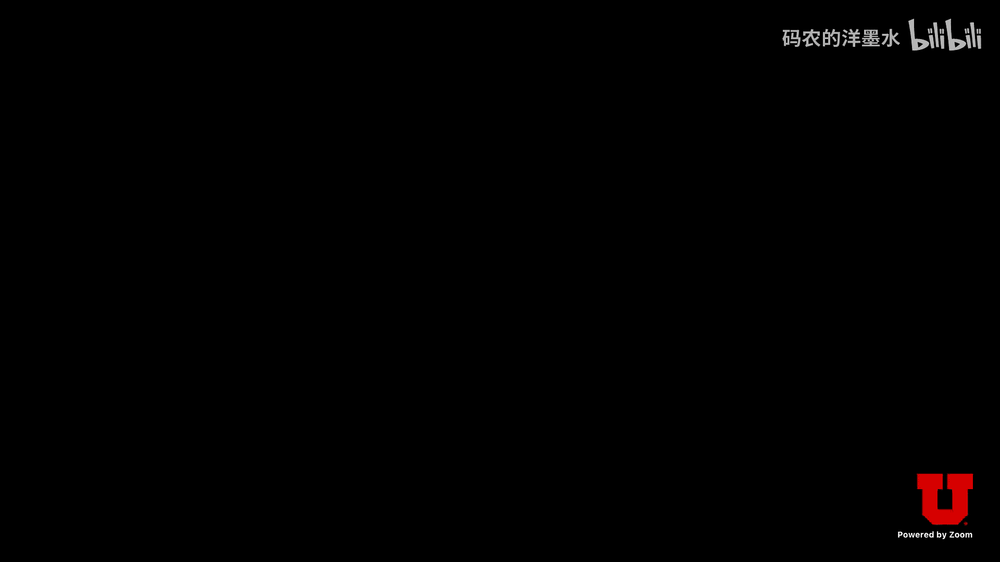
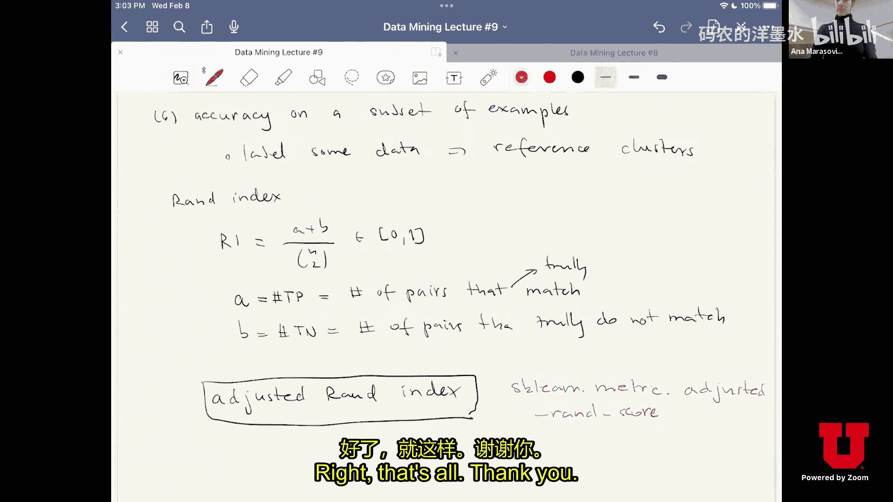

# 犹他大学-CS6140-数据挖掘-中英字幕-1080P-p09-Lecture-9---k-均值--BV1j1mLB9EAB_p9-

。

。Okay， good afternoon everyone， let's get started。We came to the end of our almost at the end of our syllabus policies the last one is about diverse student support I don't have time to go over all of them but the point of this policies to say that there are lots of affinity groups here at the University of Utah and it might be worthwhile to just check which one are here and maybe you would like to join some of them so just so you know that also bunch of these resources exists over here。

Okay while we are at the end of syllabus let's also go over some of our deadlines so as I'm sure you are aware today is the deadline for our third homework next Wednesday we requested the data collection report from you so try to meet your teammates soon and try to write that report soon and have。

Try to try to make it very concrete in terms of what data you have which is the goal of data collection report we want to see that you are on a very very good to have all the data you need you don't need to collect all the data but it must be clear that you have ever set everything in motion for collecting the data you have so in case you didn't you're scraping some data and the collection still us that's okay but it's clear that things are on a good track to be you know now done rather there soon。

U。Today we have released the For Home which is on clustering。

 basically after the lecture today you will know everything you need to solve this one so you can start working on it right away and it is due as always the weeks from today。

Okay。I guess that's all about announcements， any questions from you about Home projects。Okay。

That's good。All right let's get started and last time we had covered one type of clustering algorithm hiarchical or aglomerative clustering and we have finished on the note of how to validate those clusters and we kind of turn that question into saying is the number of clusters we have chosen good and then I told you I will go over a few more ways to validate clusters I decided to first cover today k meanss and then which is another clustering algorithm and then we'll go back to that question of cluster validation at the end of the day's lecture to talk about k means today and k means is。

Usually is referred to as two things， sometimes we are referring to specific k means algorithm that we will go over in detail today。

 but also it is good to think about it as a problem formulation。

 a lot of clustering algorithms can be thought of as K means algorithms。

 but they are not exactly the one， the most popular one。

 so just so you know that sometimes this will refer to a family of clustering algorithms rather than the specific one we are going to talk about today。

And with。With K means we are going to take our n examples like the last time。

 and we are going to cluster them into K hard clusters。

 which means that like with hierarchical clustering。

 we will not allow that certain examples are put into clusters。

 so we are placing our n examples into K hard clusters。Yes。

And the idea behind the K means problem formulation is that you are going to。

 let me try to illustrate it with an example。So let's say we have two dimensional input space。

 let's say that we on I axis have salary and on X axis we have age。

And let's make up some points here。T。Okay。So with kmi formulation， you are going to start with k。

 which is the number capital K is the number of clusters you have。

Or you are trying to achieve and let's say we have here k equals three。

 we just decided using some way of deciding that we are going to cluster these data points into three clusters。

But Kimmi's formulation you are going to start with。

Some some some random cents remember last time cents were those representatives of the cluster when we work in a Euclidean space so we start with a few random not few but exactly three because that's the number of。

Clsters we have chosen。And then we are going to in the next step group our data points to the cluster corresponding to the centroid which is closest to that point so for example。

 this points here。There are closest to this first first century then we have。

The second cluster here and the third one here。All right， now that we have done that。

 we are going to adjust our center， we are going to move it to the center of its cluster， right？

So this one is going to go somewhere along here。And this one will go here。And this one will go here。

Now we need to， again， check whether or not data points to which centroid there are closest to。

So let's see whether any of them had now。Are they now closer to any of the other centuries and it seems like from the way I have drawn this that they're all still in the same cluster。

And this is where we would stop with our clustering technique if now imagine all that this is not a case。

This point here。Is closer to this cluster here we would。Make this group of this group of points。

 a new cluster this would be。The other one and this would stay the same so we regrouped them and now you would again need to change the centroid of your。

Of your。New clusters and this one stays the same。So that's the basic idea of K means plastering formulation。

And now what we are going to do is more formally see why are we。

Putting the points to the clusters of their closest centroid and why are they choosing the cent to represent the cluster so kind of give more formal motivation for this thing I have just illustrated for you。

Okay。So let's write that more formally for them。I need to find a better solution for this。Okay。

 so the first thing we are going to introduce is what's called criterion or error or cost function。

 and that's basically the function you are trying to minimize with your clustering approach。

Or cost or error。You might find it under lots of names。

And let's use a a criterion function the sum of squares of the Euclidean distances of each example from its century。

 so we are going to have k clusters capital K clusters in each clusters。

We are going to then iterate over all data points in our input space。

 we are going to check whether that point is in the current cluster C。

So remember this is indicator function， it's one if X is in cluster CK and zero otherwise。

And we are going to multiply it by L to norm of the difference between the data point and the centroid of the CA cluster。

Okay， so。This guy here that's centroid。Or seeking。Okay so if we are trying to cluster our data points to minimize this function。

 it's kind of obvious that what we need to do is to try to minimize the distance between the point and the center right that seems like the thing which will minimize this function so thats that's what we are going to do。

We are going to define a new variable here， B IK to be equal again。

 indicator function and it's going to be one if k is。Argumin。off。

The distance between Xi and the centroid of cluster CJ。Right， so this is one if k is the argument。

 it' the cluster where the distance of the point X pi to its central is the smallest。嗯。That kind of。

Enforcing that will minimize this function J。Okay， so now basically your problem is has two parameters。

 it is this this B case and this centuriesries and because they're kind of。Dependent on each other。

This the whole minimization of this function J，ccord with respect to this parameters B and C。

 it doesn't have a closed form solution。So。We are going to write that no closed form solution。

So what we do when we don't have closed form solution。

 we do this iteratively until we find something that's a good approximation。

So we are going to then randomly initialized。Our centuries。CK。Whereever it came。Element from1 2K。嗯。

And then we are going to assign。Each point， each X。Two to the cluster。With。

Mean distance between Xi and its centered。Okay， or in other words。

 we are just going to choose this BIK， it's the same thing。All right。

 now that we have fixed our BI case， the only parameter here that's relevant are our center。

What are the centralroids that minimize this function J and when we are finding the parameter that minimizes a function。

 we are going to take the gradient of that function and find the value at which this gradient is zero。

So if we take the gradient of our function。Jame， with respect to C centroids。If we calculate that。

 so this is what we are calculating the gradient of。

 we are going to get two times sum of12 N BK that are now fixed times X minus CK。Or bar。

And this has to be zero and now if you solve this equation with respect to CK。

 you're going to get that C has to be equal to some of。That goes from1 to m of B case times X。

Over some of。1 to n of B1 k which is actually exactly the average of the points in the cluster so here under the fraction line we have exactly the size of the cluster C and then above fraction line we have one to n of excuse me not one to n but all elements that are actually in C。

Okay， so starting from this criterion function J that we wanted to minimize。

 we have worked out exactly the type of algorithm that I have illustrated with example before。

 we start with randomly initialized centroids but we are then assigning points to clusters such that they are part of the cluster where the distance between that point and that centroids is the smallest relative to other centroids and then we are computing centroids to be exactly the average of d points in the cluster。

 so it didn't appear out of nowhere it kind of came from this formulation depending on this criterion function J。

Okay， I hope that's clear how we came to that illustration。

 I will just write the algorithm in a form that。Its more easier for you to follow later。

 so came in south。versus。also rock sumizing the distance Miss central。是楚。I don't think so。

 but let me see， can I make my intuition more formal？Yeah。

 I don't think there is anything that specifically enforces this。

And we will look at so here we started with random initializations。

 we are going to look at some other initializations that will enforce that things are farther apart from each other。

 but looking just at this function J I don't think anything is strictly enforcing that behavior。Yeah。

Okay let let's write the whole algorithm so as I said k meanss can mean two things problem formulation or the specific algorithm。

 I now going to write the K means algorithm， but you will also find it under the name of Lloyd's algorithm。

Yeah。Okay， so we start with our endpoints， x12 xn。We have then randomly initialized。All right。

 excuse me， we need to then choose K， so you must decide on K before you start clustering。

Then you're going to randomly initialize。Your K centers CK for every K from one to capital K。

And then we are going to do those two steps， we are going to just a moment。

The first step is that for every point。We assigned that variable BIK。That's one if K is。Argument。

Of full clusters， if we look at the distance between xsi。And it's cented。Okay。

 that's how we assign our points to clusters and then for every centroid we are going to update it。

By taking the average of the current cluster Ck。Okay that's a whole thing right and covergence here means that basically you don't change center rates anymore and therefore the points don't change anymore so there is nothing to be change as we have seen in the illustration I gave you I didn't know how which point would now be closer to any other clusters and there was nothing to do。

嗯。So let's go over some of these properties， first of all。

 these variables will be either zero or one。Which means that this is hard clustering。

You do not allow that curere。Your point is assigned to two clusters， only to one。

Let's look at the efficiency。Before I go into efficiency， I want to stop and just check that。So far。

 this is clear。Okay。Just wait a little bit I see you're still read。Okay。

 so let's look at the efficiencies， so calculating this part here。That will be all。

So where D is the dimension。Of each point。So that's in RD。She。Okay， then here。Well have。

O of the times N。We have， again， D dimensions。And we have endpoints。

At most endpoints that can appear in a cluster。And。What else do we need here？This so。

Here OD is only for calculating the Euclidean distance。

But then we need to do this multiple times right， we need to do it for cake clusters。

And end points and then time state。We are comparing each point to the center of each cluster there are n points there are capital K clusters that mentioned for Euclidean distance everything gives us k times n times d and in the end we also have multiple iterations of this right so we repeated this certain number of times let's call capital t to be let it be the total number。

The number of iterations。That means that the whole thing is。O of T， D，M， K。

And this is not a problem in terms of。T being way smaller than our number of points and so we have well as iterations than we have our points we are going to cluster so we don't get complexity that's of n square which we had with hierarchical clustering and it's linear in all relevant parameters。

 which is way better than hierarchical clustering so efficiency relative to hierarchical clustering is much better。

で。All right， let's look at some other properties is this halt thing deterministic it does depend on the choice of the initial centuries we choose。

 but if we set。Random seed to certain value。 And then with that value of random seed。

 we repeat this experiment。 Then we should get the same cluster out of our algorithm。

 So that's one thing you can check。 There is also another。

Less obvious part of the randomness come can come from。Here。

So here where we are checking which cluster each century is closest point two clusters to centuries could be equally far away from a given point and then you need to decide where to put that point because it's equally apart from two clusters and what you would do here is you would just randomly assign it to one of one of these but again if you want this whole thing to be deterministic this random choice has to be fixed so you fixed your random seed with Python python random and then when you repeat this thing it's going to give you the same point so it is detererministic。

Will it converge it will converge because we have a finite number of possible partitions of n points into K groups。

 so we will have K to the K to the power of n possible partitions and the way we are。

Doing this algorithm is to minimize this function J and in each iteration we are going to decrease the value of function J and once we can't decrease it anymore we will stop so we are increasing all the way until we can。

Um。Is it optimal does it find the best clustering that we can find， unfortunately it does not。

So it is a griditty algorithm。And that means that it will find locally the best solution。

 but not globally。So for example。We can。Illustrate this with this example， so here。

 let's say we have these points。Let's say we have chosen randomly these two points as our cent。

 then the way we are going to cluster our points is like this。In the next stage， we are going to。

Change centers to these values and thats that's where we stop so basically these points will never be reassigned although the better partition actual partition for this points is these two clusters。

Okay， so just because we were making these greedy choices。

 we ended up with something which is not the globally the best solution。

Okay so the point here is that your K means algorithm will highly depend on the choice of the initial centuriesries that you choose so natural question is can we do something better than just randomly picking points and there are some some options for that？

Okay， so let's go over choosing。Initial cents。So our option zero was to pick them randomly。All right。

 the second option is to not choose any point in this space as you're cented。

 but choose one of the points you are trying to cluster randomly as a cented so。

Maybe we can show this， let's say we have something like this。Okay。

 so previously we would choose to randomly， for example。

 this as our cent that's our initial option zero， but with。Our with our second option。

 we are going to choose one of these points as our centuries Okay。

 so I will write that down randomly。Choose。Okay points。From。X， I。As cents。要。😊。

When choose the on each remain the same this is only about the initial choice of cents once you choose them you know using one of these options we are going to go over now but the rest of the algorithm stays the same we are always going to take the average of the vectors inside the cluster to be the cent so this is only about the initial initialization of these cents in the beginning。

Y。All right。Why why would anyone want this well if we are choosing points that we are actually going to cluster most likely we are not going to choose some random points that are super far away from our clusters doing all the all the damage like we have seen in the previous example。

 so that's kind of the benefit of these doing this approach the problem is。

That we might have some kind of outlier here。And then if we choose randomly this outlier。

Then we are going to make a lot of trouble for us because then we are going to。

Let me make a new picture just to not confuse you。Okay， so same kind of set。

But now we have this outlier。And we have chosen， let's say。

This point as one centroid and we have been very unlucky and we chose this outlier as our centroid and what will happen then is that we will likely。

Now I need to make it farther away。嗯嗯。So then what will happen is that。

This whole thing will become a cluster and this one outlier will become another cluster and although it's reasonable you know to want that outlier to be its own cluster there is the density of this gigantic cluster we have just made is really sparse and that's not what we want as well so this is also not a great solution in case we know that our data might have some outliers if your data if you're 100% ensure your data won't have outliers then this won't be a problem and this might be a reasonable thing to choose。

Okay。So another thing you could do。I will move to another page。

You could measure or construct centroid of all points。You are trying to cluster。And then adds K。

Small random vectors。And I think it will come clear what we are trying to do hereify again。

Drve some examples。So even if you had an outlier here。

 if you if you take the average of all of these points。

 you will end up somewhere where you are kind of close to each one of these blobs。

 including the outlier， and then when you add two small random vectors。

 you will get something that's not terribly far away from the all the points。

 no matter how red they are。但。😊，Does this make sense？No， but is unclear here。

So you're choosing the center of all points and then。Oh and then you're adding yeah。

 you just choose K capital K random vectors and you add it to this center。

 so you like move a little bit from from the center of all the points so you are still not super far away from all the points yeah and in this way you kind of fixed your problem of outliers。

All right。And then the option you might have heard about from before， it's called Ka meanss。Plus。

 plus。嗯。And this goes maybe。Together with this intuition that you ask about choosing centuries that are farthest away from each other。

So。You here， you would choose randomly choose。One point。X I。As your cent。

And then for every other centroid you need to choose， so cent it from2 to capital K， so for every K。

From2 to capital Okay， you are going to choose。Choose a point that is farthest away from the previous century。

Okay， so you're going to choose。し。Next， right， let's say。Choose next C。P。

Such that and it's a little bit more nuance than what I said I said we are going to choose the one that's farest away。

 we are actually going to choose a point that has high probability sorry we are going to choose we are going to set our whole things such that those points that are far farther away from our previous cent。

 have higher probability of being selected。Um。And why wouldn't we just choose the one that's farthest away rather than using this probability I will explain that in a bit。

 so we are going to choose nextta CK such that points。That are。Bardest。From previous。Previous C。

All right， let me let me just write this a little bit differently， so choose next C。Plus one。

Such that points that are farthest from previous。Cents。C okay。Have higher probability。Yeah。

Of being selected。As C plus one， the new cent rate。Yes。Okay。

 the reason why we are working with probability here should be clear with an example。

 so again if we had these blobs and some outlier then if you had chosen let's say this point here as your central81。

Then if we are just taking the farthest point， we would take this outlier， right？This one。

Which brings us into that situation we had before， right where now we are going to probably cluster the outlier as being one cluster and everything else as the gigantic powder cluster。

So。With the probability what is happening is that it' considered that here we have lots of faraway points right and although this one is the farthest there is more of these other ones which are still far away but not as far as that little outlier so probability of selecting them will actually be higher than selecting the outlier just because there will be more of them okay so with with introducing the probability you are going to。

On average， in expectation， select those that are far away but not so far away that they are an outlier。

Okay， and to define what how to how to define that probability。

 it can be something like C probability of choosing the next one as。X1 given our data points and。

Previously selected cents。Equals two， they're going to take。Abo fraction line min of all clusters。

There。Distance to。Next slide over。Sam will see today。面 k c k。A in a exchange。Okay。

This kind of formulation will give you that desired behavior that those that are far away will have higher probability of being selected as the next one。

Okay， so this is called camemins plus plus。嗯。I said that working with this probability is better because then we have this。

We don't have the problem of we likely don't have a problem with these outliers。

 but you can also use the version where you do take the point that's just farthest away so。

You can we can write this down randomly。Choose。One point。Xi is a centroid。And then choose。Next。

 centroid。做 b。The farthest。X I from。哦。Previous centroids。不是。

And this will be called known as under the name of Gonzalez。

Which is the name of the person who has first proposed this。

Now you will see in the materials for example and for the book that this will also be just called Ka means's algorithm or Gonzales's algorithm instead of just a means to initialize cents and the reason for that is that you could find the cents like that and then you can cluster your points I say that's if you don't do things itly more often these are known as just initialization techniques for the Lloyds algorithm we have seen before so you would use this to either came means plus the most often k means plus plus to initialize your cents and then you would do the iterative approach we have seen in the Lyds algorithm。

Any questions about this？Oh。嗯。😊，Yep， for calulating the probabilities like regions。

 how would you implement that？Well， you have this formula for probability。

 you just need to implement the formula it' it's。It doesn't have anything else to it。这样。最后。Okay。

 cent to have end points to check whether the next cent is one of these points。

 you would calculate this fraction and then you would pick X that has the highest value for this。有。

Okay， so one thing that I didn't say explicitly， but it might have been already in your mind is that we kind of introduced this in the Euclidean space right with these function J here that we are trying to minimize and model that you has the Euclidean distance embedded in it and that assumes that we are working with points X that are represented as vectors of real values and as we have seen in the。

Many lectures so far we are not always working with Euclidean spaces。

 so there is a version of this algorithm Loyd's algorithm known under the name of K Medoitz。

And again， you can think about mes as the formulation for more algorithms rather than just one specific algorithm。

 so what was centroid in our Euclidean space here， it will be known under a name of meoit。

And that will be a representative。Example。From our。Input space that we are trying to cluster。

And then the algorithm that we have used in。诶。The Ls algorithm we have used before changes minimally and that variation is known under Pam PAMM。

 which stands for。Partitioning around mes。And it works with any distance function you you would like to use。

 so you are going to initialize your set of mes and。

To be and I will still use notation C just to kind of make it easier to map to center from before。

 but this represents。Some examples from our set X I from our inputspace X。Okay。

 so we are going to initialize M to selected points X， we are going to have k of them。

And then we are going to repeat a very similar procedure we had with Lyd's akeleton， so for every。

For every data point， that is not our method。We are going to calculate which to which cluster this point should be place and we are going to do that in a very similar way we have done for in thelo algorithm with when we had Euclidean distance。

 we' are going to put it into a cluster。That minimizes the distance between Xi and this。Medow it。

Of that clusterster。咁。So here I have a mistake。😔，啊。Okay。

 let me just check that I didn't have this mistake before。All right， that was correct。Sure。Okay。

 very similar to what we have done before now in just instead of using the Euclidean distance。

 we are using arbitrary distance， the big thing that has changed is。That。

We are now taking points that are not meites and we need to compute the distance arbitrarily。

All right， so then we are going to update our mes。Such that we have。St them to。She。

TheWhatever minimizes the distance。Between that。With other points。Okay。Gams。

So we take all the points that are not yet considered to be our meows and then we are going to check the distance。

Between each point。X I。And。啲。That。That meage。Yeah。Right。

 and we are going to do this until we converge。Okay so basically things are kind of the same。

 we are placing every point to the cluster of the meow that's closest to that point and when we are updating our me reaction instead of taking the average because we can't take the average anymore。

 we are selecting the point that is closest to all the other points in the cluster。Okay， and。

So here things got a little bit slower because of this part here where now we are。

We need to compare every point that's not a method yet， with all of the points that are in a cluster。

 and then we can have here n minus k times n minus k comparisons。嗯。

This will altogether make this whole thing slower， so we will have complexity O of T。

 which is total number of iterations k and minus k squared。

So now we have a quadratic complexity in the number of points。

 sorry I put this to be capital case should be smoking。

Okay and then not surprisingly if you would like to make this efficient。

 there are some variations of this algorithm， I won't go into that but just know that you know since this is not as as fast as load algorithm was then there was like a wave of variations that try to speed this out so if for example if you're trying to use this for your projects and if you have huge data set and things gets fast search for faster variants of this algorithm you will find it very quickly。

Okay， so now as promised， I want to go back to the cluster validation that we have started to talk about last time。

Yes。谢个。Okay so I will just quickly go to the notes from the previous previous lecture so this is what the note we ended up on and so one thing that maybe wasn't clear when I was describing this last time is that we are talking about cluster validation techniques but a lot of time that question what is down to did we choose the number the correct number of clusters so in clustering cluster validation and choosing the right number of ks are kind of similar similar questions so very related questions so last time I have said okay the first one means just checking the quality or just sample and examples from each cluster and manually spectrum okay this is not about choosing the right number of clusters。

But then the second one was about choosing the right number of clusters I said you will have your data points and before you did any clustering you are going to class you were going to use some kind of dimensionality reduction technique to put your points no matter which dimensions they originally are into 2D space and then by looking at these 2D space you might notice that wow I have like two clear blobs。

 which means that your number of clusters should be two。

So then you go and do your clustering where you have set your number of clusters to be two。

You could then later on kind of visually also see whether the clusters you get correspond to those blobs。

 for example， if you had two clusters you can read all points that are clustered in one cluster with red and blue otherwise。

 and then it should be immediately clear whether your two blobs are now red and blue or there is some kind of mixture and that would probably tell you that something might have gone wrong。

Then I talk about elbow method and here missed two right， so this is I'll introduce this SSE SSE。

Score which is sum of squared errors and now this looks very similar to that criterion function J we have seen before。

 if you use Euclidean this is exactly that function J and what I was saying there is that we will plot something like this。

And this again tells you about whether you have chosen the right number of clusters so what we were doing here is we are depending on I axises our SS score and on axis we have other number of clusters and then the regions we were paying attention to is where we have sudden drop and then leveling Now what sudden drop of S means it means that you have reduce the error by a lot just by changing introducing one additional cluster so doing this means that you probably have captured some natural cluster because if you have managed to reduce so much error just by introducing additional cluster that hints that things are going well and then when you are leveling off that means okay you are not reducing the error much more by adding new clusters so those clusters didn't。

They don't have that you know didnt this natural capturing of natural clusters didn't occur there so if you see you know what you can kind of check is that okay have you chosen you can kind of plot this thing and see whether you have chosen the number of cluster that we correspond to this sudden drop then levelings what going happen is that you have leveling and then drops again so let's imagine maybe here cluster number four here we have leveling then have sudden drop then leveling again this is also maybe a good number of clusters so you might see multiple of these like sudden drop then leveling and sudden drop leveling and all of these are potentially good candidates for the number of clusters so by examining this kind of a plot you might。

Cture not only one good potential number for number of clusters， but multiple of them。Okay。

 so that's about elbow method again yet another method to choose good number of clusters。

 which will then result in a in a in a good。Overall clustering technique and then I promise to talk about silhouette analysis and I will talk about some other things besides that。

All right， so we have one，2， three， see。Previous lecture。Yeah。

Yeah I want to make just one more point that Id to say here so remember the last time when I told you with you could over and if you have taken machine learning card that probably means something you if you didn't I probably doesn't mean anything what I wanted to say by that is that you can introduce more and more clusters you can have as many clusters as you have points right but that would mean that each point is in its own cluster and that's a very bad clustering technique but it is the one that gives you J of zero so the solution that perfectly minimizes the function J is terrible so yeah this introducing more and more clusters and just seeing for a long time that there is this leveling means that you are just introducing more clusters when they are not needed。

So yeah， we are looking for that magical number， which is small， not too small and too large。Okay。

 let's go into。Still go at analysis。All right so this technique will as elbow metal be a visual we are going to make a plot and then inspect that plot and to produce such a plot we will need so called silette coefficients S which are calculated like this I will write something down and then I will explain what these symbols are。

Yeah。Okay， it's going to be in the interval between minus one and one。Okay。Okay。

 so AI is going to be。Equal to the distance of all points。In a cluster where XI is。To excile。Okay。

 so let's say we have this point。し。They're all in the same cluster。And then let's say this is our X。

Then the value AI。Will be calculatedd by taking the average。

Distance from other points in the cluster with Xile and the value bi。对。

It's going to be calculated as。All right， bear with me。嗯。Okay， we are going to find the cluster。

Where Xi is not in and we are going to find among those other clusters。

 the one where the distance of its points。2 X I is minimal， so let me。Write this down。Okay。

 so this is the。This one is the same， so that's where our X is that that's the  one I call CK。

 Now imagine some other cluster over here。诶。Another one which is very far away。Now。

 the distance of each cluster。Here to Xi calculated by taking the average distance of its point points to Xi。

If we take the average of these pink lines I have just made。

 they're going to be on average smaller than if I made lines with this cluster below。

 which I won't do。Okay， so maybe I can make just one so。What we choose here in the end is the。

I is the average distance of this pink line， which are distances from of the points of the nearest other cluster to X？

Okay， so what intuitively all this means when si equals to one？Then are X。

Is far away from the examples from the neighbor cluster and very close to example in its own cluster。

So。That means Xile is very close。Two points。In C。Where it belongs。嗯。And far away。From。Points。

In other clusters。Yes。Yes。And this is good。When S is minus one other extreme that's very unwanted that's probably misclstered example。

 it's an example which is very far away is far away。From。Points in C where it belongs。And。Close。

To points。In other clusters。So now if you check the S。

Coefficient for each one of your points and you notice that some of them have values that are very close to minus1 that should give you kind of a hint that this is that something went wrong and these examples are misclassy。

If we have SI being close to， I'll write it here to zero。

 then that means that Xi is on the border of two clusters。是。On the border between two clusters。Okay。

 but now I want to show you how this looks like if you are using psyit learn。Yes。All right so。

In the homework for clustering， I have added few。Few questions about how to code stuff in psychic Learnarn most of them if all of them are not all of them but some of them are just bonus points to kind of encourage you to use psyicLn but you' are not enforced to with hierarchical clustering I believe I did ask you to use psyicL I kind of want you to start using these libraries because you will never do this kind of stuff on your own you're just going to pick whatever is there implemented and then apply to your problem The only issue is that sometimes for example with K means you have as potential initializations you can pick for example K means++ but then you can't choose other ones we have talked about so you're sometimes limited with the choices you can make but otherwise this library have a lot。

Okay， so let's go into this silhouette analysis。I will try to make this as big as possible all right so here on the right we have2 d representation of these points that have been generated for these examples and obviously we have here these two blobs one is here and the other one could be here although you can also think about these as three separate blobs right。

Okay， so this is our data and now we had clustered this data and indeed these points were put in class one。

 class one， and all these other points were put in class zero。All right。

 now we are going to plot this silhouette coefficients。

 so remember silette coefficients are these values S。Okay。

 that's going to be the values potential values of SI are going to be on our x axis。

And then what we are going to plot is basically。You can imagine it。🎼Either is a to make it simple。

 but you just imagine it ass a mark logic think of how many imagine like horizontal bys。

 how many examples have value up to zero value zero approach to im line up and then you just feel all this space。

啊。All right。That's one thing you're plotting here and then if you red my that's ploting here。

 that's the average CO coefficient across all the data points in your input space。

And the thing you don't want to be happening， which doesn't happen here。

 is that all of this or let me say that way you have to find the end here to be above this about this average select coefficient life。

If you have situation like this one where the。This point here is lower than the average coefficient in the entire data that suggests that there has been a problem with clustering with that specific cluster group。

 so with this one it suggests that this group of points been haven't been clustered properly。

 unlike this one which is really good。Obviously because it's over there。

far away from everything else and because this I don't know bullet may tail far away from the average。

As well as the yellow ones。Let's see what else we have here now things are getting better right we had introduced one more class and now we had split these two into two separate clusters and now all all these tail are right on the average coefficient。

If we would introduce another cluster， so we increase the number of clusters to six。

 then we split this cluster here。See here and that resulted in something that's not good and the coefficient for those two clusters are on the average2 coefficient lie。

So I hope this kind of gives you some kind of impression of how you could use this to see whether the number of clusters you have chosen is a good choice to make。

Did you have a commission？Yeah I would say it depends whether you have found like a few of them that are misclassified and you are like。

 okay these are outliers and I actually don't care about them。

 you can have few of them and they are misclassified but they are not outliers rather your data is not represented well which happens a lot when we don't represent different demographic groups very well and then you have to take more you know careful choices there。

 but in general for right now we will talk a little bit more about how to handle outliers later in the class and how to kind of think about this difference between a real outlier and you just didn't you know consider some people。

 but I think you should focus on。Right now is if lots of points are not being classified properly。

 and I would recommend actually just looking at these silhouette plots like this and checking whether things are left or to the right of the average silhouette coefficient rather than inspecting each one of these points。

Individually for finding the big groups of misclassified examples。

Yeah I mean it only depends on the example， but let's if kind of use this example to answer your question I would say if you find lots of them that are not appropriately classified I wouldn't consider them as outliers。

 so for example here we have found with this silhouette coefficient analysis that we have split a natural cluster into two clusters for no reason beyond just having a too high number of clusters in the beginning yeah。

And yeah， of course， yeah。So you won't be asked about this in homework but I think it's a good to know that you know you don't need to start from scratch if you would like to do some of this analysis so some of this stuff can be super useful for your projects for example where I think lots of you got feedback from us if you plan to use clustering we like to see more analysis than just showing us the two- dimensionional plot of the data points you have cluster like this one we want to see more so this just showing a plot like this won't be sufficient so know that there are other things you can do and they are actually implemented the in learn so you don't need to write everything from scratch。

Okay， so I want to go over a few more things you could do。清楚。So。Okay， so。U。

One thing you could choose do is something similar to regularization in machine learning。Basically。

 you can find your number of clusters such that you run your whole algorithm multiple times with multiple values for the number of clusters。

 and you can choose the one that minimizes not only the function J， the criterion function。

 but also such that this lambda k is also minimal， higher this lambda is。Smaller。K， we' be。Basically。

 and of。Now you probably are thinking what you i'm looking for number of clusters k and now you just introduced me another parameter so we just changed the problem of finding the right number of clustersters into finding the the right number of the right value for the hyperparmeter lambda however。

 there is something called。打开佢。Information criterion。And it is something that。

That is used outside of clustering so it's like a broader technique than just what's needed from clustering I won't explain what it is。

 but if you apply it to k means then you get the following formulation for this regularization problem that we are looking for the number of clusters case start that minimize JK plus。

Two times dimension of your vectors times K。So now you are not having the hyperparmeter alongda anymore。

 you're just having fixed values two dimension of your vectors for your data points and the number of clusters so you could do that you can minimize this instead of just function J to find appropriate number of clusters。

Can you explain regularization is again just conceptually regularization is the way to we a it's a technique we use to find solutions that are simplest but still are good solutions to our problem so typically machine learning you will see this in the context of polynomials。

If you have a simple polynomial like this one。It's going to model your data。Quite well， but。

If you're allowed to your polynomial to have any coefficients associated with it。

 you can also have a solution like this， which goes。Through all of your points。But it's very complex。

 so when you give it new data， it most likely won't be a good solution for new data。

So what the regularization is it's not a huge point of this class so I don't want to go more than that is' just a way to find simplest。

 good solution to your problem。Okay and the last thing we could do is so we are doing clustering because we don't have label data right。

 but we could label a little portion of our data into clusters that we know should exist and then we could check at the accuracy。

 something similar to accuracy on that sample of examples we have actually labeled。嗯。嗯。

So let's say you are working on a very specific problem of categorizing your inputs as dogs or cats so you know you have two clusters and they have a meaning to it right dogs cats so what you can do is sample number of examples you deem reasonable for you to actually label and you can label those examples such as dogs or cats now you have a small portion of your whole data that you know you know the true clusters for those examples。

Okay， so。Label。三地痛。And produce so called reference clusters。And then you can。

 all you need to do is determine whether your technique had clustered those examples the way you have done the same way would do measure accuracy in any kind of labeled machine learning task。

Exact。There are different choices of that accuracy like metric you can use。

 but the one I think you should know is' called RA index。

And this is basically accuracy at the level of pairs of examples， so basically you will take。

I will explain what these things mean。Yeah。Okay， so a will be true the number of true positives that is the number。

Of pairs。That match。So imagine in a sense， the label you assign to them and the label assigned。

 the cluster assigned by your algorithm is the same。

And then we'll have B to be the number of true negatives， which is the number of pairs。That。Truly。

Truly match， do not match so。You have some pairs of your input example， one will be a cat。

 one will be a dog， and your algorithm will put those pairs of examples exactly to be in those clusters and then this will be true negative。

Okay， and so that's how you would check you would you would report your rent index， higher the value。

 the better however。There is a problem here of not being this index is not adjusted super nicely in a sense that if you get random assignments of clusters。

 this random assignment of clusters won't get your random R index of zero and to adjust it to get the random assignments to have random index of zero and clusters that are identical to have random index of one。

 you would use something that's called adjusted。Rand index。And I won't go into。What exactly that is。

 I would do want to point you again that these kinds of things are implemented so again。

 if you go to S color learn metrics。Adjusted。Bran score。

You will get the implementation of this and you don't need to implement it。

 you just use it for your own clusters and your own own reference clusters。Okay。

 so this is what I want to stop with the validations of clusters。

 you won't be asked any of these validations like silhouette or elbow method or RA index in your homework but really think about using them for your projects if you are using clusterings because that does us way more than just showing those plots where we can't really computationally quantify how to clustering algorithms different differ where if you introduce these metrics like these ones。

 we can tell something more meaningful in terms of relative differences between two algorithms。All。

 that's all， thank you。

是。